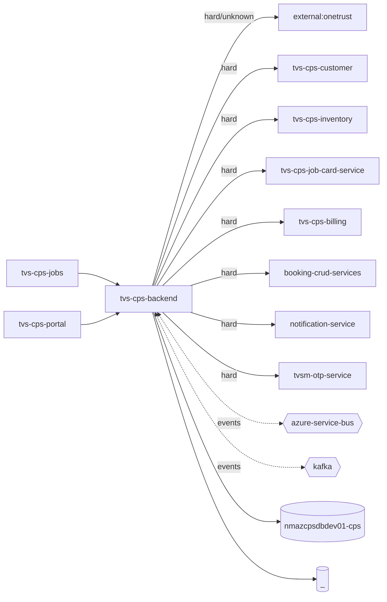

# TVS-CPS-BACKEND — High-Level Design

## Context

`tvs-cps-backend` is the backend of the TVS Channel Partner System (CPS) used by `tvs-cps-portal`; it depends on CPS sibling services (`tvs-cps-inventory`, `tvs-cps-job-card-service`, `tvs-cps-customer`, `tvs-cps-billing`) and shared TVS services (see Integration Points). Its schema is owned by `tvs-cps-db-migration` (`README.md`).

Neighbours: callers `tvs-cps-backend`, `tvs-cps-jobs`, `tvs-cps-portal`; downstream `external:onetrust`, `tvs-cps-backend`, `tvs-cps-customer`, `tvs-cps-inventory`, `tvs-cps-job-card-service`, `tvs-cps-billing`, `booking-crud-services`, `notification-service`, `tvsm-otp-service`.

## Architecture

`tvs-cps-backend` is a Maven multi-module monolith: domain modules plus `common-service` / `data-access-service` (shared infra) and `bff-service`, packaged by `tvs-cps-app` into one Spring Boot jar (`README.md`, `pom.xml`). Many outbound calls target `tvs-cps-backend` itself (BFF → domain modules over HTTP via `bff.*.base-url`).

## Integration Points

`tvs-cps-backend` registry edges (311, registry/edges.json): 258 inbound, 178 outbound.

Showing 200 of 311; full list in registry/edges.json.

| From | To | Kind | Via | Criticality | Source | Confidence |
|---|---|---|---|---|---|---|
| tvs-cps-backend | tvs-cps-backend | event | kafka:kafka-topic:cp.booking | async | code | medium |
| tvs-cps-backend | tvs-cps-backend | event | kafka:kafka-topic:cp.notification1 | async | code | medium |
| tvs-cps-backend | tvs-cps-backend | event | kafka:kafka-topic:cp.order | async | code | medium |
| tvs-cps-backend | tvs-cps-backend | event | kafka:kafka-topic:cp.service_lead | async | code | medium |
| tvs-cps-backend | booking-crud-services | http | POST /bookings | hard | code | medium |
| tvs-cps-backend | booking-crud-services | http | POST /bookings/search | hard | code | medium |
| tvs-cps-backend | booking-crud-services | http | PUT /bookings | hard | code | medium |
| tvs-cps-backend | booking-crud-services | http | PUT /bookings/cancel | hard | code | medium |
| tvs-cps-backend | external:onetrust | http | GET /{}/token | hard | code | high |
| tvs-cps-backend | external:onetrust | http | host:privacyportaluat.onetrust.com | hard | code | high |
| tvs-cps-backend | notification-service | http | POST /api/v1/notification/email | hard | code | medium |
| tvs-cps-backend | notification-service | http | POST /api/v1/notification/sms | hard | code | medium |
| tvs-cps-backend | tvs-cps-backend | http | GET /api/v1/announcement/user/banners | hard | code | high |
| tvs-cps-backend | tvs-cps-backend | http | GET /api/v1/appointments/master | hard | code | high |
| tvs-cps-backend | tvs-cps-backend | http | GET /api/v1/cart/active-cart | hard | code | high |
| tvs-cps-backend | tvs-cps-backend | http | GET /api/v1/claims/master | hard | code | high |
| tvs-cps-backend | tvs-cps-backend | http | GET /api/v1/order/active-cart | hard | code | high |
| tvs-cps-backend | tvs-cps-backend | http | GET /api/v1/order/cancellation-reasons | hard | code | high |
| tvs-cps-backend | tvs-cps-backend | http | GET /api/v1/order/get | hard | code | high |
| tvs-cps-backend | tvs-cps-backend | http | GET /api/v1/order/orderedPartDetails | hard | code | high |
| tvs-cps-backend | tvs-cps-backend | http | GET /api/v1/order/status-counts | hard | code | high |
| tvs-cps-backend | tvs-cps-backend | http | GET /api/v1/workflow/items | hard | code | high |
| tvs-cps-backend | tvs-cps-backend | http | GET /cps/api/v1/inventory/accumulated-stock/{productCatalogId} | hard | code | high |
| tvs-cps-backend | tvs-cps-backend | http | GET /cps/api/v1/order | hard | code | medium |
| tvs-cps-backend | tvs-cps-backend | http | GET /cps/api/v1/order/get-booking-list | hard | code | medium |
| tvs-cps-backend | tvs-cps-backend | http | GET /cps/api/v1/order/get-branch | hard | code | medium |
| tvs-cps-backend | tvs-cps-backend | http | GET /cps/api/v1/order/get-draft | hard | code | medium |
| tvs-cps-backend | tvs-cps-backend | http | POST /api/v1/announcement/admin/search | hard | code | high |
| tvs-cps-backend | tvs-cps-backend | http | POST /api/v1/announcement/create | hard | code | high |
| tvs-cps-backend | tvs-cps-backend | http | POST /api/v1/announcement/read | hard | code | high |
| tvs-cps-backend | tvs-cps-backend | http | POST /api/v1/announcement/update | hard | code | high |
| tvs-cps-backend | tvs-cps-backend | http | POST /api/v1/announcement/user/search | hard | code | high |
| tvs-cps-backend | tvs-cps-backend | http | POST /api/v1/appointments/analytics/stats | hard | code | high |
| tvs-cps-backend | tvs-cps-backend | http | POST /api/v1/appointments/bulk-upload | hard | code | high |
| tvs-cps-backend | tvs-cps-backend | http | POST /api/v1/appointments/bulk-upload/history | hard | code | high |
| tvs-cps-backend | tvs-cps-backend | http | POST /api/v1/appointments/count | hard | code | high |
| tvs-cps-backend | tvs-cps-backend | http | POST /api/v1/appointments/create | hard | code | high |
| tvs-cps-backend | tvs-cps-backend | http | POST /api/v1/appointments/dashboard | hard | code | high |
| tvs-cps-backend | tvs-cps-backend | http | POST /api/v1/appointments/details | hard | code | high |
| tvs-cps-backend | tvs-cps-backend | http | POST /api/v1/appointments/download | hard | code | high |
| tvs-cps-backend | tvs-cps-backend | http | POST /api/v1/appointments/list | hard | code | high |
| tvs-cps-backend | tvs-cps-backend | http | POST /api/v1/appointments/update | hard | code | high |
| tvs-cps-backend | tvs-cps-backend | http | POST /api/v1/cart/bulk-upload | hard | code | high |
| tvs-cps-backend | tvs-cps-backend | http | POST /api/v1/cart/create | hard | code | high |
| tvs-cps-backend | tvs-cps-backend | http | POST /api/v1/cart/create-active-cart | hard | code | high |
| tvs-cps-backend | tvs-cps-backend | http | POST /api/v1/cart/reorder | hard | code | high |
| tvs-cps-backend | tvs-cps-backend | http | POST /api/v1/cart/search | hard | code | high |
| tvs-cps-backend | tvs-cps-backend | http | POST /api/v1/cart/update | hard | code | high |
| tvs-cps-backend | tvs-cps-backend | http | POST /api/v1/claims | hard | code | high |
| tvs-cps-backend | tvs-cps-backend | http | POST /api/v1/claims/analytics/stats | hard | code | high |
| tvs-cps-backend | tvs-cps-backend | http | POST /api/v1/claims/bulk-upload | hard | code | high |
| tvs-cps-backend | tvs-cps-backend | http | POST /api/v1/claims/bulk-upload/history | hard | code | high |
| tvs-cps-backend | tvs-cps-backend | http | POST /api/v1/claims/close | hard | code | high |
| tvs-cps-backend | tvs-cps-backend | http | POST /api/v1/claims/dashboard | hard | code | high |
| tvs-cps-backend | tvs-cps-backend | http | POST /api/v1/claims/details | hard | code | high |
| tvs-cps-backend | tvs-cps-backend | http | POST /api/v1/claims/download | hard | code | high |
| tvs-cps-backend | tvs-cps-backend | http | POST /api/v1/claims/list | hard | code | high |
| tvs-cps-backend | tvs-cps-backend | http | POST /api/v1/collateral/create | hard | code | high |
| tvs-cps-backend | tvs-cps-backend | http | POST /api/v1/collateral/search | hard | code | high |
| tvs-cps-backend | tvs-cps-backend | http | POST /api/v1/grn/complete | hard | code | high |
| tvs-cps-backend | tvs-cps-backend | http | POST /api/v1/grn/delivery-details/add | hard | code | high |
| tvs-cps-backend | tvs-cps-backend | http | POST /api/v1/grn/initiate | hard | code | high |
| tvs-cps-backend | tvs-cps-backend | http | POST /api/v1/grn/search | hard | code | high |
| tvs-cps-backend | tvs-cps-backend | http | POST /api/v1/grn/update | hard | code | high |
| tvs-cps-backend | tvs-cps-backend | http | POST /api/v1/grn/update-claim-initiated | hard | code | high |
| tvs-cps-backend | tvs-cps-backend | http | POST /api/v1/invoice/search | hard | code | high |
| tvs-cps-backend | tvs-cps-backend | http | POST /api/v1/lead-allocation/assign | hard | code | high |
| tvs-cps-backend | tvs-cps-backend | http | POST /api/v1/lead-allocation/list | hard | code | high |
| tvs-cps-backend | tvs-cps-backend | http | POST /api/v1/lead-allocation/tracker/get | hard | code | high |
| tvs-cps-backend | tvs-cps-backend | http | POST /api/v1/lead-allocation/tracker/upsert | hard | code | high |
| tvs-cps-backend | tvs-cps-backend | http | POST /api/v1/lead-allocation/update | hard | code | high |
| tvs-cps-backend | tvs-cps-backend | http | POST /api/v1/notification-category/all | hard | code | high |
| tvs-cps-backend | tvs-cps-backend | http | POST /api/v1/notification-category/cache/refresh | hard | code | high |
| tvs-cps-backend | tvs-cps-backend | http | POST /api/v1/notification-category/list | hard | code | high |
| tvs-cps-backend | tvs-cps-backend | http | POST /api/v1/notification-category/role-mapping/reload | hard | code | high |
| tvs-cps-backend | tvs-cps-backend | http | POST /api/v1/notification-device/deregister | hard | code | high |
| tvs-cps-backend | tvs-cps-backend | http | POST /api/v1/notification-device/register | hard | code | high |
| tvs-cps-backend | tvs-cps-backend | http | POST /api/v1/notification-message/read/all | hard | code | high |
| tvs-cps-backend | tvs-cps-backend | http | POST /api/v1/notification-message/read/bulk | hard | code | high |
| tvs-cps-backend | tvs-cps-backend | http | POST /api/v1/notification-message/search | hard | code | high |
| tvs-cps-backend | tvs-cps-backend | http | POST /api/v1/notification-preference/list | hard | code | high |
| tvs-cps-backend | tvs-cps-backend | http | POST /api/v1/notification-preference/update | hard | code | high |
| tvs-cps-backend | tvs-cps-backend | http | POST /api/v1/npqr/create | hard | code | high |
| tvs-cps-backend | tvs-cps-backend | http | POST /api/v1/npqr/list | hard | code | high |
| tvs-cps-backend | tvs-cps-backend | http | POST /api/v1/order/bulk-upload | hard | code | high |
| tvs-cps-backend | tvs-cps-backend | http | POST /api/v1/order/cancel | hard | code | high |
| tvs-cps-backend | tvs-cps-backend | http | POST /api/v1/order/create | hard | code | high |
| tvs-cps-backend | tvs-cps-backend | http | POST /api/v1/order/create-active-cart | hard | code | high |
| tvs-cps-backend | tvs-cps-backend | http | POST /api/v1/order/draft/update | hard | code | high |
| tvs-cps-backend | tvs-cps-backend | http | POST /api/v1/order/place-order | hard | code | high |
| tvs-cps-backend | tvs-cps-backend | http | POST /api/v1/order/reorder | hard | code | high |
| tvs-cps-backend | tvs-cps-backend | http | POST /api/v1/order/report | hard | code | high |
| tvs-cps-backend | tvs-cps-backend | http | POST /api/v1/order/sale-order-no/list | hard | code | high |
| tvs-cps-backend | tvs-cps-backend | http | POST /api/v1/order/search | hard | code | high |
| tvs-cps-backend | tvs-cps-backend | http | POST /api/v1/order/update-allocation | hard | code | high |
| tvs-cps-backend | tvs-cps-backend | http | POST /api/v1/order/workflow/update | hard | code | high |
| tvs-cps-backend | tvs-cps-backend | http | POST /api/v1/training/create | hard | code | high |
| tvs-cps-backend | tvs-cps-backend | http | POST /api/v1/training/read | hard | code | high |
| tvs-cps-backend | tvs-cps-backend | http | POST /api/v1/training/search | hard | code | high |
| tvs-cps-backend | tvs-cps-backend | http | POST /api/v1/workflow/action | hard | code | high |
| tvs-cps-backend | tvs-cps-backend | http | POST /api/v1/workflow/init | hard | code | high |
| tvs-cps-backend | tvs-cps-backend | http | POST /api/v1/workflow/template/create | hard | code | high |
| tvs-cps-backend | tvs-cps-backend | http | POST /api/v1/workflow/template/process-activations | hard | code | high |
| tvs-cps-backend | tvs-cps-backend | http | POST /api/v1/workflow/template/update | hard | code | high |
| tvs-cps-backend | tvs-cps-backend | http | POST /cps/api/v1/appointments/analytics/stats/process | hard | code | high |
| tvs-cps-backend | tvs-cps-backend | http | POST /cps/api/v1/billing/create | hard | code | high |
| tvs-cps-backend | tvs-cps-backend | http | POST /cps/api/v1/billing/invoices/search | hard | code | high |
| tvs-cps-backend | tvs-cps-backend | http | POST /cps/api/v1/billing/post-invoice | hard | code | high |
| tvs-cps-backend | tvs-cps-backend | http | POST /cps/api/v1/billing/report/invoice-list | hard | code | high |
| tvs-cps-backend | tvs-cps-backend | http | POST /cps/api/v1/claims | hard | code | high |
| tvs-cps-backend | tvs-cps-backend | http | POST /cps/api/v1/claims/analytics/stats/process | hard | code | high |
| tvs-cps-backend | tvs-cps-backend | http | POST /cps/api/v1/customer/create | hard | code | high |
| tvs-cps-backend | tvs-cps-backend | http | POST /cps/api/v1/customer/search | hard | code | high |
| tvs-cps-backend | tvs-cps-backend | http | POST /cps/api/v1/customer/update | hard | code | high |
| tvs-cps-backend | tvs-cps-backend | http | POST /cps/api/v1/grn/upload-docs | hard | code | medium |
| tvs-cps-backend | tvs-cps-backend | http | POST /cps/api/v1/inventory/issue | hard | code | high |
| tvs-cps-backend | tvs-cps-backend | http | POST /cps/api/v1/order/get-all-order | hard | code | medium |
| tvs-cps-backend | tvs-cps-backend | http | POST /cps/api/v1/order/get-all-parts | hard | code | medium |
| tvs-cps-backend | tvs-cps-backend | http | POST /cps/api/v1/order/get-placed-order | hard | code | medium |
| tvs-cps-backend | tvs-cps-backend | http | POST /cps/api/v1/workflow/init | hard | code | high |
| tvs-cps-backend | tvs-cps-backend | http | POST /system/api/v1/appointments/list | hard | code | high |
| tvs-cps-backend | tvs-cps-backend | http | POST /system/api/v1/appointments/update | hard | code | high |
| tvs-cps-backend | tvs-cps-backend | http | POST /system/api/v1/erp-invoice/insert | hard | code | high |
| tvs-cps-backend | tvs-cps-backend | http | POST /system/api/v1/lead-allocation/list | hard | code | high |
| tvs-cps-backend | tvs-cps-backend | http | POST /system/api/v1/lead-allocation/tracker/get | hard | code | high |
| tvs-cps-backend | tvs-cps-backend | http | POST /system/api/v1/lead-allocation/tracker/upsert | hard | code | high |
| tvs-cps-backend | tvs-cps-backend | http | POST /system/api/v1/order/analytics | hard | code | high |
| tvs-cps-backend | tvs-cps-backend | http | POST /system/api/v1/order/erp-sale-order-no/list | hard | code | high |
| tvs-cps-backend | tvs-cps-backend | http | POST /system/api/v1/order/erp-sync-status | hard | code | high |
| tvs-cps-backend | tvs-cps-backend | http | POST /system/api/v2/appointments/auto-close | hard | code | high |
| tvs-cps-backend | tvs-cps-backend | http | POST /system/api/v2/claims/sap-sync | hard | code | high |
| tvs-cps-backend | tvs-cps-backend | http | PUT /api/v1/claims/update | hard | code | high |
| tvs-cps-backend | tvs-cps-backend | http | PUT /api/v1/order/update | hard | code | high |
| tvs-cps-backend | tvs-cps-billing | http | POST /api/v1/billing/create | hard | code | high |
| tvs-cps-backend | tvs-cps-billing | http | POST /api/v1/billing/discard | hard | code | high |
| tvs-cps-backend | tvs-cps-billing | http | POST /api/v1/billing/invoices/search | hard | code | high |
| tvs-cps-backend | tvs-cps-billing | http | POST /api/v1/billing/post-invoice | hard | code | high |
| tvs-cps-backend | tvs-cps-billing | http | POST /api/v1/billing/report/invoice-list | hard | code | high |
| tvs-cps-backend | tvs-cps-billing | http | POST /api/v1/billing/update | hard | code | high |
| tvs-cps-backend | tvs-cps-customer | http | POST /api/v1/customer/add-vehicle | hard | code | high |
| tvs-cps-backend | tvs-cps-customer | http | POST /api/v1/customer/create | hard | code | high |
| tvs-cps-backend | tvs-cps-customer | http | POST /api/v1/customer/delete | hard | code | high |
| tvs-cps-backend | tvs-cps-customer | http | POST /api/v1/customer/external/search | hard | code | high |
| tvs-cps-backend | tvs-cps-customer | http | POST /api/v1/customer/search | hard | code | high |
| tvs-cps-backend | tvs-cps-customer | http | POST /api/v1/customer/update | hard | code | high |
| tvs-cps-backend | tvs-cps-customer | http | POST /api/v1/vehiclesearch | hard | code | high |
| tvs-cps-backend | tvs-cps-inventory | http | GET /api/v1/inventory/bin/get | hard | code | high |
| tvs-cps-backend | tvs-cps-inventory | http | GET /api/v1/inventory/location/get | hard | code | high |
| tvs-cps-backend | tvs-cps-inventory | http | GET /api/v1/inventory/rack/get | hard | code | high |
| tvs-cps-backend | tvs-cps-inventory | http | POST /api/v1/inventory/bin/create | hard | code | high |
| tvs-cps-backend | tvs-cps-inventory | http | POST /api/v1/inventory/issue | hard | code | high |
| tvs-cps-backend | tvs-cps-inventory | http | POST /api/v1/inventory/list | hard | code | high |
| tvs-cps-backend | tvs-cps-inventory | http | POST /api/v1/inventory/location/create | hard | code | high |
| tvs-cps-backend | tvs-cps-inventory | http | POST /api/v1/inventory/rack/create | hard | code | high |
| tvs-cps-backend | tvs-cps-inventory | http | POST /api/v1/inventory/receive | hard | code | high |
| tvs-cps-backend | tvs-cps-inventory | http | POST /api/v1/inventory/report/vehicle-stock-report-list | hard | code | high |
| tvs-cps-backend | tvs-cps-inventory | http | POST /api/v1/vehicle/delivery-date/add | hard | code | high |
| tvs-cps-backend | tvs-cps-inventory | http | POST /api/v1/vehicle/inventory/lookup | hard | code | high |
| tvs-cps-backend | tvs-cps-inventory | http | POST /api/v1/vehicle/pdi | hard | code | high |
| tvs-cps-backend | tvs-cps-inventory | http | POST /api/v1/vehicle/update/stock-type | hard | code | high |
| tvs-cps-backend | tvs-cps-inventory | http | POST /system/api/v1/inventory/analytics/list | hard | code | high |
| tvs-cps-backend | tvs-cps-inventory | http | POST /system/api/v1/inventory/analytics/stats | hard | code | high |
| tvs-cps-backend | tvs-cps-inventory | http | PUT /api/v1/vehicle/submit-inspection | hard | code | high |
| tvs-cps-backend | tvs-cps-job-card-service | http | GET /api/v1/jobcards/master | hard | code | high |
| tvs-cps-backend | tvs-cps-job-card-service | http | POST /api/v1/jobcards | hard | code | high |
| tvs-cps-backend | tvs-cps-job-card-service | http | POST /api/v1/jobcards/analytics/stats | hard | code | high |
| tvs-cps-backend | tvs-cps-job-card-service | http | POST /api/v1/jobcards/bulk-upload | hard | code | high |
| tvs-cps-backend | tvs-cps-job-card-service | http | POST /api/v1/jobcards/bulk-upload/history | hard | code | high |
| tvs-cps-backend | tvs-cps-job-card-service | http | POST /api/v1/jobcards/dashboard | hard | code | high |
| tvs-cps-backend | tvs-cps-job-card-service | http | POST /api/v1/jobcards/details | hard | code | high |
| tvs-cps-backend | tvs-cps-job-card-service | http | POST /api/v1/jobcards/download | hard | code | high |
| tvs-cps-backend | tvs-cps-job-card-service | http | POST /api/v1/jobcards/list | hard | code | high |
| tvs-cps-backend | tvs-cps-job-card-service | http | POST /api/v1/jobcards/warranty-check | hard | code | high |
| tvs-cps-backend | tvs-cps-job-card-service | http | PUT /api/v1/jobcards/update | hard | code | high |
| tvs-cps-backend | tvsm-otp-service | http | POST /otp/api/generate | hard | code | medium |
| tvs-cps-backend | tvsm-otp-service | http | POST /otp/api/verify | hard | code | medium |
| tvs-cps-jobs | tvs-cps-backend | http | POST /system/api/v1/analytic/booking/stats | hard | code | high |
| tvs-cps-jobs | tvs-cps-backend | http | POST /system/api/v1/analytics-dashboard/indicators/calculate | hard | code | high |
| tvs-cps-jobs | tvs-cps-backend | http | POST /system/api/v1/appointments/auto-close | hard | code | high |
| tvs-cps-jobs | tvs-cps-backend | http | POST /system/api/v1/claims/sap-sync | hard | code | high |
| tvs-cps-portal | tvs-cps-backend | http | GET /api/v1/announcement/get/{announcementId} | hard | code | medium |
| tvs-cps-portal | tvs-cps-backend | http | GET /api/v1/announcement/user/banners | hard | code | medium |
| tvs-cps-portal | tvs-cps-backend | http | GET /api/v1/appointments/{appointmentId} | hard | code | medium |
| tvs-cps-portal | tvs-cps-backend | http | GET /cps/api/reports/list | hard | code | medium |
| tvs-cps-portal | tvs-cps-backend | http | GET /cps/api/v1/analytics-dashboard/indicators/get | hard | code | medium |
| tvs-cps-portal | tvs-cps-backend | http | GET /cps/api/v1/booking/get | hard | code | medium |
| tvs-cps-portal | tvs-cps-backend | http | GET /cps/api/v1/booking/get-booking-list | hard | code | medium |
| tvs-cps-portal | tvs-cps-backend | http | GET /cps/api/v1/booking/master-data | hard | code | medium |
| tvs-cps-portal | tvs-cps-backend | http | GET /cps/api/v1/cart/active-cart | hard | code | medium |
| tvs-cps-portal | tvs-cps-backend | http | GET /cps/api/v1/cart/{cartId} | hard | code | medium |
| tvs-cps-portal | tvs-cps-backend | http | GET /cps/api/v1/catalogs/assemblies | hard | code | medium |
| tvs-cps-portal | tvs-cps-backend | http | GET /cps/api/v1/catalogs/catalog-summary | hard | code | medium |
| tvs-cps-portal | tvs-cps-backend | http | GET /cps/api/v1/catalogs/get/{partId} | hard | code | medium |
| tvs-cps-portal | tvs-cps-backend | http | GET /cps/api/v1/catalogs/labor/area/{brand} | hard | code | medium |
| tvs-cps-portal | tvs-cps-backend | http | GET /cps/api/v1/catalogs/merchandise/categories | hard | code | medium |
| tvs-cps-portal | tvs-cps-backend | http | GET /cps/api/v1/catalogs/merchandise/colors | hard | code | medium |
| tvs-cps-portal | tvs-cps-backend | http | GET /cps/api/v1/catalogs/merchandise/{partReferenceNo} | hard | code | medium |
| tvs-cps-portal | tvs-cps-backend | http | GET /cps/api/v1/catalogs/parts | hard | code | medium |
| tvs-cps-portal | tvs-cps-backend | http | GET /cps/api/v1/catalogs/parts/vehicleCatalogSkus/{catalogSkuId} | hard | code | medium |
| tvs-cps-portal | tvs-cps-backend | http | GET /cps/api/v1/catalogs/vehicle | hard | code | medium |

## Data Ownership

`tvs-cps-backend` data stores (service.yaml `data_stores`); ownership flags are as generated (`Unknown` = not determinable).

| Store | Type | Access | Owned | Owner service | Key entities |
|---|---|---|---|---|---|
| nmazcpsdbdev01-cps | postgres | read-write | Unknown | Unknown | Announcement, AnnouncementMedia, AnnouncementReadLog, AnnouncementTarget, announcement, announcement_target |
| nmazcpsdbdev01-cps | postgres | read-write | Unknown | Unknown | Appointment, AppointmentBulkUpload, AppointmentContextMapping, AppointmentDetail, AppointmentFileMapping, AppointmentFollowUp, AppointmentJobTypeMaster, AppointmentServiceTypeMaster … |
| nmazcpsdbdev01-cps | postgres | read-write | Unknown | Unknown | AnalyticsDashboard, AnalyticsIndicator, EnquiryBulkUpload, EnquiryBulkUploadError, TenantConfig, WarrantyRegistrationAudit |
| nmazcpsdbdev01-cps | postgres | read-write | Unknown | Unknown | BulkUpload, BulkUploadError, CatalogAdditionalInfo, Claim, ClaimCatalogApproval, ClaimCatalogMapping, ClaimCatalogStatusMaster, ClaimERPMapping … |
| nmazcpsdbdev01-cps | postgres | read-write | Unknown | Unknown | Collateral, collateral |
| nmazcpsdbdev01-cps | postgres | read-write | Unknown | Unknown | LeadAllocationEntityMapping, LeadAllocationJobTypeMaster, LeadAllocationMapping, RoundRobinTracker |
| _ | postgres | write | Unknown | Unknown | notification_action_config, notification_category, notification_message, notification_subcategory, notification_template, notification_type |
| nmazcpsdbdev01-cps | postgres | read-write | Unknown | Unknown | NotificationActionConfig, NotificationCategory, NotificationDevice, NotificationMessage, NotificationPreference, NotificationSubCategory, NotificationTemplate, NotificationType |
| nmazcpsdbdev01-cps | postgres | read-write | Unknown | Unknown | NPQRFileMapping, QualityReport |
| nmazcpsdbdev01-cps | postgres | read-write | Unknown | Unknown | Cart, CartLine, Grn, GrnDeliveryDetail, GrnDetail, Invoice, InvoiceErpInfo, InvoiceLineItem … |
| nmazcpsdbdev01-cps | postgres | read-write | Unknown | Unknown | Training, TrainingMedia, TrainingReadLog |
| nmazcpsdbdev01-cps | postgres | read-write | Unknown | Unknown | Workflow, WorkflowHistory, WorkflowTemplate |

## Key Design Decisions

`tvs-cps-backend`: N/A — not determinable from code.

## Non-Functional Requirements

`tvs-cps-backend`: N/A — not determinable from code (no SLOs, scaling or latency targets in code/config).

## Security

`tvs-cps-backend` authenticates requests with JWT through `tvsm-be-core` security (excluded paths listed in API_SPEC Authentication; `tvs-cps-app/src/main/resources/config/application.yml:103-133`). Outbound calls use Azure API Management OAuth2 client credentials and Azure AD credentials for Kafka SASL (`application.yml:180-183`, header comment); OneTrust uses an OAuth token endpoint. Kafka connections use `SASL_SSL` (`application.yml:207`). Secrets are injected via environment variables (e.g. `DB_USERNAME`, `KAFKA_SERVICE_LEAD_PWD` referenced as `${...}` placeholders).

Secret config keys: 55 (providers: {'Unknown': 25, 'app-settings': 54}); values are never documented.

## Resilience and Failure Modes

`tvs-cps-backend`: no `@Retryable`/circuit breaker usage found in Java sources (grep). Service Bus consumers register error handlers (see inventory below).

Messaging error handling (inventory): dev.cp-booking: {'error_handler': True}; dev.oclns.cp-lead: {'error_handler': True}; dev.ums.user: {'error_handler': True}

Hard dependencies: `external:onetrust`, `tvs-cps-backend`, `tvs-cps-customer`, `tvs-cps-inventory`, `tvs-cps-job-card-service`, `tvs-cps-billing`, `booking-crud-services`, `notification-service`, `tvsm-otp-service`.

## Deployment Topology

`tvs-cps-backend` is built in a multi-stage Docker image: builder on the internal `tvs-cps-be-base-framework` image runs `mvn clean install -DskipTests`, runtime `amazoncorretto:21-alpine3.18-jdk` runs `tvs-cps-app-1.0.0-SNAPSHOT.jar` (`Dockerfile`). Azure DevOps pipelines: `ci-pipeline.yaml`, `cd-pipeline.yaml`, `uk-cd-pipeline.yaml`, `uk-training-cd-pipeline.yaml`, Sonar and AST scans.

| Kind | Name | File | Image / base | Ports | Environments | Variable groups |
|---|---|---|---|---|---|---|
| azure-pipeline | AST_cps_app_prod_Pipeline.yml | `AST_cps_app_prod_Pipeline.yml:1` | Unknown | Unknown | Unknown | PROD_Threshold, Tenable |
| azure-pipeline | AST_cps_app_uat_Pipeline.yml | `AST_cps_app_uat_Pipeline.yml:1` | Unknown | Unknown | Unknown | Checkmarx_Common, Tenable, UAT_Threshold |
| azure-pipeline | ast-image-scan.yaml | `ast-image-scan.yaml:1` | Unknown | Unknown | Unknown | Checkmarx_Common, UAT_Threshold |
| azure-pipeline | cd-pipeline.yaml | `cd-pipeline.yaml:1` | Unknown | Unknown | dev | Unknown |
| azure-pipeline | ci-pipeline.yaml | `ci-pipeline.yaml:1` | Unknown | Unknown | Unknown | Unknown |
| azure-pipeline | sonar.pr.yaml | `sonar.pr.yaml:1` | Unknown | Unknown | Unknown | Unknown |
| azure-pipeline | sonar.yaml | `sonar.yaml:1` | Unknown | Unknown | Unknown | Unknown |
| azure-pipeline | uk-cd-pipeline.yaml | `uk-cd-pipeline.yaml:1` | Unknown | Unknown | dev, prod, uat | Unknown |
| azure-pipeline | uk-training-cd-pipeline.yaml | `uk-training-cd-pipeline.yaml:1` | Unknown | Unknown | training | Unknown |
| dockerfile | Dockerfile | `Dockerfile:4` | tvsmazcmnsvcacrdev01.azurecr.io/tvs-cs/tvs-cps-be-base-framework:45319-37744a7, amazoncorretto:21-alpine3.18-jdk | Unknown | Unknown | Unknown |

## Observability

`tvs-cps-backend` enables `tvsm-be-core` method-level and performance logging (`thresholdMs: 100`) (`tvs-cps-app/src/main/resources/config/application.yml:108-114`); Spring Boot actuator health at `/actuator/health` (`README.md`). Metrics/tracing backends: Unknown.

Observability-related config keys: `bff.catalog-service.base-url`, `bff.catalog-service.catalog.add-discount.parent.key`, `bff.catalog-service.catalog.discount.percentage.key`, `bff.catalog-service.catalog.freight-charge.value.key`, `bff.catalog-service.catalog.page-size`, `bff.catalog-service.catalog.payment-term.value.key`, `bff.catalog-service.catalog.price.value.key`, `bff.catalog-service.catalog.rrp.value.key`, `bff.catalog-service.catalog.std-discount.parent.key`, `bff.catalog-service.catalog.total-price.value.key`, `bff.catalog-service.catalog.vat.parent.key`, `billing.catalog.parts-price-key`, `billing.catalog.vehicle-price-key`, `catalog.cron.schedule`, `catalog.labour.tax-percentage`, `catalog.vehicle.filter-available-for-sale`, `claim.catalog.appeal.limit`, `logging.level.com.tvsm.order`, `logging.level.org.hibernate.SQL`, `logging.level.org.hibernate.type.descriptor.sql.BasicBinder`, `logging.level.org.springframework.web`, `logging.pattern.console`, `logging.pattern.file`, `tvsm.core.logging.methodLevel.enabled`, `tvsm.core.logging.performance.enabled`, `tvsm.core.logging.performance.thresholdMs`
