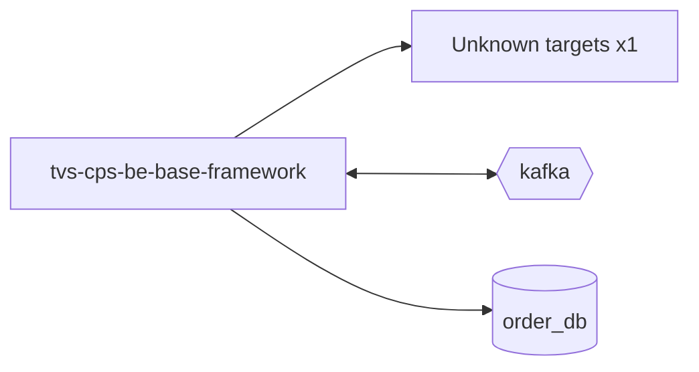

# tvs-cps-be-base-framework — High-Level Design

## Context
tvs-cps-be-base-framework is a `library` in the TVS-CS org (domain: Unknown). Neighbours: callers Unknown; downstream none resolved.

## Architecture
tvs-cps-be-base-framework components and connections (from service.yaml):

## Integration Points
tvs-cps-be-base-framework registry edges (12):

| Direction | Peer | Kind | Via | Criticality | Source | Match |
|---|---|---|---|---|---|---|
| in | `tvs-cps-backend` | library_dependency | com.tvsm:tvsm-be-core | hard | code | artifact |
| in | `tvs-cps-backend` | library_dependency | com.tvsm:tvsm-be-starter-parent | hard | code | artifact |
| in | `tvs-cps-billing` | library_dependency | com.tvsm:tvsm-be-core | hard | code | artifact |
| in | `tvs-cps-billing` | library_dependency | com.tvsm:tvsm-be-starter-parent | hard | code | artifact |
| in | `tvs-cps-customer` | library_dependency | com.tvsm:tvsm-be-core | hard | code | artifact |
| in | `tvs-cps-customer` | library_dependency | com.tvsm:tvsm-be-starter-parent | hard | code | artifact |
| in | `tvs-cps-inventory` | library_dependency | com.tvsm:tvsm-be-core | hard | code | artifact |
| in | `tvs-cps-inventory` | library_dependency | com.tvsm:tvsm-be-starter-parent | hard | code | artifact |
| in | `tvs-cps-job-card-service` | library_dependency | com.tvsm:tvsm-be-core | hard | code | artifact |
| in | `tvs-cps-job-card-service` | library_dependency | com.tvsm:tvsm-be-starter-parent | hard | code | artifact |
| in | `tvs-cps-jobs` | library_dependency | com.tvsm:tvsm-be-core | hard | code | artifact |
| in | `tvs-cps-jobs` | library_dependency | com.tvsm:tvsm-be-starter-parent | hard | code | artifact |

## Data Ownership
tvs-cps-be-base-framework data stores (service.yaml `data_stores`; ownership flag not determinable unless set):

| Store | Type | Access | Owned | Key entities |
|---|---|---|---|---|
| `order_db` | postgres | read-write | Unknown | Order |

## Key Design Decisions
tvs-cps-be-base-framework: N/A — not determinable from code.

| Decision | Alternatives considered | Reason |
|---|---|---|
| Unknown | Unknown | Unknown |

## Non-Functional Requirements
tvs-cps-be-base-framework NFR targets: N/A — not determinable from code. Tuning-related config keys: `tvsm.core.multitenant.datasource.default-data-source.maximum-pool-size`, `tvsm.kafka.producer.syncTimeoutMs`, `wiremock.settings.timeout`.

## Security
tvs-cps-be-base-framework security: endpoint auth values None. Auth code: `tvsm-be-core/src/main/java/com/tvsm/core/security/RequestValidationFilter.java:12`, `tvsm-be-core/src/main/java/com/tvsm/core/security/AuthenticationFilter.java:25`. 3 secret config key(s), sourced via: {'app-settings': 3} (names in OVERVIEW.md). PII handling: Unknown.

## Resilience and Failure Modes
tvs-cps-be-base-framework hard dependencies: none resolved. No retry/circuit-breaker code found; failure behaviour Unknown.

## Deployment Topology
tvs-cps-be-base-framework deployment artefacts (platform/regions: Unknown unless listed):

| Kind | Name | File | Environments | Image | Ports | Variable groups |
|---|---|---|---|---|---|---|
| azure-pipeline | ci-pipeline.yaml | `ci-pipeline.yaml:1` | - | - | - | - |
| dockerfile | Dockerfile | `Dockerfile:4` | - | amazoncorretto:21.0.12 | - | - |

## Observability
tvs-cps-be-base-framework observability libraries: `org.springframework.boot:spring-boot-starter-actuator`. Related config keys: `logging.level.${package}`, `logging.level.com.zaxxer.hikari`, `logging.level.org.apache`, `logging.level.org.hibernate.SQL`, `logging.level.org.hibernate.type.descriptor.sql.BasicBinder`, `logging.level.org.springframework`, `logging.level.org.springframework.web`, `logging.pattern.console`, `management.endpoint.health.show-details`, `management.endpoints.web.exposure.include`, `tvsm.core.logging.methodLevel.enabled`, `tvsm.core.logging.performance.enabled`, `tvsm.core.logging.performance.thresholdMs`. Dashboards/alerts: Unknown.
