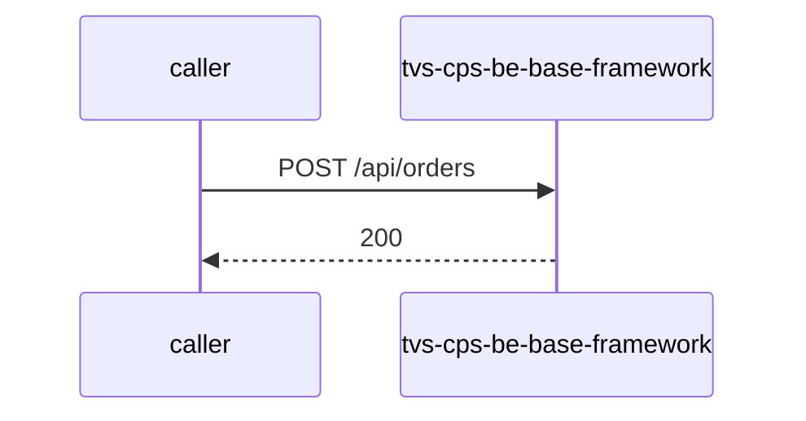

# tvs-cps-be-base-framework — Low-Level Design

## Data Model
tvs-cps-be-base-framework entities from `data_access` items (1).

Store access at `tvsm-be-archetype/src/main/resources/archetype-resources/src/main/java/__packageInPathFormat__/entity/Order.java:11`: database order_db; collections -.

### orders
Entity `Order` defined in `tvsm-be-archetype/src/main/resources/archetype-resources/src/main/java/__packageInPathFormat__/entity/Order.java:11`; table orders; operation both.
Columns: Unknown (no fields extracted).
Relationships: Unknown.

## State Machines
tvs-cps-be-base-framework status/state enums found in code (1); transitions are not determinable from code.
- `OrderStatus` (`tvsm-be-archetype/src/main/resources/archetype-resources/src/main/java/__packageInPathFormat__/entity/Order.java:39`): PENDING, CONFIRMED

## Business Rules
tvs-cps-be-base-framework validation rules on DTO fields (from schema `validation`):
N/A — no declarative validation found; other rules not determinable without manual review.

## Key Classes and Functions
tvs-cps-be-base-framework key classes:

| Class / Function | File | Responsibility |
|---|---|---|
| `HealthController` | `tvsm-be-archetype/src/main/resources/archetype-resources/src/main/java/__packageInPathFormat__/controller/HealthController.java` | HTTP handlers |
| `OrderController` | `tvsm-be-archetype/src/main/resources/archetype-resources/src/main/java/__packageInPathFormat__/controller/OrderController.java` | HTTP handlers |
| publish Unknown (`unresolved`) | `tvsm-be-core/src/main/java/com/tvsm/core/messaging/kafka/config/KafkaPublisherService.java:91` | kafka messaging |
| `@RestControllerAdvice` | `tvsm-be-core/src/main/java/com/tvsm/core/exception/GlobalExceptionHandler.java:25` | error handling |

## Sequence Details
tvs-cps-be-base-framework sequence for `POST /api/orders` (handler `OrderController.createOrder`); downstream calls inside the handler are not traced from code, module-level targets shown as optional.

## Error Handling
tvs-cps-be-base-framework error handling: `tvsm-be-core/src/main/java/com/tvsm/core/exception/GlobalExceptionHandler.java:25` (@RestControllerAdvice). Documented error statuses come from response annotations in API_SPEC.md.

## Configuration Details
tvs-cps-be-base-framework behaviour-relevant config keys (names only; full list in OVERVIEW.md):

## Edge Cases
tvs-cps-be-base-framework edge cases: N/A — not determinable from code without manual review.
