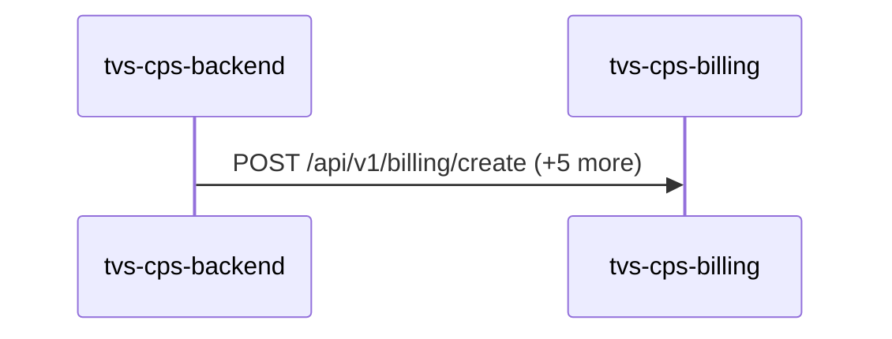
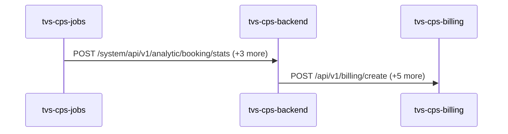
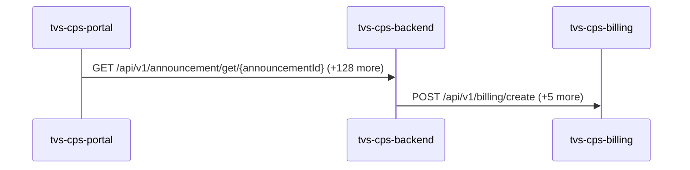

# tvs-cps-billing — Data Flows

## Flow Index
tvs-cps-billing takes part in 3 end-to-end flow(s) in registry/flows.json.

| flow_id | Name | Role of tvs-cps-billing | Trigger |
|---|---|---|---|
| tvs-cps-backend--tvs-cps-billing | tvs-cps-backend → tvs-cps-billing (1 hop) | terminal | scheduled job(s) in tvs-cps-backend (job-to-call link not resolved): JobScheduler.loadCatalogData, JobScheduler.retrieveMDPDealers, JobScheduler.retrieveMerchandiseStock (+2 more) |
| tvs-cps-jobs--tvs-cps-billing | tvs-cps-jobs → tvs-cps-billing (2 hops) | terminal | scheduled job(s) in tvs-cps-jobs (job-to-call link not resolved): CronJobScheduler.allBookingsScheduler, CronJobScheduler.allEnquiriesScheduler, CronJobScheduler.availableStockScheduler (+27 more); request to tvs-cps-jobs from outside the registry (no internal caller) |
| tvs-cps-portal--tvs-cps-billing | tvs-cps-portal → tvs-cps-billing (2 hops) | terminal | user action in tvs-cps-portal (frontend) |

## Flow: tvs-cps-backend--tvs-cps-billing
Summary: Starting at `tvs-cps-backend` (scheduled job(s) in tvs-cps-backend (job-to-call link not resolved): JobScheduler.loadCatalogData, JobScheduler.retrieveMDPDealers, JobScheduler.retrieveMerchandiseStock (+2 more)), the flow ends at `tvs-cps-billing`, using 1 sync HTTP hop(s) and 0 async event hop(s); tvs-cps-billing role: terminal; confidence high.

Steps:
| # | From | To | Via | Data (schema names) | Sync/Async | Confidence |
|---|---|---|---|---|---|---|
| 1 | tvs-cps-backend | tvs-cps-billing | POST /api/v1/billing/create, POST /api/v1/billing/discard, POST /api/v1/billing/invoices/search (+3 more) | APIResponse<GetInvoiceResponseDto>, APIResponse<InvoiceDiscardResponseDto>, APIResponse<PaginatedResponse<PostInvoiceResponseDto>>, APIResponse<PaginatedResponse<object>>, APIResponse<PostInvoiceResponseDto> (+5 more) | sync | high |

Data touched: tvs-cps-backend: postgres, postgres:nmazcpsdbsdev01-cmn-postgres-uks.postgres.database.azure.com:nmazcpsdbdev01-cps; tvs-cps-billing: postgres:localhost:billing_db

Failure points: hop 1 tvs-cps-backend → tvs-cps-billing: criticality hard

Evidence:
- hop 1 (tvs-cps-backend → tvs-cps-billing): `TVS-CPS-BACKEND/bff-service/src/main/java/com/tvsm/bff/controller/BillingBFFController.java:69`, `TVS-CPS-BACKEND/bff-service/src/main/java/com/tvsm/bff/util/ApiPassthroughUtil.java:285`, `TVS-CPS-BILLING/src/main/java/com/tvsm/billing/controller/BillingController.java:18` (+6 more)

## Flow: tvs-cps-jobs--tvs-cps-billing
Summary: Starting at `tvs-cps-jobs` (scheduled job(s) in tvs-cps-jobs (job-to-call link not resolved): CronJobScheduler.allBookingsScheduler, CronJobScheduler.allEnquiriesScheduler, CronJobScheduler.availableStockScheduler (+27 more); request to tvs-cps-jobs from outside the registry (no internal caller)), the flow passes through `tvs-cps-backend` and ends at `tvs-cps-billing`, using 2 sync HTTP hop(s) and 0 async event hop(s); tvs-cps-billing role: terminal; confidence high.

Steps:
| # | From | To | Via | Data (schema names) | Sync/Async | Confidence |
|---|---|---|---|---|---|---|
| 1 | tvs-cps-jobs | tvs-cps-backend | POST /system/api/v1/analytic/booking/stats, POST /system/api/v1/analytics-dashboard/indicators/calculate, POST /system/api/v1/appointments/auto-close (+1 more) | APIResponse<map<string,object>>, AnalyticsDto, AnalyticsRequestDTO | sync | high |
| 2 | tvs-cps-backend | tvs-cps-billing | POST /api/v1/billing/create, POST /api/v1/billing/discard, POST /api/v1/billing/invoices/search (+3 more) | APIResponse<GetInvoiceResponseDto>, APIResponse<InvoiceDiscardResponseDto>, APIResponse<PaginatedResponse<PostInvoiceResponseDto>>, APIResponse<PaginatedResponse<object>>, APIResponse<PostInvoiceResponseDto> (+5 more) | sync | high |

Data touched: tvs-cps-backend: postgres, postgres:nmazcpsdbsdev01-cmn-postgres-uks.postgres.database.azure.com:nmazcpsdbdev01-cps; tvs-cps-billing: postgres:localhost:billing_db

Failure points: hop 1 tvs-cps-jobs → tvs-cps-backend: criticality hard; hop 2 tvs-cps-backend → tvs-cps-billing: criticality hard

Evidence:
- hop 1 (tvs-cps-jobs → tvs-cps-backend): `TVS-CPS-BACKEND/bff-service/src/main/java/com/tvsm/bff/controller/AnalyticsController.java:23`, `TVS-CPS-JOBS/src/main/java/com/tvsm/jobs/service/AnalyticsService.java:32`, `TVS-CPS-JOBS/src/main/java/com/tvsm/jobs/service/RestCallService.java:50` (+4 more)
- hop 2 (tvs-cps-backend → tvs-cps-billing): `TVS-CPS-BACKEND/bff-service/src/main/java/com/tvsm/bff/controller/BillingBFFController.java:69`, `TVS-CPS-BACKEND/bff-service/src/main/java/com/tvsm/bff/util/ApiPassthroughUtil.java:285`, `TVS-CPS-BILLING/src/main/java/com/tvsm/billing/controller/BillingController.java:18` (+6 more)

## Flow: tvs-cps-portal--tvs-cps-billing
Summary: Starting at `tvs-cps-portal` (user action in tvs-cps-portal (frontend)), the flow passes through `tvs-cps-backend` and ends at `tvs-cps-billing`, using 2 sync HTTP hop(s) and 0 async event hop(s); tvs-cps-billing role: terminal; confidence medium.

Steps:
| # | From | To | Via | Data (schema names) | Sync/Async | Confidence |
|---|---|---|---|---|---|---|
| 1 | tvs-cps-portal | tvs-cps-backend | GET /api/v1/announcement/get/{announcementId}, GET /api/v1/announcement/user/banners, GET /api/v1/appointments/{appointmentId} (+126 more) | APIResponse<AnnouncementResponseDto>, APIResponse<AnnouncementResponseDto[]>, APIResponse<AppointmentCountResponseDTO>, APIResponse<AppointmentDashboardResponseDTO>, APIResponse<AppointmentDetailResponseDTO> (+105 more) | sync | medium |
| 2 | tvs-cps-backend | tvs-cps-billing | POST /api/v1/billing/create, POST /api/v1/billing/discard, POST /api/v1/billing/invoices/search (+3 more) | APIResponse<GetInvoiceResponseDto>, APIResponse<InvoiceDiscardResponseDto>, APIResponse<PaginatedResponse<PostInvoiceResponseDto>>, APIResponse<PaginatedResponse<object>>, APIResponse<PostInvoiceResponseDto> (+5 more) | sync | high |

Data touched: tvs-cps-backend: postgres, postgres:nmazcpsdbsdev01-cmn-postgres-uks.postgres.database.azure.com:nmazcpsdbdev01-cps; tvs-cps-billing: postgres:localhost:billing_db

Failure points: hop 1 tvs-cps-portal → tvs-cps-backend: criticality hard; hop 2 tvs-cps-backend → tvs-cps-billing: criticality hard

Evidence:
- hop 1 (tvs-cps-portal → tvs-cps-backend): `TVS-CPS-BACKEND/announcement-service/src/main/java/com/tvsm/announcement/controller/AnnouncementController.java:31`, `TVS-CPS-PORTAL/channel-partner-system/src/services/notification.service.ts:140`, `TVS-CPS-PORTAL/channel-partner-system/src/services/notification.service.ts:144` (+194 more)
- hop 2 (tvs-cps-backend → tvs-cps-billing): `TVS-CPS-BACKEND/bff-service/src/main/java/com/tvsm/bff/controller/BillingBFFController.java:69`, `TVS-CPS-BACKEND/bff-service/src/main/java/com/tvsm/bff/util/ApiPassthroughUtil.java:285`, `TVS-CPS-BILLING/src/main/java/com/tvsm/billing/controller/BillingController.java:18` (+6 more)
