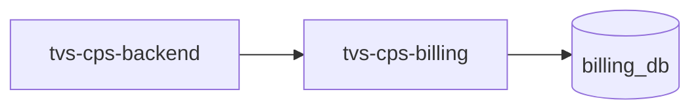

# tvs-cps-billing — High-Level Design

## Context
tvs-cps-billing is a `backend-api` in the TVS-CS org (domain: Unknown). Neighbours: callers `tvs-cps-backend`; downstream none resolved.

## Architecture
tvs-cps-billing components and connections (from service.yaml):

## Integration Points
tvs-cps-billing registry edges (8):

| Direction | Peer | Kind | Via | Criticality | Source | Match |
|---|---|---|---|---|---|---|
| in | `tvs-cps-backend` | http | POST /api/v1/billing/create | hard | code | path-unique |
| in | `tvs-cps-backend` | http | POST /api/v1/billing/discard | hard | code | path-unique |
| in | `tvs-cps-backend` | http | POST /api/v1/billing/invoices/search | hard | code | path-unique |
| in | `tvs-cps-backend` | http | POST /api/v1/billing/post-invoice | hard | code | path-unique |
| in | `tvs-cps-backend` | http | POST /api/v1/billing/report/invoice-list | hard | code | path-unique |
| in | `tvs-cps-backend` | http | POST /api/v1/billing/update | hard | code | path-unique |
| out | `tvs-cps-be-base-framework` | library_dependency | com.tvsm:tvsm-be-core | hard | code | artifact |
| out | `tvs-cps-be-base-framework` | library_dependency | com.tvsm:tvsm-be-starter-parent | hard | code | artifact |

## Data Ownership
tvs-cps-billing data stores (service.yaml `data_stores`; ownership flag not determinable unless set):

| Store | Type | Access | Owned | Key entities |
|---|---|---|---|---|
| `billing_db` | postgres | read-write | Unknown | Invoice, InvoiceLineItem, Payment |

## Key Design Decisions
tvs-cps-billing: N/A — not determinable from code.

| Decision | Alternatives considered | Reason |
|---|---|---|
| Unknown | Unknown | Unknown |

## Non-Functional Requirements
tvs-cps-billing NFR targets: N/A — not determinable from code. Tuning-related config keys: `app.rest.timeout.connect`, `app.rest.timeout.read`, `tvsm.core.multitenant.datasource.default-data-source.maximum-pool-size`.

## Security
tvs-cps-billing security: endpoint auth values None. No auth middleware found in code. 3 secret config key(s), sourced via: {'app-settings': 3} (names in OVERVIEW.md). PII handling: Unknown.

## Resilience and Failure Modes
tvs-cps-billing hard dependencies: none resolved. No retry/circuit-breaker code found; failure behaviour Unknown.

## Deployment Topology
tvs-cps-billing deployment artefacts (platform/regions: Unknown unless listed):

| Kind | Name | File | Environments | Image | Ports | Variable groups |
|---|---|---|---|---|---|---|
| azure-pipeline | AST_cps_billing_prod_Pipeline.yml | `AST_cps_billing_prod_Pipeline.yml:1` | - | - | - | PROD_Threshold, Tenable |
| azure-pipeline | AST_cps_billing_uat_Pipeline.yml | `AST_cps_billing_uat_Pipeline.yml:1` | - | - | - | Checkmarx_Common, Tenable, UAT_Threshold |
| azure-pipeline | ast-image-scan.yaml | `ast-image-scan.yaml:1` | - | - | - | Checkmarx_Common, UAT_Threshold |
| azure-pipeline | ci-pipeline.yaml | `ci-pipeline.yaml:1` | - | - | - | - |
| azure-pipeline | sonar_ci.yml | `sonar_ci.yml:1` | - | - | - | - |
| azure-pipeline | uk-cd-pipeline.yaml | `uk-cd-pipeline.yaml:1` | dev, prod, uat | - | - | - |
| azure-pipeline | uk-training-cd-pipeline.yaml | `uk-training-cd-pipeline.yaml:1` | training | - | - | - |
| dockerfile | Dockerfile | `Dockerfile:4` | - | tvsmazcmnsvcacrdev01.azurecr.io/tvs-cs/tvs-cps-be-base-framework:41532-d25ff29, amazoncorretto:21-alpine3.18-jdk | - | - |

## Observability
tvs-cps-billing observability libraries: `org.springframework.boot:spring-boot-starter-actuator`. Related config keys: `logging.level.com.tvsm.order`, `logging.level.org.hibernate.SQL`, `logging.level.org.hibernate.type.descriptor.sql.BasicBinder`, `logging.level.org.springframework.web`, `logging.pattern.console`, `logging.pattern.file`, `management.endpoint.health.show-details`, `management.endpoints.web.exposure.include`, `tvsm.core.logging.methodLevel.enabled`, `tvsm.core.logging.performance.enabled`, `tvsm.core.logging.performance.thresholdMs`. Dashboards/alerts: Unknown.
