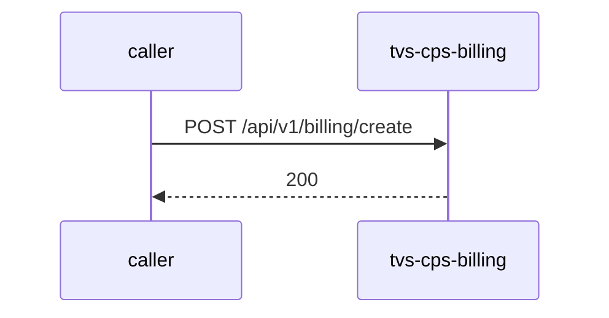

# tvs-cps-billing — Low-Level Design

## Data Model
tvs-cps-billing entities from `data_access` items (1).

Store access at `src/main/java/com/tvsm/billing/entity/Invoice.java:18`: database billing_db; collections -.

### invoices
Entity `Invoice` defined in `src/main/java/com/tvsm/billing/entity/Invoice.java:17`; table invoices; operation both.
Columns: Unknown (no fields extracted).
Relationships: Unknown.

### invoice_line_item
Entity `InvoiceLineItem` defined in `src/main/java/com/tvsm/billing/entity/InvoiceLineItem.java:14`; table invoice_line_item; operation both.
Columns: Unknown (no fields extracted).
Relationships: Unknown.

### payment
Entity `Payment` defined in `src/main/java/com/tvsm/billing/entity/Payment.java:17`; table payment; operation write.
Columns: Unknown (no fields extracted).
Relationships: Unknown.

## State Machines
tvs-cps-billing: N/A — no status/state enums found in code.

## Business Rules
tvs-cps-billing validation rules on DTO fields (from schema `validation`):
N/A — no declarative validation found; other rules not determinable without manual review.

## Key Classes and Functions
tvs-cps-billing key classes:

| Class / Function | File | Responsibility |
|---|---|---|
| `HealthController` | `src/main/java/com/tvsm/billing/controller/HealthController.java` | HTTP handlers |
| `BillingController` | `src/main/java/com/tvsm/billing/controller/BillingController.java` | HTTP handlers |
| `BillingReportController` | `src/main/java/com/tvsm/billing/controller/BillingReportController.java` | HTTP handlers |

## Sequence Details
tvs-cps-billing sequence for `POST /api/v1/billing/create` (handler `BillingController.createInvoice`); downstream calls inside the handler are not traced from code, module-level targets shown as optional.

## Error Handling
tvs-cps-billing error handling: no global exception handler found in code. Documented error statuses come from response annotations in API_SPEC.md.

## Configuration Details
tvs-cps-billing behaviour-relevant config keys (names only; full list in OVERVIEW.md):
- N/A — no behaviour-switching keys identified

## Edge Cases
tvs-cps-billing edge cases: N/A — not determinable from code without manual review.
