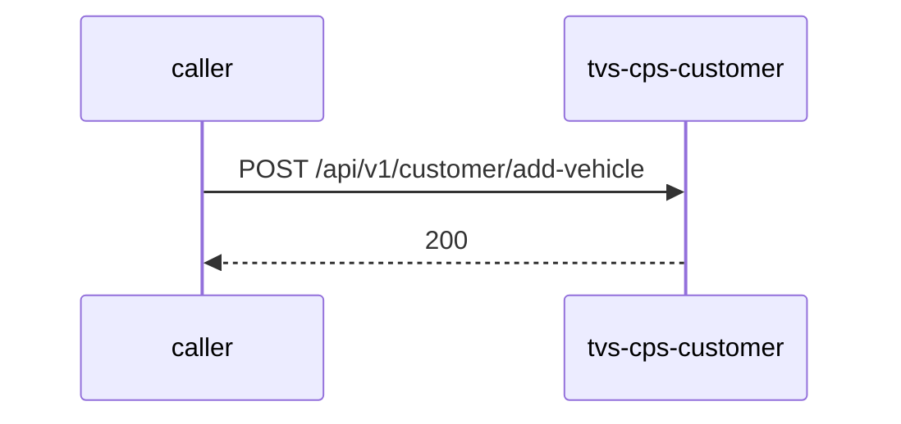

# tvs-cps-customer — Low-Level Design

## Data Model
tvs-cps-customer entities from `data_access` items (1).

Store access at `src/main/java/com/tvsm/customer/entity/Customer.java:15`: database customer; collections -.

### customer
Entity `Customer` defined in `src/main/java/com/tvsm/customer/entity/Customer.java:15`; table customer; operation both.
Columns: Unknown (no fields extracted).
Relationships: Unknown.

### customer_address
Entity `CustomerAddress` defined in `src/main/java/com/tvsm/customer/entity/CustomerAddress.java:14`; table customer_address; operation both.
Columns: Unknown (no fields extracted).
Relationships: Unknown.

### customer_audit
Entity `CustomerAudit` defined in `src/main/java/com/tvsm/customer/entity/CustomerAudit.java:18`; table customer_audit; operation write.
Columns: Unknown (no fields extracted).
Relationships: Unknown.

### customer_dealer_mapping
Entity `CustomerDealerMapping` defined in `src/main/java/com/tvsm/customer/entity/CustomerDealerMapping.java:13`; table customer_dealer_mapping; operation both.
Columns: Unknown (no fields extracted).
Relationships: Unknown.

### customer_vehicle
Entity `CustomerVehicle` defined in `src/main/java/com/tvsm/customer/entity/CustomerVehicle.java:15`; table customer_vehicle; operation both.
Columns: Unknown (no fields extracted).
Relationships: Unknown.

## State Machines
tvs-cps-customer: N/A — no status/state enums found in code.

## Business Rules
tvs-cps-customer validation rules on DTO fields (from schema `validation`):

| Schema.field | Rule | Defined in |
|---|---|---|
| `CustomerSearchRequest.page` | minimum=1 | `src/main/java/com/tvsm/customer/dto/CustomerSearchRequest.java:11` |
| `CustomerSearchRequest.size` | minimum=1;maximum=100 | `src/main/java/com/tvsm/customer/dto/CustomerSearchRequest.java:11` |
| `CustomerSearchRequest.and` | valid | `src/main/java/com/tvsm/customer/dto/CustomerSearchRequest.java:11` |
| `CustomerSearchRequest.or` | valid | `src/main/java/com/tvsm/customer/dto/CustomerSearchRequest.java:11` |
| `CustomerSearchRequest.sort` | valid | `src/main/java/com/tvsm/customer/dto/CustomerSearchRequest.java:11` |

## Key Classes and Functions
tvs-cps-customer key classes:

| Class / Function | File | Responsibility |
|---|---|---|
| `CustomerController` | `src/main/java/com/tvsm/customer/controller/CustomerController.java` | HTTP handlers |
| `ExternalCustomerController` | `src/main/java/com/tvsm/customer/controller/ExternalCustomerController.java` | HTTP handlers |
| `VehicleSearchController` | `src/main/java/com/tvsm/customer/controller/VehicleSearchController.java` | HTTP handlers |

## Sequence Details
tvs-cps-customer sequence for `POST /api/v1/customer/add-vehicle` (handler `CustomerController.addVehicleToCustomer`); downstream calls inside the handler are not traced from code, module-level targets shown as optional.

## Error Handling
tvs-cps-customer error handling: no global exception handler found in code. Documented error statuses come from response annotations in API_SPEC.md.

## Configuration Details
tvs-cps-customer behaviour-relevant config keys (names only; full list in OVERVIEW.md):
- N/A — no behaviour-switching keys identified

## Edge Cases
tvs-cps-customer edge cases: N/A — not determinable from code without manual review.
