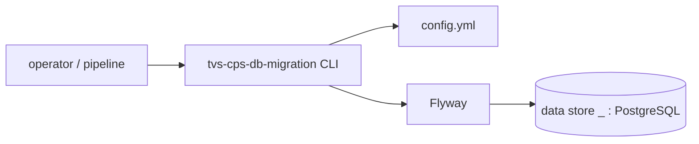

# TVS-CPS-DB-MIGRATION — High-Level Design
## Context
tvs-cps-db-migration is the schema-owner repo for the TVS CPS (Channel Partner System) PostgreSQL databases (`README.md`). It is a batch CLI, not a long-running service; registry has only `owns_schema` edges from it (109 tables) and no call/event edges in or out.

## Architecture
tvs-cps-db-migration is a single Java CLI: `MigrationRunner` → `ConfigLoader` → `MigrationService` (Flyway) → PostgreSQL.

## Integration Points
tvs-cps-db-migration has no sync (HTTP) or async (messaging) integrations. Its only integration is JDBC to PostgreSQL. Registry edges: 109 × `owns_schema` (source `code`, criticality `hard`) from tvs-cps-db-migration to `table:*` nodes, e.g. `table:appointment`, `table:customer`, `table:jobcard.job_card`, `table:inventory`, `table:invoice`, `table:workflow_template`.

## Data Ownership
tvs-cps-db-migration is the source of truth (DDL) for the data store `_` (owned: true, access: write). Key entities by module (from `CREATE TABLE` in `src/main/resources/db/migration/`):
- cps-backend: `appointment`, `appointment_job_type_master`, `appointment_status_master`, `announcement*`, `claim*`, `notification_*`, `orders`, `order_line`, `payment`, `tenant_config`, `training*`, `workflow`, `workflow_template`, `cps.lead_allocation_mapping`, `cps.round_robin_tracker`.
- customer: `customer`, `customer_address`, `customer_vehicle`, `customer_dealer_mapping`, `vehicle`.
- jobcard: `jobcard.job_card`, `jobcard.billing`, `jobcard.job_card_*_master` tables.
- cps-inventory: `inventory`, `inventory_audit`, `grn`, `grn_detail`, `bin`, `rack`.
- cps-billing: `invoice`, `invoice_line_item`, `invoice_erp_info`.
Which runtime services read/write these tables is not recorded in the registry (Unknown).

## Key Design Decisions
| Decision | Alternatives considered | Reason |
|---|---|---|
| Flyway versioned migrations per module folder (`DatabaseConfig.java:80`) | Unknown | Unknown |
| One schema per module via `schema` key (`DatabaseConfig.java:17`) | Unknown | README: single DB, multiple schemas |

## Non-Functional Requirements
N/A — not determinable from code.

## Security
tvs-cps-db-migration has no inbound authN/authZ. DB credentials come from the config file (`url`/`username`/`password`); the committed `src/main/resources/config.yml` contains credential values (not reproduced) — secret sourcing via a secret store is Unknown/absent.

## Resilience and Failure Modes
tvs-cps-db-migration has no retries. A failure in one database throws RuntimeException and stops the run with exit 1 (`MigrationService.java:40`, `MigrationRunner.java:45`). Flyway's transactional migrations/history table govern partial state.

## Deployment Topology
tvs-cps-db-migration is built as a shaded executable jar with main class `com.tvsm.migration.MigrationRunner` (`pom.xml:129-141`). No Dockerfile, helm or pipeline files in repo; how/where it runs is Unknown.

## Observability
tvs-cps-db-migration logs via slf4j-simple to stdout and prints a Flyway info table (`MigrationService.java:62`). No metrics/tracing.
