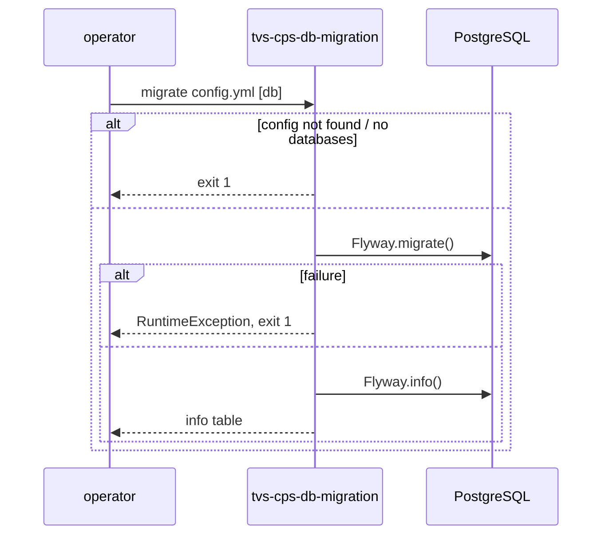

# TVS-CPS-DB-MIGRATION — Low-Level Design
## Data Model
tvs-cps-db-migration owns the DDL of data store `_` (PostgreSQL). Tables are created/altered by versioned scripts; full column lists live in the SQL files and are not duplicated here. Index of tables per module (from `CREATE TABLE` statements):

| Module folder | Tables (examples) | Evidence |
|---|---|---|
| `cps-backend` | `appointment`, `appointment_detail`, `appointment_job_type_master` (`V30__update_appointment.sql:38`), `appointment_service_type_master` (`V30__update_appointment.sql:46`), `appointment_status_master` (`V15__update_appointment_table.sql:97`), `announcement`, `claim`, `claim_type_master`, `cancellation_reason_master`, `notification_message`, `notification_template`, `orders`, `payment`, `tenant_config`, `training`, `workflow_template`, `cps.round_robin_tracker` | `src/main/resources/db/migration/cps-backend/` |
| `customer` | `customer`, `customer_address`, `customer_audit`, `customer_vehicle`, `customer_dealer_mapping`, `vehicle`, `vehicle_dealer_mapping` | `.../customer/` (from `V1__customer-service.sql`) |
| `jobcard` | `jobcard.job_card`, `jobcard.billing`, `jobcard.billing_line_item`, `jobcard.job_card_status_master`, `jobcard.job_card_complaint_master` | `.../jobcard/` (from `V1__jobcard_master_table.sql`) |
| `cps-inventory` | `inventory`, `inventory_audit`, `grn`, `grn_detail`, `grn_delivery_detail`, `bin`, `rack`, `location` | `.../cps-inventory/` (from `V1__inventory_table.sql`) |
| `cps-billing` | `invoice`, `invoice_line_item`, `invoice_erp_info`, `invoice_order_mapping` | `.../cps-billing/` (from `V1__invoice_table.sql`) |

Relationships: foreign keys exist (e.g. `cps-inventory/V11__add_fkey_constraint.sql`); full ER mapping Unknown without parsing all scripts.

## State Machines
N/A — tvs-cps-db-migration code has no state enums; status master tables (`appointment_status_master`, `claim_status_master`, `jobcard.job_card_status_master`) are seeded by migrations but transitions are enforced elsewhere (Unknown).

## Business Rules
tvs-cps-db-migration rules in code:
- Migration location = `migrationsLocation` if set, else `classpath:db/migration/<serviceName or database key>` (`DatabaseConfig.java:76-82`).
- `schema` defaults to `public`; applied only if non-empty (`DatabaseConfig.java:17`, `MigrationService.java:23`).
- First non-`--` arg after the config path selects a single database (`MigrationRunner.java:55`).

## Key Classes and Functions
| Class / Function | File | Responsibility |
|---|---|---|
| `MigrationRunner.main` | `src/main/java/com/tvsm/migration/MigrationRunner.java:18` | CLI entry, dispatch |
| `MigrationRunner.handleMigrate` | `MigrationRunner.java:51` | all vs single database |
| `MigrationService.migrate` | `src/main/java/com/tvsm/migration/service/MigrationService.java:14` | Flyway migrate |
| `MigrationService.info` | `MigrationService.java:44` | print migration status |
| `ConfigLoader.loadConfig` | `src/main/java/com/tvsm/migration/util/ConfigLoader.java:19` | load YAML/JSON config |
| `DatabaseConfig.getEffectiveMigrationsLocation` | `src/main/java/com/tvsm/migration/config/DatabaseConfig.java:76` | resolve Flyway location |

## Sequence Details
tvs-cps-db-migration migrate sequence with error branches:

## Error Handling
tvs-cps-db-migration: all exceptions caught in `main` → logged "Migration runner failed" → `System.exit(1)` (`MigrationRunner.java:45`). Missing args, unknown command or unknown database → usage/error + exit 1. No retries; idempotency comes from Flyway's schema history.

## Configuration Details
tvs-cps-db-migration config keys (names only): `databases.<name>.url`, `.username`, `.password` (connection), `.schema` (target schema), `.serviceName` (migration folder), `.migrationsLocation` (override). Loaded from filesystem path or classpath (`ConfigLoader.java:22-27`).

## Edge Cases
tvs-cps-db-migration edge cases visible in code:
- `info` command is printed in usage but not implemented → "Unknown command" (`MigrationRunner.java:39`, `:87`).
- `customer-service` config entry maps to folder `customer` via `serviceName` (`config.yml:12-18`).
- `jobcard` scripts exist but the `jobcard-service` entry is commented out, so they run only if re-enabled (`config.yml:32`).
