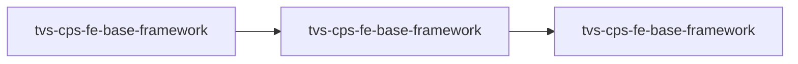

# TVS-CPS-FE-BASE-FRAMEWORK — High-Level Design

## Context
tvs-cps-fe-base-framework is the CPS front-end base (frontend-web). No registry service edges besides self-calls to its own API routes; backend APIs used by tenant apps are Unknown in this repo.

## Architecture
tvs-cps-fe-base-framework architecture (nodes from service.yaml/registry only).

Workspaces: `channel-partner-system` (Next.js App Router: `src/app`, `src/components`, `src/providers`, `src/server`, `src/i18n`, `src/pwa`, `middleware.ts`) consumes `shared` (`src/api`, `src/services`, `src/store`, `src/hooks`, `src/components`).

## Integration Points
tvs-cps-fe-base-framework registry edges (2 total, grouped):

| From | To | Kind | Source | Criticality | Count |
|---|---|---|---|---|---|
| tvs-cps-fe-base-framework | tvs-cps-fe-base-framework | http | code | hard | 2 |

## Data Ownership
tvs-cps-fe-base-framework data stores (service.yaml `data_stores`):
- none

## Key Design Decisions
tvs-cps-fe-base-framework: N/A — not determinable from code.

## Non-Functional Requirements
tvs-cps-fe-base-framework: N/A — not determinable from code.

## Security
tvs-cps-fe-base-framework: session token kept in httpOnly, sameSite=strict cookie, `secure` in production (`channel-partner-system/src/app/api/set-token/route.ts:5-10`); route guard in `src/middleware.ts`.
Secrets are configured by name only: `applicationInsightsKey` (None).

## Resilience and Failure Modes
tvs-cps-fe-base-framework: runtime config/features fetch errors are caught with fallback (`channel-partner-system/src/server/runtime-config.ts:41-56`); non-OK responses throw (`runtime-config.ts:30`). No other retry logic evidenced.

## Deployment Topology
tvs-cps-fe-base-framework: `next build` / per-tenant `build-tenant.mjs` (`channel-partner-system/package.json:9-12`); hosting Unknown (no Dockerfile/pipeline files).
- no Dockerfile/pipeline/helm files found

## Observability
tvs-cps-fe-base-framework: config key `applicationInsightsKey` suggests Azure Application Insights (name only; wiring not verified). Otherwise Unknown.
