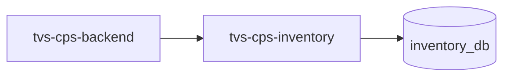

# tvs-cps-inventory — High-Level Design

## Context
tvs-cps-inventory is a `backend-api` in the TVS-CS org (domain: Unknown). Neighbours: callers `tvs-cps-backend`; downstream none resolved.

## Architecture
tvs-cps-inventory components and connections (from service.yaml):

## Integration Points
tvs-cps-inventory registry edges (19):

| Direction | Peer | Kind | Via | Criticality | Source | Match |
|---|---|---|---|---|---|---|
| in | `tvs-cps-backend` | http | GET /api/v1/inventory/bin/get | hard | code | path-unique |
| in | `tvs-cps-backend` | http | GET /api/v1/inventory/location/get | hard | code | path-unique |
| in | `tvs-cps-backend` | http | GET /api/v1/inventory/rack/get | hard | code | path-unique |
| in | `tvs-cps-backend` | http | POST /api/v1/inventory/bin/create | hard | code | path-unique |
| in | `tvs-cps-backend` | http | POST /api/v1/inventory/issue | hard | code | path-unique |
| in | `tvs-cps-backend` | http | POST /api/v1/inventory/list | hard | code | path-unique |
| in | `tvs-cps-backend` | http | POST /api/v1/inventory/location/create | hard | code | path-unique |
| in | `tvs-cps-backend` | http | POST /api/v1/inventory/rack/create | hard | code | path-unique |
| in | `tvs-cps-backend` | http | POST /api/v1/inventory/receive | hard | code | path-unique |
| in | `tvs-cps-backend` | http | POST /api/v1/inventory/report/vehicle-stock-report-list | hard | code | path-unique |
| in | `tvs-cps-backend` | http | POST /api/v1/vehicle/delivery-date/add | hard | code | path-unique |
| in | `tvs-cps-backend` | http | POST /api/v1/vehicle/inventory/lookup | hard | code | path-unique |
| in | `tvs-cps-backend` | http | POST /api/v1/vehicle/pdi | hard | code | path-unique |
| in | `tvs-cps-backend` | http | POST /api/v1/vehicle/update/stock-type | hard | code | path-unique |
| in | `tvs-cps-backend` | http | POST /system/api/v1/inventory/analytics/list | hard | code | path-unique |
| in | `tvs-cps-backend` | http | POST /system/api/v1/inventory/analytics/stats | hard | code | path-unique |
| in | `tvs-cps-backend` | http | PUT /api/v1/vehicle/submit-inspection | hard | code | path-unique |
| out | `tvs-cps-be-base-framework` | library_dependency | com.tvsm:tvsm-be-core | hard | code | artifact |
| out | `tvs-cps-be-base-framework` | library_dependency | com.tvsm:tvsm-be-starter-parent | hard | code | artifact |

## Data Ownership
tvs-cps-inventory data stores (service.yaml `data_stores`; ownership flag not determinable unless set):

| Store | Type | Access | Owned | Key entities |
|---|---|---|---|---|
| `inventory_db` | postgres | read-write | Unknown | Bin, Inventory, InventoryAudit, Location, Rack, Vehicle, VehicleDealerMapping, bin, inventory, location, rack, vehicle, vehicle_dealer_mapping |

## Key Design Decisions
tvs-cps-inventory: N/A — not determinable from code.

| Decision | Alternatives considered | Reason |
|---|---|---|
| Unknown | Unknown | Unknown |

## Non-Functional Requirements
tvs-cps-inventory NFR targets: N/A — not determinable from code. Tuning-related config keys: `app.rest.timeout.connect`, `app.rest.timeout.read`, `tvsm.core.multitenant.datasource.default-data-source.maximum-pool-size`.

## Security
tvs-cps-inventory security: endpoint auth values None. No auth middleware found in code. 3 secret config key(s), sourced via: {'app-settings': 3} (names in OVERVIEW.md). PII handling: Unknown.

## Resilience and Failure Modes
tvs-cps-inventory hard dependencies: none resolved. No retry/circuit-breaker code found; failure behaviour Unknown.

## Deployment Topology
tvs-cps-inventory deployment artefacts (platform/regions: Unknown unless listed):

| Kind | Name | File | Environments | Image | Ports | Variable groups |
|---|---|---|---|---|---|---|
| azure-pipeline | AST_cps_inventory_prod_Pipeline.yml | `AST_cps_inventory_prod_Pipeline.yml:1` | - | - | - | PROD_Threshold, Tenable |
| azure-pipeline | AST_cps_inventory_uat_Pipeline.yml | `AST_cps_inventory_uat_Pipeline.yml:1` | - | - | - | Checkmarx_Common, Tenable, UAT_Threshold |
| azure-pipeline | ast-image-scan.yaml | `ast-image-scan.yaml:1` | - | - | - | Checkmarx_Common, UAT_Threshold |
| azure-pipeline | cd-pipeline.yaml | `cd-pipeline.yaml:1` | dev | - | - | - |
| azure-pipeline | ci-pipeline.yaml | `ci-pipeline.yaml:1` | - | - | - | - |
| azure-pipeline | sonar_ci.yml | `sonar_ci.yml:1` | - | - | - | - |
| azure-pipeline | uk-cd-pipeline.yaml | `uk-cd-pipeline.yaml:1` | dev, prod, uat | - | - | - |
| azure-pipeline | uk-training-cd-pipeline.yaml | `uk-training-cd-pipeline.yaml:1` | training | - | - | - |
| dockerfile | Dockerfile | `Dockerfile:4` | - | tvsmazcmnsvcacrdev01.azurecr.io/tvs-cs/tvs-cps-be-base-framework:41532-d25ff29, amazoncorretto:21-al2023-headless | - | - |

## Observability
tvs-cps-inventory observability libraries: `org.springframework.boot:spring-boot-starter-actuator`. Related config keys: `logging.level.com.tvsm.order`, `logging.level.org.hibernate.SQL`, `logging.level.org.hibernate.type.descriptor.sql.BasicBinder`, `logging.level.org.springframework.web`, `logging.pattern.console`, `logging.pattern.file`, `management.endpoint.health.show-details`, `management.endpoints.web.exposure.include`, `tvsm.core.logging.methodLevel.enabled`, `tvsm.core.logging.performance.enabled`, `tvsm.core.logging.performance.thresholdMs`. Dashboards/alerts: Unknown.
