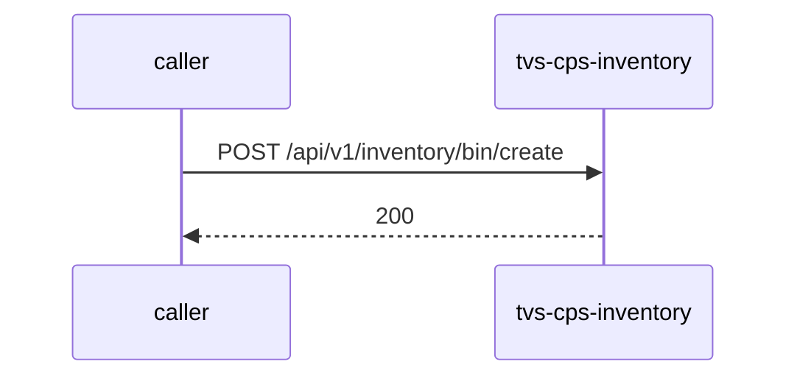

# tvs-cps-inventory — Low-Level Design

## Data Model
tvs-cps-inventory entities from `data_access` items (1).

Store access at `src/main/java/com/tvsm/inventory/entity/Bin.java:14`: database inventory_db; collections -.

### bin
Entity `Bin` defined in `src/main/java/com/tvsm/inventory/entity/Bin.java:13`; table bin; operation both.
Columns: Unknown (no fields extracted).
Relationships: Unknown.

### inventory
Entity `Inventory` defined in `src/main/java/com/tvsm/inventory/entity/Inventory.java:12`; table inventory; operation both.
Columns: Unknown (no fields extracted).
Relationships: Unknown.

### inventory_audit
Entity `InventoryAudit` defined in `src/main/java/com/tvsm/inventory/entity/InventoryAudit.java:13`; table inventory_audit; operation write.
Columns: Unknown (no fields extracted).
Relationships: Unknown.

### location
Entity `Location` defined in `src/main/java/com/tvsm/inventory/entity/Location.java:13`; table location; operation both.
Columns: Unknown (no fields extracted).
Relationships: Unknown.

### rack
Entity `Rack` defined in `src/main/java/com/tvsm/inventory/entity/Rack.java:12`; table rack; operation both.
Columns: Unknown (no fields extracted).
Relationships: Unknown.

### vehicle
Entity `Vehicle` defined in `src/main/java/com/tvsm/inventory/entity/Vehicle.java:13`; table vehicle; operation both.
Columns: Unknown (no fields extracted).
Relationships: Unknown.

### vehicle_dealer_mapping
Entity `VehicleDealerMapping` defined in `src/main/java/com/tvsm/inventory/entity/VehicleDealerMapping.java:13`; table vehicle_dealer_mapping; operation both.
Columns: Unknown (no fields extracted).
Relationships: Unknown.

### bin
Entity `bin` defined in `src/main/java/com/tvsm/inventory/repository/BinRepository.java:28`; table bin; operation read.
Columns: Unknown (no fields extracted).
Relationships: Unknown.

### inventory
Entity `inventory` defined in `src/main/java/com/tvsm/inventory/repository/InventoryRepository.java:26`; table inventory; operation read.
Columns: Unknown (no fields extracted).
Relationships: Unknown.

### location
Entity `location` defined in `src/main/java/com/tvsm/inventory/repository/InventoryRepository.java:26`; table location; operation read.
Columns: Unknown (no fields extracted).
Relationships: Unknown.

### rack
Entity `rack` defined in `src/main/java/com/tvsm/inventory/repository/InventoryRepository.java:26`; table rack; operation read.
Columns: Unknown (no fields extracted).
Relationships: Unknown.

### vehicle
Entity `vehicle` defined in `src/main/java/com/tvsm/inventory/repository/VehicleDealerMappingRepository.java:55`; table vehicle; operation read.
Columns: Unknown (no fields extracted).
Relationships: Unknown.

### vehicle_dealer_mapping
Entity `vehicle_dealer_mapping` defined in `src/main/java/com/tvsm/inventory/repository/InventoryRepository.java:148`; table vehicle_dealer_mapping; operation read.
Columns: Unknown (no fields extracted).
Relationships: Unknown.

## State Machines
tvs-cps-inventory: N/A — no status/state enums found in code.

## Business Rules
tvs-cps-inventory validation rules on DTO fields (from schema `validation`):
N/A — no declarative validation found; other rules not determinable without manual review.

## Key Classes and Functions
tvs-cps-inventory key classes:

| Class / Function | File | Responsibility |
|---|---|---|
| `HealthController` | `src/main/java/com/tvsm/inventory/controller/HealthController.java` | HTTP handlers |
| `ExternalVehicleController` | `src/main/java/com/tvsm/inventory/controller/ExternalVehicleController.java` | HTTP handlers |
| `InventoryController` | `src/main/java/com/tvsm/inventory/controller/InventoryController.java` | HTTP handlers |
| `BinController` | `src/main/java/com/tvsm/inventory/controller/BinController.java` | HTTP handlers |
| `LocationController` | `src/main/java/com/tvsm/inventory/controller/LocationController.java` | HTTP handlers |
| `RackController` | `src/main/java/com/tvsm/inventory/controller/RackController.java` | HTTP handlers |
| `VehicleController` | `src/main/java/com/tvsm/inventory/controller/VehicleController.java` | HTTP handlers |
| `VehicleReportController` | `src/main/java/com/tvsm/inventory/controller/VehicleReportController.java` | HTTP handlers |
| `InventoryDashboardController` | `src/main/java/com/tvsm/inventory/controller/InventoryDashboardController.java` | HTTP handlers |

## Sequence Details
tvs-cps-inventory sequence for `POST /api/v1/inventory/bin/create` (handler `BinController.createBin`); downstream calls inside the handler are not traced from code, module-level targets shown as optional.

## Error Handling
tvs-cps-inventory error handling: no global exception handler found in code. Documented error statuses come from response annotations in API_SPEC.md.

## Configuration Details
tvs-cps-inventory behaviour-relevant config keys (names only; full list in OVERVIEW.md):
- N/A — no behaviour-switching keys identified

## Edge Cases
tvs-cps-inventory edge cases: N/A — not determinable from code without manual review.
