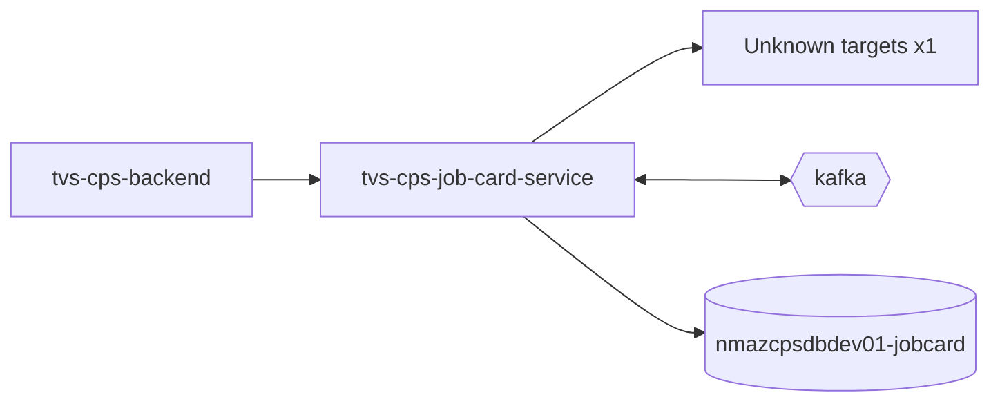

# tvs-cps-job-card-service — High-Level Design

## Context
tvs-cps-job-card-service is a `backend-api` in the TVS-CS org (domain: Unknown). Neighbours: callers `tvs-cps-backend`; downstream none resolved.

## Architecture
tvs-cps-job-card-service components and connections (from service.yaml):

## Integration Points
tvs-cps-job-card-service registry edges (13):

| Direction | Peer | Kind | Via | Criticality | Source | Match |
|---|---|---|---|---|---|---|
| in | `tvs-cps-backend` | http | GET /api/v1/jobcards/master | hard | code | path-unique |
| in | `tvs-cps-backend` | http | POST /api/v1/jobcards | hard | code | path-unique |
| in | `tvs-cps-backend` | http | POST /api/v1/jobcards/analytics/stats | hard | code | path-unique |
| in | `tvs-cps-backend` | http | POST /api/v1/jobcards/bulk-upload | hard | code | path-unique |
| in | `tvs-cps-backend` | http | POST /api/v1/jobcards/bulk-upload/history | hard | code | path-unique |
| in | `tvs-cps-backend` | http | POST /api/v1/jobcards/dashboard | hard | code | path-unique |
| in | `tvs-cps-backend` | http | POST /api/v1/jobcards/details | hard | code | path-unique |
| in | `tvs-cps-backend` | http | POST /api/v1/jobcards/download | hard | code | path-unique |
| in | `tvs-cps-backend` | http | POST /api/v1/jobcards/list | hard | code | path-unique |
| in | `tvs-cps-backend` | http | POST /api/v1/jobcards/warranty-check | hard | code | path-unique |
| in | `tvs-cps-backend` | http | PUT /api/v1/jobcards/update | hard | code | path-unique |
| out | `tvs-cps-be-base-framework` | library_dependency | com.tvsm:tvsm-be-core | hard | code | artifact |
| out | `tvs-cps-be-base-framework` | library_dependency | com.tvsm:tvsm-be-starter-parent | hard | code | artifact |

## Data Ownership
tvs-cps-job-card-service data stores (service.yaml `data_stores`; ownership flag not determinable unless set):

| Store | Type | Access | Owned | Key entities |
|---|---|---|---|---|
| `nmazcpsdbdev01-jobcard` | postgres | read-write | Unknown | Billing, BillingLineItem, BulkUpload, BulkUploadError, JobCardComplaintGroupMaster, JobCardComplaintMaster, JobCardIssueModeMaster, JobCardJobTypeMaster, JobCardLabourTypeMaster, JobCardServiceTypeMaster, JobCardStatusMaster, JobType, Jobcard, JobcardComplaintMapping, JobcardFileMapping … |

## Key Design Decisions
tvs-cps-job-card-service: N/A — not determinable from code.

| Decision | Alternatives considered | Reason |
|---|---|---|
| Unknown | Unknown | Unknown |

## Non-Functional Requirements
tvs-cps-job-card-service NFR targets: N/A — not determinable from code. Tuning-related config keys: `tvsm.core.multitenant.datasource.default-data-source.maximum-pool-size`.

## Security
tvs-cps-job-card-service security: endpoint auth values None. No auth middleware found in code. 3 secret config key(s), sourced via: {'app-settings': 3} (names in OVERVIEW.md). PII handling: Unknown.

## Resilience and Failure Modes
tvs-cps-job-card-service hard dependencies: none resolved. No retry/circuit-breaker code found; failure behaviour Unknown.

## Deployment Topology
tvs-cps-job-card-service deployment artefacts (platform/regions: Unknown unless listed):

| Kind | Name | File | Environments | Image | Ports | Variable groups |
|---|---|---|---|---|---|---|
| azure-pipeline | azure-pipelines/templates/ast-image-scan.yaml | `azure-pipelines/templates/ast-image-scan.yaml:1` | - | - | - | Checkmarx_Common, UAT_Threshold |
| azure-pipeline | azure-pipelines/templates/ast-prod.yaml | `azure-pipelines/templates/ast-prod.yaml:1` | - | - | - | PROD_Threshold, Tenable |
| azure-pipeline | azure-pipelines/templates/ast-uat.yaml | `azure-pipelines/templates/ast-uat.yaml:1` | - | - | - | Checkmarx_Common, Tenable, UAT_Threshold |
| azure-pipeline | azure-pipelines/templates/cd-pipeline.yaml | `azure-pipelines/templates/cd-pipeline.yaml:1` | dev | - | - | - |
| azure-pipeline | azure-pipelines/templates/ci-pipeline.yaml | `azure-pipelines/templates/ci-pipeline.yaml:1` | - | - | - | - |
| azure-pipeline | azure-pipelines/templates/pr-build-validation.yaml | `azure-pipelines/templates/pr-build-validation.yaml:1` | - | - | - | - |
| azure-pipeline | azure-pipelines/templates/sonar.yaml | `azure-pipelines/templates/sonar.yaml:1` | - | - | - | - |
| azure-pipeline | azure-pipelines/templates/uk-cd-pipeline.yaml | `azure-pipelines/templates/uk-cd-pipeline.yaml:1` | dev, prod, uat | - | - | - |
| azure-pipeline | azure-pipelines/templates/uk-training-cd-pipeline.yaml | `azure-pipelines/templates/uk-training-cd-pipeline.yaml:1` | training | - | - | - |
| dockerfile | Dockerfile | `Dockerfile:2` | - | tvsmazcmnsvcacrdev01.azurecr.io/tvs-cs/tvs-cps-be-base-framework:39043-100e13e, amazoncorretto:21-alpine3.18-jdk | 8080 | - |

## Observability
tvs-cps-job-card-service observability libraries: `org.springframework.boot:spring-boot-starter-actuator`. Related config keys: `logging.level.com.tvsm.jobcard`, `logging.level.org.hibernate.SQL`, `logging.level.org.hibernate.type.descriptor.sql.BasicBinder`, `logging.level.org.springframework.web`, `management.endpoint.health.show-details`, `management.endpoints.web.exposure.include`, `tvsm.core.logging.methodLevel.enabled`, `tvsm.core.logging.performance.enabled`, `tvsm.core.logging.performance.thresholdMs`. Dashboards/alerts: Unknown.
