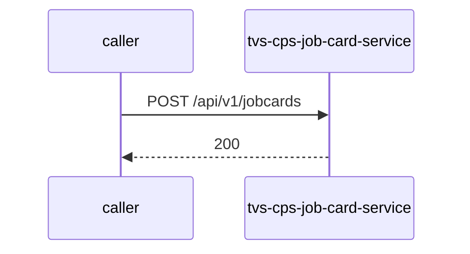

# tvs-cps-job-card-service — Low-Level Design

## Data Model
tvs-cps-job-card-service entities from `data_access` items (1).

Store access at `src/main/java/com/tvsm/jobcard/entity/Billing.java:12`: database nmazcpsdbdev01-jobcard; collections -.

### billing
Entity `Billing` defined in `src/main/java/com/tvsm/jobcard/entity/Billing.java:12`; table billing; operation Unknown.
Columns: Unknown (no fields extracted).
Relationships: Unknown.

### billing_line_item
Entity `BillingLineItem` defined in `src/main/java/com/tvsm/jobcard/entity/BillingLineItem.java:11`; table billing_line_item; operation Unknown.
Columns: Unknown (no fields extracted).
Relationships: Unknown.

### bulk_upload
Entity `BulkUpload` defined in `src/main/java/com/tvsm/jobcard/entity/BulkUpload.java:13`; table bulk_upload; operation both.
Columns: Unknown (no fields extracted).
Relationships: Unknown.

### bulk_upload_error
Entity `BulkUploadError` defined in `src/main/java/com/tvsm/jobcard/entity/BulkUploadError.java:12`; table bulk_upload_error; operation both.
Columns: Unknown (no fields extracted).
Relationships: Unknown.

### job_card_complaint_group_master
Entity `JobCardComplaintGroupMaster` defined in `src/main/java/com/tvsm/jobcard/entity/JobCardComplaintGroupMaster.java:6`; table job_card_complaint_group_master; operation read.
Columns: Unknown (no fields extracted).
Relationships: Unknown.

### job_card_complaint_master
Entity `JobCardComplaintMaster` defined in `src/main/java/com/tvsm/jobcard/entity/JobCardComplaintMaster.java:6`; table job_card_complaint_master; operation read.
Columns: Unknown (no fields extracted).
Relationships: Unknown.

### job_card_issue_mode_master
Entity `JobCardIssueModeMaster` defined in `src/main/java/com/tvsm/jobcard/entity/JobCardIssueModeMaster.java:6`; table job_card_issue_mode_master; operation read.
Columns: Unknown (no fields extracted).
Relationships: Unknown.

### job_card_job_type_master
Entity `JobCardJobTypeMaster` defined in `src/main/java/com/tvsm/jobcard/entity/JobCardJobTypeMaster.java:6`; table job_card_job_type_master; operation read.
Columns: Unknown (no fields extracted).
Relationships: Unknown.

### job_card_labour_type_master
Entity `JobCardLabourTypeMaster` defined in `src/main/java/com/tvsm/jobcard/entity/JobCardLabourTypeMaster.java:6`; table job_card_labour_type_master; operation read.
Columns: Unknown (no fields extracted).
Relationships: Unknown.

### job_card_service_type_master
Entity `JobCardServiceTypeMaster` defined in `src/main/java/com/tvsm/jobcard/entity/JobCardServiceTypeMaster.java:6`; table job_card_service_type_master; operation read.
Columns: Unknown (no fields extracted).
Relationships: Unknown.

### job_card_status_master
Entity `JobCardStatusMaster` defined in `src/main/java/com/tvsm/jobcard/entity/JobCardStatusMaster.java:6`; table job_card_status_master; operation read.
Columns: Unknown (no fields extracted).
Relationships: Unknown.

### job_type
Entity `JobType` defined in `src/main/java/com/tvsm/jobcard/entity/JobType.java:7`; table job_type; operation Unknown.
Columns: Unknown (no fields extracted).
Relationships: Unknown.

### job_card
Entity `Jobcard` defined in `src/main/java/com/tvsm/jobcard/entity/Jobcard.java:23`; table job_card; operation both.
Columns: Unknown (no fields extracted).
Relationships: Unknown.

### job_card_complaint_mapping
Entity `JobcardComplaintMapping` defined in `src/main/java/com/tvsm/jobcard/entity/JobcardComplaintMapping.java:10`; table job_card_complaint_mapping; operation both.
Columns: Unknown (no fields extracted).
Relationships: Unknown.

### job_card_file_mapping
Entity `JobcardFileMapping` defined in `src/main/java/com/tvsm/jobcard/entity/JobcardFileMapping.java:11`; table job_card_file_mapping; operation both.
Columns: Unknown (no fields extracted).
Relationships: Unknown.

### job_card_labor_mapping
Entity `JobcardLaborMapping` defined in `src/main/java/com/tvsm/jobcard/entity/JobcardLaborMapping.java:12`; table job_card_labor_mapping; operation both.
Columns: Unknown (no fields extracted).
Relationships: Unknown.

### job_card_part_mapping
Entity `JobcardPartMapping` defined in `src/main/java/com/tvsm/jobcard/entity/JobcardPartMapping.java:12`; table job_card_part_mapping; operation both.
Columns: Unknown (no fields extracted).
Relationships: Unknown.

### service_type
Entity `ServiceType` defined in `src/main/java/com/tvsm/jobcard/entity/ServiceType.java:7`; table service_type; operation Unknown.
Columns: Unknown (no fields extracted).
Relationships: Unknown.

### job_card
Entity `job_card` defined in `src/main/java/com/tvsm/jobcard/repository/JobcardRepository.java:21`; table job_card; operation read.
Columns: Unknown (no fields extracted).
Relationships: Unknown.

## State Machines
tvs-cps-job-card-service status/state enums found in code (1); transitions are not determinable from code.
- `JobcardStatus` (`src/main/java/com/tvsm/jobcard/enums/JobcardStatus.java:3`): CREATED, WORK_IN_PROGRESS, COMPLETED, CANCELLED, CLOSED, ON_HOLD

## Business Rules
tvs-cps-job-card-service validation rules on DTO fields (from schema `validation`):

| Schema.field | Rule | Defined in |
|---|---|---|
| `AddComplaintRequest.remarks` | maxLength=500 | `src/main/java/com/tvsm/jobcard/dto/JobcardUpdateRequestDTO.java:296` |
| `AddFileRequest.size` | positive | `src/main/java/com/tvsm/jobcard/dto/JobcardUpdateRequestDTO.java:357` |
| `AddLaborRequest.catalogSkuId` | maxLength=100 | `src/main/java/com/tvsm/jobcard/dto/JobcardUpdateRequestDTO.java:184` |
| `AddLaborRequest.rate` | positive | `src/main/java/com/tvsm/jobcard/dto/JobcardUpdateRequestDTO.java:184` |
| `AddLaborRequest.actualEffort` | minimum=0.0000001;maximum=4320 | `src/main/java/com/tvsm/jobcard/dto/JobcardUpdateRequestDTO.java:184` |
| `AddLaborRequest.oemSplit` | minimum=0.0 | `src/main/java/com/tvsm/jobcard/dto/JobcardUpdateRequestDTO.java:184` |
| `AddLaborRequest.dealerSplit` | minimum=0.0 | `src/main/java/com/tvsm/jobcard/dto/JobcardUpdateRequestDTO.java:184` |
| `AddPartRequest.jobCardPartMappingId` | maxLength=100 | `src/main/java/com/tvsm/jobcard/dto/JobcardUpdateRequestDTO.java:93` |
| `AddPartRequest.quantity` | positive | `src/main/java/com/tvsm/jobcard/dto/JobcardUpdateRequestDTO.java:93` |
| `AddPartRequest.partName` | maxLength=100 | `src/main/java/com/tvsm/jobcard/dto/JobcardUpdateRequestDTO.java:93` |
| `JobcardBulkUploadRequestDTO.mileageReading` | minimum=1;maximum=500000 | `src/main/java/com/tvsm/jobcard/dto/JobcardBulkUploadListDTO.java:26` |
| `JobcardBulkUploadRequestDTO.estimatedCost` | minimum=1;maximum=500000 | `src/main/java/com/tvsm/jobcard/dto/JobcardBulkUploadListDTO.java:26` |
| `JobcardBulkUploadRequestDTO.remarks` | maxLength=500 | `src/main/java/com/tvsm/jobcard/dto/JobcardBulkUploadListDTO.java:26` |
| `JobcardComplaintMappingDTO.remarks` | maxLength=500 | `src/main/java/com/tvsm/jobcard/dto/JobcardComplaintMappingDTO.java:13` |
| `JobcardCreateRequestDTO.mileageReading` | minimum=1;maximum=500000 | `src/main/java/com/tvsm/jobcard/dto/JobcardCreateRequestDTO.java:12` |
| `JobcardCreateRequestDTO.vin` | maxLength=20 | `src/main/java/com/tvsm/jobcard/dto/JobcardCreateRequestDTO.java:12` |
| `JobcardCreateRequestDTO.estimatedCost` | minimum=0;maximum=500000 | `src/main/java/com/tvsm/jobcard/dto/JobcardCreateRequestDTO.java:12` |
| `JobcardCreateRequestDTO.complaintMappings` | valid | `src/main/java/com/tvsm/jobcard/dto/JobcardCreateRequestDTO.java:12` |
| `JobcardLaborMappingDTO.catalogSkuId` | maxLength=100 | `src/main/java/com/tvsm/jobcard/dto/JobcardLaborMappingDTO.java:15` |
| `JobcardLaborMappingDTO.rate` | minimum=1;maximum=500000 | `src/main/java/com/tvsm/jobcard/dto/JobcardLaborMappingDTO.java:15` |
| `JobcardLaborMappingDTO.actualEffort` | minimum=0.0000001;maximum=4320 | `src/main/java/com/tvsm/jobcard/dto/JobcardLaborMappingDTO.java:15` |
| `JobcardPartMappingDTO.catalogSkuId` | maxLength=100 | `src/main/java/com/tvsm/jobcard/dto/JobcardPartMappingDTO.java:14` |
| `JobcardPartMappingDTO.description` | maxLength=100 | `src/main/java/com/tvsm/jobcard/dto/JobcardPartMappingDTO.java:14` |
| `JobcardUpdateRequestDTO.remarks` | maxLength=500 | `src/main/java/com/tvsm/jobcard/dto/JobcardUpdateRequestDTO.java:15` |
| `JobcardVinStatusFilterRequestDTO.filters` | valid | `src/main/java/com/tvsm/jobcard/dto/JobcardVinStatusFilterRequestDTO.java:21` |
| `UpdateComplaintRequest.remarks` | maxLength=500 | `src/main/java/com/tvsm/jobcard/dto/JobcardUpdateRequestDTO.java:321` |
| `UpdateLaborRequest.actualEffort` | minimum=0.0000001;maximum=4320 | `src/main/java/com/tvsm/jobcard/dto/JobcardUpdateRequestDTO.java:262` |

## Key Classes and Functions
tvs-cps-job-card-service key classes:

| Class / Function | File | Responsibility |
|---|---|---|
| `HealthController` | `src/main/java/com/tvsm/jobcard/controller/HealthController.java` | HTTP handlers |
| `JobcardController` | `src/main/java/com/tvsm/jobcard/controller/JobcardController.java` | HTTP handlers |
| `JobCardAnalyticsController` | `src/main/java/com/tvsm/jobcard/controller/JobCardAnalyticsController.java` | HTTP handlers |
| `ExternalJobcardController` | `src/main/java/com/tvsm/jobcard/controller/ExternalJobcardController.java` | HTTP handlers |
| publish dev.cp.job_card | `src/main/java/com/tvsm/jobcard/service/JobCardProducerService.java:29` | kafka messaging |

## Sequence Details
tvs-cps-job-card-service sequence for `POST /api/v1/jobcards` (handler `JobcardController.createJobcard`); downstream calls inside the handler are not traced from code, module-level targets shown as optional.

## Error Handling
tvs-cps-job-card-service error handling: no global exception handler found in code. Documented error statuses come from response annotations in API_SPEC.md.

## Configuration Details
tvs-cps-job-card-service behaviour-relevant config keys (names only; full list in OVERVIEW.md):
- `config:customer.search-url`: base URL for outbound calls
- `azure.eventhub.jobcard.hub-name`: publish entity name

## Edge Cases
tvs-cps-job-card-service edge cases: N/A — not determinable from code without manual review.
