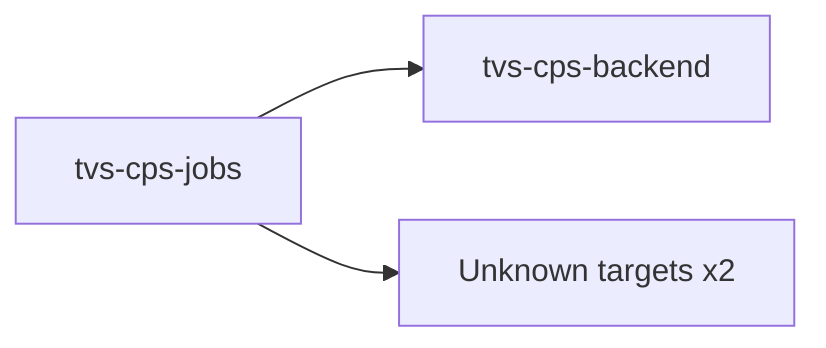

# tvs-cps-jobs — High-Level Design

## Context
tvs-cps-jobs is a `backend-api` in the TVS-CS org (domain: Unknown). Neighbours: callers Unknown; downstream `tvs-cps-backend`.

## Architecture
tvs-cps-jobs components and connections (from service.yaml):

## Integration Points
tvs-cps-jobs registry edges (6):

| Direction | Peer | Kind | Via | Criticality | Source | Match |
|---|---|---|---|---|---|---|
| out | `tvs-cps-backend` | http | POST /system/api/v1/analytic/booking/stats | hard | code | path-unique |
| out | `tvs-cps-backend` | http | POST /system/api/v1/analytics-dashboard/indicators/calculate | hard | code | path-unique |
| out | `tvs-cps-backend` | http | POST /system/api/v1/appointments/auto-close | hard | code | path-unique |
| out | `tvs-cps-backend` | http | POST /system/api/v1/claims/sap-sync | hard | code | path-unique |
| out | `tvs-cps-be-base-framework` | library_dependency | com.tvsm:tvsm-be-core | hard | code | artifact |
| out | `tvs-cps-be-base-framework` | library_dependency | com.tvsm:tvsm-be-starter-parent | hard | code | artifact |

## Data Ownership
tvs-cps-jobs data stores (service.yaml `data_stores`; ownership flag not determinable unless set):

| Store | Type | Access | Owned | Key entities |
|---|---|---|---|---|
| N/A | | | | no data stores extracted |

## Key Design Decisions
tvs-cps-jobs: N/A — not determinable from code.

| Decision | Alternatives considered | Reason |
|---|---|---|
| Unknown | Unknown | Unknown |

## Non-Functional Requirements
tvs-cps-jobs NFR targets: N/A — not determinable from code. Tuning-related config keys: `app.rest.timeout.connect`, `app.rest.timeout.read`, `azure-datalake.order-status.batch-size`, `order-sync-job.batch-size`, `scheduler.order-sync-job.batch-size`, `tvs-cps-backend.data-process.batch-size`.

## Security
tvs-cps-jobs security: endpoint auth values None. No auth middleware found in code. 14 secret config key(s), sourced via: {'app-settings': 14} (names in OVERVIEW.md). PII handling: Unknown.

## Resilience and Failure Modes
tvs-cps-jobs hard dependencies: `tvs-cps-backend`. No retry/circuit-breaker code found; failure behaviour Unknown.

## Deployment Topology
tvs-cps-jobs deployment artefacts (platform/regions: Unknown unless listed):

| Kind | Name | File | Environments | Image | Ports | Variable groups |
|---|---|---|---|---|---|---|
| azure-pipeline | AST_cps_jobs_prod_Pipeline.yml | `AST_cps_jobs_prod_Pipeline.yml:1` | - | - | - | PROD_Threshold, Tenable |
| azure-pipeline | ast-image-scan.yaml | `ast-image-scan.yaml:1` | - | - | - | Checkmarx_Common, UAT_Threshold |
| azure-pipeline | ast_cps_jobs_uat_Pipeline.yml | `ast_cps_jobs_uat_Pipeline.yml:1` | - | - | - | Checkmarx_Common, Tenable, UAT_Threshold |
| azure-pipeline | cd-pipeline.yaml | `cd-pipeline.yaml:1` | dev | - | - | - |
| azure-pipeline | ci-pipeline.yaml | `ci-pipeline.yaml:1` | - | - | - | - |
| azure-pipeline | pr-build-validation.yaml | `pr-build-validation.yaml:1` | - | - | - | - |
| azure-pipeline | sonar.yaml | `sonar.yaml:1` | - | - | - | - |
| azure-pipeline | uk-cd-pipeline.yaml | `uk-cd-pipeline.yaml:1` | dev, prod, uat | - | - | - |
| azure-pipeline | uk-training-cd-pipeline.yaml | `uk-training-cd-pipeline.yaml:1` | training | - | - | - |
| dockerfile | Dockerfile | `Dockerfile:4` | - | tvsmazcmnsvcacrdev01.azurecr.io/tvs-cs/tvs-cps-be-base-framework:41532-d25ff29, eclipse-temurin:21.0.10_7-jdk-ubi10-minimal | - | - |

## Observability
tvs-cps-jobs observability libraries: `org.springframework.boot:spring-boot-starter-actuator`. Related config keys: `logging.level.com.tvsm.jobs`, `logging.level.com.tvsm.order`, `logging.level.org.hibernate`, `logging.level.org.hibernate.SQL`, `logging.level.org.hibernate.type.descriptor.sql.BasicBinder`, `logging.level.org.mockito`, `logging.level.org.springframework`, `logging.level.org.springframework.web`, `logging.pattern.console`, `logging.pattern.file`, `management.endpoint.health.show-details`, `management.endpoints.web.exposure.include`, `tvsm.core.logging.methodLevel.enabled`, `tvsm.core.logging.performance.enabled`, `tvsm.core.logging.performance.thresholdMs`. Dashboards/alerts: Unknown.
