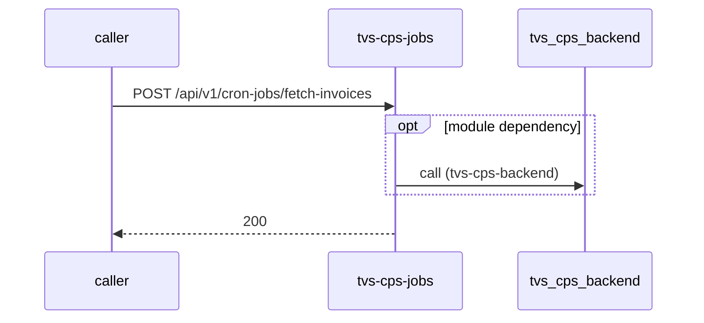

# tvs-cps-jobs — Low-Level Design

## Data Model
tvs-cps-jobs entities from `data_access` items (0).
N/A — no data access in this repo.

## State Machines
tvs-cps-jobs: N/A — no status/state enums found in code.

## Business Rules
tvs-cps-jobs validation rules on DTO fields (from schema `validation`):
N/A — no declarative validation found; other rules not determinable without manual review.

## Key Classes and Functions
tvs-cps-jobs key classes:

| Class / Function | File | Responsibility |
|---|---|---|
| `HealthController` | `src/main/java/com/tvsm/jobs/controller/HealthController.java` | HTTP handlers |
| `CronJobsController` | `src/main/java/com/tvsm/jobs/controller/CronJobsController.java` | HTTP handlers |
| `CronJobScheduler.allBookingsScheduler` | `src/main/java/com/tvsm/jobs/scheduler/CronJobScheduler.java:108` | scheduled job |
| `CronJobScheduler.allEnquiriesScheduler` | `src/main/java/com/tvsm/jobs/scheduler/CronJobScheduler.java:118` | scheduled job |
| `CronJobScheduler.testRidesMissedScheduler` | `src/main/java/com/tvsm/jobs/scheduler/CronJobScheduler.java:128` | scheduled job |
| `CronJobScheduler.unassignedEnquiriesScheduler` | `src/main/java/com/tvsm/jobs/scheduler/CronJobScheduler.java:138` | scheduled job |
| `CronJobScheduler.followupsMissedScheduler` | `src/main/java/com/tvsm/jobs/scheduler/CronJobScheduler.java:148` | scheduled job |
| `CronJobScheduler.stock90DaysScheduler` | `src/main/java/com/tvsm/jobs/scheduler/CronJobScheduler.java:158` | scheduled job |
| `CronJobScheduler.retailCountScheduler` | `src/main/java/com/tvsm/jobs/scheduler/CronJobScheduler.java:168` | scheduled job |
| `CronJobScheduler.vehiclesPendingPdiScheduler` | `src/main/java/com/tvsm/jobs/scheduler/CronJobScheduler.java:178` | scheduled job |
| `CronJobScheduler.averageStockDaysScheduler` | `src/main/java/com/tvsm/jobs/scheduler/CronJobScheduler.java:188` | scheduled job |
| `CronJobScheduler.availableStockScheduler` | `src/main/java/com/tvsm/jobs/scheduler/CronJobScheduler.java:198` | scheduled job |
| `CronJobScheduler.vehicleOrderTatScheduler` | `src/main/java/com/tvsm/jobs/scheduler/CronJobScheduler.java:208` | scheduled job |
| `CronJobScheduler.partsOrderTatScheduler` | `src/main/java/com/tvsm/jobs/scheduler/CronJobScheduler.java:218` | scheduled job |
| `CronJobScheduler.orderStatusSyncJobScheduler` | `src/main/java/com/tvsm/jobs/scheduler/CronJobScheduler.java:22` | scheduled job |
| `CronJobScheduler.vehicleOrder60Scheduler` | `src/main/java/com/tvsm/jobs/scheduler/CronJobScheduler.java:228` | scheduled job |
| `CronJobScheduler.vehicleGrnPendingScheduler` | `src/main/java/com/tvsm/jobs/scheduler/CronJobScheduler.java:238` | scheduled job |
| `CronJobScheduler.partsGrnPendingScheduler` | `src/main/java/com/tvsm/jobs/scheduler/CronJobScheduler.java:248` | scheduled job |
| `CronJobScheduler.vehicleOrderPendingGrnScheduler` | `src/main/java/com/tvsm/jobs/scheduler/CronJobScheduler.java:258` | scheduled job |
| `CronJobScheduler.totalOrderQtyScheduler` | `src/main/java/com/tvsm/jobs/scheduler/CronJobScheduler.java:268` | scheduled job |
| `CronJobScheduler.partsPurchaseOrderValueScheduler` | `src/main/java/com/tvsm/jobs/scheduler/CronJobScheduler.java:278` | scheduled job |
| `CronJobScheduler.vehicleOrderSubmittedScheduler` | `src/main/java/com/tvsm/jobs/scheduler/CronJobScheduler.java:288` | scheduled job |
| `CronJobScheduler.vehicleOrderApprovedScheduler` | `src/main/java/com/tvsm/jobs/scheduler/CronJobScheduler.java:298` | scheduled job |
| `CronJobScheduler.vehicleOrderCompletedScheduler` | `src/main/java/com/tvsm/jobs/scheduler/CronJobScheduler.java:308` | scheduled job |
| `CronJobScheduler.vehicleOrderPickedScheduler` | `src/main/java/com/tvsm/jobs/scheduler/CronJobScheduler.java:318` | scheduled job |
| `CronJobScheduler.vehicleOrderDispatchedScheduler` | `src/main/java/com/tvsm/jobs/scheduler/CronJobScheduler.java:328` | scheduled job |
| `CronJobScheduler.partsStockValueScheduler` | `src/main/java/com/tvsm/jobs/scheduler/CronJobScheduler.java:338` | scheduled job |
| `CronJobScheduler.pullOrderInvoicesJobScheduler` | `src/main/java/com/tvsm/jobs/scheduler/CronJobScheduler.java:39` | scheduled job |
| `CronJobScheduler.closeAppointmentJobScheduler` | `src/main/java/com/tvsm/jobs/scheduler/CronJobScheduler.java:55` | scheduled job |
| `CronJobScheduler.claimSAPSyncJobScheduler` | `src/main/java/com/tvsm/jobs/scheduler/CronJobScheduler.java:70` | scheduled job |
| `CronJobScheduler.l1DashboardCalculationSyncJobScheduler` | `src/main/java/com/tvsm/jobs/scheduler/CronJobScheduler.java:85` | scheduled job |
| `CronJobScheduler.bookingPendingAllotmentScheduler` | `src/main/java/com/tvsm/jobs/scheduler/CronJobScheduler.java:98` | scheduled job |

## Sequence Details
tvs-cps-jobs sequence for `POST /api/v1/cron-jobs/fetch-invoices` (handler `CronJobsController.fetchInvoices`); downstream calls inside the handler are not traced from code, module-level targets shown as optional.

## Error Handling
tvs-cps-jobs error handling: no global exception handler found in code. Status mapping: Unknown.

## Configuration Details
tvs-cps-jobs behaviour-relevant config keys (names only; full list in OVERVIEW.md):
- `scheduler.analytics.base-url`: points to `tvs-cps-backend`
- `tvs-cps-backend.base-url`: points to `tvs-cps-backend`
- `config:azure-datalake.api-url`: base URL for outbound calls
- `config:scheduler.analytics.base-url`: base URL for outbound calls
- `config:tvs-cps-backend.base-url`: base URL for outbound calls
- job `CronJobScheduler.allBookingsScheduler` schedule from config:scheduler.analytics.all-bookings.cron
- job `CronJobScheduler.allEnquiriesScheduler` schedule from config:scheduler.analytics.all-enquiries.cron
- job `CronJobScheduler.testRidesMissedScheduler` schedule from config:scheduler.analytics.test-rides-missed.cron
- job `CronJobScheduler.unassignedEnquiriesScheduler` schedule from config:scheduler.analytics.unassigned-enquiries.cron
- job `CronJobScheduler.followupsMissedScheduler` schedule from config:scheduler.analytics.followups-missed.cron
- job `CronJobScheduler.stock90DaysScheduler` schedule from config:scheduler.analytics.stock-90-days.cron
- job `CronJobScheduler.retailCountScheduler` schedule from config:scheduler.analytics.retail-count.cron
- job `CronJobScheduler.vehiclesPendingPdiScheduler` schedule from config:scheduler.analytics.vehicles-pending-pdi.cron
- job `CronJobScheduler.averageStockDaysScheduler` schedule from config:scheduler.analytics.average-stock-days.cron
- job `CronJobScheduler.availableStockScheduler` schedule from config:scheduler.analytics.available-stock.cron
- job `CronJobScheduler.vehicleOrderTatScheduler` schedule from config:scheduler.analytics.vehicle-order-tat.cron
- job `CronJobScheduler.partsOrderTatScheduler` schedule from config:scheduler.analytics.parts-order-tat.cron
- job `CronJobScheduler.orderStatusSyncJobScheduler` schedule from config:scheduler.order-sync-job.cron
- job `CronJobScheduler.vehicleOrder60Scheduler` schedule from config:scheduler.analytics.vehicle-order-60.cron
- job `CronJobScheduler.vehicleGrnPendingScheduler` schedule from config:scheduler.analytics.vehicle-grn-pending.cron
- job `CronJobScheduler.partsGrnPendingScheduler` schedule from config:scheduler.analytics.parts-grn-pending.cron
- job `CronJobScheduler.vehicleOrderPendingGrnScheduler` schedule from config:scheduler.analytics.vehicle-order-pending-grn.cron
- job `CronJobScheduler.totalOrderQtyScheduler` schedule from config:scheduler.analytics.total-order-qty.cron
- job `CronJobScheduler.partsPurchaseOrderValueScheduler` schedule from config:scheduler.analytics.parts-purchase-order-value.cron
- job `CronJobScheduler.vehicleOrderSubmittedScheduler` schedule from config:scheduler.analytics.vehicle-order-submitted.cron
- job `CronJobScheduler.vehicleOrderApprovedScheduler` schedule from config:scheduler.analytics.vehicle-order-approved.cron
- job `CronJobScheduler.vehicleOrderCompletedScheduler` schedule from config:scheduler.analytics.vehicle-order-completed.cron
- job `CronJobScheduler.vehicleOrderPickedScheduler` schedule from config:scheduler.analytics.vehicle-order-picked.cron
- job `CronJobScheduler.vehicleOrderDispatchedScheduler` schedule from config:scheduler.analytics.vehicle-order-dispatched.cron
- job `CronJobScheduler.partsStockValueScheduler` schedule from config:scheduler.analytics.parts-stock-value.cron
- job `CronJobScheduler.pullOrderInvoicesJobScheduler` schedule from config:scheduler.fetch-invoice-job.cron
- job `CronJobScheduler.closeAppointmentJobScheduler` schedule from config:scheduler.appointment-close-job.cron
- job `CronJobScheduler.claimSAPSyncJobScheduler` schedule from config:scheduler.claim-sap-sync-job.cron
- job `CronJobScheduler.l1DashboardCalculationSyncJobScheduler` schedule from config:scheduler.l1-dashboard-sync-job.cron
- job `CronJobScheduler.bookingPendingAllotmentScheduler` schedule from config:scheduler.analytics.booking-pending-allotment.cron

## Edge Cases
tvs-cps-jobs edge cases: N/A — not determinable from code without manual review.
