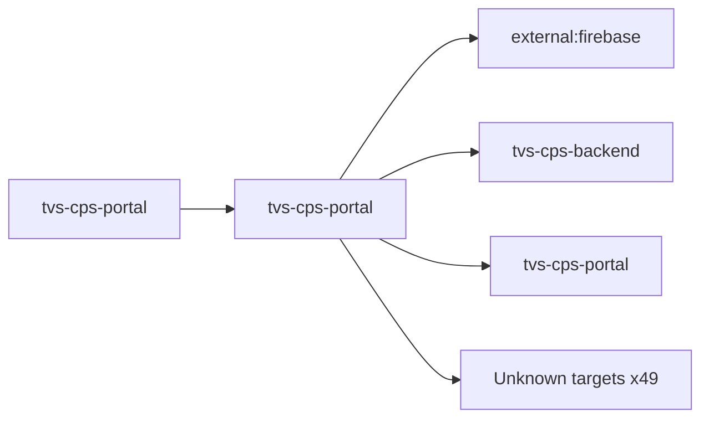

# tvs-cps-portal — High-Level Design

## Context
tvs-cps-portal is a `portal` in the TVS-CS org (domain: Unknown). Neighbours: callers `tvs-cps-portal`; downstream `external:firebase`, `tvs-cps-backend`, `tvs-cps-portal`.

## Architecture
tvs-cps-portal components and connections (from service.yaml):

## Integration Points
tvs-cps-portal registry edges (134):

| Direction | Peer | Kind | Via | Criticality | Source | Match |
|---|---|---|---|---|---|---|
| out | `tvs-cps-backend` | http | GET /api/v1/announcement/get/{announcementId} | hard | code | path-suffix |
| out | `tvs-cps-backend` | http | GET /api/v1/announcement/user/banners | hard | code | path-suffix |
| out | `tvs-cps-backend` | http | GET /api/v1/appointments/{appointmentId} | hard | code | path-suffix |
| out | `tvs-cps-backend` | http | GET /cps/api/reports/list | hard | code | path-suffix |
| out | `tvs-cps-backend` | http | GET /cps/api/v1/analytics-dashboard/indicators/get | hard | code | path-suffix |
| out | `tvs-cps-backend` | http | GET /cps/api/v1/booking/get | hard | code | path-suffix |
| out | `tvs-cps-backend` | http | GET /cps/api/v1/booking/get-booking-list | hard | code | path-suffix |
| out | `tvs-cps-backend` | http | GET /cps/api/v1/booking/master-data | hard | code | path-suffix |
| out | `tvs-cps-backend` | http | GET /cps/api/v1/cart/active-cart | hard | code | path-suffix |
| out | `tvs-cps-backend` | http | GET /cps/api/v1/cart/{cartId} | hard | code | path-suffix |
| out | `tvs-cps-backend` | http | GET /cps/api/v1/catalogs/assemblies | hard | code | path-suffix |
| out | `tvs-cps-backend` | http | GET /cps/api/v1/catalogs/catalog-summary | hard | code | path-suffix |
| out | `tvs-cps-backend` | http | GET /cps/api/v1/catalogs/get/{partId} | hard | code | path-suffix |
| out | `tvs-cps-backend` | http | GET /cps/api/v1/catalogs/labor/area/{brand} | hard | code | path-suffix |
| out | `tvs-cps-backend` | http | GET /cps/api/v1/catalogs/merchandise/categories | hard | code | path-suffix |
| out | `tvs-cps-backend` | http | GET /cps/api/v1/catalogs/merchandise/colors | hard | code | path-suffix |
| out | `tvs-cps-backend` | http | GET /cps/api/v1/catalogs/merchandise/{partReferenceNo} | hard | code | path-suffix |
| out | `tvs-cps-backend` | http | GET /cps/api/v1/catalogs/parts | hard | code | path-suffix |
| out | `tvs-cps-backend` | http | GET /cps/api/v1/catalogs/parts/vehicleCatalogSkus/{catalogSkuId} | hard | code | path-suffix |
| out | `tvs-cps-backend` | http | GET /cps/api/v1/catalogs/vehicle | hard | code | path-suffix |
| out | `tvs-cps-backend` | http | GET /cps/api/v1/catalogs/vehicle-data | hard | code | path-suffix |
| out | `tvs-cps-backend` | http | GET /cps/api/v1/channel-partner/list | hard | code | path-suffix |
| out | `tvs-cps-backend` | http | GET /cps/api/v1/claims/grn/details/{grnId} | hard | code | path-suffix |
| out | `tvs-cps-backend` | http | GET /cps/api/v1/claims/master | hard | code | path-suffix |
| out | `tvs-cps-backend` | http | GET /cps/api/v1/claims/timeline/{claimCatalogMappingId} | hard | code | path-suffix |
| out | `tvs-cps-backend` | http | GET /cps/api/v1/claims/{claimId} | hard | code | path-suffix |
| out | `tvs-cps-backend` | http | GET /cps/api/v1/dashboard/list/{type} | hard | code | path-suffix |
| out | `tvs-cps-backend` | http | GET /cps/api/v1/enquiry/get-enquiry | hard | code | path-suffix |
| out | `tvs-cps-backend` | http | GET /cps/api/v1/enquiry/getEnquiryMaster | hard | code | path-suffix |
| out | `tvs-cps-backend` | http | GET /cps/api/v1/enquiry/vehicles | hard | code | path-suffix |
| out | `tvs-cps-backend` | http | GET /cps/api/v1/enquiry/vehicles/{model}/variants | hard | code | path-suffix |
| out | `tvs-cps-backend` | http | GET /cps/api/v1/grn/details/{grnId} | hard | code | path-suffix |
| out | `tvs-cps-backend` | http | GET /cps/api/v1/invoice/delivery-view/{invoiceId} | hard | code | path-suffix |
| out | `tvs-cps-backend` | http | GET /cps/api/v1/location/address/autocomplete | hard | code | path-suffix |
| out | `tvs-cps-backend` | http | GET /cps/api/v1/location/address/details | hard | code | path-suffix |
| out | `tvs-cps-backend` | http | GET /cps/api/v1/order/get | hard | code | path-suffix |
| out | `tvs-cps-backend` | http | GET /cps/api/v1/order/get-branch | hard | code | path-suffix |
| out | `tvs-cps-backend` | http | GET /cps/api/v1/order/orderedPartDetails | hard | code | path-suffix |
| out | `tvs-cps-backend` | http | GET /cps/api/v1/order/status-counts | hard | code | path-suffix |
| out | `tvs-cps-backend` | http | GET /cps/api/v1/permissions/user-info | hard | code | path-suffix |
| out | `tvs-cps-backend` | http | GET /cps/api/v1/permissions/user-role/list | hard | code | path-suffix |
| out | `tvs-cps-backend` | http | GET /cps/api/v1/training/get/{trainingId} | hard | code | path-suffix |
| out | `tvs-cps-backend` | http | POST /api/v1/announcement/create | hard | code | path-suffix |
| out | `tvs-cps-backend` | http | POST /api/v1/announcement/delete/{announcementId} | hard | code | path-suffix |
| out | `tvs-cps-backend` | http | POST /api/v1/announcement/read | hard | code | path-suffix |
| out | `tvs-cps-backend` | http | POST /api/v1/announcement/update | hard | code | path-suffix |
| out | `tvs-cps-backend` | http | POST /api/v1/announcement/user/search | hard | code | path-suffix |
| out | `tvs-cps-backend` | http | POST /api/v1/announcement/{announcementId}/media/add/{docType} | hard | code | path-suffix |
| out | `tvs-cps-backend` | http | POST /api/v1/announcement/{announcementId}/media/delete/{mediaId} | hard | code | path-suffix |
| out | `tvs-cps-backend` | http | POST /api/v1/appointments/count | hard | code | path-suffix |
| out | `tvs-cps-backend` | http | POST /api/v1/appointments/create | hard | code | path-suffix |
| out | `tvs-cps-backend` | http | POST /api/v1/appointments/dashboard | hard | code | path-suffix |
| out | `tvs-cps-backend` | http | POST /api/v1/appointments/download | hard | code | path-suffix |
| out | `tvs-cps-backend` | http | POST /api/v1/appointments/list | hard | code | path-suffix |
| out | `tvs-cps-backend` | http | POST /api/v1/appointments/update | hard | code | path-suffix |
| out | `tvs-cps-backend` | http | POST /cps/api/reports/download | hard | code | path-suffix |
| out | `tvs-cps-backend` | http | POST /cps/api/v1/booking/cancel | hard | code | path-suffix |
| out | `tvs-cps-backend` | http | POST /cps/api/v1/booking/create | hard | code | path-suffix |
| out | `tvs-cps-backend` | http | POST /cps/api/v1/booking/search | hard | code | path-suffix |
| out | `tvs-cps-backend` | http | POST /cps/api/v1/booking/stats | hard | code | path-suffix |
| out | `tvs-cps-backend` | http | POST /cps/api/v1/booking/update | hard | code | path-suffix |
| out | `tvs-cps-backend` | http | POST /cps/api/v1/calendar/get | hard | code | path-suffix |
| out | `tvs-cps-backend` | http | POST /cps/api/v1/cart/create | hard | code | path-suffix |
| out | `tvs-cps-backend` | http | POST /cps/api/v1/cart/create-active-cart | hard | code | path-suffix |
| out | `tvs-cps-backend` | http | POST /cps/api/v1/cart/delete/{cartId} | hard | code | path-suffix |
| out | `tvs-cps-backend` | http | POST /cps/api/v1/cart/reorder | hard | code | path-suffix |
| out | `tvs-cps-backend` | http | POST /cps/api/v1/cart/search | hard | code | path-suffix |
| out | `tvs-cps-backend` | http | POST /cps/api/v1/cart/update | hard | code | path-suffix |
| out | `tvs-cps-backend` | http | POST /cps/api/v1/catalogs/all | hard | code | path-suffix |
| out | `tvs-cps-backend` | http | POST /cps/api/v1/catalogs/product-details | hard | code | path-suffix |
| out | `tvs-cps-backend` | http | POST /cps/api/v1/claims | hard | code | path-suffix |
| out | `tvs-cps-backend` | http | POST /cps/api/v1/claims/close | hard | code | path-suffix |
| out | `tvs-cps-backend` | http | POST /cps/api/v1/claims/dashboard | hard | code | path-suffix |
| out | `tvs-cps-backend` | http | POST /cps/api/v1/claims/download | hard | code | path-suffix |
| out | `tvs-cps-backend` | http | POST /cps/api/v1/claims/list | hard | code | path-suffix |
| out | `tvs-cps-backend` | http | POST /cps/api/v1/collateral/create | hard | code | path-suffix |
| out | `tvs-cps-backend` | http | POST /cps/api/v1/collateral/search | hard | code | path-suffix |
| out | `tvs-cps-backend` | http | POST /cps/api/v1/customer/inward-vehicle | hard | code | path-suffix |
| out | `tvs-cps-backend` | http | POST /cps/api/v1/customer/search-vehicle | hard | code | path-suffix |
| out | `tvs-cps-backend` | http | POST /cps/api/v1/docs/upload | hard | code | path-suffix |
| out | `tvs-cps-backend` | http | POST /cps/api/v1/enquiry/bulk-assign | hard | code | path-suffix |
| out | `tvs-cps-backend` | http | POST /cps/api/v1/enquiry/bulk-upload/history | hard | code | path-suffix |
| out | `tvs-cps-backend` | http | POST /cps/api/v1/enquiry/create | hard | code | path-suffix |
| out | `tvs-cps-backend` | http | POST /cps/api/v1/enquiry/filter | hard | code | path-suffix |
| out | `tvs-cps-backend` | http | POST /cps/api/v1/enquiry/stats | hard | code | path-suffix |
| out | `tvs-cps-backend` | http | POST /cps/api/v1/enquiry/update | hard | code | path-suffix |
| out | `tvs-cps-backend` | http | POST /cps/api/v1/grn/complete | hard | code | path-suffix |
| out | `tvs-cps-backend` | http | POST /cps/api/v1/grn/delivery-details/add | hard | code | path-suffix |
| out | `tvs-cps-backend` | http | POST /cps/api/v1/grn/initiate | hard | code | path-suffix |
| out | `tvs-cps-backend` | http | POST /cps/api/v1/grn/search | hard | code | path-suffix |
| out | `tvs-cps-backend` | http | POST /cps/api/v1/grn/update | hard | code | path-suffix |
| out | `tvs-cps-backend` | http | POST /cps/api/v1/inventory/allocate | hard | code | path-suffix |
| out | `tvs-cps-backend` | http | POST /cps/api/v1/inventory/deallocate | hard | code | path-suffix |
| out | `tvs-cps-backend` | http | POST /cps/api/v1/inventory/get-add-by-vin | hard | code | path-suffix |
| out | `tvs-cps-backend` | http | POST /cps/api/v1/invoice/search | hard | code | path-suffix |
| out | `tvs-cps-backend` | http | POST /cps/api/v1/jobcards/create | hard | code | path-suffix |
| out | `tvs-cps-backend` | http | POST /cps/api/v1/jobcards/invoice/generate | hard | code | path-suffix |
| out | `tvs-cps-backend` | http | POST /cps/api/v1/lead-allocation/list | hard | code | path-suffix |
| out | `tvs-cps-backend` | http | POST /cps/api/v1/lead-allocation/update | hard | code | path-suffix |
| out | `tvs-cps-backend` | http | POST /cps/api/v1/lead/dashboard | hard | code | path-suffix |
| out | `tvs-cps-backend` | http | POST /cps/api/v1/lead/details | hard | code | path-suffix |
| out | `tvs-cps-backend` | http | POST /cps/api/v1/lead/filter | hard | code | path-suffix |
| out | `tvs-cps-backend` | http | POST /cps/api/v1/lead/update | hard | code | path-suffix |
| out | `tvs-cps-backend` | http | POST /cps/api/v1/notification-category/all | hard | code | path-suffix |
| out | `tvs-cps-backend` | http | POST /cps/api/v1/notification-device/deregister | hard | code | path-suffix |
| out | `tvs-cps-backend` | http | POST /cps/api/v1/notification-device/register | hard | code | path-suffix |
| out | `tvs-cps-backend` | http | POST /cps/api/v1/notification-message/read/{messageId} | hard | code | path-suffix |
| out | `tvs-cps-backend` | http | POST /cps/api/v1/notification-message/search | hard | code | path-suffix |
| out | `tvs-cps-backend` | http | POST /cps/api/v1/notification-preference/list | hard | code | path-suffix |
| out | `tvs-cps-backend` | http | POST /cps/api/v1/notification-preference/update | hard | code | path-suffix |
| out | `tvs-cps-backend` | http | POST /cps/api/v1/npqr/create | hard | code | path-suffix |
| out | `tvs-cps-backend` | http | POST /cps/api/v1/npqr/list | hard | code | path-suffix |
| out | `tvs-cps-backend` | http | POST /cps/api/v1/order/cancel | hard | code | path-suffix |
| out | `tvs-cps-backend` | http | POST /cps/api/v1/order/draft/update | hard | code | path-suffix |
| out | `tvs-cps-backend` | http | POST /cps/api/v1/order/place-order | hard | code | path-suffix |
| out | `tvs-cps-backend` | http | POST /cps/api/v1/order/update-allocation | hard | code | path-suffix |
| out | `tvs-cps-backend` | http | POST /cps/api/v1/otp/generate | hard | code | path-suffix |
| out | `tvs-cps-backend` | http | POST /cps/api/v1/otp/verify | hard | code | path-suffix |
| out | `tvs-cps-backend` | http | POST /cps/api/v1/smart-search/additional-details | hard | code | path-suffix |
| out | `tvs-cps-backend` | http | POST /cps/api/v1/smart-search/details | hard | code | path-suffix |
| out | `tvs-cps-backend` | http | POST /cps/api/v1/smart-search/search | hard | code | path-suffix |
| out | `tvs-cps-backend` | http | POST /cps/api/v1/training/create | hard | code | path-suffix |
| out | `tvs-cps-backend` | http | POST /cps/api/v1/training/read | hard | code | path-suffix |
| out | `tvs-cps-backend` | http | POST /cps/api/v1/training/search | hard | code | path-suffix |
| out | `tvs-cps-backend` | http | POST /cps/api/v1/vehicle/delivery | hard | code | path-suffix |
| out | `tvs-cps-backend` | http | POST /cps/api/v1/vehicle/submit-inspection | hard | code | path-suffix |
| out | `tvs-cps-backend` | http | POST /cps/api/v1/warranty-registration/create | hard | code | path-suffix |
| out | `tvs-cps-backend` | http | POST /cps/api/v1/workflow/action | hard | code | path-suffix |
| out | `tvs-cps-backend` | http | PUT /cps/api/v1/claims/update | hard | code | path-suffix |
| self | `tvs-cps-portal` | http | GET /thenortonhub/api/getEnvConfig | hard | code | path-unique |
| self | `tvs-cps-portal` | http | POST /thenortonhub/api/chatbot | hard | code | path-unique |
| self | `tvs-cps-portal` | http | POST /thenortonhub/api/clear-token | hard | code | path-unique |
| self | `tvs-cps-portal` | http | POST /thenortonhub/api/set-token | hard | code | path-unique |
| out | `external:firebase` | library_dependency | package:firebase | hard | code | artifact |
| out | `external:firebase` | http | - | Unknown | code | external |

## Data Ownership
tvs-cps-portal data stores (service.yaml `data_stores`; ownership flag not determinable unless set):

| Store | Type | Access | Owned | Key entities |
|---|---|---|---|---|
| N/A | | | | no data stores extracted |

## Key Design Decisions
tvs-cps-portal: N/A — not determinable from code.

| Decision | Alternatives considered | Reason |
|---|---|---|
| Unknown | Unknown | Unknown |

## Non-Functional Requirements
tvs-cps-portal NFR targets: N/A — not determinable from code.

## Security
tvs-cps-portal security: endpoint auth values None. Auth code: `channel-partner-system/src/app/api/chatbot/route.ts:64`. 9 secret config key(s), sourced via: {'None': 9} (names in OVERVIEW.md). PII handling: Unknown.

## Resilience and Failure Modes
tvs-cps-portal hard dependencies: `tvs-cps-backend`, `tvs-cps-portal`. No retry/circuit-breaker code found; failure behaviour Unknown.

## Deployment Topology
tvs-cps-portal deployment artefacts (platform/regions: Unknown unless listed):

| Kind | Name | File | Environments | Image | Ports | Variable groups |
|---|---|---|---|---|---|---|
| azure-pipeline | azure-pipelines/templates/ast-cps-portal-prod.yaml | `azure-pipelines/templates/ast-cps-portal-prod.yaml:1` | - | - | - | Checkmarx_Common, PROD_Threshold, Tenable |
| azure-pipeline | azure-pipelines/templates/ast-cps-portal-uat.yaml | `azure-pipelines/templates/ast-cps-portal-uat.yaml:1` | - | - | - | Checkmarx_Common, Tenable, UAT_Threshold |
| azure-pipeline | azure-pipelines/templates/cd-pipeline.yaml | `azure-pipelines/templates/cd-pipeline.yaml:1` | dev | - | - | - |
| azure-pipeline | azure-pipelines/templates/ci-pipeline.yaml | `azure-pipelines/templates/ci-pipeline.yaml:1` | - | - | - | - |
| azure-pipeline | azure-pipelines/templates/cps-frontend-sonar-scan-pr.yaml | `azure-pipelines/templates/cps-frontend-sonar-scan-pr.yaml:1` | - | - | - | - |
| azure-pipeline | azure-pipelines/templates/cps-frontend-sonar-scan.yaml | `azure-pipelines/templates/cps-frontend-sonar-scan.yaml:1` | - | - | - | - |
| azure-pipeline | azure-pipelines/templates/docker-image-scan.yaml | `azure-pipelines/templates/docker-image-scan.yaml:1` | - | - | - | Checkmarx_Common, UAT_Threshold |
| azure-pipeline | azure-pipelines/templates/uk-cd-pipeline.yaml | `azure-pipelines/templates/uk-cd-pipeline.yaml:1` | dev, prod, uat | - | - | - |
| azure-pipeline | azure-pipelines/templates/uk-training-cd-pipeline.yaml | `azure-pipelines/templates/uk-training-cd-pipeline.yaml:1` | training | - | - | - |
| dockerfile | Dockerfile | `Dockerfile:2` | - | node:26.3.0-alpine | 3000 | - |

## Observability
tvs-cps-portal observability libraries: none found. Related config keys: `applicationInsightsKey`. Dashboards/alerts: Unknown.
