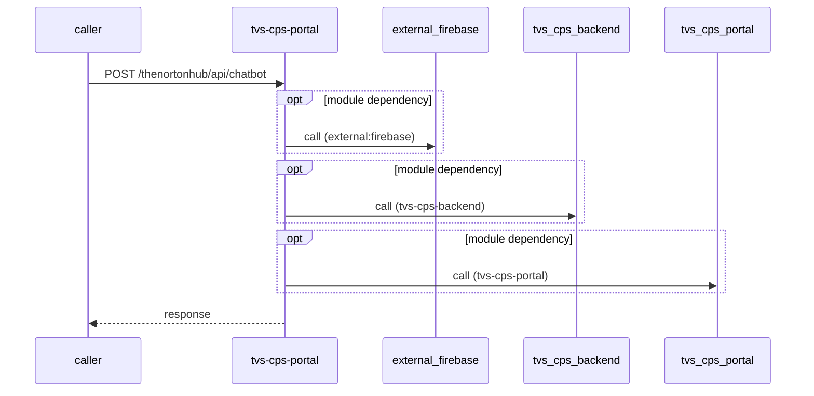

# tvs-cps-portal — Low-Level Design

## Data Model
tvs-cps-portal entities from `data_access` items (0).
N/A — no data access in this repo.

## State Machines
tvs-cps-portal status/state enums found in code (1); transitions are not determinable from code.
- `ClaimUpdateStatus` (`channel-partner-system/src/components/ui/ClaimList/ClaimList.interface.ts:76`): Success, Error

## Business Rules
tvs-cps-portal validation rules on DTO fields (from schema `validation`):
N/A — no declarative validation found; other rules not determinable without manual review.

## Key Classes and Functions
tvs-cps-portal key classes:

| Class / Function | File | Responsibility |
|---|---|---|
| `channel-partner-system/src/app/api/claim/claim-details/[claimId]/route` | `channel-partner-system/next.config.ts` | HTTP handlers |
| `channel-partner-system/src/app/api/claim/master/route` | `channel-partner-system/next.config.ts` | HTTP handlers |
| `channel-partner-system/src/app/api/file/route` | `channel-partner-system/next.config.ts` | HTTP handlers |
| `channel-partner-system/src/app/api/get-image/route` | `channel-partner-system/next.config.ts` | HTTP handlers |
| `channel-partner-system/src/app/api/getEnvConfig/route` | `channel-partner-system/next.config.ts` | HTTP handlers |
| `channel-partner-system/src/app/api/stream/route` | `channel-partner-system/next.config.ts` | HTTP handlers |
| `channel-partner-system/src/app/firebase-messaging-sw` | `channel-partner-system/next.config.ts` | HTTP handlers |
| `channel-partner-system/src/app/api/chatbot/route` | `channel-partner-system/next.config.ts` | HTTP handlers |
| `channel-partner-system/src/app/api/claim/dashboard/route` | `channel-partner-system/next.config.ts` | HTTP handlers |
| `channel-partner-system/src/app/api/claim/update/route` | `channel-partner-system/next.config.ts` | HTTP handlers |
| `channel-partner-system/src/app/api/clear-token/route` | `channel-partner-system/next.config.ts` | HTTP handlers |
| `channel-partner-system/src/app/api/set-token/route` | `channel-partner-system/next.config.ts` | HTTP handlers |

## Sequence Details
tvs-cps-portal sequence for `POST /thenortonhub/api/chatbot` (handler `channel-partner-system/src/app/api/chatbot/route.ts#POST`); downstream calls inside the handler are not traced from code, module-level targets shown as optional.

## Error Handling
tvs-cps-portal error handling: no global exception handler found in code. Status mapping: Unknown.

## Configuration Details
tvs-cps-portal behaviour-relevant config keys (names only; full list in OVERVIEW.md):
- `NEXT_PUBLIC_API_BASE_URL`: points to `tvs-cps-backend`
- `env:NEXT_PUBLIC_API_BASE_URL`: base URL for outbound calls
- `env:RUNTIME_ASSETS_BASE_URL`: base URL for outbound calls
- `env:RUNTIME_CONFIG_BASE_URL`: base URL for outbound calls
- `env:DATABRICKS_TOKEN_URL`: base URL for outbound calls
- `env:DATABRICKS_WORKSPACE_URL`: base URL for outbound calls
- `env:NEXT_PUBLIC_UMS_AUTH_SERVICE_URL`: base URL for outbound calls

## Edge Cases
tvs-cps-portal edge cases: N/A — not determinable from code without manual review.
