# tvsm-auth — Data Flows

## Flow Index
tvsm-auth takes part in 31 end-to-end flow(s) in registry/flows.json; showing the top 25 by confidence, then length.

| flow_id | Name | Role of tvsm-auth | Trigger |
|---|---|---|---|
| location-frontend--external-salesforce-1790d3 | location-frontend → external:salesforce (5 hops) | participant | user action in location-frontend (frontend) |
| location-frontend--external-salesforce-6bf172 | location-frontend → external:salesforce (5 hops) | participant | user action in location-frontend (frontend) |
| location-frontend--external-salesforce-6d9d6e | location-frontend → external:salesforce (4 hops) | participant | user action in location-frontend (frontend) |
| location-frontend--lms-crm-01d477 | location-frontend → lms-crm (5 hops) | participant | user action in location-frontend (frontend) |
| location-frontend--lms-ems | location-frontend → lms-ems (5 hops) | participant | user action in location-frontend (frontend) |
| location-frontend--lms-tvs-credit-309d01 | location-frontend → lms-tvs-credit (5 hops) | participant | user action in location-frontend (frontend) |
| location-frontend--notification-dispatcher-service-48fe37 | location-frontend → notification-dispatcher-service (5 hops) | participant | user action in location-frontend (frontend) |
| location-frontend--notification-service | location-frontend → notification-service (5 hops) | participant | user action in location-frontend (frontend) |
| location-frontend--price-engine-micro-service-backend-17193f | location-frontend → price-engine-micro-service-backend (4 hops) | participant | user action in location-frontend (frontend) |
| tvsm-auth--external-salesforce-2296f2 | tvsm-auth → external:salesforce (3 hops) | entry | scheduled job(s) in tvsm-auth (job-to-call link not resolved): CacheClearScheduler.evictAllCachesAtIntervals, NotificationReminder.sendSMSForFaceLogin |
| tvsm-auth--external-salesforce-725eb1 | tvsm-auth → external:salesforce (4 hops) | entry | scheduled job(s) in tvsm-auth (job-to-call link not resolved): CacheClearScheduler.evictAllCachesAtIntervals, NotificationReminder.sendSMSForFaceLogin |
| tvsm-auth--external-salesforce-8065ac | tvsm-auth → external:salesforce (4 hops) | entry | scheduled job(s) in tvsm-auth (job-to-call link not resolved): CacheClearScheduler.evictAllCachesAtIntervals, NotificationReminder.sendSMSForFaceLogin |
| tvsm-auth--external-salesforce-814f19 | tvsm-auth → external:salesforce (5 hops) | entry | scheduled job(s) in tvsm-auth (job-to-call link not resolved): CacheClearScheduler.evictAllCachesAtIntervals, NotificationReminder.sendSMSForFaceLogin |
| tvsm-auth--external-salesforce-a0035f | tvsm-auth → external:salesforce (4 hops) | entry | scheduled job(s) in tvsm-auth (job-to-call link not resolved): CacheClearScheduler.evictAllCachesAtIntervals, NotificationReminder.sendSMSForFaceLogin |
| tvsm-auth--external-salesforce-c5b275 | tvsm-auth → external:salesforce (5 hops) | entry | scheduled job(s) in tvsm-auth (job-to-call link not resolved): CacheClearScheduler.evictAllCachesAtIntervals, NotificationReminder.sendSMSForFaceLogin |
| tvsm-auth--lms-tvs-credit-be79ba | tvsm-auth → lms-tvs-credit (4 hops) | entry | scheduled job(s) in tvsm-auth (job-to-call link not resolved): CacheClearScheduler.evictAllCachesAtIntervals, NotificationReminder.sendSMSForFaceLogin |
| tvsmbe-location--external-salesforce-2a5435 | tvsmbe-location → external:salesforce (5 hops) | participant | scheduled job(s) in tvsmbe-location (job-to-call link not resolved): CronService.logMetricsPeriodically |
| tvsmbe-location--external-salesforce-7de335 | tvsmbe-location → external:salesforce (5 hops) | participant | scheduled job(s) in tvsmbe-location (job-to-call link not resolved): CronService.logMetricsPeriodically |
| tvsmbe-location--external-salesforce-ae0174 | tvsmbe-location → external:salesforce (4 hops) | participant | scheduled job(s) in tvsmbe-location (job-to-call link not resolved): CronService.logMetricsPeriodically |
| tvsmbe-location--external-salesforce-e29208 | tvsmbe-location → external:salesforce (4 hops) | participant | scheduled job(s) in tvsmbe-location (job-to-call link not resolved): CronService.logMetricsPeriodically |
| tvsmbe-location--external-salesforce-e8e8d4 | tvsmbe-location → external:salesforce (5 hops) | participant | scheduled job(s) in tvsmbe-location (job-to-call link not resolved): CronService.logMetricsPeriodically |
| tvsmbe-location--lms-crm | tvsmbe-location → lms-crm (5 hops) | participant | scheduled job(s) in tvsmbe-location (job-to-call link not resolved): CronService.logMetricsPeriodically |
| tvsmbe-location--lms-tvs-credit-c8d4f4 | tvsmbe-location → lms-tvs-credit (4 hops) | participant | scheduled job(s) in tvsmbe-location (job-to-call link not resolved): CronService.logMetricsPeriodically |
| tvsmbe-location--lms-tvs-credit-f81c06 | tvsmbe-location → lms-tvs-credit (5 hops) | participant | scheduled job(s) in tvsmbe-location (job-to-call link not resolved): CronService.logMetricsPeriodically |
| tvsmbe-location--notification-dispatcher-service | tvsmbe-location → notification-dispatcher-service (5 hops) | participant | scheduled job(s) in tvsmbe-location (job-to-call link not resolved): CronService.logMetricsPeriodically |

## Flow: location-frontend--external-salesforce-1790d3
Summary: Starting at `location-frontend` (user action in location-frontend (frontend)), the flow passes through `tvsmbe-location`, `tvsm-auth`, `notification-service`, `notification-dispatcher-service` and ends at `external:salesforce`, using 4 sync HTTP hop(s) and 1 async event hop(s); tvsm-auth role: participant; confidence medium.

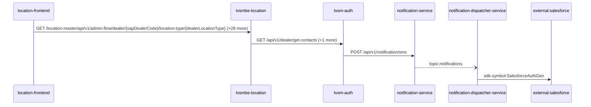

Steps:
| # | From | To | Via | Data (schema names) | Sync/Async | Confidence |
|---|---|---|---|---|---|---|
| 1 | location-frontend | tvsmbe-location | GET /location-master/api/v1/admin-flow/dealer/{sapDealerCode}/location-type/{dealerLocationType}, GET /location-master/api/v1/admin-flow/rejection-comments, GET /location-master/api/v1/admin-flow/summary (+26 more) | CreateDealerRequest, DealerListRequest, DealerResponse, DealerSearchFilterRequest, DealerSearchRequest (+8 more) | sync | high |
| 2 | tvsmbe-location | tvsm-auth | GET /api/v1/dealer/get-contacts, POST /auth/v1/app/token/validate | DealerContacts, TokenVerificationRequest, TokenVerificationResponse | sync | high |
| 3 | tvsm-auth | notification-service | POST /api/v1/notification/sms | NotificationResponse, SMSNotification | sync | medium |
| 4 | notification-service | notification-dispatcher-service | topic:notifications | Unknown | async | medium |
| 5 | notification-dispatcher-service | external:salesforce | sdk-symbol:SalesforceAuthGen | Unknown | sync | high |

Data touched: tvsmbe-location: mongo, mysql; tvsm-auth: mysql; notification-service: mongo; notification-dispatcher-service: mongo

Failure points: hop 1 location-frontend → tvsmbe-location: criticality hard; hop 2 tvsmbe-location → tvsm-auth: criticality hard; hop 3 tvsm-auth → notification-service: criticality hard; hop 4 notification-service → notification-dispatcher-service: criticality async; hop 5 notification-dispatcher-service → external:salesforce: criticality hard

Evidence:
- hop 1 (location-frontend → tvsmbe-location): `location-frontend/src/services/DealerDetailsService.ts:38`, `tvsmbe-location/src/main/java/com/tvsmotor/location_master/controller/AdminFlowController.java:28`, `location-frontend/src/services/DealerDetailsService.ts:69` (+42 more)
- hop 2 (tvsmbe-location → tvsm-auth): `tvsm-auth/src/main/java/com/tvsmotor/tvsmauth/user/profile/api/DealerController.java:42`, `tvsmbe-location/src/main/java/com/tvsmotor/location_master/service/UMSService.java:49`, `tvsmbe-location/src/main/java/com/tvsmotor/location_master/utils/OkHttpUtil.java:35` (+3 more)
- hop 3 (tvsm-auth → notification-service): `notification-service/src/main/java/com/tvsmotor/notification/controller/NotificationController.java:23`, `tvsm-auth/src/main/java/com/tvsmotor/tvsmauth/user/gateway/NotificationGateway.java:38`, `tvsm-auth/src/main/java/com/tvsmotor/tvsmauth/user/gateway/NotificationGateway.java:39` (+1 more)
- hop 4 (notification-service → notification-dispatcher-service): `notification-dispatcher-service/src/main/java/com/tvsmotor/notificationdispatcher/config/ServiceBusConfig.java:33`, `notification-dispatcher-service/src/main/java/com/tvsmotor/notificationdispatcher/config/ServiceBusConfig.java:34`, `notification-service/src/main/java/com/tvsmotor/notification/config/ServiceBusConfig.java:37` (+1 more)
- hop 5 (notification-dispatcher-service → external:salesforce): `notification-dispatcher-service/src/main/java/com/tvsmotor/notificationdispatcher/controller/SalesforceTokenController.java:18`, `notification-dispatcher-service/src/main/java/com/tvsmotor/notificationdispatcher/model/dto/salesforce/SalesforceData.java:5`, `notification-dispatcher-service/src/main/java/com/tvsmotor/notificationdispatcher/model/dto/salesforce/SalesforceTemplateKeys.java:8`

## Flow: location-frontend--external-salesforce-6bf172
Summary: Starting at `location-frontend` (user action in location-frontend (frontend)), the flow passes through `tvsmbe-location`, `tvsm-auth`, `master-data-platform`, `notification-service` and ends at `external:salesforce`, using 5 sync HTTP hop(s) and 0 async event hop(s); tvsm-auth role: participant; confidence medium.

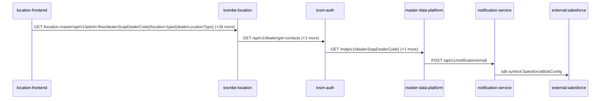

Steps:
| # | From | To | Via | Data (schema names) | Sync/Async | Confidence |
|---|---|---|---|---|---|---|
| 1 | location-frontend | tvsmbe-location | GET /location-master/api/v1/admin-flow/dealer/{sapDealerCode}/location-type/{dealerLocationType}, GET /location-master/api/v1/admin-flow/rejection-comments, GET /location-master/api/v1/admin-flow/summary (+26 more) | CreateDealerRequest, DealerListRequest, DealerResponse, DealerSearchFilterRequest, DealerSearchRequest (+8 more) | sync | high |
| 2 | tvsmbe-location | tvsm-auth | GET /api/v1/dealer/get-contacts, POST /auth/v1/app/token/validate | DealerContacts, TokenVerificationRequest, TokenVerificationResponse | sync | high |
| 3 | tvsm-auth | master-data-platform | GET /mdp/v1/dealer/{sapDealerCode}, GET /mdp/v1/dealer/{sapDealerCode}/branches | GeneralResponse | sync | medium |
| 4 | master-data-platform | notification-service | POST /api/v1/notification/email | EmailNotification, NotificationResponse | sync | high |
| 5 | notification-service | external:salesforce | sdk-symbol:SalesforceBlobConfig | Unknown | sync | high |

Data touched: tvsmbe-location: mongo, mysql; tvsm-auth: mysql; master-data-platform: mysql:xxxx.mysql.database.azure.com:mdp_20230904, other, redis; notification-service: mongo

Failure points: hop 1 location-frontend → tvsmbe-location: criticality hard; hop 2 tvsmbe-location → tvsm-auth: criticality hard; hop 3 tvsm-auth → master-data-platform: criticality hard; hop 4 master-data-platform → notification-service: criticality hard; hop 5 notification-service → external:salesforce: criticality hard

Evidence:
- hop 1 (location-frontend → tvsmbe-location): `location-frontend/src/services/DealerDetailsService.ts:38`, `tvsmbe-location/src/main/java/com/tvsmotor/location_master/controller/AdminFlowController.java:28`, `location-frontend/src/services/DealerDetailsService.ts:69` (+42 more)
- hop 2 (tvsmbe-location → tvsm-auth): `tvsm-auth/src/main/java/com/tvsmotor/tvsmauth/user/profile/api/DealerController.java:42`, `tvsmbe-location/src/main/java/com/tvsmotor/location_master/service/UMSService.java:49`, `tvsmbe-location/src/main/java/com/tvsmotor/location_master/utils/OkHttpUtil.java:35` (+3 more)
- hop 3 (tvsm-auth → master-data-platform): `master-data-platform/src/main/java/com/tvsmotor/mdp/controller/DealerController.java:20`, `tvsm-auth/src/main/java/com/tvsmotor/tvsmauth/user/gateway/MDPServiceClient.java:86`, `tvsm-auth/src/main/java/com/tvsmotor/tvsmauth/user/gateway/MDPServiceClient.java:110` (+2 more)
- hop 4 (master-data-platform → notification-service): `master-data-platform/src/main/java/com/tvsmotor/mdp/service/OkHttpService.java:24`, `master-data-platform/src/main/java/com/tvsmotor/mdp/service/notification_service/NotificationSenderService.java:69`, `notification-service/src/main/java/com/tvsmotor/notification/controller/NotificationController.java:23`
- hop 5 (notification-service → external:salesforce): `notification-service/src/main/java/com/tvsmotor/notification/config/SalesforceBlobConfig.java:10`, `notification-service/src/main/java/com/tvsmotor/notification/cronjobs/SalesforceBlobStatusJob.java:17`, `notification-service/src/main/java/com/tvsmotor/notification/model/dto/salesforce/SalesforceData.java:8`

## Flow: location-frontend--external-salesforce-6d9d6e
Summary: Starting at `location-frontend` (user action in location-frontend (frontend)), the flow passes through `tvsmbe-location`, `tvsm-auth`, `notification-service` and ends at `external:salesforce`, using 4 sync HTTP hop(s) and 0 async event hop(s); tvsm-auth role: participant; confidence medium.

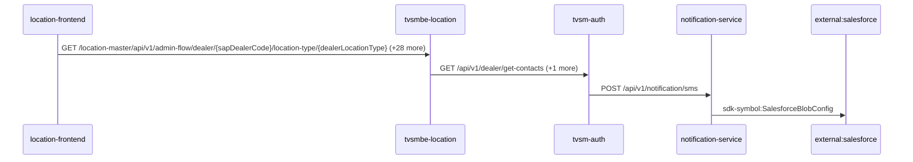

Steps:
| # | From | To | Via | Data (schema names) | Sync/Async | Confidence |
|---|---|---|---|---|---|---|
| 1 | location-frontend | tvsmbe-location | GET /location-master/api/v1/admin-flow/dealer/{sapDealerCode}/location-type/{dealerLocationType}, GET /location-master/api/v1/admin-flow/rejection-comments, GET /location-master/api/v1/admin-flow/summary (+26 more) | CreateDealerRequest, DealerListRequest, DealerResponse, DealerSearchFilterRequest, DealerSearchRequest (+8 more) | sync | high |
| 2 | tvsmbe-location | tvsm-auth | GET /api/v1/dealer/get-contacts, POST /auth/v1/app/token/validate | DealerContacts, TokenVerificationRequest, TokenVerificationResponse | sync | high |
| 3 | tvsm-auth | notification-service | POST /api/v1/notification/sms | NotificationResponse, SMSNotification | sync | medium |
| 4 | notification-service | external:salesforce | sdk-symbol:SalesforceBlobConfig | Unknown | sync | high |

Data touched: tvsmbe-location: mongo, mysql; tvsm-auth: mysql; notification-service: mongo

Failure points: hop 1 location-frontend → tvsmbe-location: criticality hard; hop 2 tvsmbe-location → tvsm-auth: criticality hard; hop 3 tvsm-auth → notification-service: criticality hard; hop 4 notification-service → external:salesforce: criticality hard

Evidence:
- hop 1 (location-frontend → tvsmbe-location): `location-frontend/src/services/DealerDetailsService.ts:38`, `tvsmbe-location/src/main/java/com/tvsmotor/location_master/controller/AdminFlowController.java:28`, `location-frontend/src/services/DealerDetailsService.ts:69` (+42 more)
- hop 2 (tvsmbe-location → tvsm-auth): `tvsm-auth/src/main/java/com/tvsmotor/tvsmauth/user/profile/api/DealerController.java:42`, `tvsmbe-location/src/main/java/com/tvsmotor/location_master/service/UMSService.java:49`, `tvsmbe-location/src/main/java/com/tvsmotor/location_master/utils/OkHttpUtil.java:35` (+3 more)
- hop 3 (tvsm-auth → notification-service): `notification-service/src/main/java/com/tvsmotor/notification/controller/NotificationController.java:23`, `tvsm-auth/src/main/java/com/tvsmotor/tvsmauth/user/gateway/NotificationGateway.java:38`, `tvsm-auth/src/main/java/com/tvsmotor/tvsmauth/user/gateway/NotificationGateway.java:39` (+1 more)
- hop 4 (notification-service → external:salesforce): `notification-service/src/main/java/com/tvsmotor/notification/config/SalesforceBlobConfig.java:10`, `notification-service/src/main/java/com/tvsmotor/notification/cronjobs/SalesforceBlobStatusJob.java:17`, `notification-service/src/main/java/com/tvsmotor/notification/model/dto/salesforce/SalesforceData.java:8`

## Flow: location-frontend--lms-crm-01d477
Summary: Starting at `location-frontend` (user action in location-frontend (frontend)), the flow passes through `tvsmbe-location`, `tvsm-auth`, `master-data-platform`, `lms-process` and ends at `lms-crm`, using 3 sync HTTP hop(s) and 2 async event hop(s); tvsm-auth role: participant; confidence medium; truncated at the depth cap.

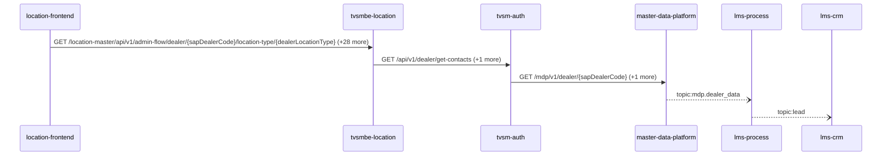

Steps:
| # | From | To | Via | Data (schema names) | Sync/Async | Confidence |
|---|---|---|---|---|---|---|
| 1 | location-frontend | tvsmbe-location | GET /location-master/api/v1/admin-flow/dealer/{sapDealerCode}/location-type/{dealerLocationType}, GET /location-master/api/v1/admin-flow/rejection-comments, GET /location-master/api/v1/admin-flow/summary (+26 more) | CreateDealerRequest, DealerListRequest, DealerResponse, DealerSearchFilterRequest, DealerSearchRequest (+8 more) | sync | high |
| 2 | tvsmbe-location | tvsm-auth | GET /api/v1/dealer/get-contacts, POST /auth/v1/app/token/validate | DealerContacts, TokenVerificationRequest, TokenVerificationResponse | sync | high |
| 3 | tvsm-auth | master-data-platform | GET /mdp/v1/dealer/{sapDealerCode}, GET /mdp/v1/dealer/{sapDealerCode}/branches | GeneralResponse | sync | medium |
| 4 | master-data-platform | lms-process | topic:mdp.dealer_data | DealerData | async | medium |
| 5 | lms-process | lms-crm | topic:lead | Unknown | async | medium |

Data touched: tvsmbe-location: mongo, mysql; tvsm-auth: mysql; master-data-platform: mysql:xxxx.mysql.database.azure.com:mdp_20230904, other, redis; lms-process: mssql; lms-crm: mssql

Failure points: hop 1 location-frontend → tvsmbe-location: criticality hard; hop 2 tvsmbe-location → tvsm-auth: criticality hard; hop 3 tvsm-auth → master-data-platform: criticality hard; hop 4 master-data-platform → lms-process: criticality async; hop 5 lms-process → lms-crm: criticality async

Evidence:
- hop 1 (location-frontend → tvsmbe-location): `location-frontend/src/services/DealerDetailsService.ts:38`, `tvsmbe-location/src/main/java/com/tvsmotor/location_master/controller/AdminFlowController.java:28`, `location-frontend/src/services/DealerDetailsService.ts:69` (+42 more)
- hop 2 (tvsmbe-location → tvsm-auth): `tvsm-auth/src/main/java/com/tvsmotor/tvsmauth/user/profile/api/DealerController.java:42`, `tvsmbe-location/src/main/java/com/tvsmotor/location_master/service/UMSService.java:49`, `tvsmbe-location/src/main/java/com/tvsmotor/location_master/utils/OkHttpUtil.java:35` (+3 more)
- hop 3 (tvsm-auth → master-data-platform): `master-data-platform/src/main/java/com/tvsmotor/mdp/controller/DealerController.java:20`, `tvsm-auth/src/main/java/com/tvsmotor/tvsmauth/user/gateway/MDPServiceClient.java:86`, `tvsm-auth/src/main/java/com/tvsmotor/tvsmauth/user/gateway/MDPServiceClient.java:110` (+2 more)
- hop 4 (master-data-platform → lms-process): `lms_process/processLeadService/Const/Constants.cs:7`, `lms_process/processLeadService/ListenerService/MdpConsumer.cs:42`, `master-data-platform/src/main/java/com/tvsmotor/mdp/config/DealerMasterServiceBusConfig.java:26` (+1 more)
- hop 5 (lms-process → lms-crm): `lms_crm/ListenerService/CrmListenerService.cs:44`, `lms_crm/Utils/Constants.cs:16`, `lms_process/processLeadService/Const/Constants.cs:6` (+1 more)

## Flow: location-frontend--lms-ems
Summary: Starting at `location-frontend` (user action in location-frontend (frontend)), the flow passes through `tvsmbe-location`, `tvsm-auth`, `master-data-platform`, `lms-process` and ends at `lms-ems`, using 3 sync HTTP hop(s) and 2 async event hop(s); tvsm-auth role: participant; confidence medium; truncated at the depth cap.


Steps:
| # | From | To | Via | Data (schema names) | Sync/Async | Confidence |
|---|---|---|---|---|---|---|
| 1 | location-frontend | tvsmbe-location | GET /location-master/api/v1/admin-flow/dealer/{sapDealerCode}/location-type/{dealerLocationType}, GET /location-master/api/v1/admin-flow/rejection-comments, GET /location-master/api/v1/admin-flow/summary (+26 more) | CreateDealerRequest, DealerListRequest, DealerResponse, DealerSearchFilterRequest, DealerSearchRequest (+8 more) | sync | high |
| 2 | tvsmbe-location | tvsm-auth | GET /api/v1/dealer/get-contacts, POST /auth/v1/app/token/validate | DealerContacts, TokenVerificationRequest, TokenVerificationResponse | sync | high |
| 3 | tvsm-auth | master-data-platform | GET /mdp/v1/dealer/{sapDealerCode}, GET /mdp/v1/dealer/{sapDealerCode}/branches | GeneralResponse | sync | medium |
| 4 | master-data-platform | lms-process | topic:mdp.dealer_data | DealerData | async | medium |
| 5 | lms-process | lms-ems | topic:lead | Unknown | async | medium |

Data touched: tvsmbe-location: mongo, mysql; tvsm-auth: mysql; master-data-platform: mysql:xxxx.mysql.database.azure.com:mdp_20230904, other, redis; lms-process: mssql; lms-ems: mssql

Failure points: hop 1 location-frontend → tvsmbe-location: criticality hard; hop 2 tvsmbe-location → tvsm-auth: criticality hard; hop 3 tvsm-auth → master-data-platform: criticality hard; hop 4 master-data-platform → lms-process: criticality async; hop 5 lms-process → lms-ems: criticality async

Evidence:
- hop 1 (location-frontend → tvsmbe-location): `location-frontend/src/services/DealerDetailsService.ts:38`, `tvsmbe-location/src/main/java/com/tvsmotor/location_master/controller/AdminFlowController.java:28`, `location-frontend/src/services/DealerDetailsService.ts:69` (+42 more)
- hop 2 (tvsmbe-location → tvsm-auth): `tvsm-auth/src/main/java/com/tvsmotor/tvsmauth/user/profile/api/DealerController.java:42`, `tvsmbe-location/src/main/java/com/tvsmotor/location_master/service/UMSService.java:49`, `tvsmbe-location/src/main/java/com/tvsmotor/location_master/utils/OkHttpUtil.java:35` (+3 more)
- hop 3 (tvsm-auth → master-data-platform): `master-data-platform/src/main/java/com/tvsmotor/mdp/controller/DealerController.java:20`, `tvsm-auth/src/main/java/com/tvsmotor/tvsmauth/user/gateway/MDPServiceClient.java:86`, `tvsm-auth/src/main/java/com/tvsmotor/tvsmauth/user/gateway/MDPServiceClient.java:110` (+2 more)
- hop 4 (master-data-platform → lms-process): `lms_process/processLeadService/Const/Constants.cs:7`, `lms_process/processLeadService/ListenerService/MdpConsumer.cs:42`, `master-data-platform/src/main/java/com/tvsmotor/mdp/config/DealerMasterServiceBusConfig.java:26` (+1 more)
- hop 5 (lms-process → lms-ems): `lms_ems/emsService/Const/Constants.cs:14`, `lms_ems/emsService/ListenerService/EmsListenerService.cs:43`, `lms_process/processLeadService/Const/Constants.cs:6` (+1 more)

## Flow: location-frontend--lms-tvs-credit-309d01
Summary: Starting at `location-frontend` (user action in location-frontend (frontend)), the flow passes through `tvsmbe-location`, `tvsm-auth`, `master-data-platform`, `lms-process` and ends at `lms-tvs-credit`, using 3 sync HTTP hop(s) and 2 async event hop(s); tvsm-auth role: participant; confidence medium.

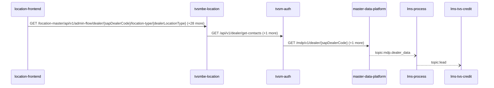

Steps:
| # | From | To | Via | Data (schema names) | Sync/Async | Confidence |
|---|---|---|---|---|---|---|
| 1 | location-frontend | tvsmbe-location | GET /location-master/api/v1/admin-flow/dealer/{sapDealerCode}/location-type/{dealerLocationType}, GET /location-master/api/v1/admin-flow/rejection-comments, GET /location-master/api/v1/admin-flow/summary (+26 more) | CreateDealerRequest, DealerListRequest, DealerResponse, DealerSearchFilterRequest, DealerSearchRequest (+8 more) | sync | high |
| 2 | tvsmbe-location | tvsm-auth | GET /api/v1/dealer/get-contacts, POST /auth/v1/app/token/validate | DealerContacts, TokenVerificationRequest, TokenVerificationResponse | sync | high |
| 3 | tvsm-auth | master-data-platform | GET /mdp/v1/dealer/{sapDealerCode}, GET /mdp/v1/dealer/{sapDealerCode}/branches | GeneralResponse | sync | medium |
| 4 | master-data-platform | lms-process | topic:mdp.dealer_data | DealerData | async | medium |
| 5 | lms-process | lms-tvs-credit | topic:lead | Unknown | async | medium |

Data touched: tvsmbe-location: mongo, mysql; tvsm-auth: mysql; master-data-platform: mysql:xxxx.mysql.database.azure.com:mdp_20230904, other, redis; lms-process: mssql; lms-tvs-credit: mssql

Failure points: hop 1 location-frontend → tvsmbe-location: criticality hard; hop 2 tvsmbe-location → tvsm-auth: criticality hard; hop 3 tvsm-auth → master-data-platform: criticality hard; hop 4 master-data-platform → lms-process: criticality async; hop 5 lms-process → lms-tvs-credit: criticality async

Evidence:
- hop 1 (location-frontend → tvsmbe-location): `location-frontend/src/services/DealerDetailsService.ts:38`, `tvsmbe-location/src/main/java/com/tvsmotor/location_master/controller/AdminFlowController.java:28`, `location-frontend/src/services/DealerDetailsService.ts:69` (+42 more)
- hop 2 (tvsmbe-location → tvsm-auth): `tvsm-auth/src/main/java/com/tvsmotor/tvsmauth/user/profile/api/DealerController.java:42`, `tvsmbe-location/src/main/java/com/tvsmotor/location_master/service/UMSService.java:49`, `tvsmbe-location/src/main/java/com/tvsmotor/location_master/utils/OkHttpUtil.java:35` (+3 more)
- hop 3 (tvsm-auth → master-data-platform): `master-data-platform/src/main/java/com/tvsmotor/mdp/controller/DealerController.java:20`, `tvsm-auth/src/main/java/com/tvsmotor/tvsmauth/user/gateway/MDPServiceClient.java:86`, `tvsm-auth/src/main/java/com/tvsmotor/tvsmauth/user/gateway/MDPServiceClient.java:110` (+2 more)
- hop 4 (master-data-platform → lms-process): `lms_process/processLeadService/Const/Constants.cs:7`, `lms_process/processLeadService/ListenerService/MdpConsumer.cs:42`, `master-data-platform/src/main/java/com/tvsmotor/mdp/config/DealerMasterServiceBusConfig.java:26` (+1 more)
- hop 5 (lms-process → lms-tvs-credit): `lms_process/processLeadService/Const/Constants.cs:6`, `lms_process/processLeadService/Services/TwoWheelerService.cs:97`, `lms_tvs_credit/lms_tvs_credit/ListenerService/TvscreditListenerService.cs:46` (+1 more)

## Flow: location-frontend--notification-dispatcher-service-48fe37
Summary: Starting at `location-frontend` (user action in location-frontend (frontend)), the flow passes through `tvsmbe-location`, `tvsm-auth`, `master-data-platform`, `notification-service` and ends at `notification-dispatcher-service`, using 4 sync HTTP hop(s) and 1 async event hop(s); tvsm-auth role: participant; confidence medium; truncated at the depth cap.

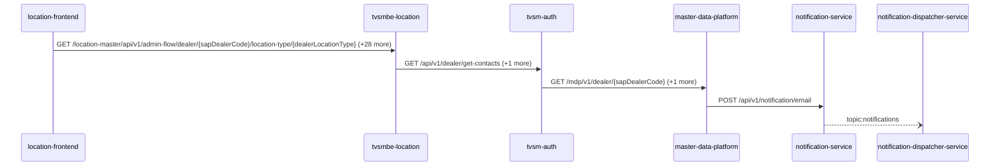

Steps:
| # | From | To | Via | Data (schema names) | Sync/Async | Confidence |
|---|---|---|---|---|---|---|
| 1 | location-frontend | tvsmbe-location | GET /location-master/api/v1/admin-flow/dealer/{sapDealerCode}/location-type/{dealerLocationType}, GET /location-master/api/v1/admin-flow/rejection-comments, GET /location-master/api/v1/admin-flow/summary (+26 more) | CreateDealerRequest, DealerListRequest, DealerResponse, DealerSearchFilterRequest, DealerSearchRequest (+8 more) | sync | high |
| 2 | tvsmbe-location | tvsm-auth | GET /api/v1/dealer/get-contacts, POST /auth/v1/app/token/validate | DealerContacts, TokenVerificationRequest, TokenVerificationResponse | sync | high |
| 3 | tvsm-auth | master-data-platform | GET /mdp/v1/dealer/{sapDealerCode}, GET /mdp/v1/dealer/{sapDealerCode}/branches | GeneralResponse | sync | medium |
| 4 | master-data-platform | notification-service | POST /api/v1/notification/email | EmailNotification, NotificationResponse | sync | high |
| 5 | notification-service | notification-dispatcher-service | topic:notifications | Unknown | async | medium |

Data touched: tvsmbe-location: mongo, mysql; tvsm-auth: mysql; master-data-platform: mysql:xxxx.mysql.database.azure.com:mdp_20230904, other, redis; notification-service: mongo; notification-dispatcher-service: mongo

Failure points: hop 1 location-frontend → tvsmbe-location: criticality hard; hop 2 tvsmbe-location → tvsm-auth: criticality hard; hop 3 tvsm-auth → master-data-platform: criticality hard; hop 4 master-data-platform → notification-service: criticality hard; hop 5 notification-service → notification-dispatcher-service: criticality async

Evidence:
- hop 1 (location-frontend → tvsmbe-location): `location-frontend/src/services/DealerDetailsService.ts:38`, `tvsmbe-location/src/main/java/com/tvsmotor/location_master/controller/AdminFlowController.java:28`, `location-frontend/src/services/DealerDetailsService.ts:69` (+42 more)
- hop 2 (tvsmbe-location → tvsm-auth): `tvsm-auth/src/main/java/com/tvsmotor/tvsmauth/user/profile/api/DealerController.java:42`, `tvsmbe-location/src/main/java/com/tvsmotor/location_master/service/UMSService.java:49`, `tvsmbe-location/src/main/java/com/tvsmotor/location_master/utils/OkHttpUtil.java:35` (+3 more)
- hop 3 (tvsm-auth → master-data-platform): `master-data-platform/src/main/java/com/tvsmotor/mdp/controller/DealerController.java:20`, `tvsm-auth/src/main/java/com/tvsmotor/tvsmauth/user/gateway/MDPServiceClient.java:86`, `tvsm-auth/src/main/java/com/tvsmotor/tvsmauth/user/gateway/MDPServiceClient.java:110` (+2 more)
- hop 4 (master-data-platform → notification-service): `master-data-platform/src/main/java/com/tvsmotor/mdp/service/OkHttpService.java:24`, `master-data-platform/src/main/java/com/tvsmotor/mdp/service/notification_service/NotificationSenderService.java:69`, `notification-service/src/main/java/com/tvsmotor/notification/controller/NotificationController.java:23`
- hop 5 (notification-service → notification-dispatcher-service): `notification-dispatcher-service/src/main/java/com/tvsmotor/notificationdispatcher/config/ServiceBusConfig.java:33`, `notification-dispatcher-service/src/main/java/com/tvsmotor/notificationdispatcher/config/ServiceBusConfig.java:34`, `notification-service/src/main/java/com/tvsmotor/notification/config/ServiceBusConfig.java:37` (+1 more)

## Flow: location-frontend--notification-service
Summary: Starting at `location-frontend` (user action in location-frontend (frontend)), the flow passes through `tvsmbe-location`, `tvsm-auth`, `master-data-platform`, `tvsmbe-mdp-bff` and ends at `notification-service`, using 4 sync HTTP hop(s) and 1 async event hop(s); tvsm-auth role: participant; confidence medium; truncated at the depth cap.

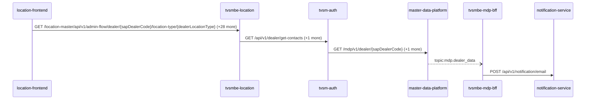

Steps:
| # | From | To | Via | Data (schema names) | Sync/Async | Confidence |
|---|---|---|---|---|---|---|
| 1 | location-frontend | tvsmbe-location | GET /location-master/api/v1/admin-flow/dealer/{sapDealerCode}/location-type/{dealerLocationType}, GET /location-master/api/v1/admin-flow/rejection-comments, GET /location-master/api/v1/admin-flow/summary (+26 more) | CreateDealerRequest, DealerListRequest, DealerResponse, DealerSearchFilterRequest, DealerSearchRequest (+8 more) | sync | high |
| 2 | tvsmbe-location | tvsm-auth | GET /api/v1/dealer/get-contacts, POST /auth/v1/app/token/validate | DealerContacts, TokenVerificationRequest, TokenVerificationResponse | sync | high |
| 3 | tvsm-auth | master-data-platform | GET /mdp/v1/dealer/{sapDealerCode}, GET /mdp/v1/dealer/{sapDealerCode}/branches | GeneralResponse | sync | medium |
| 4 | master-data-platform | tvsmbe-mdp-bff | topic:mdp.dealer_data | DealerData | async | medium |
| 5 | tvsmbe-mdp-bff | notification-service | POST /api/v1/notification/email | EmailNotification, NotificationResponse | sync | high |

Data touched: tvsmbe-location: mongo, mysql; tvsm-auth: mysql; master-data-platform: mysql:xxxx.mysql.database.azure.com:mdp_20230904, other, redis; tvsmbe-mdp-bff: mysql, mysql:tvsmazcmndbsdev01-ci.mysql.database.azure.com:tvsmazebffsdbdev01; notification-service: mongo

Failure points: hop 1 location-frontend → tvsmbe-location: criticality hard; hop 2 tvsmbe-location → tvsm-auth: criticality hard; hop 3 tvsm-auth → master-data-platform: criticality hard; hop 4 master-data-platform → tvsmbe-mdp-bff: criticality async; hop 5 tvsmbe-mdp-bff → notification-service: criticality hard

Evidence:
- hop 1 (location-frontend → tvsmbe-location): `location-frontend/src/services/DealerDetailsService.ts:38`, `tvsmbe-location/src/main/java/com/tvsmotor/location_master/controller/AdminFlowController.java:28`, `location-frontend/src/services/DealerDetailsService.ts:69` (+42 more)
- hop 2 (tvsmbe-location → tvsm-auth): `tvsm-auth/src/main/java/com/tvsmotor/tvsmauth/user/profile/api/DealerController.java:42`, `tvsmbe-location/src/main/java/com/tvsmotor/location_master/service/UMSService.java:49`, `tvsmbe-location/src/main/java/com/tvsmotor/location_master/utils/OkHttpUtil.java:35` (+3 more)
- hop 3 (tvsm-auth → master-data-platform): `master-data-platform/src/main/java/com/tvsmotor/mdp/controller/DealerController.java:20`, `tvsm-auth/src/main/java/com/tvsmotor/tvsmauth/user/gateway/MDPServiceClient.java:86`, `tvsm-auth/src/main/java/com/tvsmotor/tvsmauth/user/gateway/MDPServiceClient.java:110` (+2 more)
- hop 4 (master-data-platform → tvsmbe-mdp-bff): `master-data-platform/src/main/java/com/tvsmotor/mdp/config/DealerMasterServiceBusConfig.java:26`, `master-data-platform/src/main/java/com/tvsmotor/mdp/config/DealerMasterServiceBusConfig.java:27`, `tvsmbe-mdp-bff/outbound/src/main/java/com/tvsmotor/mdp_bff/outbound/config/BffServiceBusConfig.java:24` (+1 more)
- hop 5 (tvsmbe-mdp-bff → notification-service): `notification-service/src/main/java/com/tvsmotor/notification/controller/NotificationController.java:23`, `tvsmbe-mdp-bff/outbound/src/main/java/com/tvsmotor/mdp_bff/outbound/service/NotificationSenderService.java:46`, `tvsmbe-mdp-bff/outbound/src/main/java/com/tvsmotor/mdp_bff/outbound/service/OkHttpService.java:88`

## Flow: location-frontend--price-engine-micro-service-backend-17193f
Summary: Starting at `location-frontend` (user action in location-frontend (frontend)), the flow passes through `tvsmbe-location`, `tvsm-auth`, `master-data-platform` and ends at `price-engine-micro-service-backend`, using 3 sync HTTP hop(s) and 1 async event hop(s); tvsm-auth role: participant; confidence medium.

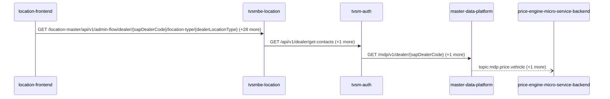

Steps:
| # | From | To | Via | Data (schema names) | Sync/Async | Confidence |
|---|---|---|---|---|---|---|
| 1 | location-frontend | tvsmbe-location | GET /location-master/api/v1/admin-flow/dealer/{sapDealerCode}/location-type/{dealerLocationType}, GET /location-master/api/v1/admin-flow/rejection-comments, GET /location-master/api/v1/admin-flow/summary (+26 more) | CreateDealerRequest, DealerListRequest, DealerResponse, DealerSearchFilterRequest, DealerSearchRequest (+8 more) | sync | high |
| 2 | tvsmbe-location | tvsm-auth | GET /api/v1/dealer/get-contacts, POST /auth/v1/app/token/validate | DealerContacts, TokenVerificationRequest, TokenVerificationResponse | sync | high |
| 3 | tvsm-auth | master-data-platform | GET /mdp/v1/dealer/{sapDealerCode}, GET /mdp/v1/dealer/{sapDealerCode}/branches | GeneralResponse | sync | medium |
| 4 | master-data-platform | price-engine-micro-service-backend | topic:mdp.price.vehicle, topic:mdp.product.vehicle | PriceVehicleData, ServiceBusOutgoingMessagePayloadBody | async | medium |

Data touched: tvsmbe-location: mongo, mysql; tvsm-auth: mysql; master-data-platform: mysql:xxxx.mysql.database.azure.com:mdp_20230904, other, redis; price-engine-micro-service-backend: mongo, redis

Failure points: hop 1 location-frontend → tvsmbe-location: criticality hard; hop 2 tvsmbe-location → tvsm-auth: criticality hard; hop 3 tvsm-auth → master-data-platform: criticality hard; hop 4 master-data-platform → price-engine-micro-service-backend: criticality async

Evidence:
- hop 1 (location-frontend → tvsmbe-location): `location-frontend/src/services/DealerDetailsService.ts:38`, `tvsmbe-location/src/main/java/com/tvsmotor/location_master/controller/AdminFlowController.java:28`, `location-frontend/src/services/DealerDetailsService.ts:69` (+42 more)
- hop 2 (tvsmbe-location → tvsm-auth): `tvsm-auth/src/main/java/com/tvsmotor/tvsmauth/user/profile/api/DealerController.java:42`, `tvsmbe-location/src/main/java/com/tvsmotor/location_master/service/UMSService.java:49`, `tvsmbe-location/src/main/java/com/tvsmotor/location_master/utils/OkHttpUtil.java:35` (+3 more)
- hop 3 (tvsm-auth → master-data-platform): `master-data-platform/src/main/java/com/tvsmotor/mdp/controller/DealerController.java:20`, `tvsm-auth/src/main/java/com/tvsmotor/tvsmauth/user/gateway/MDPServiceClient.java:86`, `tvsm-auth/src/main/java/com/tvsmotor/tvsmauth/user/gateway/MDPServiceClient.java:110` (+2 more)
- hop 4 (master-data-platform → price-engine-micro-service-backend): `Price-Engine-MicroService-Backend/sonar-exclusion-function/service-bus/implemeters/price-service-bus-implementer.ts:18`, `master-data-platform/src/main/java/com/tvsmotor/mdp/price/config/PriceVehicleServiceBusConfig.java:19`, `master-data-platform/src/main/java/com/tvsmotor/mdp/price/config/PriceVehicleServiceBusConfig.java:20` (+3 more)

## Flow: tvsm-auth--external-salesforce-2296f2
Summary: Starting at `tvsm-auth` (scheduled job(s) in tvsm-auth (job-to-call link not resolved): CacheClearScheduler.evictAllCachesAtIntervals, NotificationReminder.sendSMSForFaceLogin), the flow passes through `master-data-platform`, `notification-service` and ends at `external:salesforce`, using 3 sync HTTP hop(s) and 0 async event hop(s); tvsm-auth role: entry; confidence medium.

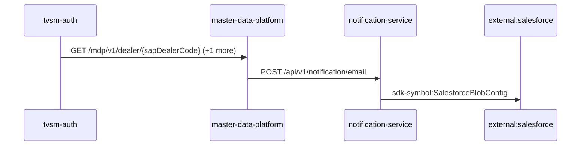

Steps:
| # | From | To | Via | Data (schema names) | Sync/Async | Confidence |
|---|---|---|---|---|---|---|
| 1 | tvsm-auth | master-data-platform | GET /mdp/v1/dealer/{sapDealerCode}, GET /mdp/v1/dealer/{sapDealerCode}/branches | GeneralResponse | sync | medium |
| 2 | master-data-platform | notification-service | POST /api/v1/notification/email | EmailNotification, NotificationResponse | sync | high |
| 3 | notification-service | external:salesforce | sdk-symbol:SalesforceBlobConfig | Unknown | sync | high |

Data touched: tvsm-auth: mysql; master-data-platform: mysql:xxxx.mysql.database.azure.com:mdp_20230904, other, redis; notification-service: mongo

Failure points: hop 1 tvsm-auth → master-data-platform: criticality hard; hop 2 master-data-platform → notification-service: criticality hard; hop 3 notification-service → external:salesforce: criticality hard

Evidence:
- hop 1 (tvsm-auth → master-data-platform): `master-data-platform/src/main/java/com/tvsmotor/mdp/controller/DealerController.java:20`, `tvsm-auth/src/main/java/com/tvsmotor/tvsmauth/user/gateway/MDPServiceClient.java:86`, `tvsm-auth/src/main/java/com/tvsmotor/tvsmauth/user/gateway/MDPServiceClient.java:110` (+2 more)
- hop 2 (master-data-platform → notification-service): `master-data-platform/src/main/java/com/tvsmotor/mdp/service/OkHttpService.java:24`, `master-data-platform/src/main/java/com/tvsmotor/mdp/service/notification_service/NotificationSenderService.java:69`, `notification-service/src/main/java/com/tvsmotor/notification/controller/NotificationController.java:23`
- hop 3 (notification-service → external:salesforce): `notification-service/src/main/java/com/tvsmotor/notification/config/SalesforceBlobConfig.java:10`, `notification-service/src/main/java/com/tvsmotor/notification/cronjobs/SalesforceBlobStatusJob.java:17`, `notification-service/src/main/java/com/tvsmotor/notification/model/dto/salesforce/SalesforceData.java:8`

## Flow: tvsm-auth--external-salesforce-725eb1
Summary: Starting at `tvsm-auth` (scheduled job(s) in tvsm-auth (job-to-call link not resolved): CacheClearScheduler.evictAllCachesAtIntervals, NotificationReminder.sendSMSForFaceLogin), the flow passes through `master-data-platform`, `tvsmbe-mdp-bff`, `notification-service` and ends at `external:salesforce`, using 3 sync HTTP hop(s) and 1 async event hop(s); tvsm-auth role: entry; confidence medium.

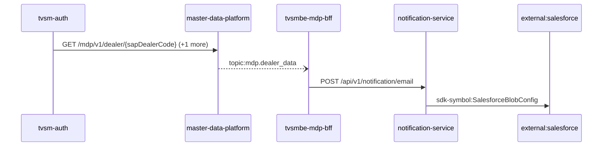

Steps:
| # | From | To | Via | Data (schema names) | Sync/Async | Confidence |
|---|---|---|---|---|---|---|
| 1 | tvsm-auth | master-data-platform | GET /mdp/v1/dealer/{sapDealerCode}, GET /mdp/v1/dealer/{sapDealerCode}/branches | GeneralResponse | sync | medium |
| 2 | master-data-platform | tvsmbe-mdp-bff | topic:mdp.dealer_data | DealerData | async | medium |
| 3 | tvsmbe-mdp-bff | notification-service | POST /api/v1/notification/email | EmailNotification, NotificationResponse | sync | high |
| 4 | notification-service | external:salesforce | sdk-symbol:SalesforceBlobConfig | Unknown | sync | high |

Data touched: tvsm-auth: mysql; master-data-platform: mysql:xxxx.mysql.database.azure.com:mdp_20230904, other, redis; tvsmbe-mdp-bff: mysql, mysql:tvsmazcmndbsdev01-ci.mysql.database.azure.com:tvsmazebffsdbdev01; notification-service: mongo

Failure points: hop 1 tvsm-auth → master-data-platform: criticality hard; hop 2 master-data-platform → tvsmbe-mdp-bff: criticality async; hop 3 tvsmbe-mdp-bff → notification-service: criticality hard; hop 4 notification-service → external:salesforce: criticality hard

Evidence:
- hop 1 (tvsm-auth → master-data-platform): `master-data-platform/src/main/java/com/tvsmotor/mdp/controller/DealerController.java:20`, `tvsm-auth/src/main/java/com/tvsmotor/tvsmauth/user/gateway/MDPServiceClient.java:86`, `tvsm-auth/src/main/java/com/tvsmotor/tvsmauth/user/gateway/MDPServiceClient.java:110` (+2 more)
- hop 2 (master-data-platform → tvsmbe-mdp-bff): `master-data-platform/src/main/java/com/tvsmotor/mdp/config/DealerMasterServiceBusConfig.java:26`, `master-data-platform/src/main/java/com/tvsmotor/mdp/config/DealerMasterServiceBusConfig.java:27`, `tvsmbe-mdp-bff/outbound/src/main/java/com/tvsmotor/mdp_bff/outbound/config/BffServiceBusConfig.java:24` (+1 more)
- hop 3 (tvsmbe-mdp-bff → notification-service): `notification-service/src/main/java/com/tvsmotor/notification/controller/NotificationController.java:23`, `tvsmbe-mdp-bff/outbound/src/main/java/com/tvsmotor/mdp_bff/outbound/service/NotificationSenderService.java:46`, `tvsmbe-mdp-bff/outbound/src/main/java/com/tvsmotor/mdp_bff/outbound/service/OkHttpService.java:88`
- hop 4 (notification-service → external:salesforce): `notification-service/src/main/java/com/tvsmotor/notification/config/SalesforceBlobConfig.java:10`, `notification-service/src/main/java/com/tvsmotor/notification/cronjobs/SalesforceBlobStatusJob.java:17`, `notification-service/src/main/java/com/tvsmotor/notification/model/dto/salesforce/SalesforceData.java:8`

## Flow: tvsm-auth--external-salesforce-8065ac
Summary: Starting at `tvsm-auth` (scheduled job(s) in tvsm-auth (job-to-call link not resolved): CacheClearScheduler.evictAllCachesAtIntervals, NotificationReminder.sendSMSForFaceLogin), the flow passes through `master-data-platform`, `notification-service`, `notification-dispatcher-service` and ends at `external:salesforce`, using 3 sync HTTP hop(s) and 1 async event hop(s); tvsm-auth role: entry; confidence medium.

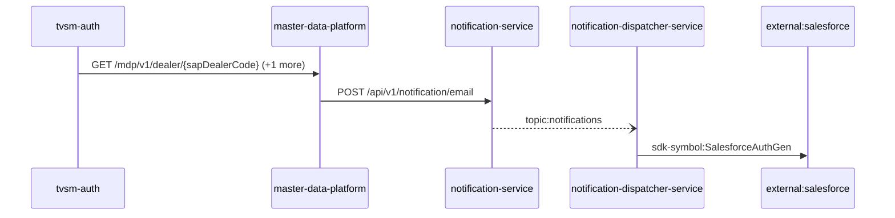

Steps:
| # | From | To | Via | Data (schema names) | Sync/Async | Confidence |
|---|---|---|---|---|---|---|
| 1 | tvsm-auth | master-data-platform | GET /mdp/v1/dealer/{sapDealerCode}, GET /mdp/v1/dealer/{sapDealerCode}/branches | GeneralResponse | sync | medium |
| 2 | master-data-platform | notification-service | POST /api/v1/notification/email | EmailNotification, NotificationResponse | sync | high |
| 3 | notification-service | notification-dispatcher-service | topic:notifications | Unknown | async | medium |
| 4 | notification-dispatcher-service | external:salesforce | sdk-symbol:SalesforceAuthGen | Unknown | sync | high |

Data touched: tvsm-auth: mysql; master-data-platform: mysql:xxxx.mysql.database.azure.com:mdp_20230904, other, redis; notification-service: mongo; notification-dispatcher-service: mongo

Failure points: hop 1 tvsm-auth → master-data-platform: criticality hard; hop 2 master-data-platform → notification-service: criticality hard; hop 3 notification-service → notification-dispatcher-service: criticality async; hop 4 notification-dispatcher-service → external:salesforce: criticality hard

Evidence:
- hop 1 (tvsm-auth → master-data-platform): `master-data-platform/src/main/java/com/tvsmotor/mdp/controller/DealerController.java:20`, `tvsm-auth/src/main/java/com/tvsmotor/tvsmauth/user/gateway/MDPServiceClient.java:86`, `tvsm-auth/src/main/java/com/tvsmotor/tvsmauth/user/gateway/MDPServiceClient.java:110` (+2 more)
- hop 2 (master-data-platform → notification-service): `master-data-platform/src/main/java/com/tvsmotor/mdp/service/OkHttpService.java:24`, `master-data-platform/src/main/java/com/tvsmotor/mdp/service/notification_service/NotificationSenderService.java:69`, `notification-service/src/main/java/com/tvsmotor/notification/controller/NotificationController.java:23`
- hop 3 (notification-service → notification-dispatcher-service): `notification-dispatcher-service/src/main/java/com/tvsmotor/notificationdispatcher/config/ServiceBusConfig.java:33`, `notification-dispatcher-service/src/main/java/com/tvsmotor/notificationdispatcher/config/ServiceBusConfig.java:34`, `notification-service/src/main/java/com/tvsmotor/notification/config/ServiceBusConfig.java:37` (+1 more)
- hop 4 (notification-dispatcher-service → external:salesforce): `notification-dispatcher-service/src/main/java/com/tvsmotor/notificationdispatcher/controller/SalesforceTokenController.java:18`, `notification-dispatcher-service/src/main/java/com/tvsmotor/notificationdispatcher/model/dto/salesforce/SalesforceData.java:5`, `notification-dispatcher-service/src/main/java/com/tvsmotor/notificationdispatcher/model/dto/salesforce/SalesforceTemplateKeys.java:8`

## Flow: tvsm-auth--external-salesforce-814f19
Summary: Starting at `tvsm-auth` (scheduled job(s) in tvsm-auth (job-to-call link not resolved): CacheClearScheduler.evictAllCachesAtIntervals, NotificationReminder.sendSMSForFaceLogin), the flow passes through `master-data-platform`, `lms-process`, `lms-ems`, `lms-crm` and ends at `external:salesforce`, using 2 sync HTTP hop(s) and 3 async event hop(s); tvsm-auth role: entry; confidence medium.

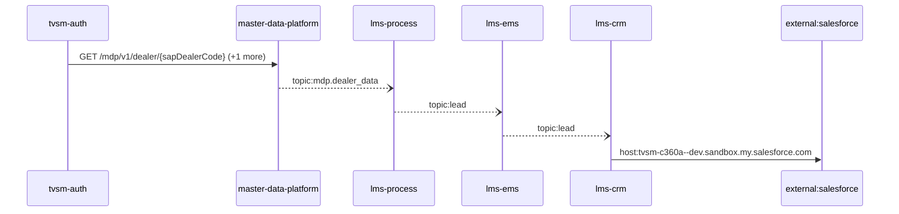

Steps:
| # | From | To | Via | Data (schema names) | Sync/Async | Confidence |
|---|---|---|---|---|---|---|
| 1 | tvsm-auth | master-data-platform | GET /mdp/v1/dealer/{sapDealerCode}, GET /mdp/v1/dealer/{sapDealerCode}/branches | GeneralResponse | sync | medium |
| 2 | master-data-platform | lms-process | topic:mdp.dealer_data | DealerData | async | medium |
| 3 | lms-process | lms-ems | topic:lead | Unknown | async | medium |
| 4 | lms-ems | lms-crm | topic:lead | Unknown | async | medium |
| 5 | lms-crm | external:salesforce | host:tvsm-c360a--dev.sandbox.my.salesforce.com | Unknown | sync | high |

Data touched: tvsm-auth: mysql; master-data-platform: mysql:xxxx.mysql.database.azure.com:mdp_20230904, other, redis; lms-process: mssql; lms-ems: mssql; lms-crm: mssql

Failure points: hop 1 tvsm-auth → master-data-platform: criticality hard; hop 2 master-data-platform → lms-process: criticality async; hop 3 lms-process → lms-ems: criticality async; hop 4 lms-ems → lms-crm: criticality async; hop 5 lms-crm → external:salesforce: criticality hard

Evidence:
- hop 1 (tvsm-auth → master-data-platform): `master-data-platform/src/main/java/com/tvsmotor/mdp/controller/DealerController.java:20`, `tvsm-auth/src/main/java/com/tvsmotor/tvsmauth/user/gateway/MDPServiceClient.java:86`, `tvsm-auth/src/main/java/com/tvsmotor/tvsmauth/user/gateway/MDPServiceClient.java:110` (+2 more)
- hop 2 (master-data-platform → lms-process): `lms_process/processLeadService/Const/Constants.cs:7`, `lms_process/processLeadService/ListenerService/MdpConsumer.cs:42`, `master-data-platform/src/main/java/com/tvsmotor/mdp/config/DealerMasterServiceBusConfig.java:26` (+1 more)
- hop 3 (lms-process → lms-ems): `lms_ems/emsService/Const/Constants.cs:14`, `lms_ems/emsService/ListenerService/EmsListenerService.cs:43`, `lms_process/processLeadService/Const/Constants.cs:6` (+1 more)
- hop 4 (lms-ems → lms-crm): `lms_crm/ListenerService/CrmListenerService.cs:44`, `lms_crm/Utils/Constants.cs:16`, `lms_ems/emsService/Const/Constants.cs:13` (+1 more)
- hop 5 (lms-crm → external:salesforce): `lms_crm/appsettings.Development.json:16`, `lms_crm/appsettings.Production.json:17`, `lms_crm/appsettings.Uat.json:17`

## Flow: tvsm-auth--external-salesforce-a0035f
Summary: Starting at `tvsm-auth` (scheduled job(s) in tvsm-auth (job-to-call link not resolved): CacheClearScheduler.evictAllCachesAtIntervals, NotificationReminder.sendSMSForFaceLogin), the flow passes through `master-data-platform`, `lms-process`, `lms-crm` and ends at `external:salesforce`, using 2 sync HTTP hop(s) and 2 async event hop(s); tvsm-auth role: entry; confidence medium.

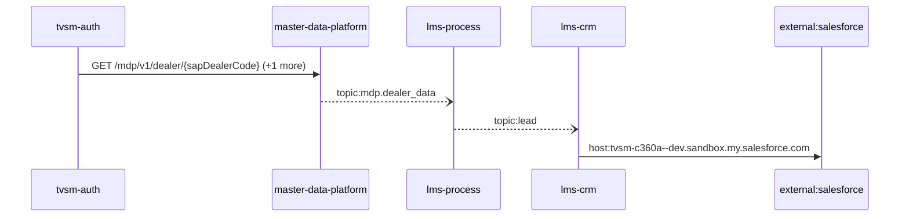

Steps:
| # | From | To | Via | Data (schema names) | Sync/Async | Confidence |
|---|---|---|---|---|---|---|
| 1 | tvsm-auth | master-data-platform | GET /mdp/v1/dealer/{sapDealerCode}, GET /mdp/v1/dealer/{sapDealerCode}/branches | GeneralResponse | sync | medium |
| 2 | master-data-platform | lms-process | topic:mdp.dealer_data | DealerData | async | medium |
| 3 | lms-process | lms-crm | topic:lead | Unknown | async | medium |
| 4 | lms-crm | external:salesforce | host:tvsm-c360a--dev.sandbox.my.salesforce.com | Unknown | sync | high |

Data touched: tvsm-auth: mysql; master-data-platform: mysql:xxxx.mysql.database.azure.com:mdp_20230904, other, redis; lms-process: mssql; lms-crm: mssql

Failure points: hop 1 tvsm-auth → master-data-platform: criticality hard; hop 2 master-data-platform → lms-process: criticality async; hop 3 lms-process → lms-crm: criticality async; hop 4 lms-crm → external:salesforce: criticality hard

Evidence:
- hop 1 (tvsm-auth → master-data-platform): `master-data-platform/src/main/java/com/tvsmotor/mdp/controller/DealerController.java:20`, `tvsm-auth/src/main/java/com/tvsmotor/tvsmauth/user/gateway/MDPServiceClient.java:86`, `tvsm-auth/src/main/java/com/tvsmotor/tvsmauth/user/gateway/MDPServiceClient.java:110` (+2 more)
- hop 2 (master-data-platform → lms-process): `lms_process/processLeadService/Const/Constants.cs:7`, `lms_process/processLeadService/ListenerService/MdpConsumer.cs:42`, `master-data-platform/src/main/java/com/tvsmotor/mdp/config/DealerMasterServiceBusConfig.java:26` (+1 more)
- hop 3 (lms-process → lms-crm): `lms_crm/ListenerService/CrmListenerService.cs:44`, `lms_crm/Utils/Constants.cs:16`, `lms_process/processLeadService/Const/Constants.cs:6` (+1 more)
- hop 4 (lms-crm → external:salesforce): `lms_crm/appsettings.Development.json:16`, `lms_crm/appsettings.Production.json:17`, `lms_crm/appsettings.Uat.json:17`

## Flow: tvsm-auth--external-salesforce-c5b275
Summary: Starting at `tvsm-auth` (scheduled job(s) in tvsm-auth (job-to-call link not resolved): CacheClearScheduler.evictAllCachesAtIntervals, NotificationReminder.sendSMSForFaceLogin), the flow passes through `master-data-platform`, `tvsmbe-mdp-bff`, `notification-service`, `notification-dispatcher-service` and ends at `external:salesforce`, using 3 sync HTTP hop(s) and 2 async event hop(s); tvsm-auth role: entry; confidence medium.

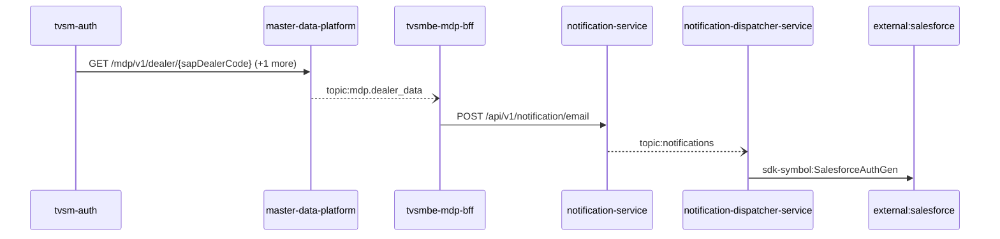

Steps:
| # | From | To | Via | Data (schema names) | Sync/Async | Confidence |
|---|---|---|---|---|---|---|
| 1 | tvsm-auth | master-data-platform | GET /mdp/v1/dealer/{sapDealerCode}, GET /mdp/v1/dealer/{sapDealerCode}/branches | GeneralResponse | sync | medium |
| 2 | master-data-platform | tvsmbe-mdp-bff | topic:mdp.dealer_data | DealerData | async | medium |
| 3 | tvsmbe-mdp-bff | notification-service | POST /api/v1/notification/email | EmailNotification, NotificationResponse | sync | high |
| 4 | notification-service | notification-dispatcher-service | topic:notifications | Unknown | async | medium |
| 5 | notification-dispatcher-service | external:salesforce | sdk-symbol:SalesforceAuthGen | Unknown | sync | high |

Data touched: tvsm-auth: mysql; master-data-platform: mysql:xxxx.mysql.database.azure.com:mdp_20230904, other, redis; tvsmbe-mdp-bff: mysql, mysql:tvsmazcmndbsdev01-ci.mysql.database.azure.com:tvsmazebffsdbdev01; notification-service: mongo; notification-dispatcher-service: mongo

Failure points: hop 1 tvsm-auth → master-data-platform: criticality hard; hop 2 master-data-platform → tvsmbe-mdp-bff: criticality async; hop 3 tvsmbe-mdp-bff → notification-service: criticality hard; hop 4 notification-service → notification-dispatcher-service: criticality async; hop 5 notification-dispatcher-service → external:salesforce: criticality hard

Evidence:
- hop 1 (tvsm-auth → master-data-platform): `master-data-platform/src/main/java/com/tvsmotor/mdp/controller/DealerController.java:20`, `tvsm-auth/src/main/java/com/tvsmotor/tvsmauth/user/gateway/MDPServiceClient.java:86`, `tvsm-auth/src/main/java/com/tvsmotor/tvsmauth/user/gateway/MDPServiceClient.java:110` (+2 more)
- hop 2 (master-data-platform → tvsmbe-mdp-bff): `master-data-platform/src/main/java/com/tvsmotor/mdp/config/DealerMasterServiceBusConfig.java:26`, `master-data-platform/src/main/java/com/tvsmotor/mdp/config/DealerMasterServiceBusConfig.java:27`, `tvsmbe-mdp-bff/outbound/src/main/java/com/tvsmotor/mdp_bff/outbound/config/BffServiceBusConfig.java:24` (+1 more)
- hop 3 (tvsmbe-mdp-bff → notification-service): `notification-service/src/main/java/com/tvsmotor/notification/controller/NotificationController.java:23`, `tvsmbe-mdp-bff/outbound/src/main/java/com/tvsmotor/mdp_bff/outbound/service/NotificationSenderService.java:46`, `tvsmbe-mdp-bff/outbound/src/main/java/com/tvsmotor/mdp_bff/outbound/service/OkHttpService.java:88`
- hop 4 (notification-service → notification-dispatcher-service): `notification-dispatcher-service/src/main/java/com/tvsmotor/notificationdispatcher/config/ServiceBusConfig.java:33`, `notification-dispatcher-service/src/main/java/com/tvsmotor/notificationdispatcher/config/ServiceBusConfig.java:34`, `notification-service/src/main/java/com/tvsmotor/notification/config/ServiceBusConfig.java:37` (+1 more)
- hop 5 (notification-dispatcher-service → external:salesforce): `notification-dispatcher-service/src/main/java/com/tvsmotor/notificationdispatcher/controller/SalesforceTokenController.java:18`, `notification-dispatcher-service/src/main/java/com/tvsmotor/notificationdispatcher/model/dto/salesforce/SalesforceData.java:5`, `notification-dispatcher-service/src/main/java/com/tvsmotor/notificationdispatcher/model/dto/salesforce/SalesforceTemplateKeys.java:8`

## Flow: tvsm-auth--lms-tvs-credit-be79ba
Summary: Starting at `tvsm-auth` (scheduled job(s) in tvsm-auth (job-to-call link not resolved): CacheClearScheduler.evictAllCachesAtIntervals, NotificationReminder.sendSMSForFaceLogin), the flow passes through `master-data-platform`, `lms-process`, `lms-ems` and ends at `lms-tvs-credit`, using 1 sync HTTP hop(s) and 3 async event hop(s); tvsm-auth role: entry; confidence medium.

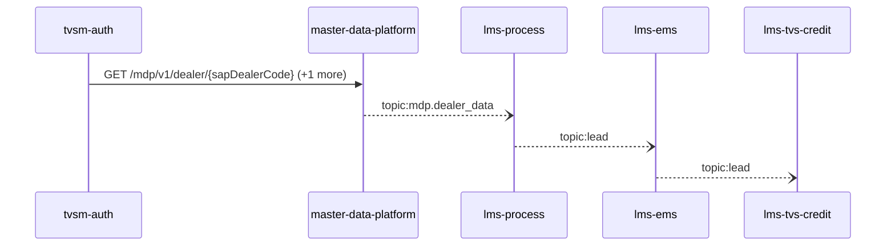

Steps:
| # | From | To | Via | Data (schema names) | Sync/Async | Confidence |
|---|---|---|---|---|---|---|
| 1 | tvsm-auth | master-data-platform | GET /mdp/v1/dealer/{sapDealerCode}, GET /mdp/v1/dealer/{sapDealerCode}/branches | GeneralResponse | sync | medium |
| 2 | master-data-platform | lms-process | topic:mdp.dealer_data | DealerData | async | medium |
| 3 | lms-process | lms-ems | topic:lead | Unknown | async | medium |
| 4 | lms-ems | lms-tvs-credit | topic:lead | Unknown | async | medium |

Data touched: tvsm-auth: mysql; master-data-platform: mysql:xxxx.mysql.database.azure.com:mdp_20230904, other, redis; lms-process: mssql; lms-ems: mssql; lms-tvs-credit: mssql

Failure points: hop 1 tvsm-auth → master-data-platform: criticality hard; hop 2 master-data-platform → lms-process: criticality async; hop 3 lms-process → lms-ems: criticality async; hop 4 lms-ems → lms-tvs-credit: criticality async

Evidence:
- hop 1 (tvsm-auth → master-data-platform): `master-data-platform/src/main/java/com/tvsmotor/mdp/controller/DealerController.java:20`, `tvsm-auth/src/main/java/com/tvsmotor/tvsmauth/user/gateway/MDPServiceClient.java:86`, `tvsm-auth/src/main/java/com/tvsmotor/tvsmauth/user/gateway/MDPServiceClient.java:110` (+2 more)
- hop 2 (master-data-platform → lms-process): `lms_process/processLeadService/Const/Constants.cs:7`, `lms_process/processLeadService/ListenerService/MdpConsumer.cs:42`, `master-data-platform/src/main/java/com/tvsmotor/mdp/config/DealerMasterServiceBusConfig.java:26` (+1 more)
- hop 3 (lms-process → lms-ems): `lms_ems/emsService/Const/Constants.cs:14`, `lms_ems/emsService/ListenerService/EmsListenerService.cs:43`, `lms_process/processLeadService/Const/Constants.cs:6` (+1 more)
- hop 4 (lms-ems → lms-tvs-credit): `lms_ems/emsService/Const/Constants.cs:13`, `lms_ems/emsService/Services/EmsService.cs:191`, `lms_tvs_credit/lms_tvs_credit/ListenerService/TvscreditListenerService.cs:46` (+1 more)

## Flow: tvsmbe-location--external-salesforce-2a5435
Summary: Starting at `tvsmbe-location` (scheduled job(s) in tvsmbe-location (job-to-call link not resolved): CronService.logMetricsPeriodically), the flow passes through `tvsm-auth`, `master-data-platform`, `tvsmbe-mdp-bff`, `notification-service` and ends at `external:salesforce`, using 4 sync HTTP hop(s) and 1 async event hop(s); tvsm-auth role: participant; confidence medium.

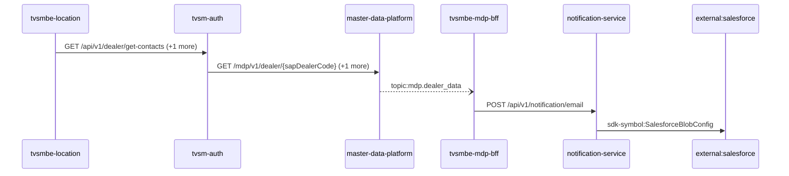

Steps:
| # | From | To | Via | Data (schema names) | Sync/Async | Confidence |
|---|---|---|---|---|---|---|
| 1 | tvsmbe-location | tvsm-auth | GET /api/v1/dealer/get-contacts, POST /auth/v1/app/token/validate | DealerContacts, TokenVerificationRequest, TokenVerificationResponse | sync | high |
| 2 | tvsm-auth | master-data-platform | GET /mdp/v1/dealer/{sapDealerCode}, GET /mdp/v1/dealer/{sapDealerCode}/branches | GeneralResponse | sync | medium |
| 3 | master-data-platform | tvsmbe-mdp-bff | topic:mdp.dealer_data | DealerData | async | medium |
| 4 | tvsmbe-mdp-bff | notification-service | POST /api/v1/notification/email | EmailNotification, NotificationResponse | sync | high |
| 5 | notification-service | external:salesforce | sdk-symbol:SalesforceBlobConfig | Unknown | sync | high |

Data touched: tvsmbe-location: mongo, mysql; tvsm-auth: mysql; master-data-platform: mysql:xxxx.mysql.database.azure.com:mdp_20230904, other, redis; tvsmbe-mdp-bff: mysql, mysql:tvsmazcmndbsdev01-ci.mysql.database.azure.com:tvsmazebffsdbdev01; notification-service: mongo

Failure points: hop 1 tvsmbe-location → tvsm-auth: criticality hard; hop 2 tvsm-auth → master-data-platform: criticality hard; hop 3 master-data-platform → tvsmbe-mdp-bff: criticality async; hop 4 tvsmbe-mdp-bff → notification-service: criticality hard; hop 5 notification-service → external:salesforce: criticality hard

Evidence:
- hop 1 (tvsmbe-location → tvsm-auth): `tvsm-auth/src/main/java/com/tvsmotor/tvsmauth/user/profile/api/DealerController.java:42`, `tvsmbe-location/src/main/java/com/tvsmotor/location_master/service/UMSService.java:49`, `tvsmbe-location/src/main/java/com/tvsmotor/location_master/utils/OkHttpUtil.java:35` (+3 more)
- hop 2 (tvsm-auth → master-data-platform): `master-data-platform/src/main/java/com/tvsmotor/mdp/controller/DealerController.java:20`, `tvsm-auth/src/main/java/com/tvsmotor/tvsmauth/user/gateway/MDPServiceClient.java:86`, `tvsm-auth/src/main/java/com/tvsmotor/tvsmauth/user/gateway/MDPServiceClient.java:110` (+2 more)
- hop 3 (master-data-platform → tvsmbe-mdp-bff): `master-data-platform/src/main/java/com/tvsmotor/mdp/config/DealerMasterServiceBusConfig.java:26`, `master-data-platform/src/main/java/com/tvsmotor/mdp/config/DealerMasterServiceBusConfig.java:27`, `tvsmbe-mdp-bff/outbound/src/main/java/com/tvsmotor/mdp_bff/outbound/config/BffServiceBusConfig.java:24` (+1 more)
- hop 4 (tvsmbe-mdp-bff → notification-service): `notification-service/src/main/java/com/tvsmotor/notification/controller/NotificationController.java:23`, `tvsmbe-mdp-bff/outbound/src/main/java/com/tvsmotor/mdp_bff/outbound/service/NotificationSenderService.java:46`, `tvsmbe-mdp-bff/outbound/src/main/java/com/tvsmotor/mdp_bff/outbound/service/OkHttpService.java:88`
- hop 5 (notification-service → external:salesforce): `notification-service/src/main/java/com/tvsmotor/notification/config/SalesforceBlobConfig.java:10`, `notification-service/src/main/java/com/tvsmotor/notification/cronjobs/SalesforceBlobStatusJob.java:17`, `notification-service/src/main/java/com/tvsmotor/notification/model/dto/salesforce/SalesforceData.java:8`

## Flow: tvsmbe-location--external-salesforce-7de335
Summary: Starting at `tvsmbe-location` (scheduled job(s) in tvsmbe-location (job-to-call link not resolved): CronService.logMetricsPeriodically), the flow passes through `tvsm-auth`, `master-data-platform`, `lms-process`, `lms-crm` and ends at `external:salesforce`, using 3 sync HTTP hop(s) and 2 async event hop(s); tvsm-auth role: participant; confidence medium.

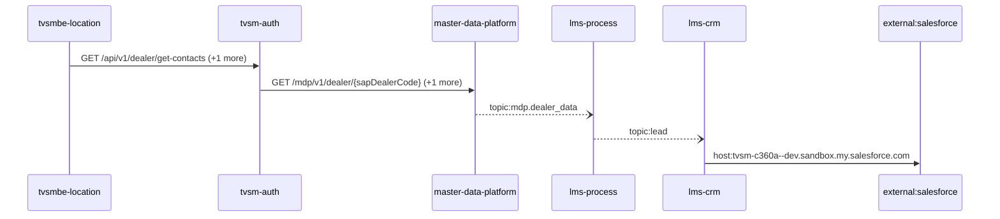

Steps:
| # | From | To | Via | Data (schema names) | Sync/Async | Confidence |
|---|---|---|---|---|---|---|
| 1 | tvsmbe-location | tvsm-auth | GET /api/v1/dealer/get-contacts, POST /auth/v1/app/token/validate | DealerContacts, TokenVerificationRequest, TokenVerificationResponse | sync | high |
| 2 | tvsm-auth | master-data-platform | GET /mdp/v1/dealer/{sapDealerCode}, GET /mdp/v1/dealer/{sapDealerCode}/branches | GeneralResponse | sync | medium |
| 3 | master-data-platform | lms-process | topic:mdp.dealer_data | DealerData | async | medium |
| 4 | lms-process | lms-crm | topic:lead | Unknown | async | medium |
| 5 | lms-crm | external:salesforce | host:tvsm-c360a--dev.sandbox.my.salesforce.com | Unknown | sync | high |

Data touched: tvsmbe-location: mongo, mysql; tvsm-auth: mysql; master-data-platform: mysql:xxxx.mysql.database.azure.com:mdp_20230904, other, redis; lms-process: mssql; lms-crm: mssql

Failure points: hop 1 tvsmbe-location → tvsm-auth: criticality hard; hop 2 tvsm-auth → master-data-platform: criticality hard; hop 3 master-data-platform → lms-process: criticality async; hop 4 lms-process → lms-crm: criticality async; hop 5 lms-crm → external:salesforce: criticality hard

Evidence:
- hop 1 (tvsmbe-location → tvsm-auth): `tvsm-auth/src/main/java/com/tvsmotor/tvsmauth/user/profile/api/DealerController.java:42`, `tvsmbe-location/src/main/java/com/tvsmotor/location_master/service/UMSService.java:49`, `tvsmbe-location/src/main/java/com/tvsmotor/location_master/utils/OkHttpUtil.java:35` (+3 more)
- hop 2 (tvsm-auth → master-data-platform): `master-data-platform/src/main/java/com/tvsmotor/mdp/controller/DealerController.java:20`, `tvsm-auth/src/main/java/com/tvsmotor/tvsmauth/user/gateway/MDPServiceClient.java:86`, `tvsm-auth/src/main/java/com/tvsmotor/tvsmauth/user/gateway/MDPServiceClient.java:110` (+2 more)
- hop 3 (master-data-platform → lms-process): `lms_process/processLeadService/Const/Constants.cs:7`, `lms_process/processLeadService/ListenerService/MdpConsumer.cs:42`, `master-data-platform/src/main/java/com/tvsmotor/mdp/config/DealerMasterServiceBusConfig.java:26` (+1 more)
- hop 4 (lms-process → lms-crm): `lms_crm/ListenerService/CrmListenerService.cs:44`, `lms_crm/Utils/Constants.cs:16`, `lms_process/processLeadService/Const/Constants.cs:6` (+1 more)
- hop 5 (lms-crm → external:salesforce): `lms_crm/appsettings.Development.json:16`, `lms_crm/appsettings.Production.json:17`, `lms_crm/appsettings.Uat.json:17`

## Flow: tvsmbe-location--external-salesforce-ae0174
Summary: Starting at `tvsmbe-location` (scheduled job(s) in tvsmbe-location (job-to-call link not resolved): CronService.logMetricsPeriodically), the flow passes through `tvsm-auth`, `notification-service`, `notification-dispatcher-service` and ends at `external:salesforce`, using 3 sync HTTP hop(s) and 1 async event hop(s); tvsm-auth role: participant; confidence medium.

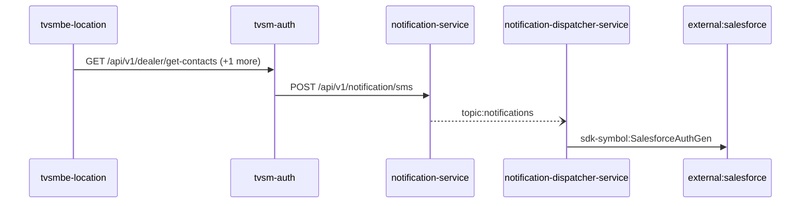

Steps:
| # | From | To | Via | Data (schema names) | Sync/Async | Confidence |
|---|---|---|---|---|---|---|
| 1 | tvsmbe-location | tvsm-auth | GET /api/v1/dealer/get-contacts, POST /auth/v1/app/token/validate | DealerContacts, TokenVerificationRequest, TokenVerificationResponse | sync | high |
| 2 | tvsm-auth | notification-service | POST /api/v1/notification/sms | NotificationResponse, SMSNotification | sync | medium |
| 3 | notification-service | notification-dispatcher-service | topic:notifications | Unknown | async | medium |
| 4 | notification-dispatcher-service | external:salesforce | sdk-symbol:SalesforceAuthGen | Unknown | sync | high |

Data touched: tvsmbe-location: mongo, mysql; tvsm-auth: mysql; notification-service: mongo; notification-dispatcher-service: mongo

Failure points: hop 1 tvsmbe-location → tvsm-auth: criticality hard; hop 2 tvsm-auth → notification-service: criticality hard; hop 3 notification-service → notification-dispatcher-service: criticality async; hop 4 notification-dispatcher-service → external:salesforce: criticality hard

Evidence:
- hop 1 (tvsmbe-location → tvsm-auth): `tvsm-auth/src/main/java/com/tvsmotor/tvsmauth/user/profile/api/DealerController.java:42`, `tvsmbe-location/src/main/java/com/tvsmotor/location_master/service/UMSService.java:49`, `tvsmbe-location/src/main/java/com/tvsmotor/location_master/utils/OkHttpUtil.java:35` (+3 more)
- hop 2 (tvsm-auth → notification-service): `notification-service/src/main/java/com/tvsmotor/notification/controller/NotificationController.java:23`, `tvsm-auth/src/main/java/com/tvsmotor/tvsmauth/user/gateway/NotificationGateway.java:38`, `tvsm-auth/src/main/java/com/tvsmotor/tvsmauth/user/gateway/NotificationGateway.java:39` (+1 more)
- hop 3 (notification-service → notification-dispatcher-service): `notification-dispatcher-service/src/main/java/com/tvsmotor/notificationdispatcher/config/ServiceBusConfig.java:33`, `notification-dispatcher-service/src/main/java/com/tvsmotor/notificationdispatcher/config/ServiceBusConfig.java:34`, `notification-service/src/main/java/com/tvsmotor/notification/config/ServiceBusConfig.java:37` (+1 more)
- hop 4 (notification-dispatcher-service → external:salesforce): `notification-dispatcher-service/src/main/java/com/tvsmotor/notificationdispatcher/controller/SalesforceTokenController.java:18`, `notification-dispatcher-service/src/main/java/com/tvsmotor/notificationdispatcher/model/dto/salesforce/SalesforceData.java:5`, `notification-dispatcher-service/src/main/java/com/tvsmotor/notificationdispatcher/model/dto/salesforce/SalesforceTemplateKeys.java:8`

## Flow: tvsmbe-location--external-salesforce-e29208
Summary: Starting at `tvsmbe-location` (scheduled job(s) in tvsmbe-location (job-to-call link not resolved): CronService.logMetricsPeriodically), the flow passes through `tvsm-auth`, `master-data-platform`, `notification-service` and ends at `external:salesforce`, using 4 sync HTTP hop(s) and 0 async event hop(s); tvsm-auth role: participant; confidence medium.

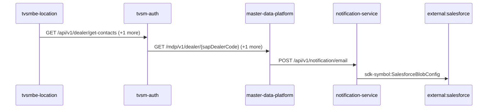

Steps:
| # | From | To | Via | Data (schema names) | Sync/Async | Confidence |
|---|---|---|---|---|---|---|
| 1 | tvsmbe-location | tvsm-auth | GET /api/v1/dealer/get-contacts, POST /auth/v1/app/token/validate | DealerContacts, TokenVerificationRequest, TokenVerificationResponse | sync | high |
| 2 | tvsm-auth | master-data-platform | GET /mdp/v1/dealer/{sapDealerCode}, GET /mdp/v1/dealer/{sapDealerCode}/branches | GeneralResponse | sync | medium |
| 3 | master-data-platform | notification-service | POST /api/v1/notification/email | EmailNotification, NotificationResponse | sync | high |
| 4 | notification-service | external:salesforce | sdk-symbol:SalesforceBlobConfig | Unknown | sync | high |

Data touched: tvsmbe-location: mongo, mysql; tvsm-auth: mysql; master-data-platform: mysql:xxxx.mysql.database.azure.com:mdp_20230904, other, redis; notification-service: mongo

Failure points: hop 1 tvsmbe-location → tvsm-auth: criticality hard; hop 2 tvsm-auth → master-data-platform: criticality hard; hop 3 master-data-platform → notification-service: criticality hard; hop 4 notification-service → external:salesforce: criticality hard

Evidence:
- hop 1 (tvsmbe-location → tvsm-auth): `tvsm-auth/src/main/java/com/tvsmotor/tvsmauth/user/profile/api/DealerController.java:42`, `tvsmbe-location/src/main/java/com/tvsmotor/location_master/service/UMSService.java:49`, `tvsmbe-location/src/main/java/com/tvsmotor/location_master/utils/OkHttpUtil.java:35` (+3 more)
- hop 2 (tvsm-auth → master-data-platform): `master-data-platform/src/main/java/com/tvsmotor/mdp/controller/DealerController.java:20`, `tvsm-auth/src/main/java/com/tvsmotor/tvsmauth/user/gateway/MDPServiceClient.java:86`, `tvsm-auth/src/main/java/com/tvsmotor/tvsmauth/user/gateway/MDPServiceClient.java:110` (+2 more)
- hop 3 (master-data-platform → notification-service): `master-data-platform/src/main/java/com/tvsmotor/mdp/service/OkHttpService.java:24`, `master-data-platform/src/main/java/com/tvsmotor/mdp/service/notification_service/NotificationSenderService.java:69`, `notification-service/src/main/java/com/tvsmotor/notification/controller/NotificationController.java:23`
- hop 4 (notification-service → external:salesforce): `notification-service/src/main/java/com/tvsmotor/notification/config/SalesforceBlobConfig.java:10`, `notification-service/src/main/java/com/tvsmotor/notification/cronjobs/SalesforceBlobStatusJob.java:17`, `notification-service/src/main/java/com/tvsmotor/notification/model/dto/salesforce/SalesforceData.java:8`

## Flow: tvsmbe-location--external-salesforce-e8e8d4
Summary: Starting at `tvsmbe-location` (scheduled job(s) in tvsmbe-location (job-to-call link not resolved): CronService.logMetricsPeriodically), the flow passes through `tvsm-auth`, `master-data-platform`, `notification-service`, `notification-dispatcher-service` and ends at `external:salesforce`, using 4 sync HTTP hop(s) and 1 async event hop(s); tvsm-auth role: participant; confidence medium.

```mermaid
sequenceDiagram
  participant tvsmbe_location as tvsmbe-location
  participant tvsm_auth as tvsm-auth
  participant master_data_platform as master-data-platform
  participant notification_service as notification-service
  participant notification_dispatcher_service as notification-dispatcher-service
  participant external_salesforce as external:salesforce
  tvsmbe_location->>tvsm_auth: GET /api/v1/dealer/get-contacts (+1 more)
  tvsm_auth->>master_data_platform: GET /mdp/v1/dealer/{sapDealerCode} (+1 more)
  master_data_platform->>notification_service: POST /api/v1/notification/email
  notification_service--)notification_dispatcher_service: topic:notifications
  notification_dispatcher_service->>external_salesforce: sdk-symbol:SalesforceAuthGen
```

Steps:
| # | From | To | Via | Data (schema names) | Sync/Async | Confidence |
|---|---|---|---|---|---|---|
| 1 | tvsmbe-location | tvsm-auth | GET /api/v1/dealer/get-contacts, POST /auth/v1/app/token/validate | DealerContacts, TokenVerificationRequest, TokenVerificationResponse | sync | high |
| 2 | tvsm-auth | master-data-platform | GET /mdp/v1/dealer/{sapDealerCode}, GET /mdp/v1/dealer/{sapDealerCode}/branches | GeneralResponse | sync | medium |
| 3 | master-data-platform | notification-service | POST /api/v1/notification/email | EmailNotification, NotificationResponse | sync | high |
| 4 | notification-service | notification-dispatcher-service | topic:notifications | Unknown | async | medium |
| 5 | notification-dispatcher-service | external:salesforce | sdk-symbol:SalesforceAuthGen | Unknown | sync | high |

Data touched: tvsmbe-location: mongo, mysql; tvsm-auth: mysql; master-data-platform: mysql:xxxx.mysql.database.azure.com:mdp_20230904, other, redis; notification-service: mongo; notification-dispatcher-service: mongo

Failure points: hop 1 tvsmbe-location → tvsm-auth: criticality hard; hop 2 tvsm-auth → master-data-platform: criticality hard; hop 3 master-data-platform → notification-service: criticality hard; hop 4 notification-service → notification-dispatcher-service: criticality async; hop 5 notification-dispatcher-service → external:salesforce: criticality hard

Evidence:
- hop 1 (tvsmbe-location → tvsm-auth): `tvsm-auth/src/main/java/com/tvsmotor/tvsmauth/user/profile/api/DealerController.java:42`, `tvsmbe-location/src/main/java/com/tvsmotor/location_master/service/UMSService.java:49`, `tvsmbe-location/src/main/java/com/tvsmotor/location_master/utils/OkHttpUtil.java:35` (+3 more)
- hop 2 (tvsm-auth → master-data-platform): `master-data-platform/src/main/java/com/tvsmotor/mdp/controller/DealerController.java:20`, `tvsm-auth/src/main/java/com/tvsmotor/tvsmauth/user/gateway/MDPServiceClient.java:86`, `tvsm-auth/src/main/java/com/tvsmotor/tvsmauth/user/gateway/MDPServiceClient.java:110` (+2 more)
- hop 3 (master-data-platform → notification-service): `master-data-platform/src/main/java/com/tvsmotor/mdp/service/OkHttpService.java:24`, `master-data-platform/src/main/java/com/tvsmotor/mdp/service/notification_service/NotificationSenderService.java:69`, `notification-service/src/main/java/com/tvsmotor/notification/controller/NotificationController.java:23`
- hop 4 (notification-service → notification-dispatcher-service): `notification-dispatcher-service/src/main/java/com/tvsmotor/notificationdispatcher/config/ServiceBusConfig.java:33`, `notification-dispatcher-service/src/main/java/com/tvsmotor/notificationdispatcher/config/ServiceBusConfig.java:34`, `notification-service/src/main/java/com/tvsmotor/notification/config/ServiceBusConfig.java:37` (+1 more)
- hop 5 (notification-dispatcher-service → external:salesforce): `notification-dispatcher-service/src/main/java/com/tvsmotor/notificationdispatcher/controller/SalesforceTokenController.java:18`, `notification-dispatcher-service/src/main/java/com/tvsmotor/notificationdispatcher/model/dto/salesforce/SalesforceData.java:5`, `notification-dispatcher-service/src/main/java/com/tvsmotor/notificationdispatcher/model/dto/salesforce/SalesforceTemplateKeys.java:8`

## Flow: tvsmbe-location--lms-crm
Summary: Starting at `tvsmbe-location` (scheduled job(s) in tvsmbe-location (job-to-call link not resolved): CronService.logMetricsPeriodically), the flow passes through `tvsm-auth`, `master-data-platform`, `lms-process`, `lms-ems` and ends at `lms-crm`, using 2 sync HTTP hop(s) and 3 async event hop(s); tvsm-auth role: participant; confidence medium; truncated at the depth cap.

```mermaid
sequenceDiagram
  participant tvsmbe_location as tvsmbe-location
  participant tvsm_auth as tvsm-auth
  participant master_data_platform as master-data-platform
  participant lms_process as lms-process
  participant lms_ems as lms-ems
  participant lms_crm as lms-crm
  tvsmbe_location->>tvsm_auth: GET /api/v1/dealer/get-contacts (+1 more)
  tvsm_auth->>master_data_platform: GET /mdp/v1/dealer/{sapDealerCode} (+1 more)
  master_data_platform--)lms_process: topic:mdp.dealer_data
  lms_process--)lms_ems: topic:lead
  lms_ems--)lms_crm: topic:lead
```

Steps:
| # | From | To | Via | Data (schema names) | Sync/Async | Confidence |
|---|---|---|---|---|---|---|
| 1 | tvsmbe-location | tvsm-auth | GET /api/v1/dealer/get-contacts, POST /auth/v1/app/token/validate | DealerContacts, TokenVerificationRequest, TokenVerificationResponse | sync | high |
| 2 | tvsm-auth | master-data-platform | GET /mdp/v1/dealer/{sapDealerCode}, GET /mdp/v1/dealer/{sapDealerCode}/branches | GeneralResponse | sync | medium |
| 3 | master-data-platform | lms-process | topic:mdp.dealer_data | DealerData | async | medium |
| 4 | lms-process | lms-ems | topic:lead | Unknown | async | medium |
| 5 | lms-ems | lms-crm | topic:lead | Unknown | async | medium |

Data touched: tvsmbe-location: mongo, mysql; tvsm-auth: mysql; master-data-platform: mysql:xxxx.mysql.database.azure.com:mdp_20230904, other, redis; lms-process: mssql; lms-ems: mssql; lms-crm: mssql

Failure points: hop 1 tvsmbe-location → tvsm-auth: criticality hard; hop 2 tvsm-auth → master-data-platform: criticality hard; hop 3 master-data-platform → lms-process: criticality async; hop 4 lms-process → lms-ems: criticality async; hop 5 lms-ems → lms-crm: criticality async

Evidence:
- hop 1 (tvsmbe-location → tvsm-auth): `tvsm-auth/src/main/java/com/tvsmotor/tvsmauth/user/profile/api/DealerController.java:42`, `tvsmbe-location/src/main/java/com/tvsmotor/location_master/service/UMSService.java:49`, `tvsmbe-location/src/main/java/com/tvsmotor/location_master/utils/OkHttpUtil.java:35` (+3 more)
- hop 2 (tvsm-auth → master-data-platform): `master-data-platform/src/main/java/com/tvsmotor/mdp/controller/DealerController.java:20`, `tvsm-auth/src/main/java/com/tvsmotor/tvsmauth/user/gateway/MDPServiceClient.java:86`, `tvsm-auth/src/main/java/com/tvsmotor/tvsmauth/user/gateway/MDPServiceClient.java:110` (+2 more)
- hop 3 (master-data-platform → lms-process): `lms_process/processLeadService/Const/Constants.cs:7`, `lms_process/processLeadService/ListenerService/MdpConsumer.cs:42`, `master-data-platform/src/main/java/com/tvsmotor/mdp/config/DealerMasterServiceBusConfig.java:26` (+1 more)
- hop 4 (lms-process → lms-ems): `lms_ems/emsService/Const/Constants.cs:14`, `lms_ems/emsService/ListenerService/EmsListenerService.cs:43`, `lms_process/processLeadService/Const/Constants.cs:6` (+1 more)
- hop 5 (lms-ems → lms-crm): `lms_crm/ListenerService/CrmListenerService.cs:44`, `lms_crm/Utils/Constants.cs:16`, `lms_ems/emsService/Const/Constants.cs:13` (+1 more)

## Flow: tvsmbe-location--lms-tvs-credit-c8d4f4
Summary: Starting at `tvsmbe-location` (scheduled job(s) in tvsmbe-location (job-to-call link not resolved): CronService.logMetricsPeriodically), the flow passes through `tvsm-auth`, `master-data-platform`, `lms-process` and ends at `lms-tvs-credit`, using 2 sync HTTP hop(s) and 2 async event hop(s); tvsm-auth role: participant; confidence medium.

```mermaid
sequenceDiagram
  participant tvsmbe_location as tvsmbe-location
  participant tvsm_auth as tvsm-auth
  participant master_data_platform as master-data-platform
  participant lms_process as lms-process
  participant lms_tvs_credit as lms-tvs-credit
  tvsmbe_location->>tvsm_auth: GET /api/v1/dealer/get-contacts (+1 more)
  tvsm_auth->>master_data_platform: GET /mdp/v1/dealer/{sapDealerCode} (+1 more)
  master_data_platform--)lms_process: topic:mdp.dealer_data
  lms_process--)lms_tvs_credit: topic:lead
```

Steps:
| # | From | To | Via | Data (schema names) | Sync/Async | Confidence |
|---|---|---|---|---|---|---|
| 1 | tvsmbe-location | tvsm-auth | GET /api/v1/dealer/get-contacts, POST /auth/v1/app/token/validate | DealerContacts, TokenVerificationRequest, TokenVerificationResponse | sync | high |
| 2 | tvsm-auth | master-data-platform | GET /mdp/v1/dealer/{sapDealerCode}, GET /mdp/v1/dealer/{sapDealerCode}/branches | GeneralResponse | sync | medium |
| 3 | master-data-platform | lms-process | topic:mdp.dealer_data | DealerData | async | medium |
| 4 | lms-process | lms-tvs-credit | topic:lead | Unknown | async | medium |

Data touched: tvsmbe-location: mongo, mysql; tvsm-auth: mysql; master-data-platform: mysql:xxxx.mysql.database.azure.com:mdp_20230904, other, redis; lms-process: mssql; lms-tvs-credit: mssql

Failure points: hop 1 tvsmbe-location → tvsm-auth: criticality hard; hop 2 tvsm-auth → master-data-platform: criticality hard; hop 3 master-data-platform → lms-process: criticality async; hop 4 lms-process → lms-tvs-credit: criticality async

Evidence:
- hop 1 (tvsmbe-location → tvsm-auth): `tvsm-auth/src/main/java/com/tvsmotor/tvsmauth/user/profile/api/DealerController.java:42`, `tvsmbe-location/src/main/java/com/tvsmotor/location_master/service/UMSService.java:49`, `tvsmbe-location/src/main/java/com/tvsmotor/location_master/utils/OkHttpUtil.java:35` (+3 more)
- hop 2 (tvsm-auth → master-data-platform): `master-data-platform/src/main/java/com/tvsmotor/mdp/controller/DealerController.java:20`, `tvsm-auth/src/main/java/com/tvsmotor/tvsmauth/user/gateway/MDPServiceClient.java:86`, `tvsm-auth/src/main/java/com/tvsmotor/tvsmauth/user/gateway/MDPServiceClient.java:110` (+2 more)
- hop 3 (master-data-platform → lms-process): `lms_process/processLeadService/Const/Constants.cs:7`, `lms_process/processLeadService/ListenerService/MdpConsumer.cs:42`, `master-data-platform/src/main/java/com/tvsmotor/mdp/config/DealerMasterServiceBusConfig.java:26` (+1 more)
- hop 4 (lms-process → lms-tvs-credit): `lms_process/processLeadService/Const/Constants.cs:6`, `lms_process/processLeadService/Services/TwoWheelerService.cs:97`, `lms_tvs_credit/lms_tvs_credit/ListenerService/TvscreditListenerService.cs:46` (+1 more)

## Flow: tvsmbe-location--lms-tvs-credit-f81c06
Summary: Starting at `tvsmbe-location` (scheduled job(s) in tvsmbe-location (job-to-call link not resolved): CronService.logMetricsPeriodically), the flow passes through `tvsm-auth`, `master-data-platform`, `lms-process`, `lms-ems` and ends at `lms-tvs-credit`, using 2 sync HTTP hop(s) and 3 async event hop(s); tvsm-auth role: participant; confidence medium.

```mermaid
sequenceDiagram
  participant tvsmbe_location as tvsmbe-location
  participant tvsm_auth as tvsm-auth
  participant master_data_platform as master-data-platform
  participant lms_process as lms-process
  participant lms_ems as lms-ems
  participant lms_tvs_credit as lms-tvs-credit
  tvsmbe_location->>tvsm_auth: GET /api/v1/dealer/get-contacts (+1 more)
  tvsm_auth->>master_data_platform: GET /mdp/v1/dealer/{sapDealerCode} (+1 more)
  master_data_platform--)lms_process: topic:mdp.dealer_data
  lms_process--)lms_ems: topic:lead
  lms_ems--)lms_tvs_credit: topic:lead
```

Steps:
| # | From | To | Via | Data (schema names) | Sync/Async | Confidence |
|---|---|---|---|---|---|---|
| 1 | tvsmbe-location | tvsm-auth | GET /api/v1/dealer/get-contacts, POST /auth/v1/app/token/validate | DealerContacts, TokenVerificationRequest, TokenVerificationResponse | sync | high |
| 2 | tvsm-auth | master-data-platform | GET /mdp/v1/dealer/{sapDealerCode}, GET /mdp/v1/dealer/{sapDealerCode}/branches | GeneralResponse | sync | medium |
| 3 | master-data-platform | lms-process | topic:mdp.dealer_data | DealerData | async | medium |
| 4 | lms-process | lms-ems | topic:lead | Unknown | async | medium |
| 5 | lms-ems | lms-tvs-credit | topic:lead | Unknown | async | medium |

Data touched: tvsmbe-location: mongo, mysql; tvsm-auth: mysql; master-data-platform: mysql:xxxx.mysql.database.azure.com:mdp_20230904, other, redis; lms-process: mssql; lms-ems: mssql; lms-tvs-credit: mssql

Failure points: hop 1 tvsmbe-location → tvsm-auth: criticality hard; hop 2 tvsm-auth → master-data-platform: criticality hard; hop 3 master-data-platform → lms-process: criticality async; hop 4 lms-process → lms-ems: criticality async; hop 5 lms-ems → lms-tvs-credit: criticality async

Evidence:
- hop 1 (tvsmbe-location → tvsm-auth): `tvsm-auth/src/main/java/com/tvsmotor/tvsmauth/user/profile/api/DealerController.java:42`, `tvsmbe-location/src/main/java/com/tvsmotor/location_master/service/UMSService.java:49`, `tvsmbe-location/src/main/java/com/tvsmotor/location_master/utils/OkHttpUtil.java:35` (+3 more)
- hop 2 (tvsm-auth → master-data-platform): `master-data-platform/src/main/java/com/tvsmotor/mdp/controller/DealerController.java:20`, `tvsm-auth/src/main/java/com/tvsmotor/tvsmauth/user/gateway/MDPServiceClient.java:86`, `tvsm-auth/src/main/java/com/tvsmotor/tvsmauth/user/gateway/MDPServiceClient.java:110` (+2 more)
- hop 3 (master-data-platform → lms-process): `lms_process/processLeadService/Const/Constants.cs:7`, `lms_process/processLeadService/ListenerService/MdpConsumer.cs:42`, `master-data-platform/src/main/java/com/tvsmotor/mdp/config/DealerMasterServiceBusConfig.java:26` (+1 more)
- hop 4 (lms-process → lms-ems): `lms_ems/emsService/Const/Constants.cs:14`, `lms_ems/emsService/ListenerService/EmsListenerService.cs:43`, `lms_process/processLeadService/Const/Constants.cs:6` (+1 more)
- hop 5 (lms-ems → lms-tvs-credit): `lms_ems/emsService/Const/Constants.cs:13`, `lms_ems/emsService/Services/EmsService.cs:191`, `lms_tvs_credit/lms_tvs_credit/ListenerService/TvscreditListenerService.cs:46` (+1 more)

## Flow: tvsmbe-location--notification-dispatcher-service
Summary: Starting at `tvsmbe-location` (scheduled job(s) in tvsmbe-location (job-to-call link not resolved): CronService.logMetricsPeriodically), the flow passes through `tvsm-auth`, `master-data-platform`, `tvsmbe-mdp-bff`, `notification-service` and ends at `notification-dispatcher-service`, using 3 sync HTTP hop(s) and 2 async event hop(s); tvsm-auth role: participant; confidence medium; truncated at the depth cap.

```mermaid
sequenceDiagram
  participant tvsmbe_location as tvsmbe-location
  participant tvsm_auth as tvsm-auth
  participant master_data_platform as master-data-platform
  participant tvsmbe_mdp_bff as tvsmbe-mdp-bff
  participant notification_service as notification-service
  participant notification_dispatcher_service as notification-dispatcher-service
  tvsmbe_location->>tvsm_auth: GET /api/v1/dealer/get-contacts (+1 more)
  tvsm_auth->>master_data_platform: GET /mdp/v1/dealer/{sapDealerCode} (+1 more)
  master_data_platform--)tvsmbe_mdp_bff: topic:mdp.dealer_data
  tvsmbe_mdp_bff->>notification_service: POST /api/v1/notification/email
  notification_service--)notification_dispatcher_service: topic:notifications
```

Steps:
| # | From | To | Via | Data (schema names) | Sync/Async | Confidence |
|---|---|---|---|---|---|---|
| 1 | tvsmbe-location | tvsm-auth | GET /api/v1/dealer/get-contacts, POST /auth/v1/app/token/validate | DealerContacts, TokenVerificationRequest, TokenVerificationResponse | sync | high |
| 2 | tvsm-auth | master-data-platform | GET /mdp/v1/dealer/{sapDealerCode}, GET /mdp/v1/dealer/{sapDealerCode}/branches | GeneralResponse | sync | medium |
| 3 | master-data-platform | tvsmbe-mdp-bff | topic:mdp.dealer_data | DealerData | async | medium |
| 4 | tvsmbe-mdp-bff | notification-service | POST /api/v1/notification/email | EmailNotification, NotificationResponse | sync | high |
| 5 | notification-service | notification-dispatcher-service | topic:notifications | Unknown | async | medium |

Data touched: tvsmbe-location: mongo, mysql; tvsm-auth: mysql; master-data-platform: mysql:xxxx.mysql.database.azure.com:mdp_20230904, other, redis; tvsmbe-mdp-bff: mysql, mysql:tvsmazcmndbsdev01-ci.mysql.database.azure.com:tvsmazebffsdbdev01; notification-service: mongo; notification-dispatcher-service: mongo

Failure points: hop 1 tvsmbe-location → tvsm-auth: criticality hard; hop 2 tvsm-auth → master-data-platform: criticality hard; hop 3 master-data-platform → tvsmbe-mdp-bff: criticality async; hop 4 tvsmbe-mdp-bff → notification-service: criticality hard; hop 5 notification-service → notification-dispatcher-service: criticality async

Evidence:
- hop 1 (tvsmbe-location → tvsm-auth): `tvsm-auth/src/main/java/com/tvsmotor/tvsmauth/user/profile/api/DealerController.java:42`, `tvsmbe-location/src/main/java/com/tvsmotor/location_master/service/UMSService.java:49`, `tvsmbe-location/src/main/java/com/tvsmotor/location_master/utils/OkHttpUtil.java:35` (+3 more)
- hop 2 (tvsm-auth → master-data-platform): `master-data-platform/src/main/java/com/tvsmotor/mdp/controller/DealerController.java:20`, `tvsm-auth/src/main/java/com/tvsmotor/tvsmauth/user/gateway/MDPServiceClient.java:86`, `tvsm-auth/src/main/java/com/tvsmotor/tvsmauth/user/gateway/MDPServiceClient.java:110` (+2 more)
- hop 3 (master-data-platform → tvsmbe-mdp-bff): `master-data-platform/src/main/java/com/tvsmotor/mdp/config/DealerMasterServiceBusConfig.java:26`, `master-data-platform/src/main/java/com/tvsmotor/mdp/config/DealerMasterServiceBusConfig.java:27`, `tvsmbe-mdp-bff/outbound/src/main/java/com/tvsmotor/mdp_bff/outbound/config/BffServiceBusConfig.java:24` (+1 more)
- hop 4 (tvsmbe-mdp-bff → notification-service): `notification-service/src/main/java/com/tvsmotor/notification/controller/NotificationController.java:23`, `tvsmbe-mdp-bff/outbound/src/main/java/com/tvsmotor/mdp_bff/outbound/service/NotificationSenderService.java:46`, `tvsmbe-mdp-bff/outbound/src/main/java/com/tvsmotor/mdp_bff/outbound/service/OkHttpService.java:88`
- hop 5 (notification-service → notification-dispatcher-service): `notification-dispatcher-service/src/main/java/com/tvsmotor/notificationdispatcher/config/ServiceBusConfig.java:33`, `notification-dispatcher-service/src/main/java/com/tvsmotor/notificationdispatcher/config/ServiceBusConfig.java:34`, `notification-service/src/main/java/com/tvsmotor/notification/config/ServiceBusConfig.java:37` (+1 more)
