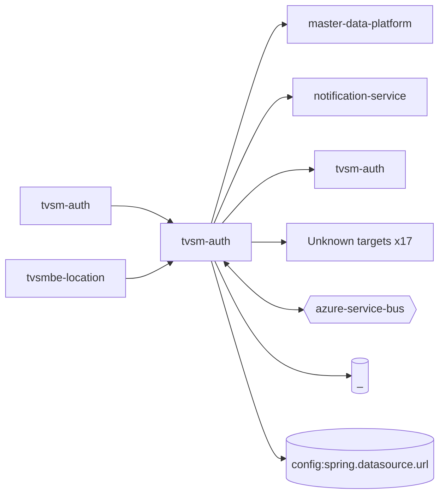

# tvsm-auth — High-Level Design

## Context
tvsm-auth is a `backend-api` in the TVS-CS org (domain: Unknown). Neighbours: callers `tvsm-auth`, `tvsmbe-location`; downstream `master-data-platform`, `notification-service`, `tvsm-auth`.

## Architecture
tvsm-auth components and connections (from service.yaml):

## Integration Points
tvsm-auth registry edges (7):

| Direction | Peer | Kind | Via | Criticality | Source | Match |
|---|---|---|---|---|---|---|
| out | `master-data-platform` | http | GET /mdp/v1/dealer/{sapDealerCode} | hard | code | path-suffix |
| out | `master-data-platform` | http | GET /mdp/v1/dealer/{sapDealerCode}/branches | hard | code | path-suffix |
| out | `notification-service` | http | POST /api/v1/notification/sms | hard | code | path-unique |
| self | `tvsm-auth` | http | GET /api/v1/location/state/list | hard | code | path-unique |
| in | `tvsmbe-location` | http | GET /api/v1/dealer/get-contacts | hard | code | path-unique |
| in | `tvsmbe-location` | http | POST /auth/v1/app/token/validate | hard | code | path-unique |
| self | `tvsm-auth` | tests | GET /auth/v1/app/token | hard | code | path-suffix |

## Data Ownership
tvsm-auth data stores (service.yaml `data_stores`; ownership flag not determinable unless set):

| Store | Type | Access | Owned | Key entities |
|---|---|---|---|---|
| `_` | mysql | write | Unknown | Specialization, address, bank_details, department_groups_mapping, departments, designation, exit_reason, form_mappings, group_info, group_roles_mapping, person_group_details, reporting_role_mapping, role, role_application_mapping, role_hierarchy … |
| `config:spring.datasource.url` | mysql | read-write | Unknown | AdUmsRoleMapping, Address, Application, BankDetails, ConflictedUsers, Dealer, DealerEmployees, Dealership, Department, Designation, Distributor, EducationDetails, EmployeeId, ExitReason, FaceRequestAudit … |

## Key Design Decisions
tvsm-auth: N/A — not determinable from code.

| Decision | Alternatives considered | Reason |
|---|---|---|
| Unknown | Unknown | Unknown |

## Non-Functional Requirements
tvsm-auth NFR targets: N/A — not determinable from code. Tuning-related config keys: `application.user.max-face-login-days`, `application.user.max-passive-days`, `application.user.max-pending-active-days`, `application.user.max-unused-days`, `server.max-http-header-size`, `spring.datasource.hikari.maximum-pool-size`, `spring.servlet.multipart.max-file-size`, `spring.servlet.multipart.max-request-size`.

## Security
tvsm-auth security: endpoint auth values None, bearer-jwt. Auth code: `src/main/java/com/tvsmotor/tvsmauth/config/SecurityConfig.java:19`, `src/main/java/com/tvsmotor/tvsmauth/config/JwtTokenFilter.java:11`. 12 secret config key(s), sourced via: {'env-file': 1, 'app-settings': 11} (names in OVERVIEW.md). PII handling: Unknown.

## Resilience and Failure Modes
tvsm-auth hard dependencies: `master-data-platform`, `notification-service`, `tvsm-auth`. Retry/circuit-breaker code: `src/main/java/com/tvsmotor/tvsmauth/user/profile/service/UserProfileService.java:440` (@Retryable).

## Deployment Topology
tvsm-auth deployment artefacts (platform/regions: Unknown unless listed):

| Kind | Name | File | Environments | Image | Ports | Variable groups |
|---|---|---|---|---|---|---|
| azure-pipeline | AST_Image_Scan_auth_ninja_Pipeline.yml | `AST_Image_Scan_auth_ninja_Pipeline.yml:1` | - | - | - | Checkmarx_Common, UAT_Threshold |
| azure-pipeline | AST_auth_ninja_UAT_Pipeline.yml | `AST_auth_ninja_UAT_Pipeline.yml:1` | - | - | - | Checkmarx_Common, Tenable, UAT_Threshold |
| azure-pipeline | AST_norton_auth_ninja_UAT_Pipeline.yml | `AST_norton_auth_ninja_UAT_Pipeline.yml:1` | - | - | - | Checkmarx_Common, Tenable, UAT_Threshold |
| azure-pipeline | auth-ninja-sonar-scan.yaml | `auth-ninja-sonar-scan.yaml:1` | - | - | - | - |
| azure-pipeline | cd-norton-pipeline.yaml | `cd-norton-pipeline.yaml:1` | dev | - | - | - |
| azure-pipeline | cd-pipeline.yaml | `cd-pipeline.yaml:1` | dev, prod, uat | - | - | - |
| azure-pipeline | ci-pipeline.yaml | `ci-pipeline.yaml:1` | - | - | - | - |
| azure-pipeline | gitleaks-scan.yaml | `gitleaks-scan.yaml:1` | - | - | - | - |
| azure-pipeline | sonar_ci_pr_pipeline.yml | `sonar_ci_pr_pipeline.yml:11` | - | - | - | - |
| azure-pipeline | uk-cd-pipeline.yaml | `uk-cd-pipeline.yaml:1` | dev, prod, uat | - | - | - |
| dockerfile | Dockerfile | `Dockerfile:4` | - | maven:3.9.16-amazoncorretto-17-alpine, amazoncorretto:17.0.20-alpine3.23 | 8080 | - |

## Observability
tvsm-auth observability libraries: none found. Related config keys: `sentry.dsn`, `sentry.traces-sample-rate`. Dashboards/alerts: Unknown.
