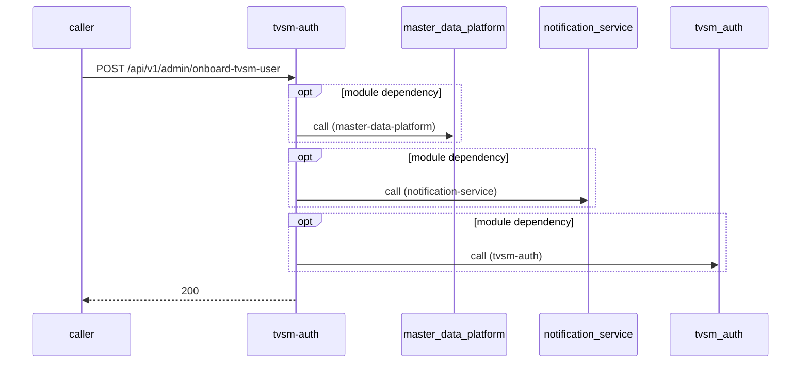

# tvsm-auth — Low-Level Design

## Data Model
tvsm-auth entities from `data_access` items (2).

Store access at `src/main/resources/db/migration/20240116_add_permission.sql:3`: database Unknown; collections -.

### Specialization
Entity `Specialization` defined in `src/main/resources/db/migration/20240911_alter_specialization_&_role.sql:1`; table Specialization; operation write.

| Column | Type | Nullable | Notes |
|---|---|---|---|
| createdAt | datetime | Unknown | - |
| createdBy | integer | Unknown | - |
| description | string | Unknown | - |
| id | integer | Unknown | - |
| multipleAllowed | boolean | Unknown | - |
| name | string | Unknown | - |
| role | Role | Unknown | - |
| updatedAt | datetime | Unknown | - |
| updatedBy | integer | Unknown | - |
| description | string | Unknown | - |
| id | integer | Unknown | - |
| multipleAllowed | boolean | Unknown | - |
| name | string | Unknown | - |
| role | Role | Unknown | - |
Relationships: Unknown.

### department_groups_mapping
Entity `department_groups_mapping` defined in `src/main/resources/db/migration/20240814_base_role_mapping_new_entries.sql:9`; table department_groups_mapping; operation write.
Columns: Unknown (no fields extracted).
Relationships: Unknown.

### departments
Entity `departments` defined in `src/main/resources/db/migration/20250428_update_role_mapping_for_admin_roles.sql:1`; table departments; operation write.
Columns: Unknown (no fields extracted).
Relationships: Unknown.

### designation
Entity `designation` defined in `src/main/resources/db/migration/20240819_add_designation.sql:10`; table designation; operation write.
Columns: Unknown (no fields extracted).
Relationships: Unknown.

### exit_reason
Entity `exit_reason` defined in `src/main/resources/db/migration/20250106_add_exit_reason.sql:7`; table exit_reason; operation write.
Columns: Unknown (no fields extracted).
Relationships: Unknown.

### form_mappings
Entity `form_mappings` defined in `src/main/resources/db/migration/20260827_update_phone_number_validation_for_ums.sql:1`; table form_mappings; operation write.
Columns: Unknown (no fields extracted).
Relationships: Unknown.

### group_info
Entity `group_info` defined in `src/main/resources/db/migration/20240814_base_role_mapping_new_entries.sql:3`; table group_info; operation write.
Columns: Unknown (no fields extracted).
Relationships: Unknown.

### group_roles_mapping
Entity `group_roles_mapping` defined in `src/main/resources/db/migration/20240814_base_role_mapping_new_entries.sql:31`; table group_roles_mapping; operation write.
Columns: Unknown (no fields extracted).
Relationships: Unknown.

### person_group_details
Entity `person_group_details` defined in `src/main/resources/db/migration/20240423_face_tables.sql:15`; table person_group_details; operation write.
Columns: Unknown (no fields extracted).
Relationships: Unknown.

### reporting_role_mapping
Entity `reporting_role_mapping` defined in `src/main/resources/db/migration/20240822_add_reporting_role_mapping.sql:6`; table reporting_role_mapping; operation write.
Columns: Unknown (no fields extracted).
Relationships: Unknown.

### role
Entity `role` defined in `src/main/resources/db/migration/20240814_base_role_mapping_new_entries.sql:15`; table role; operation write.
Columns: Unknown (no fields extracted).
Relationships: Unknown.

### role_application_mapping
Entity `role_application_mapping` defined in `src/main/resources/db/migration/20250422_role_application_mapping.sql:2`; table role_application_mapping; operation write.
Columns: Unknown (no fields extracted).
Relationships: Unknown.

### role_hierarchy
Entity `role_hierarchy` defined in `src/main/resources/db/migration/20250328_add_role_hierarchy.sql:29`; table role_hierarchy; operation write.
Columns: Unknown (no fields extracted).
Relationships: Unknown.

### specialization
Entity `specialization` defined in `src/main/resources/db/migration/20240809_alter_specilization.sql:6`; table specialization; operation write.
Columns: Unknown (no fields extracted).
Relationships: Unknown.

### training_certification
Entity `training_certification` defined in `src/main/resources/db/migration/20240525_training_details_in_users.sql:16`; table training_certification; operation write.
Columns: Unknown (no fields extracted).
Relationships: Unknown.

### address
Entity `address` defined in `src/main/resources/db/migration/data.sql:61`; table address; operation write.
Columns: Unknown (no fields extracted).
Relationships: Unknown.

### bank_details
Entity `bank_details` defined in `src/main/resources/db/migration/data.sql:66`; table bank_details; operation write.
Columns: Unknown (no fields extracted).
Relationships: Unknown.

### role
Entity `role` defined in `src/main/resources/db/migration/data.sql:5`; table role; operation write.
Columns: Unknown (no fields extracted).
Relationships: Unknown.

### user_details
Entity `user_details` defined in `src/main/resources/db/migration/data.sql:71`; table user_details; operation write.
Columns: Unknown (no fields extracted).
Relationships: Unknown.

### user_role_mapping
Entity `user_role_mapping` defined in `src/main/resources/db/migration/data.sql:75`; table user_role_mapping; operation write.
Columns: Unknown (no fields extracted).
Relationships: Unknown.

Store access at `src/main/java/com/tvsmotor/tvsmauth/applications/entity/Application.java:19`: database Unknown; collections -.

### AdUmsRoleMapping
Entity `AdUmsRoleMapping` defined in `src/main/java/com/tvsmotor/tvsmauth/user/profile/entity/AdUmsRoleMapping.java:12`; table Unknown; operation read.
Columns: Unknown (no fields extracted).
Relationships: Unknown.

### Address
Entity `Address` defined in `src/main/java/com/tvsmotor/tvsmauth/user/profile/entity/Address.java:12`; table Unknown; operation both.

| Column | Type | Nullable | Notes |
|---|---|---|---|
| city | string | Unknown | - |
| country | string | Unknown | - |
| id | integer | Unknown | - |
| line1 | string | Unknown | - |
| line2 | string | Unknown | - |
| line3 | string | Unknown | - |
| state | string | Unknown | - |
| zipCode | string | Unknown | - |
| city | string | Unknown | - |
| country | string | Unknown | - |
| id | integer | Unknown | - |
| line1 | string | Unknown | - |
| line2 | string | Unknown | - |
| line3 | string | Unknown | - |
| state | string | Unknown | - |
| zipCode | string | Unknown | - |
Relationships: Unknown.

### Application
Entity `Application` defined in `src/main/java/com/tvsmotor/tvsmauth/applications/entity/Application.java:19`; table Unknown; operation read.

| Column | Type | Nullable | Notes |
|---|---|---|---|
| id | integer | Unknown | - |
| name | string | Unknown | - |
| clientId | string | Unknown | - |
| clientSecret | string | Unknown | - |
| resourceId | string | Unknown | - |
| redirectUri | string | Unknown | - |
| appCallbackUri | string | Unknown | - |
| appLogoutUri | string | Unknown | - |
| loginPolicies | LoginPolicies[] | Unknown | - |
| isEmpConfirmationEnabled | boolean | Unknown | - |
| isEkycEnabled | boolean | Unknown | - |
| authMethods | string | Unknown | - |
| title | string | Unknown | - |
| logoImage | string | Unknown | - |
Relationships: Unknown.

### BankDetails
Entity `BankDetails` defined in `src/main/java/com/tvsmotor/tvsmauth/user/profile/entity/BankDetails.java:16`; table Unknown; operation Unknown.

| Column | Type | Nullable | Notes |
|---|---|---|---|
| id | integer | Unknown | - |
| bankName | string | Unknown | - |
| beneficiaryName | string | Unknown | - |
| ifscCode | string | Unknown | - |
| linkedMobileNumber | string | Unknown | - |
| accountNumber | string | Unknown | - |
| upiId | string | Unknown | - |
| panNumber | string | Unknown | - |
| consentReference | string | Unknown | - |
| passbookReference | string | Unknown | - |
Relationships: Unknown.

### ConflictedUsers
Entity `ConflictedUsers` defined in `src/main/java/com/tvsmotor/tvsmauth/user/profile/entity/ConflictedUsers.java:14`; table Unknown; operation both.
Columns: Unknown (no fields extracted).
Relationships: Unknown.

### Dealer
Entity `Dealer` defined in `src/main/java/com/tvsmotor/tvsmauth/user/profile/entity/Dealer.java:11`; table Unknown; operation Unknown.
Columns: Unknown (no fields extracted).
Relationships: Unknown.

### DealerEmployees
Entity `DealerEmployees` defined in `src/main/java/com/tvsmotor/tvsmauth/user/profile/entity/DealerEmployees.java:13`; table Unknown; operation Unknown.
Columns: Unknown (no fields extracted).
Relationships: Unknown.

### Dealership
Entity `Dealership` defined in `src/main/java/com/tvsmotor/tvsmauth/user/dealership/entity/Dealership.java:17`; table Unknown; operation both.

| Column | Type | Nullable | Notes |
|---|---|---|---|
| address | Address | Unknown | - |
| createdAt | datetime | Unknown | - |
| createdBy | integer | Unknown | - |
| dealerCode | string | Unknown | - |
| dealers | UserDetails[] | Unknown | - |
| emailAddress | string | Unknown | - |
| gstNumber | string | Unknown | - |
| id | integer | Unknown | - |
| mdpStatus | string | Unknown | - |
| name | string | Unknown | - |
| primaryPhoneNumber | string | Unknown | - |
| reason | string | Unknown | - |
| secondaryPhoneNumber | string | Unknown | - |
| type | enum[AMD,AD,AMD_BR] | Unknown | - |
| updatedAt | datetime | Unknown | - |
| updatedBy | integer | Unknown | - |
| address | Address | Unknown | - |
| dealerCode | string | Unknown | - |
| dealers | UserDetails[] | Unknown | - |
| emailAddress | string | Unknown | - |
| gstNumber | string | Unknown | - |
| id | integer | Unknown | - |
| mdpStatus | string | Unknown | - |
| name | string | Unknown | - |
| primaryPhoneNumber | string | Unknown | - |
| reason | string | Unknown | - |
| secondaryPhoneNumber | string | Unknown | - |
| type | enum[AMD,AD,APS,BRANCH,AMD_BR,IB] | Unknown | - |
Relationships: Unknown.

### Department
Entity `Department` defined in `src/main/java/com/tvsmotor/tvsmauth/user/department/entity/Department.java:15`; table Unknown; operation read.

| Column | Type | Nullable | Notes |
|---|---|---|---|
| createdAt | datetime | Unknown | - |
| createdBy | integer | Unknown | - |
| description | string | Unknown | - |
| groups | Group[] | Unknown | - |
| id | integer | Unknown | - |
| name | string | Unknown | - |
| updatedAt | datetime | Unknown | - |
| updatedBy | integer | Unknown | - |
| description | string | Unknown | - |
| groups | Group[] | Unknown | - |
| id | integer | Unknown | - |
| name | string | Unknown | - |
Relationships: Unknown.

### Designation
Entity `Designation` defined in `src/main/java/com/tvsmotor/tvsmauth/user/designation/entity/Designation.java:16`; table Unknown; operation read.

| Column | Type | Nullable | Notes |
|---|---|---|---|
| createdAt | datetime | Unknown | - |
| id | integer | Unknown | - |
| isDefault | boolean | Unknown | - |
| name | string | Unknown | - |
| role | Role | Unknown | - |
| updatedAt | datetime | Unknown | - |
| createdAt | datetime | Unknown | - |
| id | integer | Unknown | - |
| isDefault | boolean | Unknown | - |
| name | string | Unknown | - |
| role | Role | Unknown | - |
| updatedAt | datetime | Unknown | - |
Relationships: Unknown.

### Distributor
Entity `Distributor` defined in `src/main/java/com/tvsmotor/tvsmauth/user/profile/entity/Distributor.java:11`; table Unknown; operation Unknown.
Columns: Unknown (no fields extracted).
Relationships: Unknown.

### EducationDetails
Entity `EducationDetails` defined in `src/main/java/com/tvsmotor/tvsmauth/user/profile/entity/EducationDetails.java:19`; table Unknown; operation Unknown.

| Column | Type | Nullable | Notes |
|---|---|---|---|
| id | integer | Unknown | - |
| degreeName | string | Unknown | - |
| university | string | Unknown | - |
| yearOfPassing | string | Unknown | - |
| percentage | string | Unknown | - |
| educationBoard | string | Unknown | - |
Relationships: Unknown.

### EmployeeId
Entity `EmployeeId` defined in `src/main/java/com/tvsmotor/tvsmauth/user/profile/entity/EmployeeId.java:15`; table Unknown; operation both.
Columns: Unknown (no fields extracted).
Relationships: Unknown.

### ExitReason
Entity `ExitReason` defined in `src/main/java/com/tvsmotor/tvsmauth/user/profile/entity/ExitReason.java:9`; table Unknown; operation read.
Columns: Unknown (no fields extracted).
Relationships: Unknown.

### face_request_audit
Entity `FaceRequestAudit` defined in `src/main/java/com/tvsmotor/tvsmauth/applications/entity/FaceRequestAudit.java:12`; table face_request_audit; operation both.
Columns: Unknown (no fields extracted).
Relationships: Unknown.

### form_attributes
Entity `FormAttribute` defined in `src/main/java/com/tvsmotor/tvsmauth/user/dynamicforms/entity/FormAttribute.java:13`; table form_attributes; operation Unknown.
Columns: Unknown (no fields extracted).
Relationships: Unknown.

### form_mappings
Entity `FormMapping` defined in `src/main/java/com/tvsmotor/tvsmauth/user/dynamicforms/entity/FormMapping.java:16`; table form_mappings; operation read.
Columns: Unknown (no fields extracted).
Relationships: Unknown.

### form_segments
Entity `FormSegment` defined in `src/main/java/com/tvsmotor/tvsmauth/user/dynamicforms/entity/FormSegment.java:14`; table form_segments; operation Unknown.
Columns: Unknown (no fields extracted).
Relationships: Unknown.

### form_subsegments
Entity `FormSubsegment` defined in `src/main/java/com/tvsmotor/tvsmauth/user/dynamicforms/entity/FormSubsegment.java:13`; table form_subsegments; operation Unknown.
Columns: Unknown (no fields extracted).
Relationships: Unknown.

### Group
Entity `Group` defined in `src/main/java/com/tvsmotor/tvsmauth/user/group/entity/Group.java:15`; table Unknown; operation both.

| Column | Type | Nullable | Notes |
|---|---|---|---|
| createdAt | datetime | Unknown | - |
| createdBy | integer | Unknown | - |
| description | string | Unknown | - |
| id | integer | Unknown | - |
| name | string | Unknown | - |
| roles | Role[] | Unknown | - |
| updatedAt | datetime | Unknown | - |
| updatedBy | integer | Unknown | - |
| description | string | Unknown | - |
| id | integer | Unknown | - |
| name | string | Unknown | - |
| roles | Role[] | Unknown | - |
Relationships: Unknown.

### HOUser
Entity `HOUser` defined in `src/main/java/com/tvsmotor/tvsmauth/user/profile/entity/HOUser.java:11`; table Unknown; operation Unknown.
Columns: Unknown (no fields extracted).
Relationships: Unknown.

### LastEmployeeDetails
Entity `LastEmployeeDetails` defined in `src/main/java/com/tvsmotor/tvsmauth/user/profile/entity/LastEmployeeDetails.java:18`; table Unknown; operation Unknown.

| Column | Type | Nullable | Notes |
|---|---|---|---|
| id | integer | Unknown | - |
| roleName | string | Unknown | - |
| organizationName | string | Unknown | - |
| numberOfYears | string | Unknown | - |
Relationships: Unknown.

### LoginPolicies
Entity `LoginPolicies` defined in `src/main/java/com/tvsmotor/tvsmauth/applications/entity/LoginPolicies.java:14`; table Unknown; operation Unknown.

| Column | Type | Nullable | Notes |
|---|---|---|---|
| id | integer | Unknown | - |
| name | string | Unknown | - |
| countryCode | string | Unknown | - |
| isDefault | boolean | Unknown | - |
Relationships: Unknown.

### Permission
Entity `Permission` defined in `src/main/java/com/tvsmotor/tvsmauth/user/permission/entity/Permission.java:12`; table Unknown; operation read.

| Column | Type | Nullable | Notes |
|---|---|---|---|
| createdAt | datetime | Unknown | - |
| createdBy | integer | Unknown | - |
| description | string | Unknown | - |
| id | integer | Unknown | - |
| name | string | Unknown | - |
| updatedAt | datetime | Unknown | - |
| updatedBy | integer | Unknown | - |
| description | string | Unknown | - |
| id | integer | Unknown | - |
| name | string | Unknown | - |
Relationships: Unknown.

### PersonGroupDetails
Entity `PersonGroupDetails` defined in `src/main/java/com/tvsmotor/tvsmauth/user/profile/entity/PersonGroupDetails.java:9`; table Unknown; operation both.
Columns: Unknown (no fields extracted).
Relationships: Unknown.

### ProfessionalDetails
Entity `ProfessionalDetails` defined in `src/main/java/com/tvsmotor/tvsmauth/user/profile/entity/ProfessionalDetails.java:11`; table Unknown; operation Unknown.

| Column | Type | Nullable | Notes |
|---|---|---|---|
| drivingLicenceDateOfExpiry | date | Unknown | - |
| drivingLicenceNumber | string | Unknown | - |
| employeeId | string | Unknown | - |
| id | integer | Unknown | - |
| joiningDate | date | Unknown | - |
| drivingLicenceDateOfExpiry | date | Unknown | - |
| drivingLicenceNumber | string | Unknown | - |
| employeeId | string | Unknown | - |
| id | integer | Unknown | - |
| joiningDate | date | Unknown | - |
| lastWorkingDate | date | Unknown | - |
Relationships: Unknown.

### Role
Entity `Role` defined in `src/main/java/com/tvsmotor/tvsmauth/user/role/entity/Role.java:21`; table Unknown; operation both.

| Column | Type | Nullable | Notes |
|---|---|---|---|
| bankDetailsMandatory | boolean | Unknown | - |
| canBePassiveUser | boolean | Unknown | - |
| createdAt | datetime | Unknown | - |
| createdBy | integer | Unknown | - |
| description | string | Unknown | - |
| designation | Designation[] | Unknown | - |
| id | integer | Unknown | - |
| multipleBranchAccess | boolean | Unknown | - |
| name | string | Unknown | - |
| permissions | Permission[] | Unknown | - |
| roleType | enum[BASE_ROLE,APPLICATION] | Unknown | - |
| roles | Role[] | Unknown | - |
| specializationMultiMandatory | boolean | Unknown | - |
| updatedAt | datetime | Unknown | - |
| updatedBy | integer | Unknown | - |
| applications | Application[] | Unknown | - |
| bankDetailsMandatory | boolean | Unknown | - |
| canBePassiveUser | boolean | Unknown | - |
| childRoles | RoleHierarchy[] | Unknown | - |
| description | string | Unknown | - |
| designation | Designation[] | Unknown | - |
| id | integer | Unknown | - |
| isEmpConfirmationEnabled | boolean | Unknown | - |
| multipleBranchAccess | boolean | Unknown | - |
| name | string | Unknown | - |
| parentRoles | RoleHierarchy[] | Unknown | - |
| permissions | Permission[] | Unknown | - |
| roleType | enum[BASE_ROLE,APPLICATION] | Unknown | - |
| roles | Role[] | Unknown | - |
| specializationMultiMandatory | boolean | Unknown | - |
Relationships: Unknown.

### RoleHierarchy
Entity `RoleHierarchy` defined in `src/main/java/com/tvsmotor/tvsmauth/user/profile/entity/RoleHierarchy.java:11`; table Unknown; operation read.

| Column | Type | Nullable | Notes |
|---|---|---|---|
| id | integer | Unknown | - |
| parentRole | Role | Unknown | - |
| childRole | Role | Unknown | - |
Relationships: Unknown.

### Specialization
Entity `Specialization` defined in `src/main/java/com/tvsmotor/tvsmauth/user/specialization/entity/Specialization.java:13`; table Unknown; operation read.

| Column | Type | Nullable | Notes |
|---|---|---|---|
| createdAt | datetime | Unknown | - |
| createdBy | integer | Unknown | - |
| description | string | Unknown | - |
| id | integer | Unknown | - |
| multipleAllowed | boolean | Unknown | - |
| name | string | Unknown | - |
| role | Role | Unknown | - |
| updatedAt | datetime | Unknown | - |
| updatedBy | integer | Unknown | - |
| description | string | Unknown | - |
| id | integer | Unknown | - |
| multipleAllowed | boolean | Unknown | - |
| name | string | Unknown | - |
| role | Role | Unknown | - |
Relationships: Unknown.

### SupportUser
Entity `SupportUser` defined in `src/main/java/com/tvsmotor/tvsmauth/user/profile/entity/SupportUser.java:11`; table Unknown; operation Unknown.
Columns: Unknown (no fields extracted).
Relationships: Unknown.

### TrainingCertification
Entity `TrainingCertification` defined in `src/main/java/com/tvsmotor/tvsmauth/user/profile/entity/TrainingCertification.java:13`; table Unknown; operation read.

| Column | Type | Nullable | Notes |
|---|---|---|---|
| id | integer | Unknown | - |
| title | string | Unknown | - |
| id | integer | Unknown | - |
| title | string | Unknown | - |
Relationships: Unknown.

### TvsmUser
Entity `TvsmUser` defined in `src/main/java/com/tvsmotor/tvsmauth/user/profile/entity/TvsmUser.java:11`; table Unknown; operation Unknown.
Columns: Unknown (no fields extracted).
Relationships: Unknown.

### Type
Entity `Type` defined in `src/main/java/com/tvsmotor/tvsmauth/user/type/entity/Type.java:13`; table Unknown; operation read.

| Column | Type | Nullable | Notes |
|---|---|---|---|
| createdAt | datetime | Unknown | - |
| createdBy | integer | Unknown | - |
| description | string | Unknown | - |
| id | integer | Unknown | - |
| name | string | Unknown | - |
| role | Role | Unknown | - |
| updatedAt | datetime | Unknown | - |
| updatedBy | integer | Unknown | - |
| description | string | Unknown | - |
| id | integer | Unknown | - |
| name | string | Unknown | - |
| role | Role | Unknown | - |
Relationships: Unknown.

### UserApplicationMapping
Entity `UserApplicationMapping` defined in `src/main/java/com/tvsmotor/tvsmauth/user/profile/entity/UserApplicationMapping.java:16`; table Unknown; operation both.
Columns: Unknown (no fields extracted).
Relationships: Unknown.

### UserBaseRoleMapping
Entity `UserBaseRoleMapping` defined in `src/main/java/com/tvsmotor/tvsmauth/user/profile/entity/UserBaseRoleMapping.java:16`; table Unknown; operation write.

| Column | Type | Nullable | Notes |
|---|---|---|---|
| defaultRole | boolean | Unknown | - |
| department | Department | Unknown | - |
| group | Group | Unknown | - |
| id | integer | Unknown | - |
| role | Role | Unknown | - |
| specializations | Specialization[] | Unknown | - |
| type | Type | Unknown | - |
| userDetails | UserDetails | Unknown | - |
| userReportingRoleMapping | UserReportingRoleMapping | Unknown | - |
| department | Department | Unknown | - |
| group | Group | Unknown | - |
| id | integer | Unknown | - |
| role | Role | Unknown | - |
| specializations | Specialization[] | Unknown | - |
| type | Type | Unknown | - |
| userDetails | UserDetails | Unknown | - |
| userReportingRoleMapping | UserReportingRoleMapping | Unknown | - |
Relationships: Unknown.

### UserBranchMapping
Entity `UserBranchMapping` defined in `src/main/java/com/tvsmotor/tvsmauth/user/profile/entity/UserBranchMapping.java:16`; table Unknown; operation Unknown.

| Column | Type | Nullable | Notes |
|---|---|---|---|
| id | integer | Unknown | - |
| userDealershipMapping | UserDealershipMapping | Unknown | - |
| branchCode | string | Unknown | - |
| branchName | string | Unknown | - |
| branchSequence | integer | Unknown | - |
Relationships: Unknown.

### UserConsentDetails
Entity `UserConsentDetails` defined in `src/main/java/com/tvsmotor/tvsmauth/user/profile/ekyc/entity/UserConsentDetails.java:18`; table Unknown; operation both.

| Column | Type | Nullable | Notes |
|---|---|---|---|
| consentAccepted | boolean | Unknown | - |
| createdAt | datetime | Unknown | - |
| id | integer | Unknown | - |
| privacyPolicyAccepted | boolean | Unknown | - |
| requestId | string | Unknown | - |
| status | enum[INITIATED,COMPLETED,EXPIRED,SMS_SENT_FAILED] | Unknown | - |
| termsAndConditionsAccepted | boolean | Unknown | - |
| updatedAt | datetime | Unknown | - |
| userDetails | UserDetails | Unknown | - |
| userKey | string | Unknown | - |
| consentAccepted | boolean | Unknown | - |
| createdAt | datetime | Unknown | - |
| id | integer | Unknown | - |
| privacyPolicyAccepted | boolean | Unknown | - |
| requestId | string | Unknown | - |
| status | enum[INITIATED,COMPLETED,EXPIRED,SMS_SENT_FAILED] | Unknown | - |
| termsAndConditionsAccepted | boolean | Unknown | - |
| updatedAt | datetime | Unknown | - |
| userDetails | UserDetails | Unknown | - |
| userKey | string | Unknown | - |
Relationships: Unknown.

### UserDealershipMapping
Entity `UserDealershipMapping` defined in `src/main/java/com/tvsmotor/tvsmauth/user/profile/entity/UserDealershipMapping.java:21`; table Unknown; operation read.

| Column | Type | Nullable | Notes |
|---|---|---|---|
| id | integer | Unknown | - |
| userDetails | UserDetails | Unknown | - |
| dealerId | string | Unknown | - |
| branches | UserBranchMapping[] | Unknown | - |
Relationships: Unknown.

### UserDetails
Entity `UserDetails` defined in `src/main/java/com/tvsmotor/tvsmauth/user/profile/entity/UserDetails.java:33`; table Unknown; operation both.

| Column | Type | Nullable | Notes |
|---|---|---|---|
| address | Address | Unknown | - |
| b2cUserId | string | Unknown | - |
| baseRoles | UserBaseRoleMapping[] | Unknown | - |
| branches | BranchInfo[] | Unknown | - |
| comments | string | Unknown | - |
| createdAt | datetime | Unknown | - |
| createdBy | integer | Unknown | - |
| dateOfBirth | date | Unknown | - |
| dealerId | string | Unknown | - |
| email | string | Unknown | - |
| firstName | string | Unknown | - |
| gender | enum[FEMALE,MALE] | Unknown | - |
| id | integer | Unknown | - |
| lastName | string | Unknown | - |
| loginId | string | Unknown | - |
| maritialStatus | enum[UNMARRIED,MARRIED] | Unknown | - |
| multipleBranchAllowed | boolean | Unknown | - |
| password | string | Unknown | - |
| primaryPhoneNumber | string | Unknown | - |
| professionalDetails | ProfessionalDetails | Unknown | - |
| secondaryPhoneNumber | string | Unknown | - |
| status | enum[ACTIVE,PASSIVE,INACTIVE,PENDING_ACTIVE] | Unknown | - |
| trainingCertifications | TrainingCertification[] | Unknown | - |
| updatedAt | datetime | Unknown | - |
| updatedBy | integer | Unknown | - |
| userActive | boolean | Unknown | - |
| userActiveOrPassive | boolean | Unknown | - |
| userActiveOrPendingActive | boolean | Unknown | - |
| userConsentDetails | UserConsentDetails[] | Unknown | - |
| userEkycDetails | UserEkycDetails[] | Unknown | - |
| userFaceDetails | UserFaceDetails | Unknown | - |
| userInactive | boolean | Unknown | - |
| userLoginAudit | UserLoginAudit | Unknown | - |
| userPendingActive | boolean | Unknown | - |
| userType | enum[DEALER,DEALER_EMPLOYEE,CUSTOMER,HO] | Unknown | - |
| address | Address | Unknown | - |
| b2cUserId | string | Unknown | - |
| bankDetails | BankDetails | Unknown | - |
| baseRoles | UserBaseRoleMapping[] | Unknown | - |
| branches | BranchInfo[] | Unknown | - |
| … | 26 more | | |
Relationships: Unknown.

### UserEkycDetails
Entity `UserEkycDetails` defined in `src/main/java/com/tvsmotor/tvsmauth/user/profile/ekyc/entity/UserEkycDetails.java:18`; table Unknown; operation write.

| Column | Type | Nullable | Notes |
|---|---|---|---|
| comments | string | Unknown | - |
| createdAt | datetime | Unknown | - |
| createdBy | integer | Unknown | - |
| id | integer | Unknown | - |
| type | enum[PAN,DL,BANK] | Unknown | - |
| updatedAt | datetime | Unknown | - |
| updatedBy | integer | Unknown | - |
| userDetails | UserDetails | Unknown | - |
| value | map<string,object> | Unknown | - |
| verified | boolean | Unknown | - |
| comments | string | Unknown | - |
| id | integer | Unknown | - |
| type | enum[PAN,DL,BANK] | Unknown | - |
| userDetails | UserDetails | Unknown | - |
| value | map<string,object> | Unknown | - |
| verified | boolean | Unknown | - |
Relationships: Unknown.

### UserFaceDetails
Entity `UserFaceDetails` defined in `src/main/java/com/tvsmotor/tvsmauth/user/profile/entity/UserFaceDetails.java:9`; table Unknown; operation read.

| Column | Type | Nullable | Notes |
|---|---|---|---|
| faceId | string | Unknown | - |
| groupId | string | Unknown | - |
| id | integer | Unknown | - |
| personId | string | Unknown | - |
| user | UserDetails | Unknown | - |
| faceId | string | Unknown | - |
| faceLivenessChecked | boolean | False | - |
| groupId | string | Unknown | - |
| id | integer | Unknown | - |
| personId | string | Unknown | - |
| user | UserDetails | Unknown | - |
Relationships: Unknown.

### UserLoginAudit
Entity `UserLoginAudit` defined in `src/main/java/com/tvsmotor/tvsmauth/user/profile/entity/UserLoginAudit.java:11`; table Unknown; operation both.

| Column | Type | Nullable | Notes |
|---|---|---|---|
| id | integer | Unknown | - |
| user | UserDetails | Unknown | - |
| appId | string | Unknown | - |
| lastLogin | datetime | Unknown | - |
Relationships: Unknown.

### UserReportingRoleMapping
Entity `UserReportingRoleMapping` defined in `src/main/java/com/tvsmotor/tvsmauth/user/profile/entity/UserReportingRoleMapping.java:12`; table Unknown; operation Unknown.

| Column | Type | Nullable | Notes |
|---|---|---|---|
| designation | Designation | Unknown | - |
| designationOther | boolean | Unknown | - |
| designationValue | string | Unknown | - |
| id | integer | Unknown | - |
| reportingRole | Role | Unknown | - |
| reportingUserDetails | UserDetails | Unknown | - |
| userBaseRoleMapping | UserBaseRoleMapping | Unknown | - |
| designation | Designation | Unknown | - |
| designationValue | string | Unknown | - |
| id | integer | Unknown | - |
| isDesignationOther | boolean | False | - |
| reportingRole | Role | Unknown | - |
| reportingUserDetails | UserDetails | Unknown | - |
| userBaseRoleMapping | UserBaseRoleMapping | Unknown | - |
Relationships: Unknown.

### ad_ums_role_mapping
Entity `ad_ums_role_mapping` defined in `src/main/java/com/tvsmotor/tvsmauth/user/profile/repository/AdUmsRoleMappingRepository.java:13`; table ad_ums_role_mapping; operation read.
Columns: Unknown (no fields extracted).
Relationships: Unknown.

### application
Entity `application` defined in `src/main/java/com/tvsmotor/tvsmauth/user/profile/repository/UserApplicationMappingRepository.java:27`; table application; operation read.
Columns: Unknown (no fields extracted).
Relationships: Unknown.

### person_group_details
Entity `person_group_details` defined in `src/main/java/com/tvsmotor/tvsmauth/user/profile/repository/PersonGroupDetailsRepository.java:12`; table person_group_details; operation read.
Columns: Unknown (no fields extracted).
Relationships: Unknown.

### user_application_mapping
Entity `user_application_mapping` defined in `src/main/java/com/tvsmotor/tvsmauth/user/profile/repository/UserApplicationMappingRepository.java:27`; table user_application_mapping; operation read.
Columns: Unknown (no fields extracted).
Relationships: Unknown.

### user_branch_mapping
Entity `user_branch_mapping` defined in `src/main/java/com/tvsmotor/tvsmauth/user/profile/repository/UserDetailsRepository.java:29`; table user_branch_mapping; operation read.
Columns: Unknown (no fields extracted).
Relationships: Unknown.

### user_dealership_mapping
Entity `user_dealership_mapping` defined in `src/main/java/com/tvsmotor/tvsmauth/user/profile/repository/UserDealershipMappingRepository.java:18`; table user_dealership_mapping; operation read.
Columns: Unknown (no fields extracted).
Relationships: Unknown.

### user_details
Entity `user_details` defined in `src/main/java/com/tvsmotor/tvsmauth/user/profile/repository/UserDealershipMappingRepository.java:18`; table user_details; operation read.
Columns: Unknown (no fields extracted).
Relationships: Unknown.

## State Machines
tvsm-auth status/state enums found in code (5); transitions are not determinable from code.
- `ConsentStatus` (`src/main/java/com/tvsmotor/tvsmauth/user/profile/ekyc/entity/ConsentStatus.java:6`): INITIATED, COMPLETED, EXPIRED, SMS_SENT_FAILED
- `MaritialStatus` (`src/main/java/com/tvsmotor/tvsmauth/user/profile/enums/MaritialStatus.java:3`): UNMARRIED, MARRIED
- `Status` (`src/main/java/com/tvsmotor/tvsmauth/user/profile/enums/Status.java:6`): ACTIVE, PASSIVE, INACTIVE, PENDING_ACTIVE
- `UserConsentStatus` (`src/main/java/com/tvsmotor/tvsmauth/user/profile/ekyc/entity/UserConsentStatus.java:6`): ACCEPTED, REJECTED
- `UserStatusDto` (`src/main/java/com/tvsmotor/tvsmauth/user/profile/enums/UserStatusDto.java:3`): ACCEPT, REJECT, CONFLICT_APPROVE, CONFLICT_REJECT, ACTIVATE

## Business Rules
tvsm-auth validation rules on DTO fields (from schema `validation`):

| Schema.field | Rule | Defined in |
|---|---|---|
| `AddressDto.zipCode` | pattern=^[0-9]*$ | `src/main/java/com/tvsmotor/tvsmauth/user/profile/dto/AddressDto.java:13` |
| `AddressDto.zipCode` | pattern=NUMERIC | `src/main/java/com/tvsmotor/tvsmauth/user/profile/dto/AddressDto.java:13` |
| `AuthenticatedFaceSessionRequest.deviceCorrelationId` | maxLength=64;pattern=^[A-Za-z0-9\-_:.]+$ | `src/main/java/com/tvsmotor/tvsmauth/applications/dto/AuthenticatedFaceSessionRequest.java:10` |
| `BankDetailsDto.accountNumber` | pattern=^[0-9]*$ | `src/main/java/com/tvsmotor/tvsmauth/user/profile/dto/BankDetailsDto.java:12` |
| `BankDetailsDto.bankName` | pattern=^[a-zA-Z\s]*$ | `src/main/java/com/tvsmotor/tvsmauth/user/profile/dto/BankDetailsDto.java:12` |
| `BankDetailsDto.beneficiaryName` | pattern=^[a-zA-Z\s]*$ | `src/main/java/com/tvsmotor/tvsmauth/user/profile/dto/BankDetailsDto.java:12` |
| `BankDetailsDto.ifscCode` | pattern=^[a-zA-Z0-9]*$ | `src/main/java/com/tvsmotor/tvsmauth/user/profile/dto/BankDetailsDto.java:12` |
| `BankDetailsDto.linkedMobileNumber` | pattern=^(\+?[0-9]*)$ | `src/main/java/com/tvsmotor/tvsmauth/user/profile/dto/BankDetailsDto.java:12` |
| `BankDetailsDto.panNumber` | pattern=^[a-zA-Z0-9]*$ | `src/main/java/com/tvsmotor/tvsmauth/user/profile/dto/BankDetailsDto.java:12` |
| `BankDetailsDto.accountNumber` | pattern=NUMERIC | `src/main/java/com/tvsmotor/tvsmauth/user/profile/dto/BankDetailsDto.java:12` |
| `BankDetailsDto.bankName` | pattern=ALPHABET_WITH_SPACE | `src/main/java/com/tvsmotor/tvsmauth/user/profile/dto/BankDetailsDto.java:12` |
| `BankDetailsDto.beneficiaryName` | pattern=ALPHABET_WITH_SPACE | `src/main/java/com/tvsmotor/tvsmauth/user/profile/dto/BankDetailsDto.java:12` |
| `BankDetailsDto.ifscCode` | pattern=ALPHA_NUMERIC | `src/main/java/com/tvsmotor/tvsmauth/user/profile/dto/BankDetailsDto.java:12` |
| `BankDetailsDto.linkedMobileNumber` | pattern=PHONE_NUMBER | `src/main/java/com/tvsmotor/tvsmauth/user/profile/dto/BankDetailsDto.java:12` |
| `BankDetailsDto.panNumber` | pattern=ALPHA_NUMERIC | `src/main/java/com/tvsmotor/tvsmauth/user/profile/dto/BankDetailsDto.java:12` |
| `DeactivationRequestDto.lastWorkingDate` | pastOrPresent | `src/main/java/com/tvsmotor/tvsmauth/user/profile/dto/DeactivationRequestDto.java:10` |
| `DealerEmployeeCreateRequest.firstName` | pattern=^[a-zA-Z\s]*$ | `ums-api-specs.yml:1799` |
| `DealerEmployeeCreateRequest.lastName` | pattern=^[a-zA-Z\s]*$ | `ums-api-specs.yml:1799` |
| `DealerEmployeeCreateRequest.primaryPhoneNumber` | pattern=^(\+?[0-9]*)$ | `ums-api-specs.yml:1799` |
| `DealerEmployeeCreateRequest.secondaryPhoneNumber` | pattern=^(\+?[0-9]*)$ | `ums-api-specs.yml:1799` |
| `DealerEmployeeDetailsDto.firstName` | pattern=^[a-zA-Z\s]*$ | `src/main/java/com/tvsmotor/tvsmauth/user/profile/dto/DealerEmployeeDetailsDto.java:14` |
| `DealerEmployeeDetailsDto.lastName` | pattern=^[a-zA-Z\s]*$ | `src/main/java/com/tvsmotor/tvsmauth/user/profile/dto/DealerEmployeeDetailsDto.java:14` |
| `DealerEmployeeDetailsDto.primaryPhoneNumber` | pattern=^(\+?[0-9]*)$ | `src/main/java/com/tvsmotor/tvsmauth/user/profile/dto/DealerEmployeeDetailsDto.java:14` |
| `DealerEmployeeDetailsDto.secondaryPhoneNumber` | pattern=^(\+?[0-9]*)$ | `src/main/java/com/tvsmotor/tvsmauth/user/profile/dto/DealerEmployeeDetailsDto.java:14` |
| `DealerEmployeeResponseDto.firstName` | pattern=^[a-zA-Z\s]*$ | `src/main/java/com/tvsmotor/tvsmauth/user/profile/dto/DealerEmployeeResponseDto.java:36` |
| `DealerEmployeeResponseDto.lastName` | pattern=^[a-zA-Z\s]*$ | `src/main/java/com/tvsmotor/tvsmauth/user/profile/dto/DealerEmployeeResponseDto.java:36` |
| `DealerEmployeeResponseDto.primaryPhoneNumber` | pattern=^(\+?[0-9]*)$ | `src/main/java/com/tvsmotor/tvsmauth/user/profile/dto/DealerEmployeeResponseDto.java:36` |
| `DealerEmployeeResponseDto.secondaryPhoneNumber` | pattern=^(\+?[0-9]*)$ | `src/main/java/com/tvsmotor/tvsmauth/user/profile/dto/DealerEmployeeResponseDto.java:36` |
| `DealerEmployeeUpdateRequest.firstName` | pattern=^[a-zA-Z\s]*$ | `src/main/java/com/tvsmotor/tvsmauth/user/profile/dto/DealerEmployeeUpdateRequest.java:29` |
| `DealerEmployeeUpdateRequest.lastName` | pattern=^[a-zA-Z\s]*$ | `src/main/java/com/tvsmotor/tvsmauth/user/profile/dto/DealerEmployeeUpdateRequest.java:29` |
| `DealerEmployeeUpdateRequest.primaryPhoneNumber` | pattern=^(\+?[0-9]*)$ | `src/main/java/com/tvsmotor/tvsmauth/user/profile/dto/DealerEmployeeUpdateRequest.java:29` |
| `DealerEmployeeUpdateRequest.secondaryPhoneNumber` | pattern=^(\+?[0-9]*)$ | `src/main/java/com/tvsmotor/tvsmauth/user/profile/dto/DealerEmployeeUpdateRequest.java:29` |
| `DealerEmployeeUpdateRequest.bankDetails` | valid | `src/main/java/com/tvsmotor/tvsmauth/user/profile/dto/DealerEmployeeUpdateRequest.java:29` |
| `DealerEmployeeUpdateRequest.baseRoles` | valid | `src/main/java/com/tvsmotor/tvsmauth/user/profile/dto/DealerEmployeeUpdateRequest.java:29` |
| `DealerEmployeeUpdateRequest.educationDetails` | valid | `src/main/java/com/tvsmotor/tvsmauth/user/profile/dto/DealerEmployeeUpdateRequest.java:29` |
| `DealerEmployeeUpdateRequest.lastEmployeeDetails` | valid | `src/main/java/com/tvsmotor/tvsmauth/user/profile/dto/DealerEmployeeUpdateRequest.java:29` |
| `DynamicUserDto.formSegments` | valid | `src/main/java/com/tvsmotor/tvsmauth/user/dynamicforms/dto/DynamicUserDto.java:17` |
| `EducationDetailsDto.educationBoard` | pattern=^[a-zA-Z\s]*$ | `src/main/java/com/tvsmotor/tvsmauth/user/profile/dto/EducationDetailsDto.java:18` |
| `EducationDetailsDto.percentage` | pattern=^[0-9]*$ | `src/main/java/com/tvsmotor/tvsmauth/user/profile/dto/EducationDetailsDto.java:18` |
| `EducationDetailsDto.university` | pattern=^[a-zA-Z\s]*$ | `src/main/java/com/tvsmotor/tvsmauth/user/profile/dto/EducationDetailsDto.java:18` |
| `EducationDetailsDto.yearOfPassing` | pattern=^[0-9]*$ | `src/main/java/com/tvsmotor/tvsmauth/user/profile/dto/EducationDetailsDto.java:18` |
| `EducationDetailsDto.educationBoard` | pattern=ALPHABET_WITH_SPACE | `src/main/java/com/tvsmotor/tvsmauth/user/profile/dto/EducationDetailsDto.java:18` |
| `EducationDetailsDto.percentage` | pattern=NUMERIC | `src/main/java/com/tvsmotor/tvsmauth/user/profile/dto/EducationDetailsDto.java:18` |
| `EducationDetailsDto.university` | pattern=ALPHABET_WITH_SPACE | `src/main/java/com/tvsmotor/tvsmauth/user/profile/dto/EducationDetailsDto.java:18` |
| `EducationDetailsDto.yearOfPassing` | pattern=NUMERIC | `src/main/java/com/tvsmotor/tvsmauth/user/profile/dto/EducationDetailsDto.java:18` |
| `FaceSessionRequest.deviceCorrelationId` | maxLength=64;pattern=^[A-Za-z0-9\-_:.]+$ | `src/main/java/com/tvsmotor/tvsmauth/applications/dto/FaceSessionRequest.java:10` |
| `LastEmployeeDetailsDto.numberOfYears` | pattern=^[0-9]*$ | `src/main/java/com/tvsmotor/tvsmauth/user/profile/dto/LastEmployeeDetailsDto.java:18` |
| `LastEmployeeDetailsDto.organizationName` | pattern=^[a-zA-Z\s]*$ | `src/main/java/com/tvsmotor/tvsmauth/user/profile/dto/LastEmployeeDetailsDto.java:18` |
| `LastEmployeeDetailsDto.roleName` | pattern=^[a-zA-Z\s]*$ | `src/main/java/com/tvsmotor/tvsmauth/user/profile/dto/LastEmployeeDetailsDto.java:18` |
| `LastEmployeeDetailsDto.numberOfYears` | pattern=NUMERIC | `src/main/java/com/tvsmotor/tvsmauth/user/profile/dto/LastEmployeeDetailsDto.java:18` |
| `LastEmployeeDetailsDto.organizationName` | pattern=ALPHABET_WITH_SPACE | `src/main/java/com/tvsmotor/tvsmauth/user/profile/dto/LastEmployeeDetailsDto.java:18` |
| `LastEmployeeDetailsDto.roleName` | pattern=ALPHABET_WITH_SPACE | `src/main/java/com/tvsmotor/tvsmauth/user/profile/dto/LastEmployeeDetailsDto.java:18` |
| `ProfessionalDetailsDto.drivingLicenceNumber` | pattern=/^[A-Za-z0-9 s-]*$/ | `src/main/java/com/tvsmotor/tvsmauth/user/profile/dto/ProfessionalDetailsDto.java:15` |
| `ProfessionalDetailsDto.drivingLicenceNumber` | pattern=ALPHA_NUMERIC_SPACE_HYPHEN | `src/main/java/com/tvsmotor/tvsmauth/user/profile/dto/ProfessionalDetailsDto.java:15` |
| `UserDetails.email` | email | `src/main/java/com/tvsmotor/tvsmauth/user/profile/entity/UserDetails.java:33` |
| `UserGeneralInfoDto.firstName` | pattern=ALPHABET_WITH_SPACE | `src/main/java/com/tvsmotor/tvsmauth/user/profile/dto/UserGeneralInfoDto.java:18` |
| `UserGeneralInfoDto.lastName` | pattern=ALPHABET_WITH_SPACE | `src/main/java/com/tvsmotor/tvsmauth/user/profile/dto/UserGeneralInfoDto.java:18` |
| `UserGeneralInfoDto.dateOfBirth` | past | `src/main/java/com/tvsmotor/tvsmauth/user/profile/dto/UserGeneralInfoDto.java:18` |
| `UserGeneralInfoDto.email` | email | `src/main/java/com/tvsmotor/tvsmauth/user/profile/dto/UserGeneralInfoDto.java:18` |
| `UserGeneralInfoDto.primaryPhoneNumber` | pattern=PHONE_NUMBER | `src/main/java/com/tvsmotor/tvsmauth/user/profile/dto/UserGeneralInfoDto.java:18` |
| `UserGeneralInfoDto.secondaryPhoneNumber` | pattern=PHONE_NUMBER | `src/main/java/com/tvsmotor/tvsmauth/user/profile/dto/UserGeneralInfoDto.java:18` |
| `UserGeneralInfoDto.address` | valid | `src/main/java/com/tvsmotor/tvsmauth/user/profile/dto/UserGeneralInfoDto.java:18` |
| `UserStatusChangeRequest.status` | valid | `src/main/java/com/tvsmotor/tvsmauth/user/profile/dto/UserStatusChangeRequest.java:11` |
| `ValidationRequest.dateOfBirth` | past | `src/main/java/com/tvsmotor/tvsmauth/user/profile/ekyc/dto/ValidationRequest.java:16` |

## Key Classes and Functions
tvsm-auth key classes:

| Class / Function | File | Responsibility |
|---|---|---|
| `AdminController` | `src/main/java/com/tvsmotor/tvsmauth/user/profile/api/AdminController.java` | HTTP handlers |
| `UserApplicationController` | `src/main/java/com/tvsmotor/tvsmauth/user/profile/api/UserApplicationController.java` | HTTP handlers |
| `DealerController` | `src/main/java/com/tvsmotor/tvsmauth/user/profile/api/DealerController.java` | HTTP handlers |
| `DepartmentController` | `src/main/java/com/tvsmotor/tvsmauth/user/department/api/DepartmentController.java` | HTTP handlers |
| `GroupController` | `src/main/java/com/tvsmotor/tvsmauth/user/group/api/GroupController.java` | HTTP handlers |
| `LocationController` | `src/main/java/com/tvsmotor/tvsmauth/user/location/api/LocationController.java` | HTTP handlers |
| `RoleController` | `src/main/java/com/tvsmotor/tvsmauth/user/role/api/RoleController.java` | HTTP handlers |
| `UserProfileController` | `src/main/java/com/tvsmotor/tvsmauth/user/profile/api/UserProfileController.java` | HTTP handlers |
| `ApplicationController` | `src/main/java/com/tvsmotor/tvsmauth/applications/controller/ApplicationController.java` | HTTP handlers |
| `ConsentController` | `api-specs.yml` | HTTP handlers |
| `DynamicFormController` | `src/main/java/com/tvsmotor/tvsmauth/user/dynamicforms/api/DynamicFormController.java` | HTTP handlers |
| `EkycController` | `src/main/java/com/tvsmotor/tvsmauth/user/profile/ekyc/api/EkycController.java` | HTTP handlers |
| `CacheClearScheduler.evictAllCachesAtIntervals` | `src/main/java/com/tvsmotor/tvsmauth/config/CacheClearScheduler.java:16` | scheduled job |
| `NotificationReminder.sendSMSForFaceLogin` | `src/main/java/com/tvsmotor/tvsmauth/user/profile/scheduler/NotificationReminder.java:43` | scheduled job |
| publish dev.ums.user_apps | `src/main/java/com/tvsmotor/tvsmauth/user/gateway/AzureServiceBusPublisher.java:49` | azure-service-bus messaging |
| `@RestControllerAdvice` | `src/main/java/com/tvsmotor/tvsmauth/applications/controller/ApplicationExceptionHandler.java:15` | error handling |
| `@ControllerAdvice` | `src/main/java/com/tvsmotor/tvsmauth/applications/controller/ValidationHandler.java:18` | error handling |

## Sequence Details
tvsm-auth sequence for `POST /api/v1/admin/onboard-tvsm-user` (handler `AdminController.onboardTvsmUser`); downstream calls inside the handler are not traced from code, module-level targets shown as optional.

## Error Handling
tvsm-auth error handling: `src/main/java/com/tvsmotor/tvsmauth/applications/controller/ApplicationExceptionHandler.java:15` (@RestControllerAdvice), `src/main/java/com/tvsmotor/tvsmauth/applications/controller/ValidationHandler.java:18` (@ControllerAdvice). Documented error statuses come from response annotations in API_SPEC.md. Retry evidence: `src/main/java/com/tvsmotor/tvsmauth/user/profile/service/UserProfileService.java:440`.

## Configuration Details
tvsm-auth behaviour-relevant config keys (names only; full list in OVERVIEW.md):
- `location-master.baseUrl`: points to `tvsm-auth`
- `mdp.baseUrl`: points to `master-data-platform`
- `notification.baseUrl`: points to `notification-service`
- `config:azure.faceApi.url`: base URL for outbound calls
- `config:application.b2c.baseUri`: base URL for outbound calls
- `config:location-master.baseUrl`: base URL for outbound calls
- `config:mdp.baseUrl`: base URL for outbound calls
- `config:application.ums.tokenUrl`: base URL for outbound calls
- `config:karza.baseUrl`: base URL for outbound calls
- `config:notification.baseUrl`: base URL for outbound calls
- `azure.servicebus.topic-name`: publish entity name
- job `NotificationReminder.sendSMSForFaceLogin` schedule from config:application.user.face-api-login-reminder-cron

## Edge Cases
tvsm-auth edge cases: N/A — not determinable from code without manual review.
