# tvsm-marketplace-service — Data Flows

## Flow Index
tvsm-marketplace-service takes part in 22 end-to-end flow(s) in registry/flows.json.

| flow_id | Name | Role of tvsm-marketplace-service | Trigger |
|---|---|---|---|
| tvsm-marketplace-service--external-juspay | tvsm-marketplace-service → external:juspay (2 hops) | entry | scheduled job(s) in tvsm-marketplace-service (job-to-call link not resolved): AmazonPriceUpdateExecutorService.scheduledDrain, FlipkartPriceUpdateExecutorService.scheduledDrain, MarketplacePriceUpdateTaskService.cleanupDoneTasks (+2 more); request to tvsm-marketplace-service from outside the registry (no internal caller) |
| tvsm-marketplace-service--external-salesforce-0499bb | tvsm-marketplace-service → external:salesforce (4 hops) | entry | scheduled job(s) in tvsm-marketplace-service (job-to-call link not resolved): AmazonPriceUpdateExecutorService.scheduledDrain, FlipkartPriceUpdateExecutorService.scheduledDrain, MarketplacePriceUpdateTaskService.cleanupDoneTasks (+2 more); request to tvsm-marketplace-service from outside the registry (no internal caller) |
| tvsm-marketplace-service--external-salesforce-18fcb0 | tvsm-marketplace-service → external:salesforce (3 hops) | entry | scheduled job(s) in tvsm-marketplace-service (job-to-call link not resolved): AmazonPriceUpdateExecutorService.scheduledDrain, FlipkartPriceUpdateExecutorService.scheduledDrain, MarketplacePriceUpdateTaskService.cleanupDoneTasks (+2 more); request to tvsm-marketplace-service from outside the registry (no internal caller) |
| tvsm-marketplace-service--external-salesforce-1dcb9e | tvsm-marketplace-service → external:salesforce (5 hops) | entry | scheduled job(s) in tvsm-marketplace-service (job-to-call link not resolved): AmazonPriceUpdateExecutorService.scheduledDrain, FlipkartPriceUpdateExecutorService.scheduledDrain, MarketplacePriceUpdateTaskService.cleanupDoneTasks (+2 more); request to tvsm-marketplace-service from outside the registry (no internal caller) |
| tvsm-marketplace-service--external-salesforce-2a50d2 | tvsm-marketplace-service → external:salesforce (2 hops) | entry | scheduled job(s) in tvsm-marketplace-service (job-to-call link not resolved): AmazonPriceUpdateExecutorService.scheduledDrain, FlipkartPriceUpdateExecutorService.scheduledDrain, MarketplacePriceUpdateTaskService.cleanupDoneTasks (+2 more); request to tvsm-marketplace-service from outside the registry (no internal caller) |
| tvsm-marketplace-service--external-salesforce-2fede5 | tvsm-marketplace-service → external:salesforce (5 hops) | entry | scheduled job(s) in tvsm-marketplace-service (job-to-call link not resolved): AmazonPriceUpdateExecutorService.scheduledDrain, FlipkartPriceUpdateExecutorService.scheduledDrain, MarketplacePriceUpdateTaskService.cleanupDoneTasks (+2 more); request to tvsm-marketplace-service from outside the registry (no internal caller) |
| tvsm-marketplace-service--external-salesforce-3dee9f | tvsm-marketplace-service → external:salesforce (4 hops) | entry | scheduled job(s) in tvsm-marketplace-service (job-to-call link not resolved): AmazonPriceUpdateExecutorService.scheduledDrain, FlipkartPriceUpdateExecutorService.scheduledDrain, MarketplacePriceUpdateTaskService.cleanupDoneTasks (+2 more); request to tvsm-marketplace-service from outside the registry (no internal caller) |
| tvsm-marketplace-service--external-salesforce-551358 | tvsm-marketplace-service → external:salesforce (4 hops) | entry | scheduled job(s) in tvsm-marketplace-service (job-to-call link not resolved): AmazonPriceUpdateExecutorService.scheduledDrain, FlipkartPriceUpdateExecutorService.scheduledDrain, MarketplacePriceUpdateTaskService.cleanupDoneTasks (+2 more); request to tvsm-marketplace-service from outside the registry (no internal caller) |
| tvsm-marketplace-service--external-salesforce-649bc8 | tvsm-marketplace-service → external:salesforce (3 hops) | entry | scheduled job(s) in tvsm-marketplace-service (job-to-call link not resolved): AmazonPriceUpdateExecutorService.scheduledDrain, FlipkartPriceUpdateExecutorService.scheduledDrain, MarketplacePriceUpdateTaskService.cleanupDoneTasks (+2 more); request to tvsm-marketplace-service from outside the registry (no internal caller) |
| tvsm-marketplace-service--external-salesforce-bdaaa9 | tvsm-marketplace-service → external:salesforce (3 hops) | entry | scheduled job(s) in tvsm-marketplace-service (job-to-call link not resolved): AmazonPriceUpdateExecutorService.scheduledDrain, FlipkartPriceUpdateExecutorService.scheduledDrain, MarketplacePriceUpdateTaskService.cleanupDoneTasks (+2 more); request to tvsm-marketplace-service from outside the registry (no internal caller) |
| tvsm-marketplace-service--external-salesforce-c207f1 | tvsm-marketplace-service → external:salesforce (5 hops) | entry | scheduled job(s) in tvsm-marketplace-service (job-to-call link not resolved): AmazonPriceUpdateExecutorService.scheduledDrain, FlipkartPriceUpdateExecutorService.scheduledDrain, MarketplacePriceUpdateTaskService.cleanupDoneTasks (+2 more); request to tvsm-marketplace-service from outside the registry (no internal caller) |
| tvsm-marketplace-service--external-salesforce-c4ec04 | tvsm-marketplace-service → external:salesforce (4 hops) | entry | scheduled job(s) in tvsm-marketplace-service (job-to-call link not resolved): AmazonPriceUpdateExecutorService.scheduledDrain, FlipkartPriceUpdateExecutorService.scheduledDrain, MarketplacePriceUpdateTaskService.cleanupDoneTasks (+2 more); request to tvsm-marketplace-service from outside the registry (no internal caller) |
| tvsm-marketplace-service--external-salesforce-e50034 | tvsm-marketplace-service → external:salesforce (4 hops) | entry | scheduled job(s) in tvsm-marketplace-service (job-to-call link not resolved): AmazonPriceUpdateExecutorService.scheduledDrain, FlipkartPriceUpdateExecutorService.scheduledDrain, MarketplacePriceUpdateTaskService.cleanupDoneTasks (+2 more); request to tvsm-marketplace-service from outside the registry (no internal caller) |
| tvsm-marketplace-service--external-salesforce-eddaa5 | tvsm-marketplace-service → external:salesforce (5 hops) | entry | scheduled job(s) in tvsm-marketplace-service (job-to-call link not resolved): AmazonPriceUpdateExecutorService.scheduledDrain, FlipkartPriceUpdateExecutorService.scheduledDrain, MarketplacePriceUpdateTaskService.cleanupDoneTasks (+2 more); request to tvsm-marketplace-service from outside the registry (no internal caller) |
| tvsm-marketplace-service--lms-tvs-credit-14d6fb | tvsm-marketplace-service → lms-tvs-credit (3 hops) | entry | scheduled job(s) in tvsm-marketplace-service (job-to-call link not resolved): AmazonPriceUpdateExecutorService.scheduledDrain, FlipkartPriceUpdateExecutorService.scheduledDrain, MarketplacePriceUpdateTaskService.cleanupDoneTasks (+2 more); request to tvsm-marketplace-service from outside the registry (no internal caller) |
| tvsm-marketplace-service--lms-tvs-credit-474091 | tvsm-marketplace-service → lms-tvs-credit (3 hops) | entry | scheduled job(s) in tvsm-marketplace-service (job-to-call link not resolved): AmazonPriceUpdateExecutorService.scheduledDrain, FlipkartPriceUpdateExecutorService.scheduledDrain, MarketplacePriceUpdateTaskService.cleanupDoneTasks (+2 more); request to tvsm-marketplace-service from outside the registry (no internal caller) |
| tvsm-marketplace-service--lms-tvs-credit-b29d58 | tvsm-marketplace-service → lms-tvs-credit (4 hops) | entry | scheduled job(s) in tvsm-marketplace-service (job-to-call link not resolved): AmazonPriceUpdateExecutorService.scheduledDrain, FlipkartPriceUpdateExecutorService.scheduledDrain, MarketplacePriceUpdateTaskService.cleanupDoneTasks (+2 more); request to tvsm-marketplace-service from outside the registry (no internal caller) |
| tvsm-marketplace-service--lms-tvs-credit-d00a93 | tvsm-marketplace-service → lms-tvs-credit (3 hops) | entry | scheduled job(s) in tvsm-marketplace-service (job-to-call link not resolved): AmazonPriceUpdateExecutorService.scheduledDrain, FlipkartPriceUpdateExecutorService.scheduledDrain, MarketplacePriceUpdateTaskService.cleanupDoneTasks (+2 more); request to tvsm-marketplace-service from outside the registry (no internal caller) |
| tvsm-marketplace-service--lms-tvs-credit-f1e37c | tvsm-marketplace-service → lms-tvs-credit (4 hops) | entry | scheduled job(s) in tvsm-marketplace-service (job-to-call link not resolved): AmazonPriceUpdateExecutorService.scheduledDrain, FlipkartPriceUpdateExecutorService.scheduledDrain, MarketplacePriceUpdateTaskService.cleanupDoneTasks (+2 more); request to tvsm-marketplace-service from outside the registry (no internal caller) |
| tvsm-marketplace-service--lms-tvs-credit-f5f5de | tvsm-marketplace-service → lms-tvs-credit (4 hops) | entry | scheduled job(s) in tvsm-marketplace-service (job-to-call link not resolved): AmazonPriceUpdateExecutorService.scheduledDrain, FlipkartPriceUpdateExecutorService.scheduledDrain, MarketplacePriceUpdateTaskService.cleanupDoneTasks (+2 more); request to tvsm-marketplace-service from outside the registry (no internal caller) |
| tvsm-marketplace-service--lms-tvs-credit-ff08c9 | tvsm-marketplace-service → lms-tvs-credit (2 hops) | entry | scheduled job(s) in tvsm-marketplace-service (job-to-call link not resolved): AmazonPriceUpdateExecutorService.scheduledDrain, FlipkartPriceUpdateExecutorService.scheduledDrain, MarketplacePriceUpdateTaskService.cleanupDoneTasks (+2 more); request to tvsm-marketplace-service from outside the registry (no internal caller) |
| tvsm-marketplace-service--price-engine-micro-service-backend | tvsm-marketplace-service → price-engine-micro-service-backend (2 hops) | entry | scheduled job(s) in tvsm-marketplace-service (job-to-call link not resolved): AmazonPriceUpdateExecutorService.scheduledDrain, FlipkartPriceUpdateExecutorService.scheduledDrain, MarketplacePriceUpdateTaskService.cleanupDoneTasks (+2 more); request to tvsm-marketplace-service from outside the registry (no internal caller) |

## Flow: tvsm-marketplace-service--external-juspay
Summary: Starting at `tvsm-marketplace-service` (scheduled job(s) in tvsm-marketplace-service (job-to-call link not resolved): AmazonPriceUpdateExecutorService.scheduledDrain, FlipkartPriceUpdateExecutorService.scheduledDrain, MarketplacePriceUpdateTaskService.cleanupDoneTasks (+2 more); request to tvsm-marketplace-service from outside the registry (no internal caller)), the flow passes through `booking-crud-services` and ends at `external:juspay`, using 2 sync HTTP hop(s) and 0 async event hop(s); tvsm-marketplace-service role: entry; confidence high.

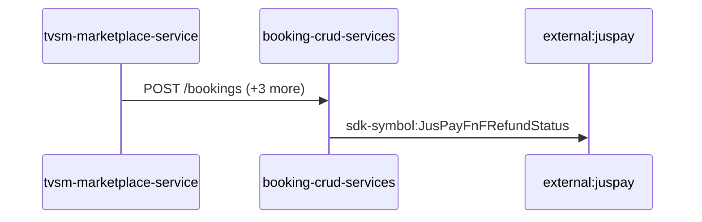

Steps:
| # | From | To | Via | Data (schema names) | Sync/Async | Confidence |
|---|---|---|---|---|---|---|
| 1 | tvsm-marketplace-service | booking-crud-services | POST /bookings, POST /bookings/search, PUT /bookings (+1 more) | BookingResponseDto, BookingRetrievalRequestDto, BookingRetrievalResponseDto, CancelBookingRequestDto, CancellationResponseDto (+2 more) | sync | high |
| 2 | booking-crud-services | external:juspay | sdk-symbol:JusPayFnFRefundStatus | Unknown | sync | high |

Data touched: tvsm-marketplace-service: mysql, mysql:localhost:marketplace; booking-crud-services: mssql

Failure points: hop 1 tvsm-marketplace-service → booking-crud-services: criticality hard; hop 2 booking-crud-services → external:juspay: criticality hard

Evidence:
- hop 1 (tvsm-marketplace-service → booking-crud-services): `booking-crud-services/Booking Service.openapi.yaml:275`, `tvsm-marketplace-service/src/main/java/com/tvsmotor/marketplace/service/OkHttpService.java:85`, `tvsm-marketplace-service/src/main/java/com/tvsmotor/marketplace/service/booking_service/BookingApiCallerService.java:55` (+7 more)
- hop 2 (booking-crud-services → external:juspay): `booking-crud-services/src/bookings/dto/booking-refund-status-update/booking-refund-status-request.dto.ts:19`, `booking-crud-services/src/bookings/services/booking-refund/jusPay-refund.service.ts:15`, `booking-crud-services/src/bookings/services/jusPay.service.ts:10`

## Flow: tvsm-marketplace-service--external-salesforce-0499bb
Summary: Starting at `tvsm-marketplace-service` (scheduled job(s) in tvsm-marketplace-service (job-to-call link not resolved): AmazonPriceUpdateExecutorService.scheduledDrain, FlipkartPriceUpdateExecutorService.scheduledDrain, MarketplacePriceUpdateTaskService.cleanupDoneTasks (+2 more); request to tvsm-marketplace-service from outside the registry (no internal caller)), the flow passes through `master-data-platform`, `tvsmbe-mdp-bff`, `notification-service` and ends at `external:salesforce`, using 3 sync HTTP hop(s) and 1 async event hop(s); tvsm-marketplace-service role: entry; confidence medium.

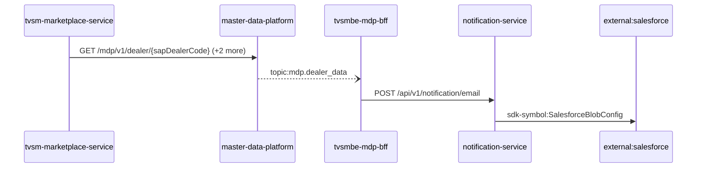

Steps:
| # | From | To | Via | Data (schema names) | Sync/Async | Confidence |
|---|---|---|---|---|---|---|
| 1 | tvsm-marketplace-service | master-data-platform | GET /mdp/v1/dealer/{sapDealerCode}, GET /mdp/v1/product/vehicle/part/{sapPartId}, POST /mdp/v1/dealers/listOfDealerDetails/basedOnProximity | GeneralResponse, ProximityRequest | sync | high |
| 2 | master-data-platform | tvsmbe-mdp-bff | topic:mdp.dealer_data | DealerData | async | medium |
| 3 | tvsmbe-mdp-bff | notification-service | POST /api/v1/notification/email | EmailNotification, NotificationResponse | sync | high |
| 4 | notification-service | external:salesforce | sdk-symbol:SalesforceBlobConfig | Unknown | sync | high |

Data touched: tvsm-marketplace-service: mysql, mysql:localhost:marketplace; master-data-platform: mysql:xxxx.mysql.database.azure.com:mdp_20230904, other, redis; tvsmbe-mdp-bff: mysql, mysql:tvsmazcmndbsdev01-ci.mysql.database.azure.com:tvsmazebffsdbdev01; notification-service: mongo

Failure points: hop 1 tvsm-marketplace-service → master-data-platform: criticality hard; hop 2 master-data-platform → tvsmbe-mdp-bff: criticality async; hop 3 tvsmbe-mdp-bff → notification-service: criticality hard; hop 4 notification-service → external:salesforce: criticality hard

Evidence:
- hop 1 (tvsm-marketplace-service → master-data-platform): `master-data-platform/src/main/java/com/tvsmotor/mdp/controller/DealerController.java:20`, `tvsm-marketplace-service/src/main/java/com/tvsmotor/marketplace/service/OkHttpService.java:39`, `tvsm-marketplace-service/src/main/java/com/tvsmotor/marketplace/service/mdp/MdpApiCallerService.java:72` (+4 more)
- hop 2 (master-data-platform → tvsmbe-mdp-bff): `master-data-platform/src/main/java/com/tvsmotor/mdp/config/DealerMasterServiceBusConfig.java:26`, `master-data-platform/src/main/java/com/tvsmotor/mdp/config/DealerMasterServiceBusConfig.java:27`, `tvsmbe-mdp-bff/outbound/src/main/java/com/tvsmotor/mdp_bff/outbound/config/BffServiceBusConfig.java:24` (+1 more)
- hop 3 (tvsmbe-mdp-bff → notification-service): `notification-service/src/main/java/com/tvsmotor/notification/controller/NotificationController.java:23`, `tvsmbe-mdp-bff/outbound/src/main/java/com/tvsmotor/mdp_bff/outbound/service/NotificationSenderService.java:46`, `tvsmbe-mdp-bff/outbound/src/main/java/com/tvsmotor/mdp_bff/outbound/service/OkHttpService.java:88`
- hop 4 (notification-service → external:salesforce): `notification-service/src/main/java/com/tvsmotor/notification/config/SalesforceBlobConfig.java:10`, `notification-service/src/main/java/com/tvsmotor/notification/cronjobs/SalesforceBlobStatusJob.java:17`, `notification-service/src/main/java/com/tvsmotor/notification/model/dto/salesforce/SalesforceData.java:8`

## Flow: tvsm-marketplace-service--external-salesforce-18fcb0
Summary: Starting at `tvsm-marketplace-service` (scheduled job(s) in tvsm-marketplace-service (job-to-call link not resolved): AmazonPriceUpdateExecutorService.scheduledDrain, FlipkartPriceUpdateExecutorService.scheduledDrain, MarketplacePriceUpdateTaskService.cleanupDoneTasks (+2 more); request to tvsm-marketplace-service from outside the registry (no internal caller)), the flow passes through `notification-service`, `notification-dispatcher-service` and ends at `external:salesforce`, using 2 sync HTTP hop(s) and 1 async event hop(s); tvsm-marketplace-service role: entry; confidence medium.

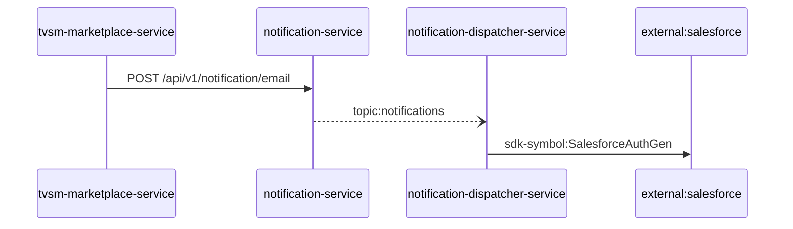

Steps:
| # | From | To | Via | Data (schema names) | Sync/Async | Confidence |
|---|---|---|---|---|---|---|
| 1 | tvsm-marketplace-service | notification-service | POST /api/v1/notification/email | EmailNotification, NotificationResponse | sync | high |
| 2 | notification-service | notification-dispatcher-service | topic:notifications | Unknown | async | medium |
| 3 | notification-dispatcher-service | external:salesforce | sdk-symbol:SalesforceAuthGen | Unknown | sync | high |

Data touched: tvsm-marketplace-service: mysql, mysql:localhost:marketplace; notification-service: mongo; notification-dispatcher-service: mongo

Failure points: hop 1 tvsm-marketplace-service → notification-service: criticality hard; hop 2 notification-service → notification-dispatcher-service: criticality async; hop 3 notification-dispatcher-service → external:salesforce: criticality hard

Evidence:
- hop 1 (tvsm-marketplace-service → notification-service): `notification-service/src/main/java/com/tvsmotor/notification/controller/NotificationController.java:23`, `tvsm-marketplace-service/src/main/java/com/tvsmotor/marketplace/service/OkHttpService.java:85`, `tvsm-marketplace-service/src/main/java/com/tvsmotor/marketplace/service/notification_service/NotificationApiCallerService.java:42`
- hop 2 (notification-service → notification-dispatcher-service): `notification-dispatcher-service/src/main/java/com/tvsmotor/notificationdispatcher/config/ServiceBusConfig.java:33`, `notification-dispatcher-service/src/main/java/com/tvsmotor/notificationdispatcher/config/ServiceBusConfig.java:34`, `notification-service/src/main/java/com/tvsmotor/notification/config/ServiceBusConfig.java:37` (+1 more)
- hop 3 (notification-dispatcher-service → external:salesforce): `notification-dispatcher-service/src/main/java/com/tvsmotor/notificationdispatcher/controller/SalesforceTokenController.java:18`, `notification-dispatcher-service/src/main/java/com/tvsmotor/notificationdispatcher/model/dto/salesforce/SalesforceData.java:5`, `notification-dispatcher-service/src/main/java/com/tvsmotor/notificationdispatcher/model/dto/salesforce/SalesforceTemplateKeys.java:8`

## Flow: tvsm-marketplace-service--external-salesforce-1dcb9e
Summary: Starting at `tvsm-marketplace-service` (scheduled job(s) in tvsm-marketplace-service (job-to-call link not resolved): AmazonPriceUpdateExecutorService.scheduledDrain, FlipkartPriceUpdateExecutorService.scheduledDrain, MarketplacePriceUpdateTaskService.cleanupDoneTasks (+2 more); request to tvsm-marketplace-service from outside the registry (no internal caller)), the flow passes through `lms`, `lms-ems`, `lms-process`, `lms-crm` and ends at `external:salesforce`, using 2 sync HTTP hop(s) and 3 async event hop(s); tvsm-marketplace-service role: entry; confidence medium.

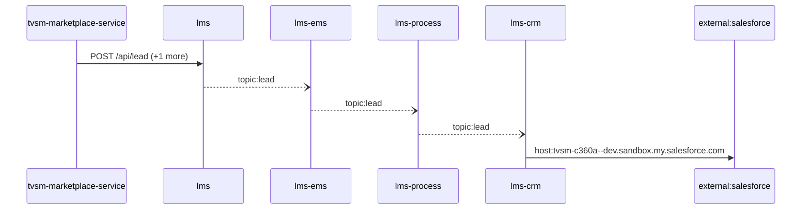

Steps:
| # | From | To | Via | Data (schema names) | Sync/Async | Confidence |
|---|---|---|---|---|---|---|
| 1 | tvsm-marketplace-service | lms | POST /api/lead, POST /api/leads/getDetails | LeadRequestModel, LeadsFilterRequestForSingleLead | sync | medium |
| 2 | lms | lms-ems | topic:lead | Unknown | async | medium |
| 3 | lms-ems | lms-process | topic:lead | Unknown | async | medium |
| 4 | lms-process | lms-crm | topic:lead | Unknown | async | medium |
| 5 | lms-crm | external:salesforce | host:tvsm-c360a--dev.sandbox.my.salesforce.com | Unknown | sync | high |

Data touched: tvsm-marketplace-service: mysql, mysql:localhost:marketplace; lms: mssql, mssql:icubemobappsqlstg.database.windows.net:tazlmssqldbdev01; lms-ems: mssql; lms-process: mssql; lms-crm: mssql

Failure points: hop 1 tvsm-marketplace-service → lms: criticality hard; hop 2 lms → lms-ems: criticality async; hop 3 lms-ems → lms-process: criticality async; hop 4 lms-process → lms-crm: criticality async; hop 5 lms-crm → external:salesforce: criticality hard

Evidence:
- hop 1 (tvsm-marketplace-service → lms): `lms/leadLogs/Controllers/LeadAcquisitionController.cs:61`, `tvsm-marketplace-service/src/main/java/com/tvsmotor/marketplace/service/LeadApiCallerService.java:42`, `tvsm-marketplace-service/src/main/java/com/tvsmotor/marketplace/service/OkHttpService.java:85` (+2 more)
- hop 2 (lms → lms-ems): `lms/leadLogs/Services/LeadDispatchService.cs:21`, `lms_ems/emsService/Const/Constants.cs:14`, `lms_ems/emsService/ListenerService/EmsListenerService.cs:43`
- hop 3 (lms-ems → lms-process): `lms_ems/emsService/Const/Constants.cs:13`, `lms_ems/emsService/Services/EmsService.cs:191`, `lms_process/processLeadService/Const/Constants.cs:10` (+1 more)
- hop 4 (lms-process → lms-crm): `lms_crm/ListenerService/CrmListenerService.cs:44`, `lms_crm/Utils/Constants.cs:16`, `lms_process/processLeadService/Const/Constants.cs:6` (+1 more)
- hop 5 (lms-crm → external:salesforce): `lms_crm/appsettings.Development.json:16`, `lms_crm/appsettings.Production.json:17`, `lms_crm/appsettings.Uat.json:17`

## Flow: tvsm-marketplace-service--external-salesforce-2a50d2
Summary: Starting at `tvsm-marketplace-service` (scheduled job(s) in tvsm-marketplace-service (job-to-call link not resolved): AmazonPriceUpdateExecutorService.scheduledDrain, FlipkartPriceUpdateExecutorService.scheduledDrain, MarketplacePriceUpdateTaskService.cleanupDoneTasks (+2 more); request to tvsm-marketplace-service from outside the registry (no internal caller)), the flow passes through `notification-service` and ends at `external:salesforce`, using 2 sync HTTP hop(s) and 0 async event hop(s); tvsm-marketplace-service role: entry; confidence high.

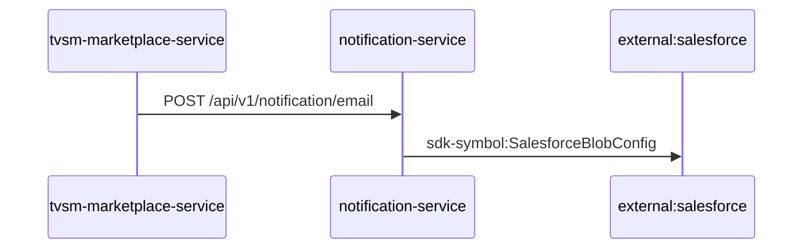

Steps:
| # | From | To | Via | Data (schema names) | Sync/Async | Confidence |
|---|---|---|---|---|---|---|
| 1 | tvsm-marketplace-service | notification-service | POST /api/v1/notification/email | EmailNotification, NotificationResponse | sync | high |
| 2 | notification-service | external:salesforce | sdk-symbol:SalesforceBlobConfig | Unknown | sync | high |

Data touched: tvsm-marketplace-service: mysql, mysql:localhost:marketplace; notification-service: mongo

Failure points: hop 1 tvsm-marketplace-service → notification-service: criticality hard; hop 2 notification-service → external:salesforce: criticality hard

Evidence:
- hop 1 (tvsm-marketplace-service → notification-service): `notification-service/src/main/java/com/tvsmotor/notification/controller/NotificationController.java:23`, `tvsm-marketplace-service/src/main/java/com/tvsmotor/marketplace/service/OkHttpService.java:85`, `tvsm-marketplace-service/src/main/java/com/tvsmotor/marketplace/service/notification_service/NotificationApiCallerService.java:42`
- hop 2 (notification-service → external:salesforce): `notification-service/src/main/java/com/tvsmotor/notification/config/SalesforceBlobConfig.java:10`, `notification-service/src/main/java/com/tvsmotor/notification/cronjobs/SalesforceBlobStatusJob.java:17`, `notification-service/src/main/java/com/tvsmotor/notification/model/dto/salesforce/SalesforceData.java:8`

## Flow: tvsm-marketplace-service--external-salesforce-2fede5
Summary: Starting at `tvsm-marketplace-service` (scheduled job(s) in tvsm-marketplace-service (job-to-call link not resolved): AmazonPriceUpdateExecutorService.scheduledDrain, FlipkartPriceUpdateExecutorService.scheduledDrain, MarketplacePriceUpdateTaskService.cleanupDoneTasks (+2 more); request to tvsm-marketplace-service from outside the registry (no internal caller)), the flow passes through `master-data-platform`, `lms-process`, `lms-ems`, `lms-crm` and ends at `external:salesforce`, using 2 sync HTTP hop(s) and 3 async event hop(s); tvsm-marketplace-service role: entry; confidence medium.

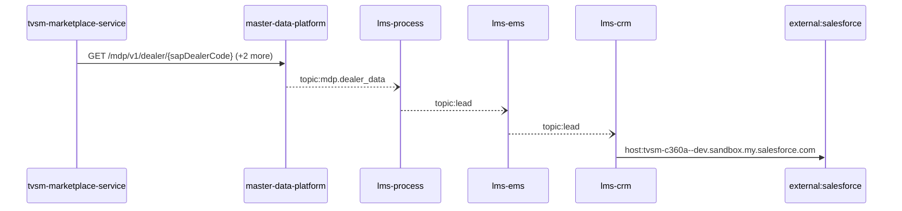

Steps:
| # | From | To | Via | Data (schema names) | Sync/Async | Confidence |
|---|---|---|---|---|---|---|
| 1 | tvsm-marketplace-service | master-data-platform | GET /mdp/v1/dealer/{sapDealerCode}, GET /mdp/v1/product/vehicle/part/{sapPartId}, POST /mdp/v1/dealers/listOfDealerDetails/basedOnProximity | GeneralResponse, ProximityRequest | sync | high |
| 2 | master-data-platform | lms-process | topic:mdp.dealer_data | DealerData | async | medium |
| 3 | lms-process | lms-ems | topic:lead | Unknown | async | medium |
| 4 | lms-ems | lms-crm | topic:lead | Unknown | async | medium |
| 5 | lms-crm | external:salesforce | host:tvsm-c360a--dev.sandbox.my.salesforce.com | Unknown | sync | high |

Data touched: tvsm-marketplace-service: mysql, mysql:localhost:marketplace; master-data-platform: mysql:xxxx.mysql.database.azure.com:mdp_20230904, other, redis; lms-process: mssql; lms-ems: mssql; lms-crm: mssql

Failure points: hop 1 tvsm-marketplace-service → master-data-platform: criticality hard; hop 2 master-data-platform → lms-process: criticality async; hop 3 lms-process → lms-ems: criticality async; hop 4 lms-ems → lms-crm: criticality async; hop 5 lms-crm → external:salesforce: criticality hard

Evidence:
- hop 1 (tvsm-marketplace-service → master-data-platform): `master-data-platform/src/main/java/com/tvsmotor/mdp/controller/DealerController.java:20`, `tvsm-marketplace-service/src/main/java/com/tvsmotor/marketplace/service/OkHttpService.java:39`, `tvsm-marketplace-service/src/main/java/com/tvsmotor/marketplace/service/mdp/MdpApiCallerService.java:72` (+4 more)
- hop 2 (master-data-platform → lms-process): `lms_process/processLeadService/Const/Constants.cs:7`, `lms_process/processLeadService/ListenerService/MdpConsumer.cs:42`, `master-data-platform/src/main/java/com/tvsmotor/mdp/config/DealerMasterServiceBusConfig.java:26` (+1 more)
- hop 3 (lms-process → lms-ems): `lms_ems/emsService/Const/Constants.cs:14`, `lms_ems/emsService/ListenerService/EmsListenerService.cs:43`, `lms_process/processLeadService/Const/Constants.cs:6` (+1 more)
- hop 4 (lms-ems → lms-crm): `lms_crm/ListenerService/CrmListenerService.cs:44`, `lms_crm/Utils/Constants.cs:16`, `lms_ems/emsService/Const/Constants.cs:13` (+1 more)
- hop 5 (lms-crm → external:salesforce): `lms_crm/appsettings.Development.json:16`, `lms_crm/appsettings.Production.json:17`, `lms_crm/appsettings.Uat.json:17`

## Flow: tvsm-marketplace-service--external-salesforce-3dee9f
Summary: Starting at `tvsm-marketplace-service` (scheduled job(s) in tvsm-marketplace-service (job-to-call link not resolved): AmazonPriceUpdateExecutorService.scheduledDrain, FlipkartPriceUpdateExecutorService.scheduledDrain, MarketplacePriceUpdateTaskService.cleanupDoneTasks (+2 more); request to tvsm-marketplace-service from outside the registry (no internal caller)), the flow passes through `lms`, `lms-ems`, `lms-crm` and ends at `external:salesforce`, using 2 sync HTTP hop(s) and 2 async event hop(s); tvsm-marketplace-service role: entry; confidence medium.

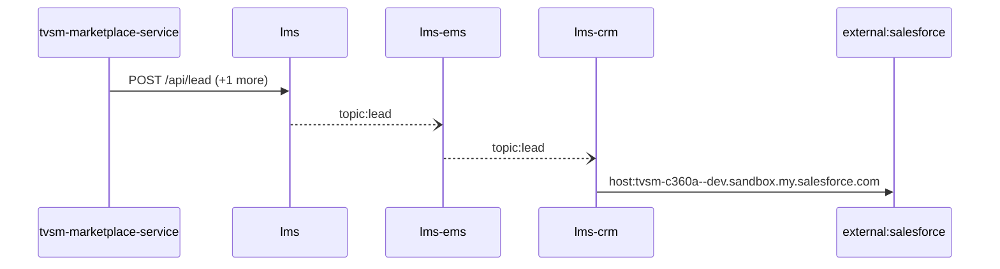

Steps:
| # | From | To | Via | Data (schema names) | Sync/Async | Confidence |
|---|---|---|---|---|---|---|
| 1 | tvsm-marketplace-service | lms | POST /api/lead, POST /api/leads/getDetails | LeadRequestModel, LeadsFilterRequestForSingleLead | sync | medium |
| 2 | lms | lms-ems | topic:lead | Unknown | async | medium |
| 3 | lms-ems | lms-crm | topic:lead | Unknown | async | medium |
| 4 | lms-crm | external:salesforce | host:tvsm-c360a--dev.sandbox.my.salesforce.com | Unknown | sync | high |

Data touched: tvsm-marketplace-service: mysql, mysql:localhost:marketplace; lms: mssql, mssql:icubemobappsqlstg.database.windows.net:tazlmssqldbdev01; lms-ems: mssql; lms-crm: mssql

Failure points: hop 1 tvsm-marketplace-service → lms: criticality hard; hop 2 lms → lms-ems: criticality async; hop 3 lms-ems → lms-crm: criticality async; hop 4 lms-crm → external:salesforce: criticality hard

Evidence:
- hop 1 (tvsm-marketplace-service → lms): `lms/leadLogs/Controllers/LeadAcquisitionController.cs:61`, `tvsm-marketplace-service/src/main/java/com/tvsmotor/marketplace/service/LeadApiCallerService.java:42`, `tvsm-marketplace-service/src/main/java/com/tvsmotor/marketplace/service/OkHttpService.java:85` (+2 more)
- hop 2 (lms → lms-ems): `lms/leadLogs/Services/LeadDispatchService.cs:21`, `lms_ems/emsService/Const/Constants.cs:14`, `lms_ems/emsService/ListenerService/EmsListenerService.cs:43`
- hop 3 (lms-ems → lms-crm): `lms_crm/ListenerService/CrmListenerService.cs:44`, `lms_crm/Utils/Constants.cs:16`, `lms_ems/emsService/Const/Constants.cs:13` (+1 more)
- hop 4 (lms-crm → external:salesforce): `lms_crm/appsettings.Development.json:16`, `lms_crm/appsettings.Production.json:17`, `lms_crm/appsettings.Uat.json:17`

## Flow: tvsm-marketplace-service--external-salesforce-551358
Summary: Starting at `tvsm-marketplace-service` (scheduled job(s) in tvsm-marketplace-service (job-to-call link not resolved): AmazonPriceUpdateExecutorService.scheduledDrain, FlipkartPriceUpdateExecutorService.scheduledDrain, MarketplacePriceUpdateTaskService.cleanupDoneTasks (+2 more); request to tvsm-marketplace-service from outside the registry (no internal caller)), the flow passes through `master-data-platform`, `notification-service`, `notification-dispatcher-service` and ends at `external:salesforce`, using 3 sync HTTP hop(s) and 1 async event hop(s); tvsm-marketplace-service role: entry; confidence medium.

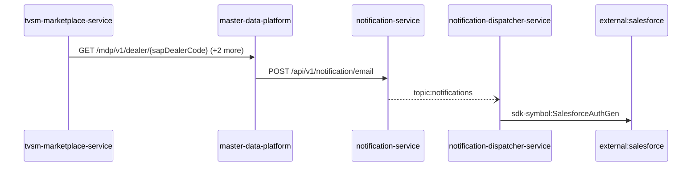

Steps:
| # | From | To | Via | Data (schema names) | Sync/Async | Confidence |
|---|---|---|---|---|---|---|
| 1 | tvsm-marketplace-service | master-data-platform | GET /mdp/v1/dealer/{sapDealerCode}, GET /mdp/v1/product/vehicle/part/{sapPartId}, POST /mdp/v1/dealers/listOfDealerDetails/basedOnProximity | GeneralResponse, ProximityRequest | sync | high |
| 2 | master-data-platform | notification-service | POST /api/v1/notification/email | EmailNotification, NotificationResponse | sync | high |
| 3 | notification-service | notification-dispatcher-service | topic:notifications | Unknown | async | medium |
| 4 | notification-dispatcher-service | external:salesforce | sdk-symbol:SalesforceAuthGen | Unknown | sync | high |

Data touched: tvsm-marketplace-service: mysql, mysql:localhost:marketplace; master-data-platform: mysql:xxxx.mysql.database.azure.com:mdp_20230904, other, redis; notification-service: mongo; notification-dispatcher-service: mongo

Failure points: hop 1 tvsm-marketplace-service → master-data-platform: criticality hard; hop 2 master-data-platform → notification-service: criticality hard; hop 3 notification-service → notification-dispatcher-service: criticality async; hop 4 notification-dispatcher-service → external:salesforce: criticality hard

Evidence:
- hop 1 (tvsm-marketplace-service → master-data-platform): `master-data-platform/src/main/java/com/tvsmotor/mdp/controller/DealerController.java:20`, `tvsm-marketplace-service/src/main/java/com/tvsmotor/marketplace/service/OkHttpService.java:39`, `tvsm-marketplace-service/src/main/java/com/tvsmotor/marketplace/service/mdp/MdpApiCallerService.java:72` (+4 more)
- hop 2 (master-data-platform → notification-service): `master-data-platform/src/main/java/com/tvsmotor/mdp/service/OkHttpService.java:24`, `master-data-platform/src/main/java/com/tvsmotor/mdp/service/notification_service/NotificationSenderService.java:69`, `notification-service/src/main/java/com/tvsmotor/notification/controller/NotificationController.java:23`
- hop 3 (notification-service → notification-dispatcher-service): `notification-dispatcher-service/src/main/java/com/tvsmotor/notificationdispatcher/config/ServiceBusConfig.java:33`, `notification-dispatcher-service/src/main/java/com/tvsmotor/notificationdispatcher/config/ServiceBusConfig.java:34`, `notification-service/src/main/java/com/tvsmotor/notification/config/ServiceBusConfig.java:37` (+1 more)
- hop 4 (notification-dispatcher-service → external:salesforce): `notification-dispatcher-service/src/main/java/com/tvsmotor/notificationdispatcher/controller/SalesforceTokenController.java:18`, `notification-dispatcher-service/src/main/java/com/tvsmotor/notificationdispatcher/model/dto/salesforce/SalesforceData.java:5`, `notification-dispatcher-service/src/main/java/com/tvsmotor/notificationdispatcher/model/dto/salesforce/SalesforceTemplateKeys.java:8`

## Flow: tvsm-marketplace-service--external-salesforce-649bc8
Summary: Starting at `tvsm-marketplace-service` (scheduled job(s) in tvsm-marketplace-service (job-to-call link not resolved): AmazonPriceUpdateExecutorService.scheduledDrain, FlipkartPriceUpdateExecutorService.scheduledDrain, MarketplacePriceUpdateTaskService.cleanupDoneTasks (+2 more); request to tvsm-marketplace-service from outside the registry (no internal caller)), the flow passes through `lms`, `lms-crm` and ends at `external:salesforce`, using 2 sync HTTP hop(s) and 1 async event hop(s); tvsm-marketplace-service role: entry; confidence medium.

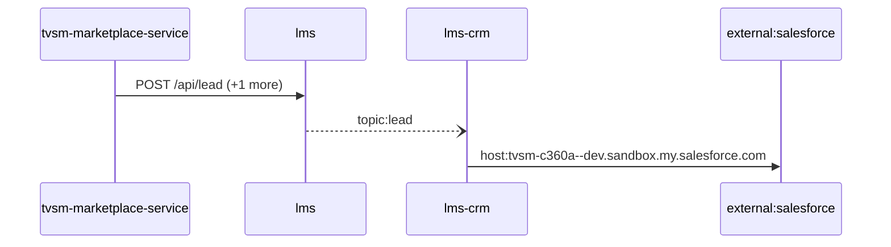

Steps:
| # | From | To | Via | Data (schema names) | Sync/Async | Confidence |
|---|---|---|---|---|---|---|
| 1 | tvsm-marketplace-service | lms | POST /api/lead, POST /api/leads/getDetails | LeadRequestModel, LeadsFilterRequestForSingleLead | sync | medium |
| 2 | lms | lms-crm | topic:lead | Unknown | async | medium |
| 3 | lms-crm | external:salesforce | host:tvsm-c360a--dev.sandbox.my.salesforce.com | Unknown | sync | high |

Data touched: tvsm-marketplace-service: mysql, mysql:localhost:marketplace; lms: mssql, mssql:icubemobappsqlstg.database.windows.net:tazlmssqldbdev01; lms-crm: mssql

Failure points: hop 1 tvsm-marketplace-service → lms: criticality hard; hop 2 lms → lms-crm: criticality async; hop 3 lms-crm → external:salesforce: criticality hard

Evidence:
- hop 1 (tvsm-marketplace-service → lms): `lms/leadLogs/Controllers/LeadAcquisitionController.cs:61`, `tvsm-marketplace-service/src/main/java/com/tvsmotor/marketplace/service/LeadApiCallerService.java:42`, `tvsm-marketplace-service/src/main/java/com/tvsmotor/marketplace/service/OkHttpService.java:85` (+2 more)
- hop 2 (lms → lms-crm): `lms/leadLogs/Services/LeadDispatchService.cs:21`, `lms_crm/ListenerService/CrmListenerService.cs:44`, `lms_crm/Utils/Constants.cs:16`
- hop 3 (lms-crm → external:salesforce): `lms_crm/appsettings.Development.json:16`, `lms_crm/appsettings.Production.json:17`, `lms_crm/appsettings.Uat.json:17`

## Flow: tvsm-marketplace-service--external-salesforce-bdaaa9
Summary: Starting at `tvsm-marketplace-service` (scheduled job(s) in tvsm-marketplace-service (job-to-call link not resolved): AmazonPriceUpdateExecutorService.scheduledDrain, FlipkartPriceUpdateExecutorService.scheduledDrain, MarketplacePriceUpdateTaskService.cleanupDoneTasks (+2 more); request to tvsm-marketplace-service from outside the registry (no internal caller)), the flow passes through `master-data-platform`, `notification-service` and ends at `external:salesforce`, using 3 sync HTTP hop(s) and 0 async event hop(s); tvsm-marketplace-service role: entry; confidence high.

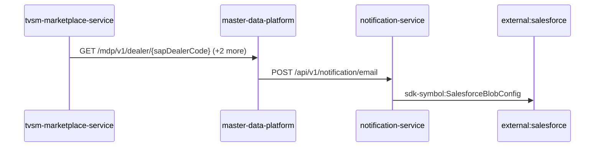

Steps:
| # | From | To | Via | Data (schema names) | Sync/Async | Confidence |
|---|---|---|---|---|---|---|
| 1 | tvsm-marketplace-service | master-data-platform | GET /mdp/v1/dealer/{sapDealerCode}, GET /mdp/v1/product/vehicle/part/{sapPartId}, POST /mdp/v1/dealers/listOfDealerDetails/basedOnProximity | GeneralResponse, ProximityRequest | sync | high |
| 2 | master-data-platform | notification-service | POST /api/v1/notification/email | EmailNotification, NotificationResponse | sync | high |
| 3 | notification-service | external:salesforce | sdk-symbol:SalesforceBlobConfig | Unknown | sync | high |

Data touched: tvsm-marketplace-service: mysql, mysql:localhost:marketplace; master-data-platform: mysql:xxxx.mysql.database.azure.com:mdp_20230904, other, redis; notification-service: mongo

Failure points: hop 1 tvsm-marketplace-service → master-data-platform: criticality hard; hop 2 master-data-platform → notification-service: criticality hard; hop 3 notification-service → external:salesforce: criticality hard

Evidence:
- hop 1 (tvsm-marketplace-service → master-data-platform): `master-data-platform/src/main/java/com/tvsmotor/mdp/controller/DealerController.java:20`, `tvsm-marketplace-service/src/main/java/com/tvsmotor/marketplace/service/OkHttpService.java:39`, `tvsm-marketplace-service/src/main/java/com/tvsmotor/marketplace/service/mdp/MdpApiCallerService.java:72` (+4 more)
- hop 2 (master-data-platform → notification-service): `master-data-platform/src/main/java/com/tvsmotor/mdp/service/OkHttpService.java:24`, `master-data-platform/src/main/java/com/tvsmotor/mdp/service/notification_service/NotificationSenderService.java:69`, `notification-service/src/main/java/com/tvsmotor/notification/controller/NotificationController.java:23`
- hop 3 (notification-service → external:salesforce): `notification-service/src/main/java/com/tvsmotor/notification/config/SalesforceBlobConfig.java:10`, `notification-service/src/main/java/com/tvsmotor/notification/cronjobs/SalesforceBlobStatusJob.java:17`, `notification-service/src/main/java/com/tvsmotor/notification/model/dto/salesforce/SalesforceData.java:8`

## Flow: tvsm-marketplace-service--external-salesforce-c207f1
Summary: Starting at `tvsm-marketplace-service` (scheduled job(s) in tvsm-marketplace-service (job-to-call link not resolved): AmazonPriceUpdateExecutorService.scheduledDrain, FlipkartPriceUpdateExecutorService.scheduledDrain, MarketplacePriceUpdateTaskService.cleanupDoneTasks (+2 more); request to tvsm-marketplace-service from outside the registry (no internal caller)), the flow passes through `lms`, `lms-process`, `lms-ems`, `lms-crm` and ends at `external:salesforce`, using 2 sync HTTP hop(s) and 3 async event hop(s); tvsm-marketplace-service role: entry; confidence medium.

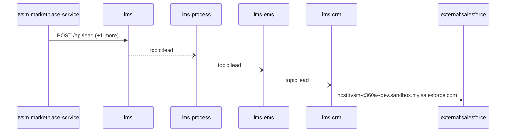

Steps:
| # | From | To | Via | Data (schema names) | Sync/Async | Confidence |
|---|---|---|---|---|---|---|
| 1 | tvsm-marketplace-service | lms | POST /api/lead, POST /api/leads/getDetails | LeadRequestModel, LeadsFilterRequestForSingleLead | sync | medium |
| 2 | lms | lms-process | topic:lead | Unknown | async | medium |
| 3 | lms-process | lms-ems | topic:lead | Unknown | async | medium |
| 4 | lms-ems | lms-crm | topic:lead | Unknown | async | medium |
| 5 | lms-crm | external:salesforce | host:tvsm-c360a--dev.sandbox.my.salesforce.com | Unknown | sync | high |

Data touched: tvsm-marketplace-service: mysql, mysql:localhost:marketplace; lms: mssql, mssql:icubemobappsqlstg.database.windows.net:tazlmssqldbdev01; lms-process: mssql; lms-ems: mssql; lms-crm: mssql

Failure points: hop 1 tvsm-marketplace-service → lms: criticality hard; hop 2 lms → lms-process: criticality async; hop 3 lms-process → lms-ems: criticality async; hop 4 lms-ems → lms-crm: criticality async; hop 5 lms-crm → external:salesforce: criticality hard

Evidence:
- hop 1 (tvsm-marketplace-service → lms): `lms/leadLogs/Controllers/LeadAcquisitionController.cs:61`, `tvsm-marketplace-service/src/main/java/com/tvsmotor/marketplace/service/LeadApiCallerService.java:42`, `tvsm-marketplace-service/src/main/java/com/tvsmotor/marketplace/service/OkHttpService.java:85` (+2 more)
- hop 2 (lms → lms-process): `lms/leadLogs/Services/LeadDispatchService.cs:21`, `lms_process/processLeadService/Const/Constants.cs:10`, `lms_process/processLeadService/ListenerService/QueueConsumer.cs:36`
- hop 3 (lms-process → lms-ems): `lms_ems/emsService/Const/Constants.cs:14`, `lms_ems/emsService/ListenerService/EmsListenerService.cs:43`, `lms_process/processLeadService/Const/Constants.cs:6` (+1 more)
- hop 4 (lms-ems → lms-crm): `lms_crm/ListenerService/CrmListenerService.cs:44`, `lms_crm/Utils/Constants.cs:16`, `lms_ems/emsService/Const/Constants.cs:13` (+1 more)
- hop 5 (lms-crm → external:salesforce): `lms_crm/appsettings.Development.json:16`, `lms_crm/appsettings.Production.json:17`, `lms_crm/appsettings.Uat.json:17`

## Flow: tvsm-marketplace-service--external-salesforce-c4ec04
Summary: Starting at `tvsm-marketplace-service` (scheduled job(s) in tvsm-marketplace-service (job-to-call link not resolved): AmazonPriceUpdateExecutorService.scheduledDrain, FlipkartPriceUpdateExecutorService.scheduledDrain, MarketplacePriceUpdateTaskService.cleanupDoneTasks (+2 more); request to tvsm-marketplace-service from outside the registry (no internal caller)), the flow passes through `lms`, `lms-process`, `lms-crm` and ends at `external:salesforce`, using 2 sync HTTP hop(s) and 2 async event hop(s); tvsm-marketplace-service role: entry; confidence medium.


Steps:
| # | From | To | Via | Data (schema names) | Sync/Async | Confidence |
|---|---|---|---|---|---|---|
| 1 | tvsm-marketplace-service | lms | POST /api/lead, POST /api/leads/getDetails | LeadRequestModel, LeadsFilterRequestForSingleLead | sync | medium |
| 2 | lms | lms-process | topic:lead | Unknown | async | medium |
| 3 | lms-process | lms-crm | topic:lead | Unknown | async | medium |
| 4 | lms-crm | external:salesforce | host:tvsm-c360a--dev.sandbox.my.salesforce.com | Unknown | sync | high |

Data touched: tvsm-marketplace-service: mysql, mysql:localhost:marketplace; lms: mssql, mssql:icubemobappsqlstg.database.windows.net:tazlmssqldbdev01; lms-process: mssql; lms-crm: mssql

Failure points: hop 1 tvsm-marketplace-service → lms: criticality hard; hop 2 lms → lms-process: criticality async; hop 3 lms-process → lms-crm: criticality async; hop 4 lms-crm → external:salesforce: criticality hard

Evidence:
- hop 1 (tvsm-marketplace-service → lms): `lms/leadLogs/Controllers/LeadAcquisitionController.cs:61`, `tvsm-marketplace-service/src/main/java/com/tvsmotor/marketplace/service/LeadApiCallerService.java:42`, `tvsm-marketplace-service/src/main/java/com/tvsmotor/marketplace/service/OkHttpService.java:85` (+2 more)
- hop 2 (lms → lms-process): `lms/leadLogs/Services/LeadDispatchService.cs:21`, `lms_process/processLeadService/Const/Constants.cs:10`, `lms_process/processLeadService/ListenerService/QueueConsumer.cs:36`
- hop 3 (lms-process → lms-crm): `lms_crm/ListenerService/CrmListenerService.cs:44`, `lms_crm/Utils/Constants.cs:16`, `lms_process/processLeadService/Const/Constants.cs:6` (+1 more)
- hop 4 (lms-crm → external:salesforce): `lms_crm/appsettings.Development.json:16`, `lms_crm/appsettings.Production.json:17`, `lms_crm/appsettings.Uat.json:17`

## Flow: tvsm-marketplace-service--external-salesforce-e50034
Summary: Starting at `tvsm-marketplace-service` (scheduled job(s) in tvsm-marketplace-service (job-to-call link not resolved): AmazonPriceUpdateExecutorService.scheduledDrain, FlipkartPriceUpdateExecutorService.scheduledDrain, MarketplacePriceUpdateTaskService.cleanupDoneTasks (+2 more); request to tvsm-marketplace-service from outside the registry (no internal caller)), the flow passes through `master-data-platform`, `lms-process`, `lms-crm` and ends at `external:salesforce`, using 2 sync HTTP hop(s) and 2 async event hop(s); tvsm-marketplace-service role: entry; confidence medium.

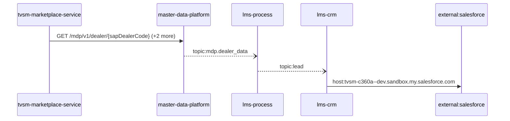

Steps:
| # | From | To | Via | Data (schema names) | Sync/Async | Confidence |
|---|---|---|---|---|---|---|
| 1 | tvsm-marketplace-service | master-data-platform | GET /mdp/v1/dealer/{sapDealerCode}, GET /mdp/v1/product/vehicle/part/{sapPartId}, POST /mdp/v1/dealers/listOfDealerDetails/basedOnProximity | GeneralResponse, ProximityRequest | sync | high |
| 2 | master-data-platform | lms-process | topic:mdp.dealer_data | DealerData | async | medium |
| 3 | lms-process | lms-crm | topic:lead | Unknown | async | medium |
| 4 | lms-crm | external:salesforce | host:tvsm-c360a--dev.sandbox.my.salesforce.com | Unknown | sync | high |

Data touched: tvsm-marketplace-service: mysql, mysql:localhost:marketplace; master-data-platform: mysql:xxxx.mysql.database.azure.com:mdp_20230904, other, redis; lms-process: mssql; lms-crm: mssql

Failure points: hop 1 tvsm-marketplace-service → master-data-platform: criticality hard; hop 2 master-data-platform → lms-process: criticality async; hop 3 lms-process → lms-crm: criticality async; hop 4 lms-crm → external:salesforce: criticality hard

Evidence:
- hop 1 (tvsm-marketplace-service → master-data-platform): `master-data-platform/src/main/java/com/tvsmotor/mdp/controller/DealerController.java:20`, `tvsm-marketplace-service/src/main/java/com/tvsmotor/marketplace/service/OkHttpService.java:39`, `tvsm-marketplace-service/src/main/java/com/tvsmotor/marketplace/service/mdp/MdpApiCallerService.java:72` (+4 more)
- hop 2 (master-data-platform → lms-process): `lms_process/processLeadService/Const/Constants.cs:7`, `lms_process/processLeadService/ListenerService/MdpConsumer.cs:42`, `master-data-platform/src/main/java/com/tvsmotor/mdp/config/DealerMasterServiceBusConfig.java:26` (+1 more)
- hop 3 (lms-process → lms-crm): `lms_crm/ListenerService/CrmListenerService.cs:44`, `lms_crm/Utils/Constants.cs:16`, `lms_process/processLeadService/Const/Constants.cs:6` (+1 more)
- hop 4 (lms-crm → external:salesforce): `lms_crm/appsettings.Development.json:16`, `lms_crm/appsettings.Production.json:17`, `lms_crm/appsettings.Uat.json:17`

## Flow: tvsm-marketplace-service--external-salesforce-eddaa5
Summary: Starting at `tvsm-marketplace-service` (scheduled job(s) in tvsm-marketplace-service (job-to-call link not resolved): AmazonPriceUpdateExecutorService.scheduledDrain, FlipkartPriceUpdateExecutorService.scheduledDrain, MarketplacePriceUpdateTaskService.cleanupDoneTasks (+2 more); request to tvsm-marketplace-service from outside the registry (no internal caller)), the flow passes through `master-data-platform`, `tvsmbe-mdp-bff`, `notification-service`, `notification-dispatcher-service` and ends at `external:salesforce`, using 3 sync HTTP hop(s) and 2 async event hop(s); tvsm-marketplace-service role: entry; confidence medium.

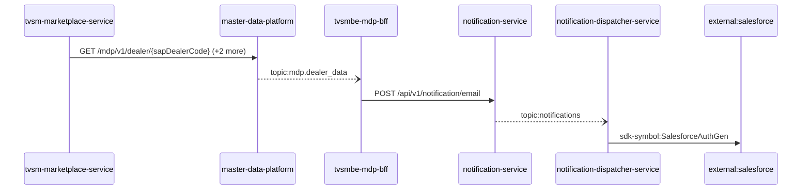

Steps:
| # | From | To | Via | Data (schema names) | Sync/Async | Confidence |
|---|---|---|---|---|---|---|
| 1 | tvsm-marketplace-service | master-data-platform | GET /mdp/v1/dealer/{sapDealerCode}, GET /mdp/v1/product/vehicle/part/{sapPartId}, POST /mdp/v1/dealers/listOfDealerDetails/basedOnProximity | GeneralResponse, ProximityRequest | sync | high |
| 2 | master-data-platform | tvsmbe-mdp-bff | topic:mdp.dealer_data | DealerData | async | medium |
| 3 | tvsmbe-mdp-bff | notification-service | POST /api/v1/notification/email | EmailNotification, NotificationResponse | sync | high |
| 4 | notification-service | notification-dispatcher-service | topic:notifications | Unknown | async | medium |
| 5 | notification-dispatcher-service | external:salesforce | sdk-symbol:SalesforceAuthGen | Unknown | sync | high |

Data touched: tvsm-marketplace-service: mysql, mysql:localhost:marketplace; master-data-platform: mysql:xxxx.mysql.database.azure.com:mdp_20230904, other, redis; tvsmbe-mdp-bff: mysql, mysql:tvsmazcmndbsdev01-ci.mysql.database.azure.com:tvsmazebffsdbdev01; notification-service: mongo; notification-dispatcher-service: mongo

Failure points: hop 1 tvsm-marketplace-service → master-data-platform: criticality hard; hop 2 master-data-platform → tvsmbe-mdp-bff: criticality async; hop 3 tvsmbe-mdp-bff → notification-service: criticality hard; hop 4 notification-service → notification-dispatcher-service: criticality async; hop 5 notification-dispatcher-service → external:salesforce: criticality hard

Evidence:
- hop 1 (tvsm-marketplace-service → master-data-platform): `master-data-platform/src/main/java/com/tvsmotor/mdp/controller/DealerController.java:20`, `tvsm-marketplace-service/src/main/java/com/tvsmotor/marketplace/service/OkHttpService.java:39`, `tvsm-marketplace-service/src/main/java/com/tvsmotor/marketplace/service/mdp/MdpApiCallerService.java:72` (+4 more)
- hop 2 (master-data-platform → tvsmbe-mdp-bff): `master-data-platform/src/main/java/com/tvsmotor/mdp/config/DealerMasterServiceBusConfig.java:26`, `master-data-platform/src/main/java/com/tvsmotor/mdp/config/DealerMasterServiceBusConfig.java:27`, `tvsmbe-mdp-bff/outbound/src/main/java/com/tvsmotor/mdp_bff/outbound/config/BffServiceBusConfig.java:24` (+1 more)
- hop 3 (tvsmbe-mdp-bff → notification-service): `notification-service/src/main/java/com/tvsmotor/notification/controller/NotificationController.java:23`, `tvsmbe-mdp-bff/outbound/src/main/java/com/tvsmotor/mdp_bff/outbound/service/NotificationSenderService.java:46`, `tvsmbe-mdp-bff/outbound/src/main/java/com/tvsmotor/mdp_bff/outbound/service/OkHttpService.java:88`
- hop 4 (notification-service → notification-dispatcher-service): `notification-dispatcher-service/src/main/java/com/tvsmotor/notificationdispatcher/config/ServiceBusConfig.java:33`, `notification-dispatcher-service/src/main/java/com/tvsmotor/notificationdispatcher/config/ServiceBusConfig.java:34`, `notification-service/src/main/java/com/tvsmotor/notification/config/ServiceBusConfig.java:37` (+1 more)
- hop 5 (notification-dispatcher-service → external:salesforce): `notification-dispatcher-service/src/main/java/com/tvsmotor/notificationdispatcher/controller/SalesforceTokenController.java:18`, `notification-dispatcher-service/src/main/java/com/tvsmotor/notificationdispatcher/model/dto/salesforce/SalesforceData.java:5`, `notification-dispatcher-service/src/main/java/com/tvsmotor/notificationdispatcher/model/dto/salesforce/SalesforceTemplateKeys.java:8`

## Flow: tvsm-marketplace-service--lms-tvs-credit-14d6fb
Summary: Starting at `tvsm-marketplace-service` (scheduled job(s) in tvsm-marketplace-service (job-to-call link not resolved): AmazonPriceUpdateExecutorService.scheduledDrain, FlipkartPriceUpdateExecutorService.scheduledDrain, MarketplacePriceUpdateTaskService.cleanupDoneTasks (+2 more); request to tvsm-marketplace-service from outside the registry (no internal caller)), the flow passes through `lms`, `lms-ems` and ends at `lms-tvs-credit`, using 1 sync HTTP hop(s) and 2 async event hop(s); tvsm-marketplace-service role: entry; confidence medium.

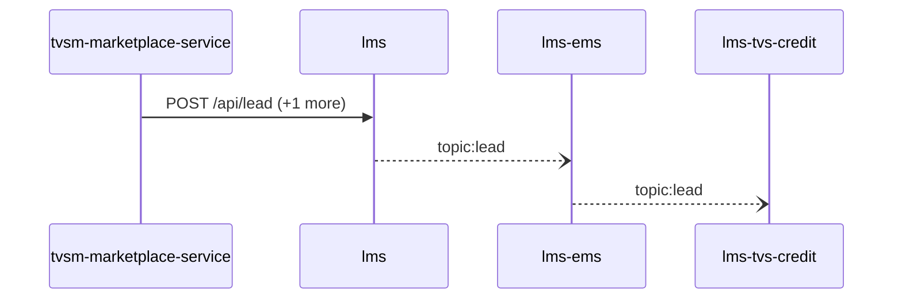

Steps:
| # | From | To | Via | Data (schema names) | Sync/Async | Confidence |
|---|---|---|---|---|---|---|
| 1 | tvsm-marketplace-service | lms | POST /api/lead, POST /api/leads/getDetails | LeadRequestModel, LeadsFilterRequestForSingleLead | sync | medium |
| 2 | lms | lms-ems | topic:lead | Unknown | async | medium |
| 3 | lms-ems | lms-tvs-credit | topic:lead | Unknown | async | medium |

Data touched: tvsm-marketplace-service: mysql, mysql:localhost:marketplace; lms: mssql, mssql:icubemobappsqlstg.database.windows.net:tazlmssqldbdev01; lms-ems: mssql; lms-tvs-credit: mssql

Failure points: hop 1 tvsm-marketplace-service → lms: criticality hard; hop 2 lms → lms-ems: criticality async; hop 3 lms-ems → lms-tvs-credit: criticality async

Evidence:
- hop 1 (tvsm-marketplace-service → lms): `lms/leadLogs/Controllers/LeadAcquisitionController.cs:61`, `tvsm-marketplace-service/src/main/java/com/tvsmotor/marketplace/service/LeadApiCallerService.java:42`, `tvsm-marketplace-service/src/main/java/com/tvsmotor/marketplace/service/OkHttpService.java:85` (+2 more)
- hop 2 (lms → lms-ems): `lms/leadLogs/Services/LeadDispatchService.cs:21`, `lms_ems/emsService/Const/Constants.cs:14`, `lms_ems/emsService/ListenerService/EmsListenerService.cs:43`
- hop 3 (lms-ems → lms-tvs-credit): `lms_ems/emsService/Const/Constants.cs:13`, `lms_ems/emsService/Services/EmsService.cs:191`, `lms_tvs_credit/lms_tvs_credit/ListenerService/TvscreditListenerService.cs:46` (+1 more)

## Flow: tvsm-marketplace-service--lms-tvs-credit-474091
Summary: Starting at `tvsm-marketplace-service` (scheduled job(s) in tvsm-marketplace-service (job-to-call link not resolved): AmazonPriceUpdateExecutorService.scheduledDrain, FlipkartPriceUpdateExecutorService.scheduledDrain, MarketplacePriceUpdateTaskService.cleanupDoneTasks (+2 more); request to tvsm-marketplace-service from outside the registry (no internal caller)), the flow passes through `lms`, `lms-process` and ends at `lms-tvs-credit`, using 1 sync HTTP hop(s) and 2 async event hop(s); tvsm-marketplace-service role: entry; confidence medium.

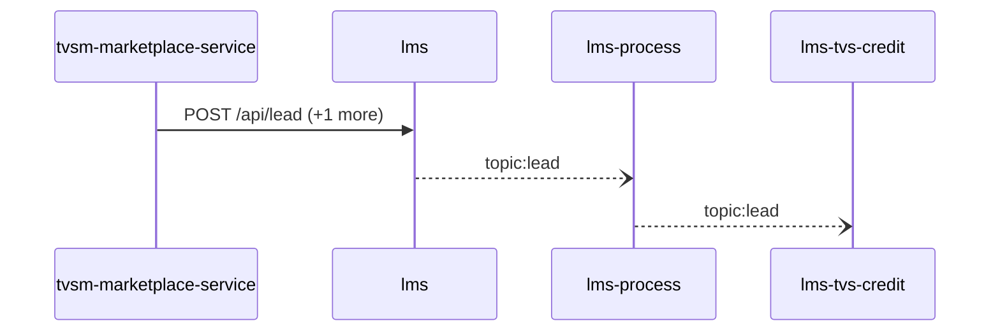

Steps:
| # | From | To | Via | Data (schema names) | Sync/Async | Confidence |
|---|---|---|---|---|---|---|
| 1 | tvsm-marketplace-service | lms | POST /api/lead, POST /api/leads/getDetails | LeadRequestModel, LeadsFilterRequestForSingleLead | sync | medium |
| 2 | lms | lms-process | topic:lead | Unknown | async | medium |
| 3 | lms-process | lms-tvs-credit | topic:lead | Unknown | async | medium |

Data touched: tvsm-marketplace-service: mysql, mysql:localhost:marketplace; lms: mssql, mssql:icubemobappsqlstg.database.windows.net:tazlmssqldbdev01; lms-process: mssql; lms-tvs-credit: mssql

Failure points: hop 1 tvsm-marketplace-service → lms: criticality hard; hop 2 lms → lms-process: criticality async; hop 3 lms-process → lms-tvs-credit: criticality async

Evidence:
- hop 1 (tvsm-marketplace-service → lms): `lms/leadLogs/Controllers/LeadAcquisitionController.cs:61`, `tvsm-marketplace-service/src/main/java/com/tvsmotor/marketplace/service/LeadApiCallerService.java:42`, `tvsm-marketplace-service/src/main/java/com/tvsmotor/marketplace/service/OkHttpService.java:85` (+2 more)
- hop 2 (lms → lms-process): `lms/leadLogs/Services/LeadDispatchService.cs:21`, `lms_process/processLeadService/Const/Constants.cs:10`, `lms_process/processLeadService/ListenerService/QueueConsumer.cs:36`
- hop 3 (lms-process → lms-tvs-credit): `lms_process/processLeadService/Const/Constants.cs:6`, `lms_process/processLeadService/Services/TwoWheelerService.cs:97`, `lms_tvs_credit/lms_tvs_credit/ListenerService/TvscreditListenerService.cs:46` (+1 more)

## Flow: tvsm-marketplace-service--lms-tvs-credit-b29d58
Summary: Starting at `tvsm-marketplace-service` (scheduled job(s) in tvsm-marketplace-service (job-to-call link not resolved): AmazonPriceUpdateExecutorService.scheduledDrain, FlipkartPriceUpdateExecutorService.scheduledDrain, MarketplacePriceUpdateTaskService.cleanupDoneTasks (+2 more); request to tvsm-marketplace-service from outside the registry (no internal caller)), the flow passes through `lms`, `lms-ems`, `lms-process` and ends at `lms-tvs-credit`, using 1 sync HTTP hop(s) and 3 async event hop(s); tvsm-marketplace-service role: entry; confidence medium.

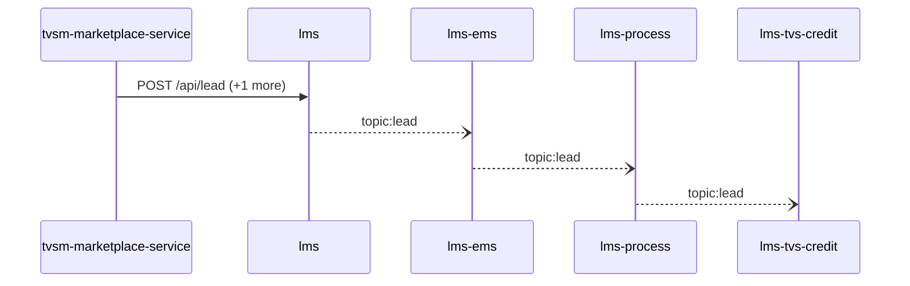

Steps:
| # | From | To | Via | Data (schema names) | Sync/Async | Confidence |
|---|---|---|---|---|---|---|
| 1 | tvsm-marketplace-service | lms | POST /api/lead, POST /api/leads/getDetails | LeadRequestModel, LeadsFilterRequestForSingleLead | sync | medium |
| 2 | lms | lms-ems | topic:lead | Unknown | async | medium |
| 3 | lms-ems | lms-process | topic:lead | Unknown | async | medium |
| 4 | lms-process | lms-tvs-credit | topic:lead | Unknown | async | medium |

Data touched: tvsm-marketplace-service: mysql, mysql:localhost:marketplace; lms: mssql, mssql:icubemobappsqlstg.database.windows.net:tazlmssqldbdev01; lms-ems: mssql; lms-process: mssql; lms-tvs-credit: mssql

Failure points: hop 1 tvsm-marketplace-service → lms: criticality hard; hop 2 lms → lms-ems: criticality async; hop 3 lms-ems → lms-process: criticality async; hop 4 lms-process → lms-tvs-credit: criticality async

Evidence:
- hop 1 (tvsm-marketplace-service → lms): `lms/leadLogs/Controllers/LeadAcquisitionController.cs:61`, `tvsm-marketplace-service/src/main/java/com/tvsmotor/marketplace/service/LeadApiCallerService.java:42`, `tvsm-marketplace-service/src/main/java/com/tvsmotor/marketplace/service/OkHttpService.java:85` (+2 more)
- hop 2 (lms → lms-ems): `lms/leadLogs/Services/LeadDispatchService.cs:21`, `lms_ems/emsService/Const/Constants.cs:14`, `lms_ems/emsService/ListenerService/EmsListenerService.cs:43`
- hop 3 (lms-ems → lms-process): `lms_ems/emsService/Const/Constants.cs:13`, `lms_ems/emsService/Services/EmsService.cs:191`, `lms_process/processLeadService/Const/Constants.cs:10` (+1 more)
- hop 4 (lms-process → lms-tvs-credit): `lms_process/processLeadService/Const/Constants.cs:6`, `lms_process/processLeadService/Services/TwoWheelerService.cs:97`, `lms_tvs_credit/lms_tvs_credit/ListenerService/TvscreditListenerService.cs:46` (+1 more)

## Flow: tvsm-marketplace-service--lms-tvs-credit-d00a93
Summary: Starting at `tvsm-marketplace-service` (scheduled job(s) in tvsm-marketplace-service (job-to-call link not resolved): AmazonPriceUpdateExecutorService.scheduledDrain, FlipkartPriceUpdateExecutorService.scheduledDrain, MarketplacePriceUpdateTaskService.cleanupDoneTasks (+2 more); request to tvsm-marketplace-service from outside the registry (no internal caller)), the flow passes through `master-data-platform`, `lms-process` and ends at `lms-tvs-credit`, using 1 sync HTTP hop(s) and 2 async event hop(s); tvsm-marketplace-service role: entry; confidence medium.

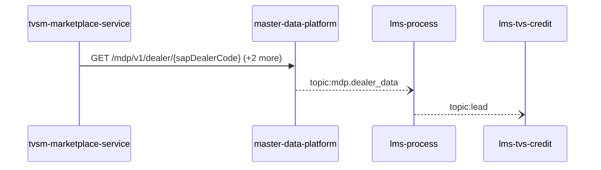

Steps:
| # | From | To | Via | Data (schema names) | Sync/Async | Confidence |
|---|---|---|---|---|---|---|
| 1 | tvsm-marketplace-service | master-data-platform | GET /mdp/v1/dealer/{sapDealerCode}, GET /mdp/v1/product/vehicle/part/{sapPartId}, POST /mdp/v1/dealers/listOfDealerDetails/basedOnProximity | GeneralResponse, ProximityRequest | sync | high |
| 2 | master-data-platform | lms-process | topic:mdp.dealer_data | DealerData | async | medium |
| 3 | lms-process | lms-tvs-credit | topic:lead | Unknown | async | medium |

Data touched: tvsm-marketplace-service: mysql, mysql:localhost:marketplace; master-data-platform: mysql:xxxx.mysql.database.azure.com:mdp_20230904, other, redis; lms-process: mssql; lms-tvs-credit: mssql

Failure points: hop 1 tvsm-marketplace-service → master-data-platform: criticality hard; hop 2 master-data-platform → lms-process: criticality async; hop 3 lms-process → lms-tvs-credit: criticality async

Evidence:
- hop 1 (tvsm-marketplace-service → master-data-platform): `master-data-platform/src/main/java/com/tvsmotor/mdp/controller/DealerController.java:20`, `tvsm-marketplace-service/src/main/java/com/tvsmotor/marketplace/service/OkHttpService.java:39`, `tvsm-marketplace-service/src/main/java/com/tvsmotor/marketplace/service/mdp/MdpApiCallerService.java:72` (+4 more)
- hop 2 (master-data-platform → lms-process): `lms_process/processLeadService/Const/Constants.cs:7`, `lms_process/processLeadService/ListenerService/MdpConsumer.cs:42`, `master-data-platform/src/main/java/com/tvsmotor/mdp/config/DealerMasterServiceBusConfig.java:26` (+1 more)
- hop 3 (lms-process → lms-tvs-credit): `lms_process/processLeadService/Const/Constants.cs:6`, `lms_process/processLeadService/Services/TwoWheelerService.cs:97`, `lms_tvs_credit/lms_tvs_credit/ListenerService/TvscreditListenerService.cs:46` (+1 more)

## Flow: tvsm-marketplace-service--lms-tvs-credit-f1e37c
Summary: Starting at `tvsm-marketplace-service` (scheduled job(s) in tvsm-marketplace-service (job-to-call link not resolved): AmazonPriceUpdateExecutorService.scheduledDrain, FlipkartPriceUpdateExecutorService.scheduledDrain, MarketplacePriceUpdateTaskService.cleanupDoneTasks (+2 more); request to tvsm-marketplace-service from outside the registry (no internal caller)), the flow passes through `lms`, `lms-process`, `lms-ems` and ends at `lms-tvs-credit`, using 1 sync HTTP hop(s) and 3 async event hop(s); tvsm-marketplace-service role: entry; confidence medium.

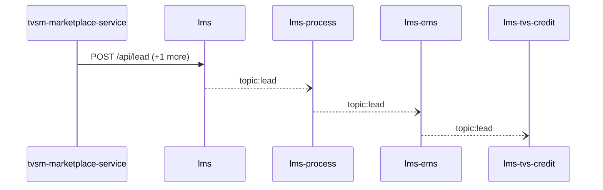

Steps:
| # | From | To | Via | Data (schema names) | Sync/Async | Confidence |
|---|---|---|---|---|---|---|
| 1 | tvsm-marketplace-service | lms | POST /api/lead, POST /api/leads/getDetails | LeadRequestModel, LeadsFilterRequestForSingleLead | sync | medium |
| 2 | lms | lms-process | topic:lead | Unknown | async | medium |
| 3 | lms-process | lms-ems | topic:lead | Unknown | async | medium |
| 4 | lms-ems | lms-tvs-credit | topic:lead | Unknown | async | medium |

Data touched: tvsm-marketplace-service: mysql, mysql:localhost:marketplace; lms: mssql, mssql:icubemobappsqlstg.database.windows.net:tazlmssqldbdev01; lms-process: mssql; lms-ems: mssql; lms-tvs-credit: mssql

Failure points: hop 1 tvsm-marketplace-service → lms: criticality hard; hop 2 lms → lms-process: criticality async; hop 3 lms-process → lms-ems: criticality async; hop 4 lms-ems → lms-tvs-credit: criticality async

Evidence:
- hop 1 (tvsm-marketplace-service → lms): `lms/leadLogs/Controllers/LeadAcquisitionController.cs:61`, `tvsm-marketplace-service/src/main/java/com/tvsmotor/marketplace/service/LeadApiCallerService.java:42`, `tvsm-marketplace-service/src/main/java/com/tvsmotor/marketplace/service/OkHttpService.java:85` (+2 more)
- hop 2 (lms → lms-process): `lms/leadLogs/Services/LeadDispatchService.cs:21`, `lms_process/processLeadService/Const/Constants.cs:10`, `lms_process/processLeadService/ListenerService/QueueConsumer.cs:36`
- hop 3 (lms-process → lms-ems): `lms_ems/emsService/Const/Constants.cs:14`, `lms_ems/emsService/ListenerService/EmsListenerService.cs:43`, `lms_process/processLeadService/Const/Constants.cs:6` (+1 more)
- hop 4 (lms-ems → lms-tvs-credit): `lms_ems/emsService/Const/Constants.cs:13`, `lms_ems/emsService/Services/EmsService.cs:191`, `lms_tvs_credit/lms_tvs_credit/ListenerService/TvscreditListenerService.cs:46` (+1 more)

## Flow: tvsm-marketplace-service--lms-tvs-credit-f5f5de
Summary: Starting at `tvsm-marketplace-service` (scheduled job(s) in tvsm-marketplace-service (job-to-call link not resolved): AmazonPriceUpdateExecutorService.scheduledDrain, FlipkartPriceUpdateExecutorService.scheduledDrain, MarketplacePriceUpdateTaskService.cleanupDoneTasks (+2 more); request to tvsm-marketplace-service from outside the registry (no internal caller)), the flow passes through `master-data-platform`, `lms-process`, `lms-ems` and ends at `lms-tvs-credit`, using 1 sync HTTP hop(s) and 3 async event hop(s); tvsm-marketplace-service role: entry; confidence medium.

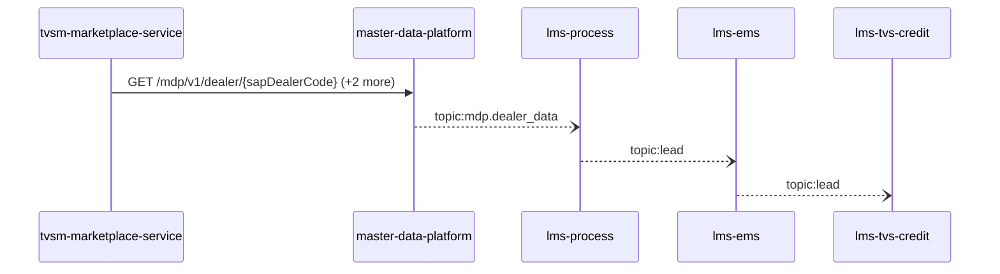

Steps:
| # | From | To | Via | Data (schema names) | Sync/Async | Confidence |
|---|---|---|---|---|---|---|
| 1 | tvsm-marketplace-service | master-data-platform | GET /mdp/v1/dealer/{sapDealerCode}, GET /mdp/v1/product/vehicle/part/{sapPartId}, POST /mdp/v1/dealers/listOfDealerDetails/basedOnProximity | GeneralResponse, ProximityRequest | sync | high |
| 2 | master-data-platform | lms-process | topic:mdp.dealer_data | DealerData | async | medium |
| 3 | lms-process | lms-ems | topic:lead | Unknown | async | medium |
| 4 | lms-ems | lms-tvs-credit | topic:lead | Unknown | async | medium |

Data touched: tvsm-marketplace-service: mysql, mysql:localhost:marketplace; master-data-platform: mysql:xxxx.mysql.database.azure.com:mdp_20230904, other, redis; lms-process: mssql; lms-ems: mssql; lms-tvs-credit: mssql

Failure points: hop 1 tvsm-marketplace-service → master-data-platform: criticality hard; hop 2 master-data-platform → lms-process: criticality async; hop 3 lms-process → lms-ems: criticality async; hop 4 lms-ems → lms-tvs-credit: criticality async

Evidence:
- hop 1 (tvsm-marketplace-service → master-data-platform): `master-data-platform/src/main/java/com/tvsmotor/mdp/controller/DealerController.java:20`, `tvsm-marketplace-service/src/main/java/com/tvsmotor/marketplace/service/OkHttpService.java:39`, `tvsm-marketplace-service/src/main/java/com/tvsmotor/marketplace/service/mdp/MdpApiCallerService.java:72` (+4 more)
- hop 2 (master-data-platform → lms-process): `lms_process/processLeadService/Const/Constants.cs:7`, `lms_process/processLeadService/ListenerService/MdpConsumer.cs:42`, `master-data-platform/src/main/java/com/tvsmotor/mdp/config/DealerMasterServiceBusConfig.java:26` (+1 more)
- hop 3 (lms-process → lms-ems): `lms_ems/emsService/Const/Constants.cs:14`, `lms_ems/emsService/ListenerService/EmsListenerService.cs:43`, `lms_process/processLeadService/Const/Constants.cs:6` (+1 more)
- hop 4 (lms-ems → lms-tvs-credit): `lms_ems/emsService/Const/Constants.cs:13`, `lms_ems/emsService/Services/EmsService.cs:191`, `lms_tvs_credit/lms_tvs_credit/ListenerService/TvscreditListenerService.cs:46` (+1 more)

## Flow: tvsm-marketplace-service--lms-tvs-credit-ff08c9
Summary: Starting at `tvsm-marketplace-service` (scheduled job(s) in tvsm-marketplace-service (job-to-call link not resolved): AmazonPriceUpdateExecutorService.scheduledDrain, FlipkartPriceUpdateExecutorService.scheduledDrain, MarketplacePriceUpdateTaskService.cleanupDoneTasks (+2 more); request to tvsm-marketplace-service from outside the registry (no internal caller)), the flow passes through `lms` and ends at `lms-tvs-credit`, using 1 sync HTTP hop(s) and 1 async event hop(s); tvsm-marketplace-service role: entry; confidence medium.

```mermaid
sequenceDiagram
  participant tvsm_marketplace_service as tvsm-marketplace-service
  participant lms as lms
  participant lms_tvs_credit as lms-tvs-credit
  tvsm_marketplace_service->>lms: POST /api/lead (+1 more)
  lms--)lms_tvs_credit: topic:lead
```

Steps:
| # | From | To | Via | Data (schema names) | Sync/Async | Confidence |
|---|---|---|---|---|---|---|
| 1 | tvsm-marketplace-service | lms | POST /api/lead, POST /api/leads/getDetails | LeadRequestModel, LeadsFilterRequestForSingleLead | sync | medium |
| 2 | lms | lms-tvs-credit | topic:lead | Unknown | async | medium |

Data touched: tvsm-marketplace-service: mysql, mysql:localhost:marketplace; lms: mssql, mssql:icubemobappsqlstg.database.windows.net:tazlmssqldbdev01; lms-tvs-credit: mssql

Failure points: hop 1 tvsm-marketplace-service → lms: criticality hard; hop 2 lms → lms-tvs-credit: criticality async

Evidence:
- hop 1 (tvsm-marketplace-service → lms): `lms/leadLogs/Controllers/LeadAcquisitionController.cs:61`, `tvsm-marketplace-service/src/main/java/com/tvsmotor/marketplace/service/LeadApiCallerService.java:42`, `tvsm-marketplace-service/src/main/java/com/tvsmotor/marketplace/service/OkHttpService.java:85` (+2 more)
- hop 2 (lms → lms-tvs-credit): `lms/leadLogs/Services/LeadDispatchService.cs:21`, `lms_tvs_credit/lms_tvs_credit/ListenerService/TvscreditListenerService.cs:46`, `lms_tvs_credit/lms_tvs_credit/Services/AppSettingsService.cs:27`

## Flow: tvsm-marketplace-service--price-engine-micro-service-backend
Summary: Starting at `tvsm-marketplace-service` (scheduled job(s) in tvsm-marketplace-service (job-to-call link not resolved): AmazonPriceUpdateExecutorService.scheduledDrain, FlipkartPriceUpdateExecutorService.scheduledDrain, MarketplacePriceUpdateTaskService.cleanupDoneTasks (+2 more); request to tvsm-marketplace-service from outside the registry (no internal caller)), the flow passes through `master-data-platform` and ends at `price-engine-micro-service-backend`, using 1 sync HTTP hop(s) and 1 async event hop(s); tvsm-marketplace-service role: entry; confidence medium.

```mermaid
sequenceDiagram
  participant tvsm_marketplace_service as tvsm-marketplace-service
  participant master_data_platform as master-data-platform
  participant price_engine_micro_service_backend as price-engine-micro-service-backend
  tvsm_marketplace_service->>master_data_platform: GET /mdp/v1/dealer/{sapDealerCode} (+2 more)
  master_data_platform--)price_engine_micro_service_backend: topic:mdp.price.vehicle (+1 more)
```

Steps:
| # | From | To | Via | Data (schema names) | Sync/Async | Confidence |
|---|---|---|---|---|---|---|
| 1 | tvsm-marketplace-service | master-data-platform | GET /mdp/v1/dealer/{sapDealerCode}, GET /mdp/v1/product/vehicle/part/{sapPartId}, POST /mdp/v1/dealers/listOfDealerDetails/basedOnProximity | GeneralResponse, ProximityRequest | sync | high |
| 2 | master-data-platform | price-engine-micro-service-backend | topic:mdp.price.vehicle, topic:mdp.product.vehicle | PriceVehicleData, ServiceBusOutgoingMessagePayloadBody | async | medium |

Data touched: tvsm-marketplace-service: mysql, mysql:localhost:marketplace; master-data-platform: mysql:xxxx.mysql.database.azure.com:mdp_20230904, other, redis; price-engine-micro-service-backend: mongo, redis

Failure points: hop 1 tvsm-marketplace-service → master-data-platform: criticality hard; hop 2 master-data-platform → price-engine-micro-service-backend: criticality async

Evidence:
- hop 1 (tvsm-marketplace-service → master-data-platform): `master-data-platform/src/main/java/com/tvsmotor/mdp/controller/DealerController.java:20`, `tvsm-marketplace-service/src/main/java/com/tvsmotor/marketplace/service/OkHttpService.java:39`, `tvsm-marketplace-service/src/main/java/com/tvsmotor/marketplace/service/mdp/MdpApiCallerService.java:72` (+4 more)
- hop 2 (master-data-platform → price-engine-micro-service-backend): `Price-Engine-MicroService-Backend/sonar-exclusion-function/service-bus/implemeters/price-service-bus-implementer.ts:18`, `master-data-platform/src/main/java/com/tvsmotor/mdp/price/config/PriceVehicleServiceBusConfig.java:19`, `master-data-platform/src/main/java/com/tvsmotor/mdp/price/config/PriceVehicleServiceBusConfig.java:20` (+3 more)
