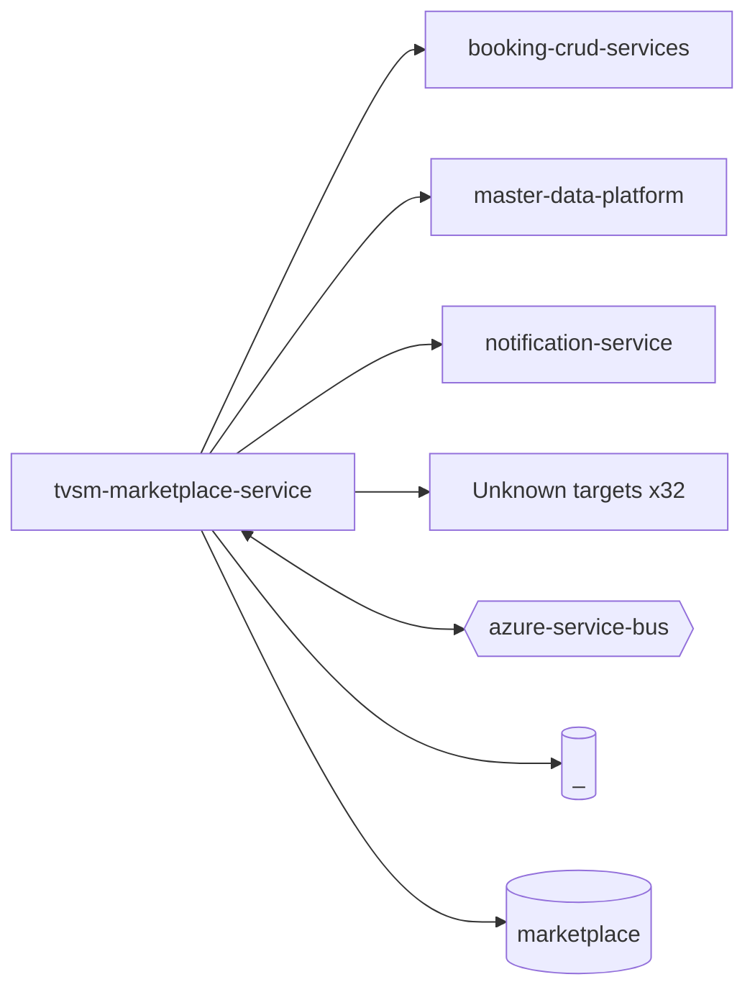

# tvsm-marketplace-service — High-Level Design

## Context
tvsm-marketplace-service is a `backend-api` in the TVS-CS org (domain: Unknown). Neighbours: callers Unknown; downstream `booking-crud-services`, `master-data-platform`, `notification-service`.

## Architecture
tvsm-marketplace-service components and connections (from service.yaml):

## Integration Points
tvsm-marketplace-service registry edges (8):

| Direction | Peer | Kind | Via | Criticality | Source | Match |
|---|---|---|---|---|---|---|
| out | `booking-crud-services` | http | POST /bookings | hard | code | path-unique |
| out | `booking-crud-services` | http | POST /bookings/search | hard | code | path-unique |
| out | `booking-crud-services` | http | PUT /bookings | hard | code | path-unique |
| out | `booking-crud-services` | http | PUT /bookings/cancel | hard | code | path-unique |
| out | `master-data-platform` | http | GET /mdp/v1/dealer/{sapDealerCode} | hard | code | path-unique |
| out | `master-data-platform` | http | GET /mdp/v1/product/vehicle/part/{sapPartId} | hard | code | path-unique |
| out | `master-data-platform` | http | POST /mdp/v1/dealers/listOfDealerDetails/basedOnProximity | hard | code | path-unique |
| out | `notification-service` | http | POST /api/v1/notification/email | hard | code | path-unique |

## Data Ownership
tvsm-marketplace-service data stores (service.yaml `data_stores`; ownership flag not determinable unless set):

| Store | Type | Access | Owned | Key entities |
|---|---|---|---|---|
| `_` | mysql | write | Unknown | dealer_state_marketplace_mappings, indian_states, orders |
| `marketplace` | mysql | read-write | Unknown | AuditLog, CustomerAddressDetails, CustomerPaymentDetails, Dealer, DealerMarketplaceMapping, DealerRefreshToken, DealerVehicleMapping, DmsDealerInventoryCache, FlipkartSaltKeyMetadata, IndianState, MarketplaceDealerSku, MarketplaceDrainLock, MarketplacePriceUpdateTask, Order, OrderDetails … |

## Key Design Decisions
tvsm-marketplace-service: N/A — not determinable from code.

| Decision | Alternatives considered | Reason |
|---|---|---|
| Unknown | Unknown | Unknown |

## Non-Functional Requirements
tvsm-marketplace-service NFR targets: N/A — not determinable from code. Tuning-related config keys: `LISTING_SYNC_AMAZON_BATCH_SIZE`, `PRICE_UPDATE_AMAZON_BATCH_SIZE`, `listingSync.amazon.batchSize`, `priceUpdate.amazon.batchSize`, `spring.datasource.hikari.maximumPoolSize`, `spring.servlet.multipart.max-file-size`.

## Security
tvsm-marketplace-service security: endpoint auth values None. Auth code: `src/main/java/com/tvsmotor/marketplace/config/MarketplaceOncePerRequestFilter.java:19`. 41 secret config key(s), sourced via: {'env-file': 24, 'app-settings': 17} (names in OVERVIEW.md). PII handling: Unknown.

## Resilience and Failure Modes
tvsm-marketplace-service hard dependencies: `booking-crud-services`, `master-data-platform`, `notification-service`. Retry/circuit-breaker code: `src/main/java/com/tvsmotor/marketplace/cache/CacheService.java:21` (@Retryable), `src/main/java/com/tvsmotor/marketplace/service/LeadApiCallerService.java:34` (@Retryable), `src/main/java/com/tvsmotor/marketplace/service/mdp/MdpApiCallerService.java:49` (@Retryable), `src/main/java/com/tvsmotor/marketplace/service/price_update/AmazonPriceUpdateExecutorService.java:134` (@Retryable), `src/main/java/com/tvsmotor/marketplace/service/amazon/AmazonListingsSyncService.java:439` (@Retryable), `src/main/java/com/tvsmotor/marketplace/service/amazon/AmazonSpApiCallerService.java:71` (@Retryable), `src/main/java/com/tvsmotor/marketplace/service/amazon/AmazonOperationalService.java:45` (@Retryable), `src/main/java/com/tvsmotor/marketplace/service/amazon/AmazonOAuthApiCallerService.java:45` (@Retryable), `src/main/java/com/tvsmotor/marketplace/service/order_management/amazon/AmazonOrderCaptureService.java:39` (@Retryable), `src/main/java/com/tvsmotor/marketplace/service/notification_service/NotificationApiCallerService.java:38` (@Retryable). Subscriber error handling: `src/main/java/com/tvsmotor/marketplace/config/ECommerceServiceBusConfig.java:74` {"error_handler": true}, `src/main/java/com/tvsmotor/marketplace/config/ECommerceServiceBusConfig.java:156` {"error_handler": true}, `src/main/java/com/tvsmotor/marketplace/config/ECommerceServiceBusConfig.java:112` {"error_handler": true}, `src/main/java/com/tvsmotor/marketplace/config/ECommerceServiceBusConfig.java:32` {"error_handler": true}

## Deployment Topology
tvsm-marketplace-service deployment artefacts (platform/regions: Unknown unless listed):

| Kind | Name | File | Environments | Image | Ports | Variable groups |
|---|---|---|---|---|---|---|
| azure-pipeline | AST_Image_Scan_marketplace_Pipeline.yml | `AST_Image_Scan_marketplace_Pipeline.yml:1` | - | - | - | Checkmarx_Common, UAT_Threshold |
| azure-pipeline | AST_MDP_marketplace_PROD_Pipeline.yml | `AST_MDP_marketplace_PROD_Pipeline.yml:1` | - | - | - | PROD_Threshold, Tenable |
| azure-pipeline | AST_MDP_marketplace_UAT_Pipeline.yml | `AST_MDP_marketplace_UAT_Pipeline.yml:1` | - | - | - | Checkmarx_Common, Tenable, UAT_Threshold |
| azure-pipeline | cd-pipeline.yaml | `cd-pipeline.yaml:1` | dev, prod, uat | - | - | - |
| azure-pipeline | ci-pipeline.yaml | `ci-pipeline.yaml:1` | - | - | - | - |
| azure-pipeline | sonar_ci_pipeline.yml | `sonar_ci_pipeline.yml:1` | - | - | - | - |
| dockerfile | Dockerfile | `Dockerfile:2` | - | maven:3.9.16-amazoncorretto-17-alpine, amazoncorretto:17.0.20-alpine3.23 | 8080 | - |

## Observability
tvsm-marketplace-service observability libraries: none found. Related config keys: `logging.level.com.azure.messaging.servicebus`, `logging.level.root`. Dashboards/alerts: Unknown.
