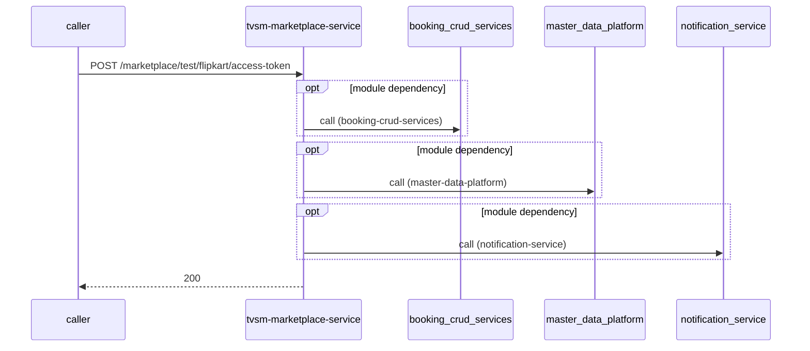

# tvsm-marketplace-service — Low-Level Design

## Data Model
tvsm-marketplace-service entities from `data_access` items (2).

Store access at `src/main/resources/db/migration/v1.10__add_flipkart_current_status_to_orders_20260326.sql:1`: database Unknown; collections -.

### dealer_state_marketplace_mappings
Entity `dealer_state_marketplace_mappings` defined in `src/main/resources/db/migration/v1.18__add_dealer_marketplace_mapping_composite_uks_20260715.sql:3`; table dealer_state_marketplace_mappings; operation write.
Columns: Unknown (no fields extracted).
Relationships: Unknown.

### indian_states
Entity `indian_states` defined in `src/main/resources/db/migration/v1.8__update_indexes_indian_states_20260216.sql:8`; table indian_states; operation write.
Columns: Unknown (no fields extracted).
Relationships: Unknown.

### orders
Entity `orders` defined in `src/main/resources/db/migration/v1.11__add_hsrp_date_to_order_details_20260520.sql:7`; table orders; operation write.
Columns: Unknown (no fields extracted).
Relationships: Unknown.

Store access at `src/main/java/com/tvsmotor/marketplace/entity/AuditLog.java:12`: database marketplace; collections -.

### audit_log
Entity `AuditLog` defined in `src/main/java/com/tvsmotor/marketplace/entity/AuditLog.java:11`; table audit_log; operation write.
Columns: Unknown (no fields extracted).
Relationships: Unknown.

### customer_address_details
Entity `CustomerAddressDetails` defined in `src/main/java/com/tvsmotor/marketplace/entity/order_management/CustomerAddressDetails.java:12`; table customer_address_details; operation both.
Columns: Unknown (no fields extracted).
Relationships: Unknown.

### customer_payment_details
Entity `CustomerPaymentDetails` defined in `src/main/java/com/tvsmotor/marketplace/entity/order_management/CustomerPaymentDetails.java:12`; table customer_payment_details; operation both.
Columns: Unknown (no fields extracted).
Relationships: Unknown.

### dealers
Entity `Dealer` defined in `src/main/java/com/tvsmotor/marketplace/entity/Dealer.java:10`; table dealers; operation both.
Columns: Unknown (no fields extracted).
Relationships: Unknown.

### dealer_state_marketplace_mappings
Entity `DealerMarketplaceMapping` defined in `src/main/java/com/tvsmotor/marketplace/entity/price_update/dealer_as_a_seller/DealerMarketplaceMapping.java:12`; table dealer_state_marketplace_mappings; operation both.
Columns: Unknown (no fields extracted).
Relationships: Unknown.

### dealer_refresh_tokens
Entity `DealerRefreshToken` defined in `src/main/java/com/tvsmotor/marketplace/entity/price_update/dealer_as_a_seller/DealerRefreshToken.java:15`; table dealer_refresh_tokens; operation both.
Columns: Unknown (no fields extracted).
Relationships: Unknown.

### dealer_vehicle_mapping
Entity `DealerVehicleMapping` defined in `src/main/java/com/tvsmotor/marketplace/entity/DealerVehicleMapping.java:19`; table dealer_vehicle_mapping; operation both.
Columns: Unknown (no fields extracted).
Relationships: Unknown.

### dms_dealer_inventory_cache
Entity `DmsDealerInventoryCache` defined in `src/main/java/com/tvsmotor/marketplace/entity/DmsDealerInventoryCache.java:19`; table dms_dealer_inventory_cache; operation both.
Columns: Unknown (no fields extracted).
Relationships: Unknown.

### flipkart_salt_key_metadata
Entity `FlipkartSaltKeyMetadata` defined in `src/main/java/com/tvsmotor/marketplace/entity/FlipkartSaltKeyMetadata.java:13`; table flipkart_salt_key_metadata; operation both.
Columns: Unknown (no fields extracted).
Relationships: Unknown.

### indian_states
Entity `IndianState` defined in `src/main/java/com/tvsmotor/marketplace/entity/IndianState.java:10`; table indian_states; operation both.
Columns: Unknown (no fields extracted).
Relationships: Unknown.

### marketplace_dealer_sku
Entity `MarketplaceDealerSku` defined in `src/main/java/com/tvsmotor/marketplace/entity/MarketplaceDealerSku.java:27`; table marketplace_dealer_sku; operation both.
Columns: Unknown (no fields extracted).
Relationships: Unknown.

### marketplace_drain_locks
Entity `MarketplaceDrainLock` defined in `src/main/java/com/tvsmotor/marketplace/entity/price_update/MarketplaceDrainLock.java:11`; table marketplace_drain_locks; operation both.
Columns: Unknown (no fields extracted).
Relationships: Unknown.

### marketplace_price_update_tasks
Entity `MarketplacePriceUpdateTask` defined in `src/main/java/com/tvsmotor/marketplace/entity/price_update/MarketplacePriceUpdateTask.java:14`; table marketplace_price_update_tasks; operation both.
Columns: Unknown (no fields extracted).
Relationships: Unknown.

### orders
Entity `Order` defined in `src/main/java/com/tvsmotor/marketplace/entity/order_management/Order.java:16`; table orders; operation both.
Columns: Unknown (no fields extracted).
Relationships: Unknown.

### order_details
Entity `OrderDetails` defined in `src/main/java/com/tvsmotor/marketplace/entity/order_management/OrderDetails.java:12`; table order_details; operation both.
Columns: Unknown (no fields extracted).
Relationships: Unknown.

### part_id_model_id_transitions
Entity `PartIdModelIdTransition` defined in `src/main/java/com/tvsmotor/marketplace/entity/part_id_model_id_transition/PartIdModelIdTransition.java:19`; table part_id_model_id_transitions; operation both.
Columns: Unknown (no fields extracted).
Relationships: Unknown.

### seller_access_credentials
Entity `SellerAccessCredentials` defined in `src/main/java/com/tvsmotor/marketplace/entity/SellerAccessCredentials.java:11`; table seller_access_credentials; operation both.
Columns: Unknown (no fields extracted).
Relationships: Unknown.

### tvs_product_details
Entity `TvsProductDetails` defined in `src/main/java/com/tvsmotor/marketplace/entity/TvsProductDetails.java:10`; table tvs_product_details; operation both.
Columns: Unknown (no fields extracted).
Relationships: Unknown.

### vehicle_marketplace_codes
Entity `VehicleMarketplaceCode` defined in `src/main/java/com/tvsmotor/marketplace/entity/VehicleMarketplaceCode.java:10`; table vehicle_marketplace_codes; operation both.
Columns: Unknown (no fields extracted).
Relationships: Unknown.

### vehicle_prices
Entity `VehiclePrice` defined in `src/main/java/com/tvsmotor/marketplace/entity/VehiclePrice.java:11`; table vehicle_prices; operation both.
Columns: Unknown (no fields extracted).
Relationships: Unknown.

### locked_by
Entity `locked_by` defined in `src/main/java/com/tvsmotor/marketplace/repository/price_update/MarketplaceDrainLockRepository.java:13`; table locked_by; operation write.
Columns: Unknown (no fields extracted).
Relationships: Unknown.

### marketplace_drain_locks
Entity `marketplace_drain_locks` defined in `src/main/java/com/tvsmotor/marketplace/repository/price_update/MarketplaceDrainLockRepository.java:13`; table marketplace_drain_locks; operation both.
Columns: Unknown (no fields extracted).
Relationships: Unknown.

### marketplace_price_update_tasks
Entity `marketplace_price_update_tasks` defined in `src/main/java/com/tvsmotor/marketplace/repository/price_update/MarketplacePriceUpdateTaskRepository.java:18`; table marketplace_price_update_tasks; operation both.
Columns: Unknown (no fields extracted).
Relationships: Unknown.

### new_price
Entity `new_price` defined in `src/main/java/com/tvsmotor/marketplace/repository/price_update/MarketplacePriceUpdateTaskRepository.java:18`; table new_price; operation write.
Columns: Unknown (no fields extracted).
Relationships: Unknown.

### vehicle_marketplace_codes
Entity `vehicle_marketplace_codes` defined in `src/main/java/com/tvsmotor/marketplace/repository/VehiclePriceRepo.java:15`; table vehicle_marketplace_codes; operation read.
Columns: Unknown (no fields extracted).
Relationships: Unknown.

### vehicle_prices
Entity `vehicle_prices` defined in `src/main/java/com/tvsmotor/marketplace/repository/VehiclePriceRepo.java:15`; table vehicle_prices; operation read.
Columns: Unknown (no fields extracted).
Relationships: Unknown.

## State Machines
tvsm-marketplace-service status/state enums found in code (1); transitions are not determinable from code.
- `OrderStatus` (`src/main/java/com/tvsmotor/marketplace/enums/OrderStatus.java:6`): CAPTURED, ACCEPTED, DEALER_ASSIGNED, PUSHED_TO_LS_AND_BS, APPROVED, INVOICE_GENERATED, INVOICE_DATA_PUSHED_TO_3P_MARKETPLACE, SHIPPED, GATE_PASS_GENERATED, HSRP_INITIATED, DELIVERED, CANCELLATION_REQUESTED, CANCELLED, ABANDONED

## Business Rules
tvsm-marketplace-service validation rules on DTO fields (from schema `validation`):
N/A — no declarative validation found; other rules not determinable without manual review.

## Key Classes and Functions
tvsm-marketplace-service key classes:

| Class / Function | File | Responsibility |
|---|---|---|
| `TestController` | `src/main/java/com/tvsmotor/marketplace/controller/TestController.java` | HTTP handlers |
| `FlipkartHelperController` | `src/main/java/com/tvsmotor/marketplace/controller/FlipkartHelperController.java` | HTTP handlers |
| `OrderController` | `src/main/java/com/tvsmotor/marketplace/controller/OrderController.java` | HTTP handlers |
| `TestServiceBusController` | `src/main/java/com/tvsmotor/marketplace/controller/TestServiceBusController.java` | HTTP handlers |
| `DealerInventoryController` | `src/main/java/com/tvsmotor/marketplace/controller/DealerInventoryController.java` | HTTP handlers |
| `DealerMarketplaceMappingController` | `src/main/java/com/tvsmotor/marketplace/controller/DealerMarketplaceMappingController.java` | HTTP handlers |
| `DealerRefreshTokenController` | `src/main/java/com/tvsmotor/marketplace/controller/DealerRefreshTokenController.java` | HTTP handlers |
| `PartIdModelIdTransitionController` | `src/main/java/com/tvsmotor/marketplace/controller/PartIdModelIdTransitionController.java` | HTTP handlers |
| `ProductsController` | `src/main/java/com/tvsmotor/marketplace/controller/ProductsController.java` | HTTP handlers |
| `DealerVehicleMappingController` | `src/main/java/com/tvsmotor/marketplace/controller/DealerVehicleMappingController.java` | HTTP handlers |
| `FlipkartWebhookController` | `src/main/java/com/tvsmotor/marketplace/controller/FlipkartWebhookController.java` | HTTP handlers |
| `FlipkartSaltKeyMetadataController` | `src/main/java/com/tvsmotor/marketplace/controller/FlipkartSaltKeyMetadataController.java` | HTTP handlers |
| `AmazonListingSyncController` | `src/main/java/com/tvsmotor/marketplace/controller/AmazonListingSyncController.java` | HTTP handlers |
| `DealerController` | `src/main/java/com/tvsmotor/marketplace/controller/DealerController.java` | HTTP handlers |
| `ServerMetricsService.scheduledLogServerMetrics` | `src/main/java/com/tvsmotor/marketplace/service/ServerMetricsService.java:31` | scheduled job |
| `AmazonPriceUpdateExecutorService.scheduledDrain` | `src/main/java/com/tvsmotor/marketplace/service/price_update/AmazonPriceUpdateExecutorService.java:104` | scheduled job |
| `FlipkartPriceUpdateExecutorService.scheduledDrain` | `src/main/java/com/tvsmotor/marketplace/service/price_update/FlipkartPriceUpdateExecutorService.java:83` | scheduled job |
| `MarketplacePriceUpdateTaskService.recoverStaleLocks` | `src/main/java/com/tvsmotor/marketplace/service/price_update/MarketplacePriceUpdateTaskService.java:162` | scheduled job |
| `MarketplacePriceUpdateTaskService.cleanupDoneTasks` | `src/main/java/com/tvsmotor/marketplace/service/price_update/MarketplacePriceUpdateTaskService.java:174` | scheduled job |
| subscribe uat.booking | `src/main/java/com/tvsmotor/marketplace/config/ECommerceServiceBusConfig.java:74` | azure-service-bus messaging |
| subscribe xxxx | `src/main/java/com/tvsmotor/marketplace/config/ECommerceServiceBusConfig.java:156` | azure-service-bus messaging |
| subscribe xxx | `src/main/java/com/tvsmotor/marketplace/config/ECommerceServiceBusConfig.java:112` | azure-service-bus messaging |
| subscribe dev.catalog.price_updates | `src/main/java/com/tvsmotor/marketplace/config/ECommerceServiceBusConfig.java:32` | azure-service-bus messaging |
| `@ControllerAdvice` | `src/main/java/com/tvsmotor/marketplace/exceptions/handlers/RestExceptionHandler.java:23` | error handling |

## Sequence Details
tvsm-marketplace-service sequence for `POST /marketplace/test/flipkart/access-token` (handler `FlipkartHelperController.testGetAccessTokenAndFlipkartApiCall`); downstream calls inside the handler are not traced from code, module-level targets shown as optional.

## Error Handling
tvsm-marketplace-service error handling: `src/main/java/com/tvsmotor/marketplace/exceptions/handlers/RestExceptionHandler.java:23` (@ControllerAdvice). Status mapping: Unknown. Retry evidence: `src/main/java/com/tvsmotor/marketplace/cache/CacheService.java:21`, `src/main/java/com/tvsmotor/marketplace/service/LeadApiCallerService.java:34`, `src/main/java/com/tvsmotor/marketplace/service/mdp/MdpApiCallerService.java:49`, `src/main/java/com/tvsmotor/marketplace/service/price_update/AmazonPriceUpdateExecutorService.java:134`, `src/main/java/com/tvsmotor/marketplace/service/amazon/AmazonListingsSyncService.java:439`, `src/main/java/com/tvsmotor/marketplace/service/amazon/AmazonSpApiCallerService.java:71`, `src/main/java/com/tvsmotor/marketplace/service/amazon/AmazonOperationalService.java:45`, `src/main/java/com/tvsmotor/marketplace/service/amazon/AmazonOAuthApiCallerService.java:45`, `src/main/java/com/tvsmotor/marketplace/service/order_management/amazon/AmazonOrderCaptureService.java:39`, `src/main/java/com/tvsmotor/marketplace/service/notification_service/NotificationApiCallerService.java:38`.

## Configuration Details
tvsm-marketplace-service behaviour-relevant config keys (names only; full list in OVERVIEW.md):
- `bookingService.api.base-url`: points to `booking-crud-services`
- `mdp.api.base-url`: points to `master-data-platform`
- `notification.base-url`: points to `notification-service`
- `config:amazon.sp.api.base-url`: base URL for outbound calls
- `config:flipkart.seller.api.base-url`: base URL for outbound calls
- `config:location-master.base.url`: base URL for outbound calls
- `config:mdp.api.base-url`: base URL for outbound calls
- `config:priceUpdate.flipkart.dealer_as_a_seller.tvsClientId`: base URL for outbound calls
- `config:amazon.lwa.api.base-url`: base URL for outbound calls
- `config:b2c.token.url`: base URL for outbound calls
- `config:bookingService.api.base-url`: base URL for outbound calls
- `config:dms.api.base-url`: base URL for outbound calls
- `config:flipkart.partner.api.base.url`: base URL for outbound calls
- `config:lead.service.api.base.url`: base URL for outbound calls
- `config:notification.base-url`: base URL for outbound calls
- `spring.jms.servicebus.topic.bookingUpdates.name`: subscribe entity name
- `spring.jms.servicebus.topic.catalogProductUpdates.name`: subscribe entity name
- `spring.jms.servicebus.topic.priceEngineUpdates.name`: subscribe entity name
- `spring.jms.servicebus.topic.vehiclePriceData.name`: subscribe entity name
- job `AmazonPriceUpdateExecutorService.scheduledDrain` schedule from unknown
- job `FlipkartPriceUpdateExecutorService.scheduledDrain` schedule from unknown
- job `MarketplacePriceUpdateTaskService.recoverStaleLocks` schedule from unknown
- job `MarketplacePriceUpdateTaskService.cleanupDoneTasks` schedule from unknown

## Edge Cases
tvsm-marketplace-service edge cases: N/A — not determinable from code without manual review.
