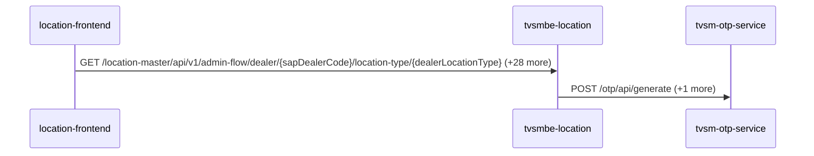
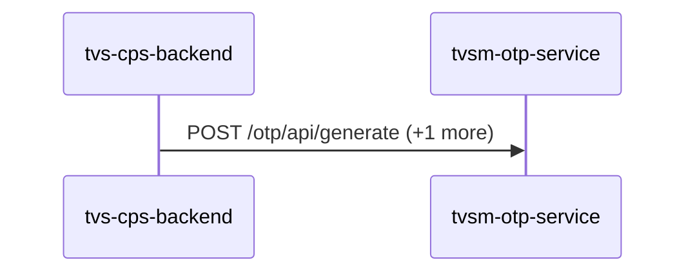
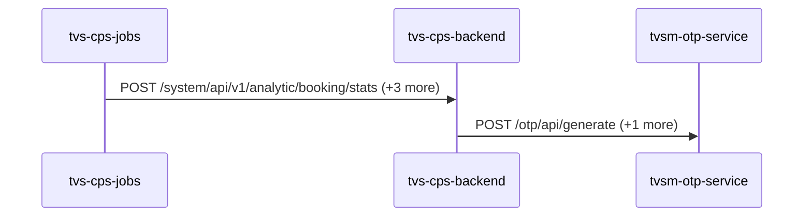
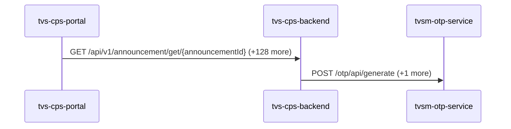
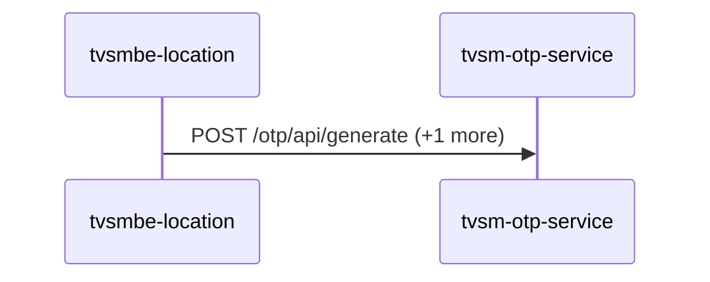

# tvsm-otp-service — Data Flows

## Flow Index
tvsm-otp-service takes part in 5 end-to-end flow(s) in registry/flows.json.

| flow_id | Name | Role of tvsm-otp-service | Trigger |
|---|---|---|---|
| location-frontend--tvsm-otp-service | location-frontend → tvsm-otp-service (2 hops) | terminal | user action in location-frontend (frontend) |
| tvs-cps-backend--tvsm-otp-service | tvs-cps-backend → tvsm-otp-service (1 hop) | terminal | scheduled job(s) in tvs-cps-backend (job-to-call link not resolved): JobScheduler.loadCatalogData, JobScheduler.retrieveMDPDealers, JobScheduler.retrieveMerchandiseStock (+2 more) |
| tvs-cps-jobs--tvsm-otp-service | tvs-cps-jobs → tvsm-otp-service (2 hops) | terminal | scheduled job(s) in tvs-cps-jobs (job-to-call link not resolved): CronJobScheduler.allBookingsScheduler, CronJobScheduler.allEnquiriesScheduler, CronJobScheduler.availableStockScheduler (+27 more); request to tvs-cps-jobs from outside the registry (no internal caller) |
| tvs-cps-portal--tvsm-otp-service | tvs-cps-portal → tvsm-otp-service (2 hops) | terminal | user action in tvs-cps-portal (frontend) |
| tvsmbe-location--tvsm-otp-service | tvsmbe-location → tvsm-otp-service (1 hop) | terminal | scheduled job(s) in tvsmbe-location (job-to-call link not resolved): CronService.logMetricsPeriodically |

## Flow: location-frontend--tvsm-otp-service
Summary: Starting at `location-frontend` (user action in location-frontend (frontend)), the flow passes through `tvsmbe-location` and ends at `tvsm-otp-service`, using 2 sync HTTP hop(s) and 0 async event hop(s); tvsm-otp-service role: terminal; confidence medium.

Steps:
| # | From | To | Via | Data (schema names) | Sync/Async | Confidence |
|---|---|---|---|---|---|---|
| 1 | location-frontend | tvsmbe-location | GET /location-master/api/v1/admin-flow/dealer/{sapDealerCode}/location-type/{dealerLocationType}, GET /location-master/api/v1/admin-flow/rejection-comments, GET /location-master/api/v1/admin-flow/summary (+26 more) | CreateDealerRequest, DealerListRequest, DealerResponse, DealerSearchFilterRequest, DealerSearchRequest (+8 more) | sync | high |
| 2 | tvsmbe-location | tvsm-otp-service | POST /otp/api/generate, POST /otp/api/verify | ApiResponseWrapper<OtpResponse[]>, ApiResponseWrapper<OtpVerificationResponse>, OtpRequest, OtpVerify | sync | medium |

Data touched: tvsmbe-location: mongo, mysql; tvsm-otp-service: redis

Failure points: hop 1 location-frontend → tvsmbe-location: criticality hard; hop 2 tvsmbe-location → tvsm-otp-service: criticality hard

Evidence:
- hop 1 (location-frontend → tvsmbe-location): `location-frontend/src/services/DealerDetailsService.ts:38`, `tvsmbe-location/src/main/java/com/tvsmotor/location_master/controller/AdminFlowController.java:28`, `location-frontend/src/services/DealerDetailsService.ts:69` (+42 more)
- hop 2 (tvsmbe-location → tvsm-otp-service): `tvsm-otp-service/src/main/java/com/otp/controller/OtpController.java:32`, `tvsmbe-location/src/main/java/com/tvsmotor/location_master/service/OtpService.java:78`, `tvsmbe-location/src/main/java/com/tvsmotor/location_master/utils/OkHttpUtil.java:54` (+1 more)

## Flow: tvs-cps-backend--tvsm-otp-service
Summary: Starting at `tvs-cps-backend` (scheduled job(s) in tvs-cps-backend (job-to-call link not resolved): JobScheduler.loadCatalogData, JobScheduler.retrieveMDPDealers, JobScheduler.retrieveMerchandiseStock (+2 more)), the flow ends at `tvsm-otp-service`, using 1 sync HTTP hop(s) and 0 async event hop(s); tvsm-otp-service role: terminal; confidence medium.

Steps:
| # | From | To | Via | Data (schema names) | Sync/Async | Confidence |
|---|---|---|---|---|---|---|
| 1 | tvs-cps-backend | tvsm-otp-service | POST /otp/api/generate, POST /otp/api/verify | ApiResponseWrapper<OtpResponse[]>, ApiResponseWrapper<OtpVerificationResponse>, OtpRequest, OtpVerify | sync | medium |

Data touched: tvs-cps-backend: postgres, postgres:nmazcpsdbsdev01-cmn-postgres-uks.postgres.database.azure.com:nmazcpsdbdev01-cps; tvsm-otp-service: redis

Failure points: hop 1 tvs-cps-backend → tvsm-otp-service: criticality hard

Evidence:
- hop 1 (tvs-cps-backend → tvsm-otp-service): `TVS-CPS-BACKEND/bff-service/src/main/java/com/tvsm/bff/client/OptAndNotificationClient.java:97`, `tvsm-otp-service/src/main/java/com/otp/controller/OtpController.java:32`, `TVS-CPS-BACKEND/bff-service/src/main/java/com/tvsm/bff/client/OptAndNotificationClient.java:334`

## Flow: tvs-cps-jobs--tvsm-otp-service
Summary: Starting at `tvs-cps-jobs` (scheduled job(s) in tvs-cps-jobs (job-to-call link not resolved): CronJobScheduler.allBookingsScheduler, CronJobScheduler.allEnquiriesScheduler, CronJobScheduler.availableStockScheduler (+27 more); request to tvs-cps-jobs from outside the registry (no internal caller)), the flow passes through `tvs-cps-backend` and ends at `tvsm-otp-service`, using 2 sync HTTP hop(s) and 0 async event hop(s); tvsm-otp-service role: terminal; confidence medium.

Steps:
| # | From | To | Via | Data (schema names) | Sync/Async | Confidence |
|---|---|---|---|---|---|---|
| 1 | tvs-cps-jobs | tvs-cps-backend | POST /system/api/v1/analytic/booking/stats, POST /system/api/v1/analytics-dashboard/indicators/calculate, POST /system/api/v1/appointments/auto-close (+1 more) | APIResponse<map<string,object>>, AnalyticsDto, AnalyticsRequestDTO | sync | high |
| 2 | tvs-cps-backend | tvsm-otp-service | POST /otp/api/generate, POST /otp/api/verify | ApiResponseWrapper<OtpResponse[]>, ApiResponseWrapper<OtpVerificationResponse>, OtpRequest, OtpVerify | sync | medium |

Data touched: tvs-cps-backend: postgres, postgres:nmazcpsdbsdev01-cmn-postgres-uks.postgres.database.azure.com:nmazcpsdbdev01-cps; tvsm-otp-service: redis

Failure points: hop 1 tvs-cps-jobs → tvs-cps-backend: criticality hard; hop 2 tvs-cps-backend → tvsm-otp-service: criticality hard

Evidence:
- hop 1 (tvs-cps-jobs → tvs-cps-backend): `TVS-CPS-BACKEND/bff-service/src/main/java/com/tvsm/bff/controller/AnalyticsController.java:23`, `TVS-CPS-JOBS/src/main/java/com/tvsm/jobs/service/AnalyticsService.java:32`, `TVS-CPS-JOBS/src/main/java/com/tvsm/jobs/service/RestCallService.java:50` (+4 more)
- hop 2 (tvs-cps-backend → tvsm-otp-service): `TVS-CPS-BACKEND/bff-service/src/main/java/com/tvsm/bff/client/OptAndNotificationClient.java:97`, `tvsm-otp-service/src/main/java/com/otp/controller/OtpController.java:32`, `TVS-CPS-BACKEND/bff-service/src/main/java/com/tvsm/bff/client/OptAndNotificationClient.java:334`

## Flow: tvs-cps-portal--tvsm-otp-service
Summary: Starting at `tvs-cps-portal` (user action in tvs-cps-portal (frontend)), the flow passes through `tvs-cps-backend` and ends at `tvsm-otp-service`, using 2 sync HTTP hop(s) and 0 async event hop(s); tvsm-otp-service role: terminal; confidence medium.

Steps:
| # | From | To | Via | Data (schema names) | Sync/Async | Confidence |
|---|---|---|---|---|---|---|
| 1 | tvs-cps-portal | tvs-cps-backend | GET /api/v1/announcement/get/{announcementId}, GET /api/v1/announcement/user/banners, GET /api/v1/appointments/{appointmentId} (+126 more) | APIResponse<AnnouncementResponseDto>, APIResponse<AnnouncementResponseDto[]>, APIResponse<AppointmentCountResponseDTO>, APIResponse<AppointmentDashboardResponseDTO>, APIResponse<AppointmentDetailResponseDTO> (+105 more) | sync | medium |
| 2 | tvs-cps-backend | tvsm-otp-service | POST /otp/api/generate, POST /otp/api/verify | ApiResponseWrapper<OtpResponse[]>, ApiResponseWrapper<OtpVerificationResponse>, OtpRequest, OtpVerify | sync | medium |

Data touched: tvs-cps-backend: postgres, postgres:nmazcpsdbsdev01-cmn-postgres-uks.postgres.database.azure.com:nmazcpsdbdev01-cps; tvsm-otp-service: redis

Failure points: hop 1 tvs-cps-portal → tvs-cps-backend: criticality hard; hop 2 tvs-cps-backend → tvsm-otp-service: criticality hard

Evidence:
- hop 1 (tvs-cps-portal → tvs-cps-backend): `TVS-CPS-BACKEND/announcement-service/src/main/java/com/tvsm/announcement/controller/AnnouncementController.java:31`, `TVS-CPS-PORTAL/channel-partner-system/src/services/notification.service.ts:140`, `TVS-CPS-PORTAL/channel-partner-system/src/services/notification.service.ts:144` (+194 more)
- hop 2 (tvs-cps-backend → tvsm-otp-service): `TVS-CPS-BACKEND/bff-service/src/main/java/com/tvsm/bff/client/OptAndNotificationClient.java:97`, `tvsm-otp-service/src/main/java/com/otp/controller/OtpController.java:32`, `TVS-CPS-BACKEND/bff-service/src/main/java/com/tvsm/bff/client/OptAndNotificationClient.java:334`

## Flow: tvsmbe-location--tvsm-otp-service
Summary: Starting at `tvsmbe-location` (scheduled job(s) in tvsmbe-location (job-to-call link not resolved): CronService.logMetricsPeriodically), the flow ends at `tvsm-otp-service`, using 1 sync HTTP hop(s) and 0 async event hop(s); tvsm-otp-service role: terminal; confidence medium.

Steps:
| # | From | To | Via | Data (schema names) | Sync/Async | Confidence |
|---|---|---|---|---|---|---|
| 1 | tvsmbe-location | tvsm-otp-service | POST /otp/api/generate, POST /otp/api/verify | ApiResponseWrapper<OtpResponse[]>, ApiResponseWrapper<OtpVerificationResponse>, OtpRequest, OtpVerify | sync | medium |

Data touched: tvsmbe-location: mongo, mysql; tvsm-otp-service: redis

Failure points: hop 1 tvsmbe-location → tvsm-otp-service: criticality hard

Evidence:
- hop 1 (tvsmbe-location → tvsm-otp-service): `tvsm-otp-service/src/main/java/com/otp/controller/OtpController.java:32`, `tvsmbe-location/src/main/java/com/tvsmotor/location_master/service/OtpService.java:78`, `tvsmbe-location/src/main/java/com/tvsmotor/location_master/utils/OkHttpUtil.java:54` (+1 more)
