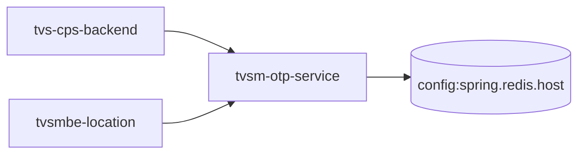

# tvsm-otp-service — High-Level Design

## Context
tvsm-otp-service is a `backend-api` in the TVS-CS org (domain: Unknown). Neighbours: callers `tvs-cps-backend`, `tvsmbe-location`; downstream none resolved.

## Architecture
tvsm-otp-service components and connections (from service.yaml):

## Integration Points
tvsm-otp-service registry edges (4):

| Direction | Peer | Kind | Via | Criticality | Source | Match |
|---|---|---|---|---|---|---|
| in | `tvs-cps-backend` | http | POST /otp/api/generate | hard | code | path-suffix |
| in | `tvs-cps-backend` | http | POST /otp/api/verify | hard | code | path-suffix |
| in | `tvsmbe-location` | http | POST /otp/api/generate | hard | code | path-suffix |
| in | `tvsmbe-location` | http | POST /otp/api/verify | hard | code | path-suffix |

## Data Ownership
tvsm-otp-service data stores (service.yaml `data_stores`; ownership flag not determinable unless set):

| Store | Type | Access | Owned | Key entities |
|---|---|---|---|---|
| `config:spring.redis.host` | redis | Unknown | Unknown | Unknown |

## Key Design Decisions
tvsm-otp-service: N/A — not determinable from code.

| Decision | Alternatives considered | Reason |
|---|---|---|
| Unknown | Unknown | Unknown |

## Non-Functional Requirements
tvsm-otp-service NFR targets: N/A — not determinable from code.

## Security
tvsm-otp-service security: endpoint auth values None. No auth middleware found in code. 2 secret config key(s), sourced via: {'app-settings': 2} (names in OVERVIEW.md). PII handling: Unknown.

## Resilience and Failure Modes
tvsm-otp-service hard dependencies: none resolved. No retry/circuit-breaker code found; failure behaviour Unknown.

## Deployment Topology
tvsm-otp-service deployment artefacts (platform/regions: Unknown unless listed):

| Kind | Name | File | Environments | Image | Ports | Variable groups |
|---|---|---|---|---|---|---|
| azure-pipeline | azure-pipelines/ast-image-scan-otp-pipeline.yaml | `azure-pipelines/ast-image-scan-otp-pipeline.yaml:1` | - | - | - | Checkmarx_Common, UAT_Threshold |
| azure-pipeline | azure-pipelines/ast-otp-prod-pipeline.yaml | `azure-pipelines/ast-otp-prod-pipeline.yaml:1` | - | - | - | PROD_Threshold, Tenable |
| azure-pipeline | azure-pipelines/ast-otp-uat-pipeline.yaml | `azure-pipelines/ast-otp-uat-pipeline.yaml:1` | - | - | - | Checkmarx_Common, Tenable, UAT_Threshold |
| azure-pipeline | azure-pipelines/cd-pipeline.yaml | `azure-pipelines/cd-pipeline.yaml:1` | dev, uat | - | - | - |
| azure-pipeline | azure-pipelines/ci-pipeline.yaml | `azure-pipelines/ci-pipeline.yaml:1` | - | - | - | - |
| azure-pipeline | azure-pipelines/sonar.yaml | `azure-pipelines/sonar.yaml:13` | - | - | - | - |
| azure-pipeline | cd-pipeline.yaml | `cd-pipeline.yaml:1` | dev, prod, uat | - | - | - |
| azure-pipeline | ci-otp-pipeline.yaml | `ci-otp-pipeline.yaml:1` | - | - | - | - |
| azure-pipeline | uk-cd-pipeline.yaml | `uk-cd-pipeline.yaml:1` | dev, prod, uat | - | - | - |
| azure-pipeline | uk-cd-training-pipeline.yaml | `uk-cd-training-pipeline.yaml:1` | training | - | - | - |
| dockerfile | Dockerfile | `Dockerfile:8` | - | maven:3.9.16-amazoncorretto-21-alpine, eclipse-temurin:17-jdk-alpine-3.21 | 7001 | - |
| dockerfile | Dockerfile.build | `Dockerfile.build:1` | - | maven:3.9.16-amazoncorretto-21-alpine | - | - |

## Observability
tvsm-otp-service observability libraries: `org.springframework.boot:spring-boot-starter-actuator`, `org.springframework.boot:spring-boot-starter-log4j2`. Related config keys: `management.endpoint.health.enabled`, `management.endpoint.health.show-details`, `management.endpoints.web.exposure.include`. Dashboards/alerts: Unknown.
