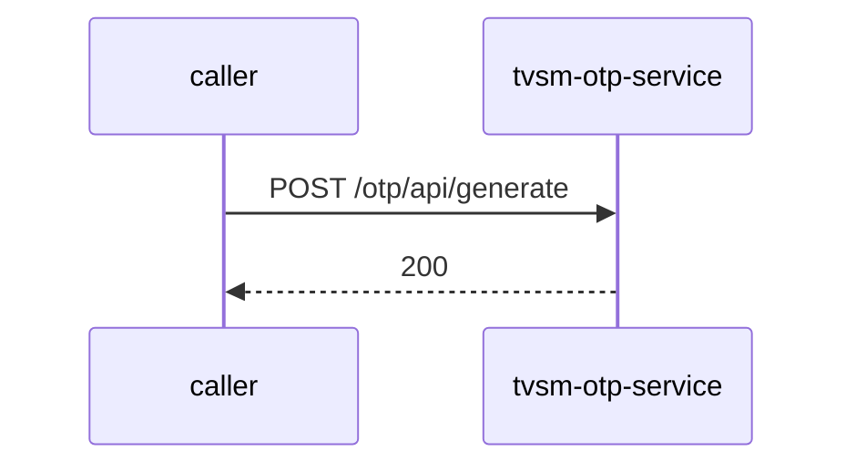

# tvsm-otp-service — Low-Level Design

## Data Model
tvsm-otp-service entities from `data_access` items (1).

Store access at `src/main/java/com/otp/config/OtpServiceHealthIndicator.java:26`: database Unknown; collections -.

## State Machines
tvsm-otp-service: N/A — no status/state enums found in code.

## Business Rules
tvsm-otp-service validation rules on DTO fields (from schema `validation`):

| Schema.field | Rule | Defined in |
|---|---|---|
| `OtpVerify.otp` | pattern=^\d{4,6}$ | `src/main/java/com/otp/model/OtpVerify.java:8` |

## Key Classes and Functions
tvsm-otp-service key classes:

| Class / Function | File | Responsibility |
|---|---|---|
| `OtpController` | `src/main/java/com/otp/controller/OtpController.java` | HTTP handlers |
| `@RestControllerAdvice` | `src/main/java/com/otp/exception/GlobalExceptionHandler.java:15` | error handling |

## Sequence Details
tvsm-otp-service sequence for `POST /otp/api/generate` (handler `OtpController.generateOtp`); downstream calls inside the handler are not traced from code, module-level targets shown as optional.

## Error Handling
tvsm-otp-service error handling: `src/main/java/com/otp/exception/GlobalExceptionHandler.java:15` (@RestControllerAdvice). Status mapping: Unknown.

## Configuration Details
tvsm-otp-service behaviour-relevant config keys (names only; full list in OVERVIEW.md):
- N/A — no behaviour-switching keys identified

## Edge Cases
tvsm-otp-service edge cases: N/A — not determinable from code without manual review.
