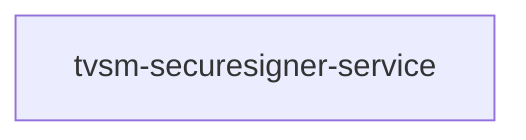

# tvsm-securesigner-service — High-Level Design

## Context
tvsm-securesigner-service is a `backend-api` in the TVS-CS org (domain: Unknown). Neighbours: callers Unknown; downstream none resolved.

## Architecture
tvsm-securesigner-service components and connections (from service.yaml):

## Integration Points
tvsm-securesigner-service registry edges (0):

| Direction | Peer | Kind | Via | Criticality | Source | Match |
|---|---|---|---|---|---|---|
| N/A | | | | | | no registry edges |

## Data Ownership
tvsm-securesigner-service data stores (service.yaml `data_stores`; ownership flag not determinable unless set):

| Store | Type | Access | Owned | Key entities |
|---|---|---|---|---|
| N/A | | | | no data stores extracted |

## Key Design Decisions
tvsm-securesigner-service: N/A — not determinable from code.

| Decision | Alternatives considered | Reason |
|---|---|---|
| Unknown | Unknown | Unknown |

## Non-Functional Requirements
tvsm-securesigner-service NFR targets: N/A — not determinable from code.

## Security
tvsm-securesigner-service security: endpoint auth values None. Auth code: `src/main/java/com/tvsm/urlsigner/service/SignerService.java:12`. 2 secret config key(s), sourced via: {'app-settings': 2} (names in OVERVIEW.md). PII handling: Unknown.

## Resilience and Failure Modes
tvsm-securesigner-service hard dependencies: none resolved. No retry/circuit-breaker code found; failure behaviour Unknown.

## Deployment Topology
tvsm-securesigner-service deployment artefacts (platform/regions: Unknown unless listed):

| Kind | Name | File | Environments | Image | Ports | Variable groups |
|---|---|---|---|---|---|---|
| azure-pipeline | AST_Image_Scan_secure_signer_Pipeline.yml | `AST_Image_Scan_secure_signer_Pipeline.yml:1` | - | - | - | Checkmarx_Common, UAT_Threshold |
| azure-pipeline | AST_secure_signer_UAT_Pipeline.yml | `AST_secure_signer_UAT_Pipeline.yml:1` | - | - | - | Checkmarx_Common, Tenable, UAT_Threshold |
| azure-pipeline | cd-pipeline.yaml | `cd-pipeline.yaml:1` | dev, prod, uat | - | - | - |
| azure-pipeline | ci-pipeline.yaml | `ci-pipeline.yaml:1` | - | - | - | - |
| dockerfile | Dockerfile | `Dockerfile:4` | - | maven:3.9.9-amazoncorretto-17-debian-bookworm, amazoncorretto:17.0.13-al2023-headless | 8080 | - |

## Observability
tvsm-securesigner-service observability libraries: none found. Related config keys: none. Dashboards/alerts: Unknown.
