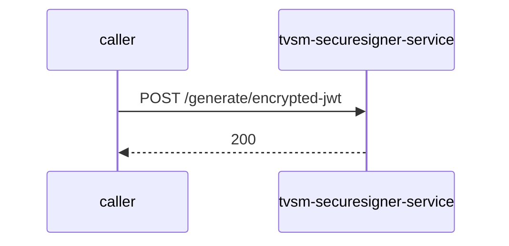

# tvsm-securesigner-service — Low-Level Design

## Data Model
tvsm-securesigner-service entities from `data_access` items (0).
N/A — no data access in this repo.

## State Machines
tvsm-securesigner-service: N/A — no status/state enums found in code.

## Business Rules
tvsm-securesigner-service validation rules on DTO fields (from schema `validation`):
N/A — no declarative validation found; other rules not determinable without manual review.

## Key Classes and Functions
tvsm-securesigner-service key classes:

| Class / Function | File | Responsibility |
|---|---|---|
| `SignerController` | `src/main/java/com/tvsm/urlsigner/controller/SignerController.java` | HTTP handlers |
| `TestController` | `src/main/java/com/tvsm/urlsigner/controller/TestController.java` | HTTP handlers |

## Sequence Details
tvsm-securesigner-service sequence for `POST /generate/encrypted-jwt` (handler `SignerController.createEncryptedJwt`); downstream calls inside the handler are not traced from code, module-level targets shown as optional.

## Error Handling
tvsm-securesigner-service error handling: no global exception handler found in code. Status mapping: Unknown.

## Configuration Details
tvsm-securesigner-service behaviour-relevant config keys (names only; full list in OVERVIEW.md):
- N/A — no behaviour-switching keys identified

## Edge Cases
tvsm-securesigner-service edge cases: N/A — not determinable from code without manual review.
