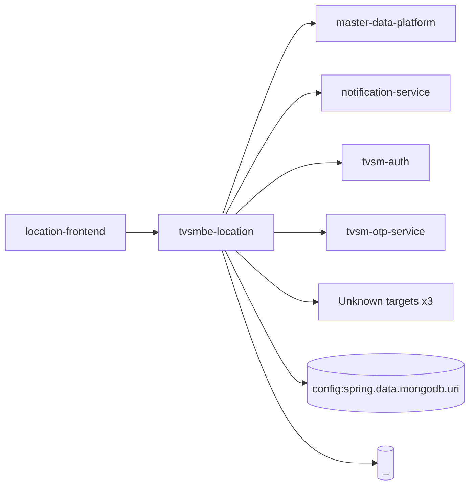

# tvsmbe-location — High-Level Design

## Context
tvsmbe-location is a `backend-api` in the TVS-CS org (domain: Unknown). Neighbours: callers `location-frontend`; downstream `master-data-platform`, `notification-service`, `tvsm-auth`, `tvsm-otp-service`.

## Architecture
tvsmbe-location components and connections (from service.yaml):

## Integration Points
tvsmbe-location registry edges (42):

| Direction | Peer | Kind | Via | Criticality | Source | Match |
|---|---|---|---|---|---|---|
| in | `location-frontend` | http | GET /location-master/api/v1/admin-flow/dealer/{sapDealerCode}/location-type/{dealerLocationType} | hard | code | path-unique |
| in | `location-frontend` | http | GET /location-master/api/v1/admin-flow/rejection-comments | hard | code | path-unique |
| in | `location-frontend` | http | GET /location-master/api/v1/admin-flow/summary | hard | code | path-unique |
| in | `location-frontend` | http | GET /location-master/api/v1/admin-flow/{sapDealerCode}/contacts/{dealerLocationType} | hard | code | path-unique |
| in | `location-frontend` | http | GET /location-master/api/v1/country/{countryCode}/filter-config | hard | code | path-unique |
| in | `location-frontend` | http | GET /location-master/api/v1/country/{countryCode}/provinces | hard | code | path-unique |
| in | `location-frontend` | http | GET /location-master/api/v1/dealer-flow/dealer/{sapDealerCode} | hard | code | path-unique |
| in | `location-frontend` | http | GET /location-master/api/v1/dealer-flow/dealer/{sapDealerCode}/location-type/{dealerLocationType} | hard | code | path-unique |
| in | `location-frontend` | http | GET /location-master/api/v1/dealer-flow/dealerInfo | hard | code | path-unique |
| in | `location-frontend` | http | GET /location-master/api/v1/dealer/summary | hard | code | path-unique |
| in | `location-frontend` | http | GET /location-master/api/v1/dealer/template | hard | code | path-unique |
| in | `location-frontend` | http | GET /location-master/api/v1/geo/geocode | hard | code | path-unique |
| in | `location-frontend` | http | GET /location-master/api/v1/user-x/{userId}/countries | hard | code | path-unique |
| in | `location-frontend` | http | POST /location-master/api/v1/admin-flow/list | hard | code | path-unique |
| in | `location-frontend` | http | POST /location-master/api/v1/admin-flow/send-location-update-sms | hard | code | path-unique |
| in | `location-frontend` | http | POST /location-master/api/v1/admin-flow/verification | hard | code | path-unique |
| in | `location-frontend` | http | POST /location-master/api/v1/admin/migrate/import-dealership-locations | hard | code | path-unique |
| in | `location-frontend` | http | POST /location-master/api/v1/charging-station/nearby | hard | code | path-unique |
| in | `location-frontend` | http | POST /location-master/api/v1/dealer | hard | code | path-unique |
| in | `location-frontend` | http | POST /location-master/api/v1/dealer-search | hard | code | path-unique |
| in | `location-frontend` | http | POST /location-master/api/v1/dealer/export | hard | code | path-unique |
| in | `location-frontend` | http | POST /location-master/api/v1/dealer/list | hard | code | path-unique |
| in | `location-frontend` | http | POST /location-master/api/v1/domestic-dealer/brands | hard | code | path-unique |
| in | `location-frontend` | http | POST /location-master/api/v1/domestic-dealer/clusters | hard | code | path-unique |
| in | `location-frontend` | http | POST /location-master/api/v1/domestic-dealer/get-sms | hard | code | path-unique |
| in | `location-frontend` | http | POST /location-master/api/v1/domestic-dealer/send-otp | hard | code | path-unique |
| in | `location-frontend` | http | POST /location-master/api/v1/finder/dealers | hard | code | path-unique |
| in | `location-frontend` | http | POST /location-master/v1/dealer-location/submit | hard | code | path-unique |
| in | `location-frontend` | http | PUT /location-master/api/v1/dealer/{id} | hard | code | path-unique |
| out | `master-data-platform` | http | GET /mdp/v1/dealer/{sapDealerCode} | hard | code | path-unique |
| out | `master-data-platform` | http | GET /mdp/v1/dealer/{sapDealerCode}/branches | hard | code | path-unique |
| out | `master-data-platform` | http | POST /mdp/v1/dealers/data | hard | code | path-unique |
| out | `master-data-platform` | http | POST /mdp/v1/dealers/listOfDealerDetails/basedOnProximity | hard | code | path-unique |
| out | `master-data-platform` | http | POST /mdp/v1/dealers/listOfSapDealerCode/basedOnFilters | hard | code | path-unique |
| out | `master-data-platform` | http | POST /mdp/v1/dealers/stateWiseCount/basedOnFilters | hard | code | path-unique |
| out | `notification-service` | http | GET /api/v1/notification/retryPreference | hard | code | path-unique |
| out | `notification-service` | http | POST /api/v1/notification/sms | hard | code | path-unique |
| out | `tvsm-auth` | http | GET /api/v1/dealer/get-contacts | hard | code | path-unique |
| out | `tvsm-auth` | http | POST /auth/v1/app/token/validate | hard | code | path-unique |
| out | `tvsm-otp-service` | http | POST /otp/api/generate | hard | code | path-suffix |
| out | `tvsm-otp-service` | http | POST /otp/api/verify | hard | code | path-suffix |
| out | `master-data-platform` | tests | GET /mdp/v1/dealer/{sapDealerCode}/branches | hard | code | path-suffix |

## Data Ownership
tvsmbe-location data stores (service.yaml `data_stores`; ownership flag not determinable unless set):

| Store | Type | Access | Owned | Key entities |
|---|---|---|---|---|
| `config:spring.data.mongodb.uri` | mongo | read-write | Unknown | Area, AuditLog, City, Country, DealerInfoDetails, DealerSecretKey, DealershipLocation, District, Division, DomesticDealerCache, Locale, Location, Pincode, PincodeCentroidEntity, RejectionComment … |
| `_` | mysql | write | Unknown | Unknown |

## Key Design Decisions
tvsmbe-location: N/A — not determinable from code.

| Decision | Alternatives considered | Reason |
|---|---|---|
| Unknown | Unknown | Unknown |

## Non-Functional Requirements
tvsmbe-location NFR targets: N/A — not determinable from code. Tuning-related config keys: `spring.servlet.multipart.max-file-size`, `spring.servlet.multipart.max-request-size`.

## Security
tvsmbe-location security: endpoint auth values unknown. Auth code: `src/main/java/com/tvsmotor/location_master/security/SecurityConfig.java:10`, `src/main/java/com/tvsmotor/location_master/security/RequestFilter.java:17`. 26 secret config key(s), sourced via: {'env-file': 12, 'app-settings': 14} (names in OVERVIEW.md). PII handling: Unknown.

## Resilience and Failure Modes
tvsmbe-location hard dependencies: `master-data-platform`, `notification-service`, `tvsm-auth`, `tvsm-otp-service`. Retry/circuit-breaker code: `src/main/java/com/tvsmotor/location_master/utils/SecretKeyManager.java:44` (@Retryable), `src/main/java/com/tvsmotor/location_master/service/MDPDealerService.java:61` (@Retryable), `src/main/java/com/tvsmotor/location_master/service/UMSService.java:44` (@Retryable), `src/main/java/com/tvsmotor/location_master/service/LeadService.java:54` (@Retryable), `src/main/java/com/tvsmotor/location_master/service/NotificationSmsDispatcherService.java:48` (@Retryable), `src/main/java/com/tvsmotor/location_master/service/AzureB2CTokenGenerationService.java:69` (@Retryable).

## Deployment Topology
tvsmbe-location deployment artefacts (platform/regions: Unknown unless listed):

| Kind | Name | File | Environments | Image | Ports | Variable groups |
|---|---|---|---|---|---|---|
| azure-pipeline | AST_Image_Scan_Location_Master_Pipeline.yml | `AST_Image_Scan_Location_Master_Pipeline.yml:1` | - | - | - | Checkmarx_Common, UAT_Threshold |
| azure-pipeline | AST_Location_Master_tvsmbe_location_UAT_Pipeline.yml | `AST_Location_Master_tvsmbe_location_UAT_Pipeline.yml:1` | - | - | - | Checkmarx_Common, Tenable, UAT_Threshold |
| azure-pipeline | azure-pipelines/uat.cd.yml | `azure-pipelines/uat.cd.yml:2` | UAT | - | - | - |
| azure-pipeline | azure-pipelines/uat.ci.yml | `azure-pipelines/uat.ci.yml:1` | - | - | - | Checkmarx_Common, UAT_Threshold |
| azure-pipeline | cd-pipeline.yaml | `cd-pipeline.yaml:1` | dev, prod, uat | - | - | - |
| azure-pipeline | ci-pipeline.yaml | `ci-pipeline.yaml:1` | - | - | - | - |
| azure-pipeline | sonar_ci_pr_pipeline.yml | `sonar_ci_pr_pipeline.yml:2` | - | - | - | - |
| dockerfile | Dockerfile | `Dockerfile:2` | - | maven:3.9.15-amazoncorretto-17-alpine, amazoncorretto:26.0.1-alpine | 8080 | - |

## Observability
tvsmbe-location observability libraries: `io.sentry:sentry-logback`, `io.sentry:sentry-spring-boot-starter`, `org.springframework.boot:spring-boot-starter-actuator`. Related config keys: `SENTRY_AUTH_TOKEN`, `WEBSITE_HTTPLOGGING_RETENTION_DAYS`, `logging.level.root`, `sentry.dsn`, `sentry.maxRequestBodySize`, `sentry.sendDefaultPii`, `sentry.traces-sample-rate`. Dashboards/alerts: Unknown.
