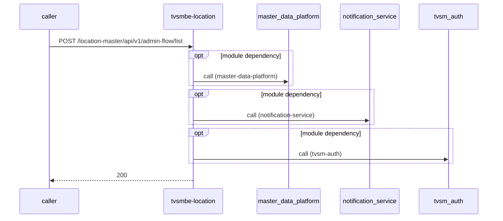

# tvsmbe-location — Low-Level Design

## Data Model
tvsmbe-location entities from `data_access` items (2).

Store access at `src/main/java/com/tvsmotor/location_master/entity/Area.java:10`: database Unknown; collections area, audit_log, city, country, dealer_data, dealer_secret_key, dealership_location, district, division, domestic_dealer_cache, locale, location_data, pincode, pincode_centroid_data, rejection_comments, state, state_details, sub_district, user_x, verified_dealer_locations.

### Area
Entity `Area` defined in `src/main/java/com/tvsmotor/location_master/entity/Area.java:7`; table Unknown; operation write.
Columns: Unknown (no fields extracted).
Relationships: Unknown.

### AuditLog
Entity `AuditLog` defined in `src/main/java/com/tvsmotor/location_master/entity/AuditLog.java:7`; table Unknown; operation write.
Columns: Unknown (no fields extracted).
Relationships: Unknown.

### City
Entity `City` defined in `src/main/java/com/tvsmotor/location_master/entity/City.java:7`; table Unknown; operation write.
Columns: Unknown (no fields extracted).
Relationships: Unknown.

### Country
Entity `Country` defined in `src/main/java/com/tvsmotor/location_master/entity/Country.java:18`; table Unknown; operation read.
Columns: Unknown (no fields extracted).
Relationships: Unknown.

### DealerInfoDetails
Entity `DealerInfoDetails` defined in `src/main/java/com/tvsmotor/location_master/entity/DealerInfoDetails.java:14`; table Unknown; operation both.
Columns: Unknown (no fields extracted).
Relationships: Unknown.

### DealerSecretKey
Entity `DealerSecretKey` defined in `src/main/java/com/tvsmotor/location_master/entity/DealerSecretKey.java:7`; table Unknown; operation both.
Columns: Unknown (no fields extracted).
Relationships: Unknown.

### DealershipLocation
Entity `DealershipLocation` defined in `src/main/java/com/tvsmotor/location_master/entity/DealershipLocation.java:14`; table Unknown; operation both.
Columns: Unknown (no fields extracted).
Relationships: Unknown.

### District
Entity `District` defined in `src/main/java/com/tvsmotor/location_master/entity/District.java:7`; table Unknown; operation write.
Columns: Unknown (no fields extracted).
Relationships: Unknown.

### Division
Entity `Division` defined in `src/main/java/com/tvsmotor/location_master/entity/Division.java:7`; table Unknown; operation write.
Columns: Unknown (no fields extracted).
Relationships: Unknown.

### DomesticDealerCache
Entity `DomesticDealerCache` defined in `src/main/java/com/tvsmotor/location_master/entity/DomesticDealerCache.java:8`; table Unknown; operation read.
Columns: Unknown (no fields extracted).
Relationships: Unknown.

### Locale
Entity `Locale` defined in `src/main/java/com/tvsmotor/location_master/entity/Locale.java:7`; table Unknown; operation read.
Columns: Unknown (no fields extracted).
Relationships: Unknown.

### Location
Entity `Location` defined in `src/main/java/com/tvsmotor/location_master/entity/Location.java:11`; table Unknown; operation both.

| Column | Type | Nullable | Notes |
|---|---|---|---|
| province | string | Unknown | - |
| city | string | Unknown | - |
Relationships: Unknown.

### Pincode
Entity `Pincode` defined in `src/main/java/com/tvsmotor/location_master/entity/Pincode.java:7`; table Unknown; operation write.
Columns: Unknown (no fields extracted).
Relationships: Unknown.

### PincodeCentroidEntity
Entity `PincodeCentroidEntity` defined in `src/main/java/com/tvsmotor/location_master/entity/PincodeCentroidEntity.java:8`; table Unknown; operation read.
Columns: Unknown (no fields extracted).
Relationships: Unknown.

### RejectionComment
Entity `RejectionComment` defined in `src/main/java/com/tvsmotor/location_master/entity/RejectionComment.java:11`; table Unknown; operation read.
Columns: Unknown (no fields extracted).
Relationships: Unknown.

### State
Entity `State` defined in `src/main/java/com/tvsmotor/location_master/entity/State.java:7`; table Unknown; operation both.

| Column | Type | Nullable | Notes |
|---|---|---|---|
| name | string | Unknown | - |
| code | string | Unknown | - |
| country_id | integer | Unknown | - |
Relationships: Unknown.

### StateDetails
Entity `StateDetails` defined in `src/main/java/com/tvsmotor/location_master/entity/StateDetails.java:7`; table Unknown; operation read.
Columns: Unknown (no fields extracted).
Relationships: Unknown.

### SubDistrict
Entity `SubDistrict` defined in `src/main/java/com/tvsmotor/location_master/entity/SubDistrict.java:7`; table Unknown; operation write.
Columns: Unknown (no fields extracted).
Relationships: Unknown.

### UserX
Entity `UserX` defined in `src/main/java/com/tvsmotor/location_master/entity/UserX.java:12`; table Unknown; operation both.

| Column | Type | Nullable | Notes |
|---|---|---|---|
| userId | string | Unknown | - |
| phoneNumber | string | Unknown | - |
| name | string | Unknown | - |
| role | enum[ADMIN,DEALER,TERRITORY_MANAGER] | Unknown | - |
| owningMatrix | UserOwnedEntity[] | Unknown | - |
Relationships: Unknown.

### VerifiedDealerLocation
Entity `VerifiedDealerLocation` defined in `src/main/java/com/tvsmotor/location_master/entity/VerifiedDealerLocation.java:11`; table Unknown; operation both.
Columns: Unknown (no fields extracted).
Relationships: Unknown.

Store access at `src/main/resources/db/migration/v1.1__location_master_DDL_tables.sql:11`: database Unknown; collections -.

## State Machines
tvsmbe-location status/state enums found in code (2); transitions are not determinable from code.
- `DealerLocationStatus` (`src/main/java/com/tvsmotor/location_master/ENUM/DealerLocationStatus.java:5`): VERIFICATION_PENDING, REJECTED, VERIFIED, VERIFICATION_TO_BE_INITIATED, VERIFICATION_INITIATED, RE_VERIFICATION_INITIATED, RE_VERIFICATION_PENDING
- `DealershipStatus` (`src/main/java/com/tvsmotor/location_master/ENUM/DealershipStatus.java:3`): ACTIVE, DELETED, PRE_ACTIVE, INACTIVE

## Business Rules
tvsmbe-location validation rules on DTO fields (from schema `validation`):
N/A — no declarative validation found; other rules not determinable without manual review.

## Key Classes and Functions
tvsmbe-location key classes:

| Class / Function | File | Responsibility |
|---|---|---|
| `TestController` | `src/main/java/com/tvsmotor/location_master/controller/TestController.java` | HTTP handlers |
| `UserXController` | `src/main/java/com/tvsmotor/location_master/controller/UserXController.java` | HTTP handlers |
| `AdminFlowController` | `src/main/java/com/tvsmotor/location_master/controller/AdminFlowController.java` | HTTP handlers |
| `CountryController` | `src/main/java/com/tvsmotor/location_master/controller/CountryController.java` | HTTP handlers |
| `DealerFlowController` | `src/main/java/com/tvsmotor/location_master/controller/DealerFlowController.java` | HTTP handlers |
| `IBDealerController` | `src/main/java/com/tvsmotor/location_master/controller/IBDealerController.java` | HTTP handlers |
| `GeoCodeController` | `src/main/java/com/tvsmotor/location_master/controller/GeoCodeController.java` | HTTP handlers |
| `LocationController` | `src/main/java/com/tvsmotor/location_master/controller/LocationController.java` | HTTP handlers |
| `LocationMasterController` | `src/main/java/com/tvsmotor/location_master/controller/LocationMasterController.java` | HTTP handlers |
| `MobileFlowController` | `src/main/java/com/tvsmotor/location_master/controller/MobileFlowController.java` | HTTP handlers |
| `MigrationController` | `src/main/java/com/tvsmotor/location_master/controller/MigrationController.java` | HTTP handlers |
| `ChargingStationController` | `src/main/java/com/tvsmotor/location_master/controller/ChargingStationController.java` | HTTP handlers |
| `DealershipLocationController` | `src/main/java/com/tvsmotor/location_master/controller/DealershipLocationController.java` | HTTP handlers |
| `DomesticDealerController` | `src/main/java/com/tvsmotor/location_master/controller/DomesticDealerController.java` | HTTP handlers |
| `DealerProximityController` | `src/main/java/com/tvsmotor/location_master/controller/DealerProximityController.java` | HTTP handlers |
| `CronService.logMetricsPeriodically` | `src/main/java/com/tvsmotor/location_master/service/CronService.java:32` | scheduled job |
| `@ControllerAdvice` | `src/main/java/com/tvsmotor/location_master/exception/RestExceptionHandler.java:22` | error handling |

## Sequence Details
tvsmbe-location sequence for `POST /location-master/api/v1/admin-flow/list` (handler `AdminFlowController.getDealerListByStatusPagination`); downstream calls inside the handler are not traced from code, module-level targets shown as optional.

## Error Handling
tvsmbe-location error handling: `src/main/java/com/tvsmotor/location_master/exception/RestExceptionHandler.java:22` (@ControllerAdvice). Status mapping: Unknown. Retry evidence: `src/main/java/com/tvsmotor/location_master/utils/SecretKeyManager.java:44`, `src/main/java/com/tvsmotor/location_master/service/MDPDealerService.java:61`, `src/main/java/com/tvsmotor/location_master/service/UMSService.java:44`, `src/main/java/com/tvsmotor/location_master/service/LeadService.java:54`, `src/main/java/com/tvsmotor/location_master/service/NotificationSmsDispatcherService.java:48`, `src/main/java/com/tvsmotor/location_master/service/AzureB2CTokenGenerationService.java:69`.

## Configuration Details
tvsmbe-location behaviour-relevant config keys (names only; full list in OVERVIEW.md):
- `MDP_BASE_URL`: points to `master-data-platform`
- `NOTIFICATION_BASE_URL`: points to `notification-service`
- `UMS_BASE_URL`: points to `tvsm-auth`
- `otp.service.base.url`: points to `tvsm-otp-service`
- `config:mdp.base.url`: base URL for outbound calls
- `config:notification.base.url`: base URL for outbound calls
- `config:ums.base.url`: base URL for outbound calls
- `config:kazam.base.url`: base URL for outbound calls
- `config:lms.base.url`: base URL for outbound calls
- `config:otp.service.base.url`: base URL for outbound calls

## Edge Cases
tvsmbe-location edge cases: N/A — not determinable from code without manual review.
