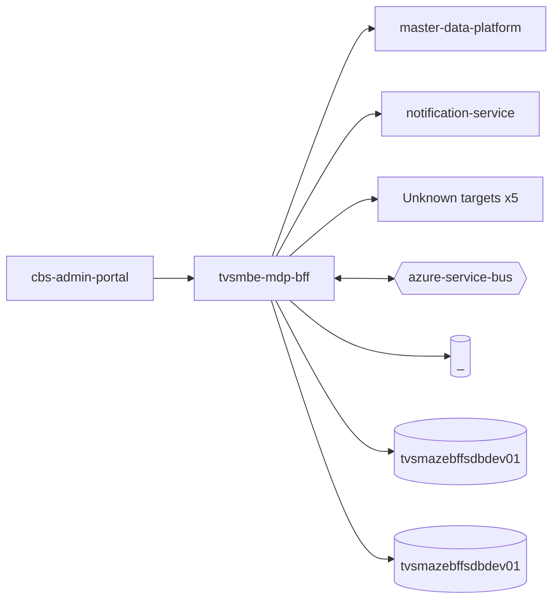

# tvsmbe-mdp-bff — High-Level Design

## Context
tvsmbe-mdp-bff is a `bff` in the TVS-CS org (domain: Unknown). Neighbours: callers `cbs-admin-portal`; downstream `master-data-platform`, `notification-service`.

## Architecture
tvsmbe-mdp-bff components and connections (from service.yaml):

## Integration Points
tvsmbe-mdp-bff registry edges (5):

| Direction | Peer | Kind | Via | Criticality | Source | Match |
|---|---|---|---|---|---|---|
| in | `master-data-platform` | event | azure-service-bus:topic:mdp.dealer_data | async | code | entity |
| in | `cbs-admin-portal` | http | GET /mdp-bff/v1/mdp/dealer/{sapDealerCode} | hard | code | path-suffix |
| out | `master-data-platform` | http | POST /mdp/v1/dealer/mapDealerWithKNumber | hard | code | path-unique |
| out | `master-data-platform` | http | POST /mdp/v1/dealers/basedOnFilters | hard | code | path-unique |
| out | `notification-service` | http | POST /api/v1/notification/email | hard | code | path-unique |

## Data Ownership
tvsmbe-mdp-bff data stores (service.yaml `data_stores`; ownership flag not determinable unless set):

| Store | Type | Access | Owned | Key entities |
|---|---|---|---|---|
| `_` | mysql | write | Unknown | Unknown |
| `tvsmazebffsdbdev01` | mysql | write | Unknown | AuditLog |
| `tvsmazebffsdbdev01` | mysql | read-write | Unknown | AuditLog, FailedMdpMessageExceptionEntity, FailureEventTypeInfo |

## Key Design Decisions
tvsmbe-mdp-bff: N/A — not determinable from code.

| Decision | Alternatives considered | Reason |
|---|---|---|
| Unknown | Unknown | Unknown |

## Non-Functional Requirements
tvsmbe-mdp-bff NFR targets: N/A — not determinable from code. Tuning-related config keys: `KNOWLARITY_K_NUM_POOL_API_EMPTY_NOTIFICATION_RECIPIENTS`.

## Security
tvsmbe-mdp-bff security: endpoint auth values None. No auth middleware found in code. 21 secret config key(s), sourced via: {'env-file': 8, 'app-settings': 13} (names in OVERVIEW.md). PII handling: Unknown.

## Resilience and Failure Modes
tvsmbe-mdp-bff hard dependencies: `master-data-platform`, `notification-service`. Retry/circuit-breaker code: `inbound/src/main/java/com/tvsmotor/bff/service/AzureB2CTokenGenerationService.java:65` (@Retryable), `inbound/src/main/java/com/tvsmotor/bff/service/MdpDealerOperationsService.java:64` (@Retryable), `outbound/src/main/java/com/tvsmotor/mdp_bff/outbound/service/NotificationSenderService.java:41` (@Retryable), `outbound/src/main/java/com/tvsmotor/mdp_bff/outbound/service/AzureB2CTokenGenerationService.java:63` (@Retryable), `outbound/src/main/java/com/tvsmotor/mdp_bff/outbound/service/MdpDealerOperationsService.java:48` (@Retryable), `outbound/src/main/java/com/tvsmotor/mdp_bff/outbound/service/daksha/DakshaDealerDataProcessorService.java:25` (@Retryable), `outbound/src/main/java/com/tvsmotor/mdp_bff/outbound/service/lat_long/LatLongDealerDataProcessorService.java:25` (@Retryable), `outbound/src/main/java/com/tvsmotor/mdp_bff/outbound/service/single_interface/SingleInterfaceDealerDataProcessorService.java:63` (@Retryable), `outbound/src/main/java/com/tvsmotor/mdp_bff/outbound/service/knowlarity/KnowlarityApiCallerService.java:52` (@Retryable). Subscriber error handling: `outbound/src/main/java/com/tvsmotor/mdp_bff/outbound/config/BffServiceBusConfig.java:26` {"error_handler": true}

## Deployment Topology
tvsmbe-mdp-bff deployment artefacts (platform/regions: Unknown unless listed):

| Kind | Name | File | Environments | Image | Ports | Variable groups |
|---|---|---|---|---|---|---|
| azure-pipeline | AST_Image_Scan_MDP_BFF_Inbound_tvsmbe_mdp_bff_UAT_Pipeline.yml | `AST_Image_Scan_MDP_BFF_Inbound_tvsmbe_mdp_bff_UAT_Pipeline.yml:1` | - | - | - | Checkmarx_Common, UAT_Threshold |
| azure-pipeline | AST_Image_Scan_MDP_BFF_Outbound_tvsmbe_mdp_bff_UAT_Pipeline.yml | `AST_Image_Scan_MDP_BFF_Outbound_tvsmbe_mdp_bff_UAT_Pipeline.yml:1` | - | - | - | Checkmarx_Common, UAT_Threshold |
| azure-pipeline | inbound/AST_MDP_BFF_tvsmbe_mdp_bff_PROD_Pipeline.yml | `inbound/AST_MDP_BFF_tvsmbe_mdp_bff_PROD_Pipeline.yml:1` | - | - | - | PROD_Threshold, Tenable |
| azure-pipeline | inbound/AST_MDP_BFF_tvsmbe_mdp_bff_UAT_Pipeline.yml | `inbound/AST_MDP_BFF_tvsmbe_mdp_bff_UAT_Pipeline.yml:1` | - | - | - | Checkmarx_Common, Tenable, UAT_Threshold |
| azure-pipeline | inbound/cd-pipeline.yaml | `inbound/cd-pipeline.yaml:1` | dev, prod, uat | - | - | - |
| azure-pipeline | inbound/ci-pipeline.yaml | `inbound/ci-pipeline.yaml:1` | - | - | - | - |
| azure-pipeline | inbound/sonar_ci_pr_pipelines.yml | `inbound/sonar_ci_pr_pipelines.yml:1` | - | - | - | - |
| dockerfile | inbound/Dockerfile | `inbound/Dockerfile:2` | - | maven:3.9.14-amazoncorretto-17, amazoncorretto:17.0.18 | 8080 | - |
| azure-pipeline | outbound/cd-pipeline.yaml | `outbound/cd-pipeline.yaml:1` | dev, prod, uat | - | - | - |
| azure-pipeline | outbound/ci-pipeline.yaml | `outbound/ci-pipeline.yaml:1` | - | - | - | - |
| azure-pipeline | outbound/sonar_ci_pr_pipelines.yml | `outbound/sonar_ci_pr_pipelines.yml:1` | - | - | - | - |
| dockerfile | outbound/Dockerfile | `outbound/Dockerfile:2` | - | maven:3.9.14-amazoncorretto-17, amazoncorretto:17.0.18 | 8080 | - |

## Observability
tvsmbe-mdp-bff observability libraries: `org.springframework.boot:spring-boot-starter-actuator`. Related config keys: `WEBSITE_HTTPLOGGING_RETENTION_DAYS`, `logging.level.com.azure.*`, `logging.level.com.microsoft.aad.msal4j`, `logging.level.root`. Dashboards/alerts: Unknown.
