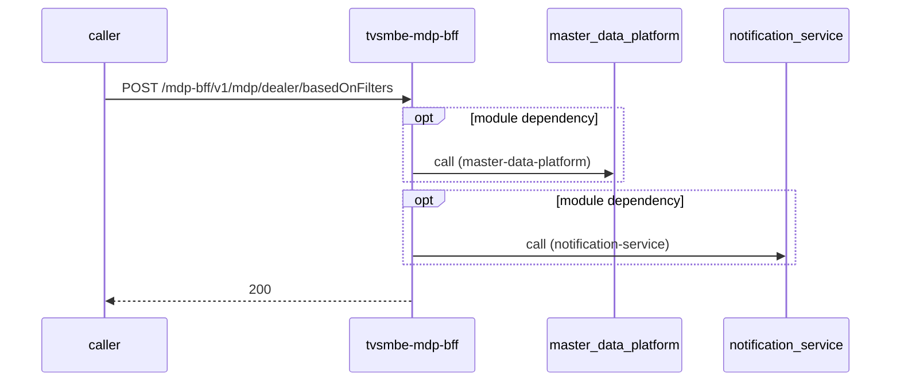

# tvsmbe-mdp-bff — Low-Level Design

## Data Model
tvsmbe-mdp-bff entities from `data_access` items (3).

Store access at `inbound/src/main/resources/db/migrations/v1.1_audit_log_table_20240523.sql:1`: database Unknown; collections -.

Store access at `inbound/src/main/java/com/tvsmotor/bff/entity/AuditLog.java:10`: database tvsmazebffsdbdev01; collections -.

### audit_log
Entity `AuditLog` defined in `inbound/src/main/java/com/tvsmotor/bff/entity/AuditLog.java:9`; table audit_log; operation write.
Columns: Unknown (no fields extracted).
Relationships: Unknown.

Store access at `outbound/src/main/java/com/tvsmotor/mdp_bff/outbound/entity/AuditLog.java:11`: database tvsmazebffsdbdev01; collections -.

### audit_log
Entity `AuditLog` defined in `outbound/src/main/java/com/tvsmotor/mdp_bff/outbound/entity/AuditLog.java:10`; table audit_log; operation write.
Columns: Unknown (no fields extracted).
Relationships: Unknown.

### failed_mdp_message_exception
Entity `FailedMdpMessageExceptionEntity` defined in `outbound/src/main/java/com/tvsmotor/mdp_bff/outbound/entity/FailedMdpMessageExceptionEntity.java:17`; table failed_mdp_message_exception; operation write.
Columns: Unknown (no fields extracted).
Relationships: Unknown.

### failure_event_type_info
Entity `FailureEventTypeInfo` defined in `outbound/src/main/java/com/tvsmotor/mdp_bff/outbound/entity/FailureEventTypeInfo.java:12`; table failure_event_type_info; operation both.
Columns: Unknown (no fields extracted).
Relationships: Unknown.

## State Machines
tvsmbe-mdp-bff: N/A — no status/state enums found in code.

## Business Rules
tvsmbe-mdp-bff validation rules on DTO fields (from schema `validation`):
N/A — no declarative validation found; other rules not determinable without manual review.

## Key Classes and Functions
tvsmbe-mdp-bff key classes:

| Class / Function | File | Responsibility |
|---|---|---|
| `MdpController` | `inbound/src/main/java/com/tvsmotor/bff/controller/MdpController.java` | HTTP handlers |
| `TestController` | `inbound/src/main/java/com/tvsmotor/bff/controller/TestController.java` | HTTP handlers |
| `WebHookController` | `inbound/src/main/java/com/tvsmotor/bff/controller/WebHookController.java` | HTTP handlers |
| `CronService.logMetricsPeriodically` | `inbound/src/main/java/com/tvsmotor/bff/service/CronService.java:23` | scheduled job |
| `CronService.logMetricsPeriodically` | `outbound/src/main/java/com/tvsmotor/mdp_bff/outbound/service/CronService.java:24` | scheduled job |
| subscribe dev.mdp.dealer_data | `outbound/src/main/java/com/tvsmotor/mdp_bff/outbound/config/BffServiceBusConfig.java:26` | azure-service-bus messaging |
| `@ControllerAdvice` | `inbound/src/main/java/com/tvsmotor/bff/exceptions/handlers/RestExceptionHandler.java:18` | error handling |

## Sequence Details
tvsmbe-mdp-bff sequence for `POST /mdp-bff/v1/mdp/dealer/basedOnFilters` (handler `MdpController.getDealerDataBasedOnFilters`); downstream calls inside the handler are not traced from code, module-level targets shown as optional.

## Error Handling
tvsmbe-mdp-bff error handling: `inbound/src/main/java/com/tvsmotor/bff/exceptions/handlers/RestExceptionHandler.java:18` (@ControllerAdvice). Status mapping: Unknown. Retry evidence: `inbound/src/main/java/com/tvsmotor/bff/service/AzureB2CTokenGenerationService.java:65`, `inbound/src/main/java/com/tvsmotor/bff/service/MdpDealerOperationsService.java:64`, `outbound/src/main/java/com/tvsmotor/mdp_bff/outbound/service/NotificationSenderService.java:41`, `outbound/src/main/java/com/tvsmotor/mdp_bff/outbound/service/AzureB2CTokenGenerationService.java:63`, `outbound/src/main/java/com/tvsmotor/mdp_bff/outbound/service/MdpDealerOperationsService.java:48`, `outbound/src/main/java/com/tvsmotor/mdp_bff/outbound/service/daksha/DakshaDealerDataProcessorService.java:25`, `outbound/src/main/java/com/tvsmotor/mdp_bff/outbound/service/lat_long/LatLongDealerDataProcessorService.java:25`, `outbound/src/main/java/com/tvsmotor/mdp_bff/outbound/service/single_interface/SingleInterfaceDealerDataProcessorService.java:63`, `outbound/src/main/java/com/tvsmotor/mdp_bff/outbound/service/knowlarity/KnowlarityApiCallerService.java:52`.

## Configuration Details
tvsmbe-mdp-bff behaviour-relevant config keys (names only; full list in OVERVIEW.md):
- `mdp.api.dealer.mapDealerWithKNumber`: points to `master-data-platform`
- `mdp.get-dealer-data.based-on-filters.api-url`: points to `master-data-platform`
- `notification.base-url`: points to `notification-service`
- `config:mdp.get-dealer-data.api-url`: base URL for outbound calls
- `config:azure.b2c.token.url`: base URL for outbound calls
- `config:mdp.get-dealer-data.based-on-filters.api-url`: base URL for outbound calls
- `config:mdp.api.dealer.mapDealerWithKNumber`: base URL for outbound calls
- `config:notification.base-url`: base URL for outbound calls
- `config:si.outletApi.baseUrl`: base URL for outbound calls
- `spring.jms.servicebus.topic.mdpDealerData.name`: subscribe entity name

## Edge Cases
tvsmbe-mdp-bff edge cases: N/A — not determinable from code without manual review.
