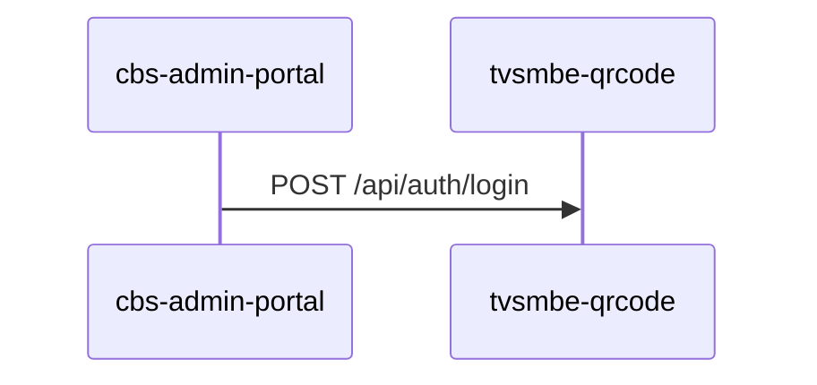
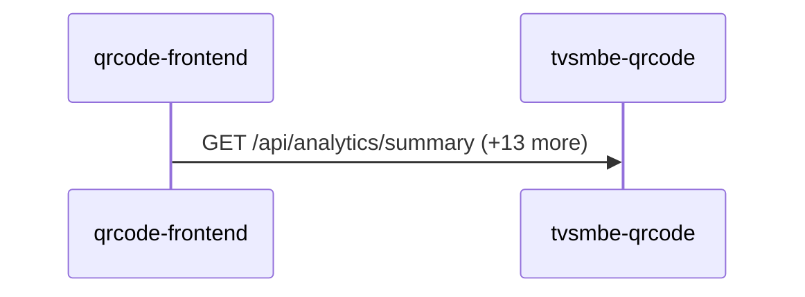

# tvsmbe-qrcode — Data Flows

## Flow Index
tvsmbe-qrcode takes part in 2 end-to-end flow(s) in registry/flows.json.

| flow_id | Name | Role of tvsmbe-qrcode | Trigger |
|---|---|---|---|
| cbs-admin-portal--tvsmbe-qrcode | cbs-admin-portal → tvsmbe-qrcode (1 hop) | terminal | user action in cbs-admin-portal (frontend) |
| qrcode-frontend--tvsmbe-qrcode | qrcode-frontend → tvsmbe-qrcode (1 hop) | terminal | user action in qrcode-frontend (frontend) |

## Flow: cbs-admin-portal--tvsmbe-qrcode
Summary: Starting at `cbs-admin-portal` (user action in cbs-admin-portal (frontend)), the flow ends at `tvsmbe-qrcode`, using 1 sync HTTP hop(s) and 0 async event hop(s); tvsmbe-qrcode role: terminal; confidence medium.

Steps:
| # | From | To | Via | Data (schema names) | Sync/Async | Confidence |
|---|---|---|---|---|---|---|
| 1 | cbs-admin-portal | tvsmbe-qrcode | POST /api/auth/login | Unknown | sync | medium |

Data touched: tvsmbe-qrcode: mongo:tvs_qr

Failure points: hop 1 cbs-admin-portal → tvsmbe-qrcode: criticality hard

Evidence:
- hop 1 (cbs-admin-portal → tvsmbe-qrcode): `cbs-admin-portal/src/services/dataService.js:32`, `tvsmbe-qrcode/src/main/java/com/tvsmotor/qrcode/controller/AuthController.java:30`

## Flow: qrcode-frontend--tvsmbe-qrcode
Summary: Starting at `qrcode-frontend` (user action in qrcode-frontend (frontend)), the flow ends at `tvsmbe-qrcode`, using 1 sync HTTP hop(s) and 0 async event hop(s); tvsmbe-qrcode role: terminal; confidence high.

Steps:
| # | From | To | Via | Data (schema names) | Sync/Async | Confidence |
|---|---|---|---|---|---|---|
| 1 | qrcode-frontend | tvsmbe-qrcode | GET /api/analytics/summary, GET /api/analytics/timeline, GET /api/analytics/top (+11 more) | Unknown | sync | high |

Data touched: tvsmbe-qrcode: mongo:tvs_qr

Failure points: hop 1 qrcode-frontend → tvsmbe-qrcode: criticality hard

Evidence:
- hop 1 (qrcode-frontend → tvsmbe-qrcode): `qrcode-frontend/src/api.ts:218`, `tvsmbe-qrcode/src/main/java/com/tvsmotor/qrcode/controller/AnalyticsController.java:27`, `qrcode-frontend/src/api.ts:236` (+20 more)
