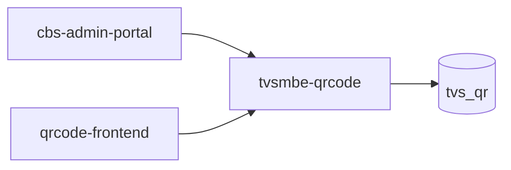

# tvsmbe-qrcode — High-Level Design

## Context
tvsmbe-qrcode is a `backend-api` in the TVS-CS org (domain: Unknown). Neighbours: callers `cbs-admin-portal`, `qrcode-frontend`; downstream none resolved.

## Architecture
tvsmbe-qrcode components and connections (from service.yaml):

## Integration Points
tvsmbe-qrcode registry edges (15):

| Direction | Peer | Kind | Via | Criticality | Source | Match |
|---|---|---|---|---|---|---|
| in | `cbs-admin-portal` | http | POST /api/auth/login | hard | code | path-suffix |
| in | `qrcode-frontend` | http | GET /api/analytics/summary | hard | code | path-unique |
| in | `qrcode-frontend` | http | GET /api/analytics/timeline | hard | code | path-unique |
| in | `qrcode-frontend` | http | GET /api/analytics/top | hard | code | path-unique |
| in | `qrcode-frontend` | http | GET /api/auth/config | hard | code | path-unique |
| in | `qrcode-frontend` | http | GET /api/auth/me | hard | code | path-unique |
| in | `qrcode-frontend` | http | PATCH /api/qr-library/{id}/redirect | hard | code | path-unique |
| in | `qrcode-frontend` | http | PATCH /api/qr-library/{id}/status | hard | code | path-unique |
| in | `qrcode-frontend` | http | POST /api/auth/login | hard | code | path-unique |
| in | `qrcode-frontend` | http | POST /api/auth/logout | hard | code | path-unique |
| in | `qrcode-frontend` | http | POST /api/auth/refresh | hard | code | path-unique |
| in | `qrcode-frontend` | http | POST /api/qr-create/preview | hard | code | path-unique |
| in | `qrcode-frontend` | http | POST /api/qr-create/save | hard | code | path-unique |
| in | `qrcode-frontend` | http | POST /api/qr/generate | hard | code | path-unique |
| in | `qrcode-frontend` | http | POST /api/qr/save | hard | code | path-unique |

## Data Ownership
tvsmbe-qrcode data stores (service.yaml `data_stores`; ownership flag not determinable unless set):

| Store | Type | Access | Owned | Key entities |
|---|---|---|---|---|
| `tvs_qr` | mongo | read-write | Unknown | QrAuditLog, QrCode, QrRedirectEvent, QrUser |

## Key Design Decisions
tvsmbe-qrcode: N/A — not determinable from code.

| Decision | Alternatives considered | Reason |
|---|---|---|
| Unknown | Unknown | Unknown |

## Non-Functional Requirements
tvsmbe-qrcode NFR targets: N/A — not determinable from code.

## Security
tvsmbe-qrcode security: endpoint auth values None. Auth code: `src/main/java/com/tvsmotor/qrcode/auth/JwtService.java:4`, `src/main/java/com/tvsmotor/qrcode/auth/TvsmAuthFilter.java:5`. 10 secret config key(s), sourced via: {'None': 5, 'app-settings': 5} (names in OVERVIEW.md). PII handling: Unknown.

## Resilience and Failure Modes
tvsmbe-qrcode hard dependencies: none resolved. No retry/circuit-breaker code found; failure behaviour Unknown.

## Deployment Topology
tvsmbe-qrcode deployment artefacts (platform/regions: Unknown unless listed):

| Kind | Name | File | Environments | Image | Ports | Variable groups |
|---|---|---|---|---|---|---|
| compose-service | backend-admin | `docker-compose.yml:33` | - | - | 8084:8084 | - |
| compose-service | backend-public | `docker-compose.yml:15` | - | - | 8085:8085 | - |
| compose-service | mongodb | `docker-compose.yml:2` | - | mongo:7 | 27017:27017 | - |
| dockerfile | Dockerfile | `Dockerfile:2` | - | eclipse-temurin:21-jdk, eclipse-temurin:21-jre | 8084 | - |

## Observability
tvsmbe-qrcode observability libraries: none found. Related config keys: none. Dashboards/alerts: Unknown.
