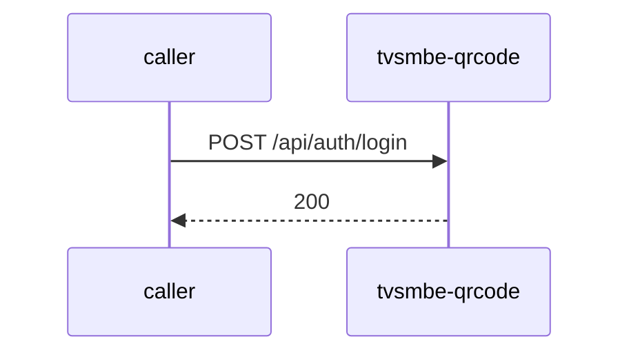

# tvsmbe-qrcode — Low-Level Design

## Data Model
tvsmbe-qrcode entities from `data_access` items (1).

Store access at `src/main/java/com/tvsmotor/qrcode/controller/AnalyticsController.java:45`: database tvs_qr; collections qr_audit_logs, qr_codes, qr_redirect_events, qr_users, sequences.

### QrAuditLog
Entity `QrAuditLog` defined in `src/main/java/com/tvsmotor/qrcode/db/entities/QrAuditLog.java:12`; table Unknown; operation write.
Columns: Unknown (no fields extracted).
Relationships: Unknown.

### QrCode
Entity `QrCode` defined in `src/main/java/com/tvsmotor/qrcode/db/entities/QrCode.java:12`; table Unknown; operation both.
Columns: Unknown (no fields extracted).
Relationships: Unknown.

### QrRedirectEvent
Entity `QrRedirectEvent` defined in `src/main/java/com/tvsmotor/qrcode/db/entities/QrRedirectEvent.java:11`; table Unknown; operation write.
Columns: Unknown (no fields extracted).
Relationships: Unknown.

### QrUser
Entity `QrUser` defined in `src/main/java/com/tvsmotor/qrcode/db/entities/QrUser.java:11`; table Unknown; operation both.
Columns: Unknown (no fields extracted).
Relationships: Unknown.

## State Machines
tvsmbe-qrcode: N/A — no status/state enums found in code.

## Business Rules
tvsmbe-qrcode validation rules on DTO fields (from schema `validation`):
N/A — no declarative validation found; other rules not determinable without manual review.

## Key Classes and Functions
tvsmbe-qrcode key classes:

| Class / Function | File | Responsibility |
|---|---|---|
| `AnalyticsController` | `src/main/java/com/tvsmotor/qrcode/controller/AnalyticsController.java` | HTTP handlers |
| `AuthController` | `src/main/java/com/tvsmotor/qrcode/controller/AuthController.java` | HTTP handlers |
| `QrLibraryController` | `src/main/java/com/tvsmotor/qrcode/controller/QrLibraryController.java` | HTTP handlers |
| `LogosController` | `src/main/java/com/tvsmotor/qrcode/controller/LogosController.java` | HTTP handlers |
| `RedirectController` | `src/main/java/com/tvsmotor/qrcode/controller/RedirectController.java` | HTTP handlers |
| `QrCreateController` | `src/main/java/com/tvsmotor/qrcode/controller/QrCreateController.java` | HTTP handlers |
| `QrComposeController` | `src/main/java/com/tvsmotor/qrcode/controller/QrComposeController.java` | HTTP handlers |
| `@RestControllerAdvice` | `src/main/java/com/tvsmotor/qrcode/exceptions/GlobalExceptionHandler.java:7` | error handling |

## Sequence Details
tvsmbe-qrcode sequence for `POST /api/auth/login` (handler `AuthController.login`); downstream calls inside the handler are not traced from code, module-level targets shown as optional.

## Error Handling
tvsmbe-qrcode error handling: `src/main/java/com/tvsmotor/qrcode/exceptions/GlobalExceptionHandler.java:7` (@RestControllerAdvice). Status mapping: Unknown.

## Configuration Details
tvsmbe-qrcode behaviour-relevant config keys (names only; full list in OVERVIEW.md):
- N/A — no behaviour-switching keys identified

## Edge Cases
tvsmbe-qrcode edge cases: N/A — not determinable from code without manual review.
