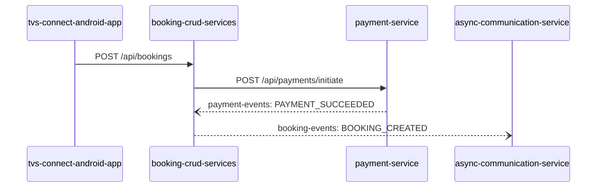

# <Service Name> — Data Flows

## Flow Index
| flow_id | Name | Role of <service-id> | Trigger |
|---|---|---|---|
| vehicle-booking | Customer books a vehicle | orchestrator | User taps "Book" |

## Flow: vehicle-booking
Heading format is fixed: `## Flow: <flow_id>`. Use the same flow_id in every service that participates.

Summary: one paragraph in plain language, naming every service_id involved.

Steps:
| # | From | To | Via | Data | Sync/Async |
|---|---|---|---|---|---|
| 1 | tvs-connect-android-app | booking-crud-services | POST /api/bookings | booking request | sync |

Data touched: which stores are read/written at which step.

Failure points: what happens if each step fails, and who notices.
