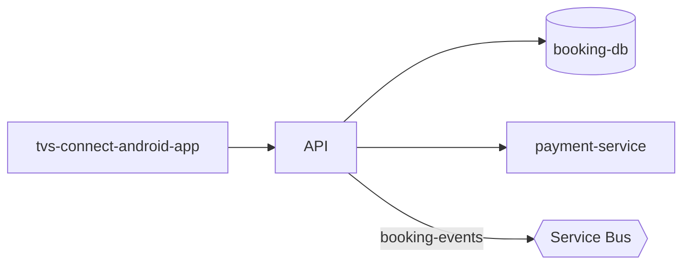

# <Service Name> — High-Level Design

## Context
Where <service-id> sits in the TVS landscape. Which domain, which neighbors.

## Architecture
Components inside <service-id> and how they connect. Include a mermaid diagram:

## Integration Points
Summary of sync and async integrations. Each line names the service_id and the protocol.

## Data Ownership
Which data <service-id> is the source of truth for, and which it only reads.

## Key Design Decisions
| Decision | Alternatives considered | Reason |
|---|---|---|
| | | |

## Non-Functional Requirements
Scale, latency targets, availability, throughput.

## Security
AuthN/AuthZ model, PII handled, network boundaries.

## Resilience and Failure Modes
What happens when each hard dependency fails. Retries, circuit breakers, fallbacks.

## Deployment Topology
Hosting, scaling, regions, CI/CD pipeline.

## Observability
Logs, metrics, traces, dashboards, alerts.
