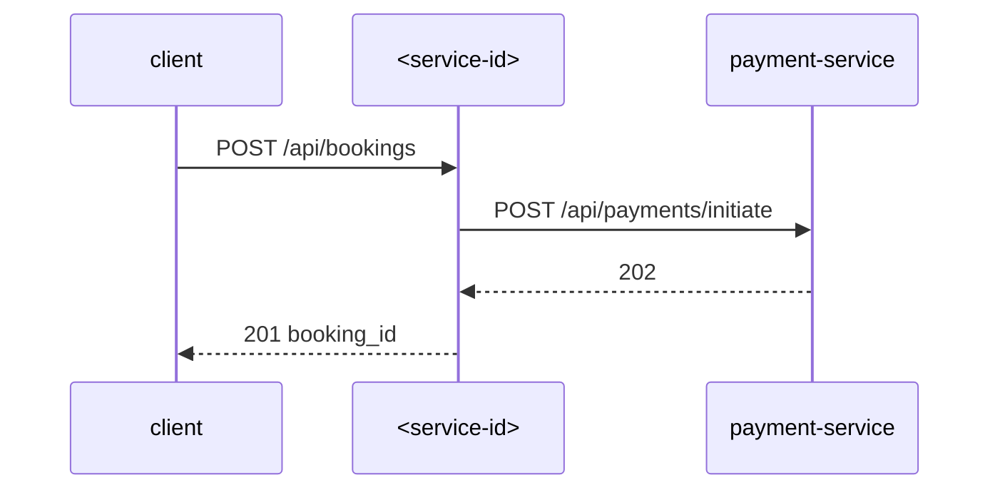

# <Service Name> — Low-Level Design

## Data Model
Tables/collections owned by <service-id>.

### <table_name>
| Column | Type | Nullable | Notes |
|---|---|---|---|
| | | | |

Relationships: …

## State Machines
Entity lifecycles (e.g. Booking: CREATED → PENDING_PAYMENT → CONFIRMED → CANCELLED) and what triggers each transition.

## Business Rules
Validation rules, calculations, pricing logic, eligibility checks.

## Key Classes and Functions
| Class / Function | File | Responsibility |
|---|---|---|
| | | |

## Sequence Details
Step-by-step sequences for complex operations, including error branches.

## Error Handling
Error codes, retry policies, idempotency keys.

## Configuration Details
How each config key changes behaviour.

## Edge Cases
Known tricky scenarios and how they're handled.
